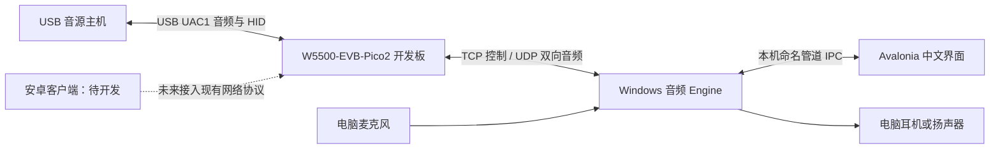

# USB 音频桥接工具（USB Audio Bridge）

本工程把 USB 音源主机的声音，经 W5500-EVB-Pico2 开发板和局域网，送到 Windows 电脑现有的耳机或扬声器播放；也可以把电脑麦克风的声音反向送到 USB 主机。音源主机可以是支持相应 USB 声卡的电脑、手机或游戏设备，具体格式、录音和媒体键兼容性需要在对应主机上验证。

本文面向使用者，并提供工程架构概览。新开发者请继续阅读 [开发文档导航](docs/README.md)。本文按 **2026-10-22、根目录 VERSION = 0.12.12** 的源码整理；源码版本不等于板卡已经烧写的版本，也不表示所有硬件场景均已验收。

## 1. 软件能做什么

| 功能 | 当前说明 |
| --- | --- |
| 接收 USB 主机声音 | 开发板模拟 UAC1 声卡，将双声道声音通过 UDP 发送给 Windows 软件 |
| 电脑播放 | 使用所选 Windows 耳机／扬声器，支持缓冲、时钟漂移补偿和重采样 |
| 反向麦克风 | 电脑采集输入，经独立 UDP 通路送入开发板的 USB 单声道录音端点；需要手动启用 |
| Host 快捷控制 | 音量加／减、静音、播放／暂停、上一曲、下一曲，使用 USB HID 媒体键 |
| 声卡配置 | 名称、设备类型、HID 兼容、播放／录音格式、USB 模拟启停和 LD2 灯效 |
| 设备网络维护 | 选择电脑网卡、搜索、手动连接、DHCP／静态 IPv4 配置及UDP 广播恢复 |
| 播放调整 | PCM／IMA ADPCM、可选 XOR4 纠错、重采样质量、应用内增益与 DSP |
| 固件烧写 | 独立窗口通过电脑上的 RP2350 BOOTSEL 启动盘传输本项目 UF2 镜像 |
| 安卓客户端 | `SoundConvertClientAndroid` 为**待开发的安卓客户端工程**，当前不作为可用客户端交付 |

当前采用 UAC1、USB Full-Speed 和 IPv4。没有 UAC2、32-bit 音频、歌曲名称／歌手／封面／进度读取、媒体配套 APK、配对服务、Windows Host 绝对音量设置或网络远程固件升级。HID 请求成功只表示按键已受理，不代表播放器已经执行或能够读回播放状态。

## 2. 工程架构概览



Windows 界面负责显示和操作，独立 Engine 负责连接、音频和设备管理。开发板上 Core 0 管理 USB，Core 1 管理 W5500 网络；通过有界队列交换音频。界面与音频分进程运行，但退出软件会结束其所属 Engine。

| 目录 | 作用 |
| --- | --- |
| `SoundConvertBoard/` | RP2350 固件，Pico SDK、TinyUSB UAC1、W5500 硬件 TCP/UDP |
| `SoundConvertClient/App/` | Windows Avalonia 前台、中文页面、托盘及固件烧写窗口 |
| `SoundConvertClient/Engine/` | 独立音频后台进程的启动入口 |
| `SoundConvertClient/Runtime/` | 业务状态、IPC、WASAPI、配置事务、本地设置和生命周期 |
| `SoundConvertClient/Core/` | 网络报文、音频缓冲、重采样、纠错、编码和时钟算法 |
| `SoundConvertClientAndroid/` | 待开发的安卓客户端，后续需要独立实现安卓音频与运行生命周期 |
| `tools/` | 构建、诊断、测试、烧写和发布工具 |
| `docs/开发指南/` | 面向首次接触本工程的现行开发说明 |
| `docs/开发流程/` | 按批次记录的设计、实施与验收文档，含历史行为；当前忽略规则不将其纳入版本控制 |
| `artifacts/` | 本机构建、发布和验收产物，通常不会随源码提供 |
| `datasheet/` | 硬件资料与说明 |

更详细的数据流、模块入口和线程边界见 [软件架构](docs/开发指南/01-软件架构.md)。

## 3. 使用前准备

需要一块 W5500-EVB-Pico2（RP2350 + W5500）、USB 数据线、以太网连接，以及一台运行本软件的 Windows x64 电脑。电脑需有可用的输出设备；使用反向麦克风时还需要可用输入源。预编译自包含程序无需另装 .NET 运行时，源码构建需要 .NET SDK。

建议首次将开发板和电脑接到同一个有 DHCP 的局域网，电脑优先使用有线网卡。电脑与开发板直连时，如果两端没有 DHCP 服务，应先通过 UDP 广播配置给开发板设置与电脑匹配的静态地址；软件不会自动修改电脑网卡 IP。

搜索、未连接时的 IP 齿轮配置和恢复统一使用 UDP 广播，无需抓包驱动。同一广播域内支持不同 IP 子网；广播不能穿越普通路由器或隔离 VLAN。电脑网卡须有 IPv4 地址，板卡须更新到配套固件；TCP 控制与音频仍使用正常 IP 通信。搜索与连接进行中可点击取消。设置中的“与虚拟声卡意外断链后自动重连”默认开启，修改立即保存；停止播放时仍能重连，手动断开、取消连接或退出会停止重连。

### 安装版与免安装版

- **安装版**：运行 `SoundConvertClient-Setup-V<版本>-x64.exe`，按需选择“仅为我安装”或“为所有用户安装”。后者需要管理员权限。快捷方式名称为“USB 音频桥接工具”。
- **免安装版**：完整解压程序文件夹后运行 `SoundConvertClient.exe`。必须保留旁边的 DLL、运行库和完整 `Engine/` 子目录，不能只复制一个 EXE。
- **源码发布目录**：通常为 `SoundConvertClient/artifacts/publish/win-x64/`；归档发布包通常使用 `artifacts/releases/V<版本>/client-win-x64/`。这些目录需要实际构建或获取发布包后才存在。
- **升级**：先通过托盘“退出”结束旧版前台和 Engine，再安装或换用完整新目录。安装器支持同版修改／修复、新版升级并保留配置；不混用不同版本的前后台文件。

安装范围、升级和可选配置卸载详见 [安装包说明](SoundConvertClient/InnoSetup/README.md)。

## 4. 第一次播放：USB 主机 → 电脑

1. 将开发板以太网接入网络，将其 USB 接到**音源主机**。USB 数据方向中的 Host 指这台音源设备，不一定是运行软件的 Windows 电脑。
2. 开发板上电后读取已保存的配置并自动开始 USB 声卡模拟，不等待电脑软件连接或 DHCP 完成。音源主机通常会看到 `W5500-EVB-Pico2`，若改过名称则显示保存后的名称。
3. 启动软件，进入“虚拟声卡”，在“搜索网卡”中选取实际连到板卡所在网络的电脑网卡，再点击“搜索设备”。多网卡电脑应核对网卡名称、IPv4 和设备唯一标识。
4. 在目标设备行点击“连接”。底部状态栏显示连接进度；读取和确认完成后显示“已连接 · 设备名”。如提示管理权被占用，先检查是否有另一套软件正在管理该板卡。
5. 管理连接成功后软件自动开始输出。进入“播放”，选择电脑实际的耳机／扬声器，或选择“Windows 系统默认”。如已停止，点击页面中的开始输出按钮。
6. 在 USB 音源主机的声音设置中，选择开发板的 USB 声卡作为输出，并开始播放。软件显示等待音源时，应检查主机是否真正向该声卡送数。
7. 观察有效音频包、缓冲水位和输出状态，再确认电脑耳机实际有声。只有管理连接成功并不能证明整条音频链路已经工作。

“Windows 系统默认”跟随系统默认的多媒体端点变化；明确选择某个设备时保持该选择。软件会防止把本工程 USB 声卡误选为自身监听输出造成回路，不主动更改 Windows 默认音频设备。

### 搜索不到时手动连接

在“虚拟声卡”选好网卡，点击“手动连接”，填写开发板当前 IPv4 和 TCP 端口，控制端口为 **49161**。IP 必须按现场实际地址填写，文档或旧日志中的地址不能直接复用。手动连接仍需要电脑经所选网卡能到达板卡。

### 三种“停止”的区别

| 操作 | 结果 |
| --- | --- |
| 停止输出／监听 | 停止电脑接收播放，USB 声卡模拟可以继续运行 |
| 停止 USB 模拟 | USB 声卡在 Host 上断开，相关音频流失效；再次开始会重新枚举 |
| 断开设备 | 结束管理连接与相关网络音频，不等于给开发板断电 |

本次上电期间手动停止 USB 模拟后，重新连接软件或开始监听不会隐式重新开启；请在“声卡配置与模拟”中明确开始。开发板重新上电会按上电策略再次自动开始。

## 5. 各页面怎么用

| 页面 | 主要用途 |
| --- | --- |
| 主页 | 查看已连接设备、USB／网络／播放概况及常用控制 |
| 虚拟声卡 | 搜索、连接、IP 配置、状态监视、USB 配置、灯效和端口状态 |
| 播放 | 电脑输出、开始／停止输出、音量、缓冲、传输、趋势图、Host 快捷键和 DSP |
| 输入 | 电脑麦克风选择、3 秒电平检测、反向传输和 USB 麦克风高级控制 |
| 固件烧写 | 打开独立 USB／UF2 烧写窗口，无需先建立网络连接 |
| 日志 | 查看运行信息，定位连接、配置和音频问题 |
| 设置 | 开机启动、托盘、自动连接、监视间隔、UDP 端口、数据目录和退出 |
| 更新日志／关于 | 查看当前版本说明、程序信息及依赖信息 |

操作期间页面会显示实时进度并限制重复或冲突提交。连接失败会保留原因及检查建议；主动取消和连接失败是不同结果。

### 声卡类型、名称与格式

在“虚拟声卡 → 声卡配置与模拟”编辑，点击“保存声卡配置”后才提交；“放弃修改”恢复草稿。运行中保存会停止模拟、执行配置事务并按原运行意图恢复，Host 会短暂断开并重新枚举。

- 设备类型有桌面扬声器、扬声器、耳机和耳麦。**耳机类型不开放 USB 麦克风**；需要反向输入时选择支持录音的类型。
- Windows 耳机／耳麦可使用“Windows 媒体键兼容模式”；是否生效仍取决于 Host 和播放器。
- 播放为双声道：16-bit 支持 44.1／48／88.2／96／176.4／192 kHz；24-bit 支持 44.1／48／88.2／96 kHz。
- 录音为单声道：16-bit 支持 8／16／32／44.1／48／96 kHz；24-bit 支持 44.1／48／96 kHz。默认录音格式为 48 kHz／16-bit。
- 可选格式受所选电脑输出／输入设备当前能力和固件能力约束，置灰项请查看提示。保存的格式集合只是允许 Host 选择的范围，**当前实际格式由 Host 决定**。
- 播放路径允许升采样和位深扩展；需要降低采样率或有效位深的声明项会按策略排除。麦克风可将较高规格电脑输入转换为允许的较低 USB 录音格式。

“Host 当前格式”与“已保存的格式”不同。Host 空闲时的最近格式记录也不代表此刻正在送音频。

### LD2 指示灯

在声卡配置卡片底部选择模式，再点击上方“保存声卡配置”，重启后保留。可选自动、常灭、常亮、持续呼吸和持续闪烁。自动模式下，USB 已枚举且空闲时呼吸，有播放或录音数据流时闪烁，停止／未连接／挂起时熄灭；数字静音也属于数据流。

“闪灯识别（5 秒）”临时覆盖灯效，结束后恢复已保存模式，不写入配置。它用于辨认目标板卡，不表示网络音频已通过验收。

### 音量与媒体键

| 控制 | 影响位置 | 保存／限制 |
| --- | --- | --- |
| Host 音量加／减／静音等六个快捷键 | USB 主机或其播放器 | 发送一次 HID 按键；不读回确定的系统百分比、歌曲或播放状态 |
| 主页“Host 快捷控制”中的声卡内部音量 | 板端 USB 播放 PCM → 网络 | 0–100% 线性幅值，上电默认 80%；运行期有效，重启恢复默认，USB 软停止／开始保留 |
| Windows 输出音量／静音 | 当前电脑输出端点 | 影响使用该端点的系统声音；与 Host、板内增益独立 |
| 本地播放增益／仅静音本地播放 | 本软件输出 | 在“播放”的高级区设置，只作用于本应用 |
| 麦克风发送增益／发送静音 | 电脑输入 → 网络 | 在“输入”页设置 |
| USB 麦克风增益／静音 | 板端录音 Feature Unit | 高级运行控制，可被 Host 后续写入覆盖，以实际读回为准 |

80% 内部音量表示幅值乘以 0.8，约为 −1.94 dB，不是 Host 音量 80%。Host 标准 UAC1 播放音量仍由 Host 管理，与内部增益相乘；如果无声，应分别检查这些静音和增益层。

### 缓冲、纠错与声音处理

首次可使用默认配置。播放默认缓冲上限为 20 ms；网络或调度不稳定时，可比较“均衡 40 ms”与“高余量 80 ms”，也可在 4–100 ms 内设置。修改后点击“应用并重新开始输出”。较大缓冲通常能容忍更大的到包抖动，但会增加等待；**缓冲上限不是已测得的端到端延迟**。

高级稳定性设置提供：

- **PCM**：默认无压缩传输。
- **IMA ADPCM**：有损压缩，24-bit 源先量化到 16-bit；需要固件确认支持。
- **网络纠错**：每 4 个播放包增加 1 个 XOR 修复包，只能恢复同组一个缺包，会增加流量；默认关闭，不用于反向麦克风。
- **重采样质量**：低延迟／均衡／高质量，默认均衡。
- **时间与频差观测**：默认“原有控制”；仅观测不调速，“时钟辅助”为实验功能，不代表已证明能降低实际延迟。

下方诊断区显示最近 60 秒的缓冲水位与时钟漂移趋势。高级区可查看接收电平、单声道合并、左右平衡、三段 EQ、限幅和恢复渐变。DSP 会改变声音；先用默认路径排查连续性，再逐项启用并比较。

## 6. 使用电脑麦克风：电脑 → USB 主机

1. 确认板卡当前设备类型支持录音，并在 Host 上出现开发板的 USB 录音设备。
2. 在“输入”选择电脑麦克风或“Windows 系统默认”，必要时刷新输入列表。
3. 点击“检测输入（3秒）”，对麦克风说话并检查电平。此操作统计电平和采集帧数，不保存录音。
4. 确认所保存的 USB 录音格式不超过电脑输入源当前采样率和精度；首次使用 48 kHz／16-bit 单声道，并按实际设备能力调整。
5. 点击“启用麦克风传输”，在 USB 主机的录音应用中选择开发板麦克风并开始录音。
6. 结束后点击“停止输入”。软件启动时不会自动采集麦克风。

播放和麦克风有各自的会话、UDP 端口和队列，可以同时工作，也可以单独停止。默认采用播放优先策略；修改该策略需重新启用输入。电脑采集有电平但 Host 无声时，还应检查 Host 是否真正打开录音端点、USB 麦克风静音、发送静音和实际格式。

## 7. 网络和 UDP 端口设置

### DHCP／静态 IPv4

在设备行点击 IP 齿轮，软件按设备 ID、MAC 和原网卡核对目标。先断开当前设备，再根据弹窗选择 DHCP 或静态 IPv4、前缀和网关。静态前缀范围为 `/1`–`/30`，地址、网关需符合所在网络要求。

网络改址采用“准备 → 临时应用 → 重新发现 → 确认”事务；未确认的候选不会当作已保存。静态／DHCP 通常分别有 30／120 秒确认窗口。若界面提示待确认，请使用顶部“查询事务”“确认网络配置”或“回滚网络配置”；TCP 不可达时使用UDP 广播恢复。DHCP 失败不会自动切换到随机静态地址。

UDP 广播改址会停止 USB 模拟，提交后保持停止，完成维护后请明确开始模拟。恢复 DHCP 策略不保证服务器分配回原来的 IP。

### 音频 UDP 端口

“设置 → UDP 音频端口”提供四项：声音输出／声音输入，各自的“虚拟声卡 UDP”和“本软件 UDP”。默认均为“自动协商”，也可填 1024–65535 的固定端口。

- 同一端的播放和麦克风固定端口不能相同；板端不能占用发现 49160、控制 49161。
- 点击“保存端口设置”一次保存全部四项，下次开始输出或启用麦克风生效，当前传输继续使用原端口。
- “虚拟声卡”底部“端口状态”显示活动流的真实端口；未启动时显示策略，不将默认值当作协商结果。
- TCP 控制固定为 49161，UDP 发现固定为 49160。旧固件播放／麦克风板端兼容端口为 49162／49163，不能把它们当作新版本固定音频端口。
- 若防火墙限制 UDP，应按实际协商端口配置规则，或明确设置固定端口；端口占用会导致启动失败。

## 8. 托盘、自动连接与退出

关闭窗口默认收起到系统托盘，此时前台进程和 Engine 仍运行，音频可继续。托盘卡片提供 Host 快捷键、电脑输出音量、页面入口与退出。启动／最小化／关闭窗口是否收起可在设置中调整。

**托盘“退出”、设置“退出应用”，或关闭窗口且未启用收起到托盘，都会停止两向音频、控制连接并回收所属 Engine。当前不提供退出界面后让后台继续播放的模式。**

默认开启“后台启动时自动连接上一次成功管理的设备”。首次没有成功记录时等待用户连接；按原网卡和设备唯一 ID 寻找目标，不按旧 IP 接管其他设备。关闭此项会取消未完成自动连接并保留最近设备；手动断开后不会立即自动重连。

## 9. USB／UF2 固件更新

1. 通过“固件烧写”打开独立窗口，准备本板对应的 RP2350 Arm-S `.uf2` 镜像。
2. 按住开发板 BOOTSEL，再用 USB 数据线连接**运行软件的电脑**，出现 RP2350 启动盘后松开。原来接手机或游戏机的 USB 需要换接电脑，音频会中断。
3. 点击“选择 UF2…”，核对文件、大小、地址和 SHA256，明确选择对应启动盘。
4. 点击“开始烧写”，等待传输完成，不拔线；传输期间软件限制退出和重复操作。
5. 板卡通常自动重启。换回音源主机，重新搜索连接，核对固件版本、配置保留、USB 枚举和实际音频。

窗口会检查 UF2 芯片类型、结构与地址范围，保护本板 2 MiB Flash 末尾 8 KiB 配置区；不要使用整片擦除镜像。100% 表示文件传输、刷新及关闭完成，仍需确认实板启动，不能当作 Flash 读回或音频验收。降级前先核对配置记录兼容性。开发人员也可使用 SWD，见 [构建与验证](docs/开发指南/05-构建测试与发布.md)。

## 10. 配置、日志与常见问题

用户数据默认在 `%LOCALAPPDATA%\UsbAudioBridge`，可从“设置 → 配置与日志 → 打开目录”进入：

| 文件 | 内容 |
| --- | --- |
| `settings.json` | 本地软件设置、设备选择、端口策略和待处理事务信息 |
| `settings.json.bak`、`settings.schema1.bak` | 最近备份或旧结构迁移备份 |
| `devices.json` | 最近设备及按设备记录的历史信息 |
| `events.jsonl`、`events.jsonl.1` | 运行事件日志与轮转日志 |

修改配置文件前先退出软件。软件配置与开发板 Flash 中的名称、USB 格式和网络配置是两份不同的数据。安装升级保留用户配置；卸载默认保留，交互卸载可明确选择删除配置，日志和诊断仍保留。

| 现象 | 优先检查 |
| --- | --- |
| 搜不到板卡 | 网线／供电、所选网卡、DHCP、同广播域、防火墙；已知 IP 可手动连接，无有效 IP 用 UDP 广播恢复 |
| IP 齿轮／广播恢复不可用 | 板卡固件是否配套、双方是否在同一广播域、防火墙是否允许 UDP、原网卡和设备身份是否匹配 |
| 已连接但等待音源 | USB 模拟是否运行，Host 是否选中板卡输出并开始送音频 |
| 有包但电脑无声 | 所选输出、Windows 音量、应用静音、板内音量和 Host 静音；确认是否一直收到数字静音 |
| 断续、爆音或水位见底 | 导出诊断，比较缺帧／欠载／过期计数；在同一工况比较 20／40／80 ms，不只凭主观感受判断 |
| 高规格格式不可选 | 电脑当前输出／输入上限、已保存格式集合、固件能力；Host 实际选中值不一定等于 Windows 上层设置 |
| 媒体键无响应 | USB 枚举、HID 就绪、设备类型、Windows 兼容开关，以及 Host／播放器本身的支持情况 |
| 麦克风无声 | 支持录音的设备类型、手动启用、输入检测、Host 打开录音端点、两端静音与实际格式 |
| 前后台不兼容 | 退出旧版并换用同一完整目录，保留匹配的 Engine；不能只更新 EXE |
| 改 IP 后连不上 | 查询未完成事务，确认候选地址或回滚；原电脑 IP 不会自动改变 |
| 关闭窗口后仍有声音 | 默认收起到托盘；需要停止软件时使用“退出” |

提交问题时请附软件版本、实板固件版本、USB 主机型号、网卡与拓扑、实际格式、端口、缓冲设置、复现步骤及导出诊断。历史测试结果只适用于其标注的版本和工况。

## 11. 从源码开始

Windows 解决方案为 `SoundConvertClient/UsbAudioBridge.slnx`。当前锁定 .NET SDK 10.0.401、Avalonia 12.1.1、NAudio 2.2.1；固件使用 Pico SDK 2.3.1 和锁定的 TinyUSB，详见 [依赖清单](SoundConvertBoard/vendor/DEPENDENCIES.md)。

在仓库根目录执行以下命令；先进入客户端目录，使 SDK 选择遵循该目录的 global.json：

```powershell
Push-Location .\SoundConvertClient
dotnet restore .\UsbAudioBridge.slnx --locked-mode
dotnet build .\UsbAudioBridge.slnx -c Release --no-restore
dotnet run --project .\Checks\UsbAudioBridge.Checks.csproj -c Release --no-build
Pop-Location
```

已安装脚本所需 Pico 工具和固定路径的开发机，可运行 `.\tools\Build-All.ps1` 构建固件和上位机；该脚本会按需给本地锁定 TinyUSB 应用诊断补丁，不会自动烧写。

继续阅读 [开发文档导航](docs/README.md)，其中分别介绍架构、现行协议、Windows 模块开发、固件模块开发、构建验证发布，以及待开发安卓客户端的接入边界。
