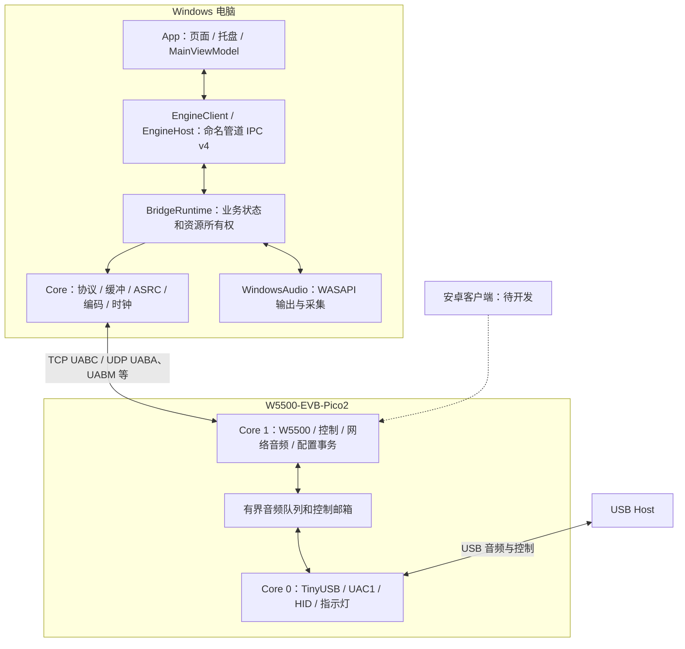

# 软件架构

适用基线：2026-10-22，VERSION 0.12.12。返回 [文档导航](../README.md)。本文先说明系统组成，再给出可直接跟踪的源码入口；操作方法见 [根 README](../../README.md)。

## 1. 先理解系统中的三个角色

1. **USB Host**：向板卡播放声音、从板卡录音的主机，例如另一台电脑、手机或游戏设备。它选择实际 USB alternate setting 和采样率。
2. **开发板**：USB Device 与网络音频桥，硬件为 RP2350 + W5500，不是电脑内部的虚拟音频驱动。
3. **网络客户端**：当前可用实现为 Windows 客户端，通过电脑音频设备播放／采集。`SoundConvertClientAndroid` 是待开发的安卓网络客户端，不是已经交付的 Host 歌曲信息配套应用。

USB Host 和 Windows 客户端可以在同一电脑，也可以是不同设备。讨论音量、格式和延迟时，应明确指的是哪一端。

## 2. 部署和分层



Windows `App` 与 `Engine` 是两个进程。`Runtime` 和 `Core` 是代码／程序集分层，不是另外两个常驻服务。App 也引用部分 Runtime 类型，但正式界面使用 MainViewModel 代理业务，音频资源由 Engine 内的 BridgeRuntime 持有。

## 3. Windows 工程依赖与职责

解决方案：[UsbAudioBridge.slnx](../../SoundConvertClient/UsbAudioBridge.slnx)。

| 层 | 核心入口 | 职责和边界 |
| --- | --- | --- |
| App | [Program.cs](../../SoundConvertClient/App/Program.cs)、[MainWindow.axaml.cs](../../SoundConvertClient/App/MainWindow.axaml.cs) | GUI／CLI 分流、单实例、窗口、托盘、独立烧写窗口 |
| 界面代理 | [MainViewModel.cs](../../SoundConvertClient/App/MainViewModel.cs) 及其 partial 文件 | 显示快照、保留短期编辑、发送命令；不直接持有板卡连接或 WASAPI 播放器 |
| 本机 IPC | [EngineClient.cs](../../SoundConvertClient/Runtime/EngineClient.cs)、[EngineHost.cs](../../SoundConvertClient/Runtime/EngineHost.cs)、[EngineProtocol.cs](../../SoundConvertClient/Runtime/EngineProtocol.cs) | 有界请求、快照、操作票据和实例验证 |
| Engine 入口 | [Engine/Program.cs](../../SoundConvertClient/Engine/Program.cs) | 先加入所属 Job，再创建调度器、Runtime 和管道服务 |
| 业务层 | [BridgeRuntime.cs](../../SoundConvertClient/Runtime/BridgeRuntime.cs) 及其 partial 文件 | 连接、配置、音频运行意图、监视、错误和资源回收 |
| 业务调度 | [RuntimeDispatcher.cs](../../SoundConvertClient/Runtime/RuntimeDispatcher.cs) | 串行业务状态访问；音频接收／输出回调有各自执行路径 |
| 协议与算法 | [Network.cs](../../SoundConvertClient/Core/Network.cs)、[Wire.cs](../../SoundConvertClient/Core/Wire.cs)、[AudioBuffer.cs](../../SoundConvertClient/Core/AudioBuffer.cs) | 控制帧、UDP、音频时间轴、漂移补偿、重采样等 |
| Windows 平台层 | [WindowsAudio.cs](../../SoundConvertClient/Runtime/WindowsAudio.cs)、[WindowsDefaultAudio.cs](../../SoundConvertClient/Runtime/WindowsDefaultAudio.cs) | WASAPI、端点枚举、默认设备、输出与输入控制 |
| 本地数据 | [LocalStore.cs](../../SoundConvertClient/Runtime/LocalStore.cs) | 设置、设备历史、迁移、备份、日志 |

依赖方向是 Core → 不依赖 UI；Runtime → Core 与 Windows 音频库；Engine → Runtime；App → Runtime／Core 并打包 Engine。增加可跨平台的算法时优先放 Core，Windows API 放 Runtime，控件与窗口代码放 App。

## 4. 播放数据如何走完一条链路

```text
Host USB OUT
  → TinyUSB 接收 FIFO
  → Core 0 提取真实格式 PCM，应用播放 FU 与内部增益
  → usb_audio_block_t + generation + sample_index
  → SPSC 队列
  → Core 1 有期限发送、可选 ADPCM／XOR4
  → UABA UDP
  → AudioReceiver 验证端点、身份、代次和格式
  → AudioBuffer 按 sample_index 写入
  → 漂移控制 + 连续变比率 sinc 重采样
  → AudioOutputPipeline／声音处理／本地增益
  → WASAPI → 电脑输出设备
```

`sample_index` 的单位是采样帧，一帧包含所有声道。例如双声道 48 kHz 每毫秒通常是 48 帧、96 个标量样本。16-bit 每帧 4 字节，packed 24-bit 每帧 6 字节。

网络包到达时间只反映投递和调度；音频顺序按样本索引恢复。`sequence` 用于包级诊断，不能直接代替样本位置。旧 stream／token／generation 的包不能混入新播放缓冲。

播放接收采用独立接收线程，控制与保活异步执行，WASAPI 按设备时钟拉取输出。音频回调不等待 UI、TCP 请求、文件保存或设备枚举。界面仅定期读取快照和诊断缓存，禁止每个音频包更新绑定集合。

## 5. 反向麦克风是独立通路

```text
电脑输入源 → WASAPI 采集 → 单声道样本队列
  → MicrophoneSender 独立工作线程
  → 重采样／量化／发送增益／约 1 ms 封包
  → UABM UDP → Core 1 源端点验证和有界重排
  → 麦克风 SPSC 队列 → Core 0 TinyUSB IN FIFO → Host USB IN
```

它有独立的 stream_id、epoch、token、端口、保活和停止流程，不是把播放 socket 反向使用。当前只有 PCM，没有反向 ADPCM 或 XOR4；桌面扬声器／扬声器／耳麦预设允许录音，耳机预设不提供录音接口。软件启动不自动采集。

## 6. 开发板双核资源所有权

| 资源 | 所有者 | 跨核交互 |
| --- | --- | --- |
| TinyUSB 调用、连接启停、UAC／HID | Core 0 | Core 1 通过邮箱请求启停／运行控制，Core 0 执行并发布快照 |
| 名称与描述符配置准备 | 启动时 Core 0，后续停止状态下 Core 1 | 专用接口验证／提交描述符候选；重新连接和枚举由 Core 0 执行 |
| 播放 USB FIFO 提取 | Core 0 生产，Core 1 消费 | 有界 SPSC 队列，整块数据 release／acquire 发布 |
| 麦克风网络数据 | Core 1 生产，Core 0 消费 | 独立有界队列，按录音 generation 隔离 |
| W5500、SPI、8 个硬件 socket | Core 1 | USB 回调不能调用网络驱动 |
| 启动配置 | 启动时 Core 0 读取 | 网络核启动前完成 USB 首次配置 |
| 后续配置事务与 Flash 保存 | Core 1 | 停止 USB 后按安全 Flash 机制提交 |
| LD2 GPIO25 PWM | Core 0 | Core 1 原子发布模式／临时识别请求 |
| 看门狗 | 双核心跳门控 | 单个 owner 卡死时不能由另一个核无限代喂 |

入口为 [SoundConvertBoard.c](../../SoundConvertBoard/SoundConvertBoard.c)。固件没有 lwIP 软件 IP 栈：W5500 提供硬件 TCP／UDP，MACRAW socket 仅用于 ARP 地址冲突探测。

## 7. 四个时钟和几种缓冲

需要分别理解 Host USB 样本流、板卡单调时钟、电脑单调时钟和电脑实际音频输出时钟。USB FIFO 反馈维护 USB 侧余量；电脑 AudioBuffer 与 ASRC 处理网络到包抖动和源／输出频差；两者不能互相替代。

| 环节 | 作用 | 不能推导出的结论 |
| --- | --- | --- |
| USB FIFO 和反馈目标 | 吸收 USB 调度与提取差异 | FIFO 容量不是固定延迟 |
| 板端队列和 4 ms 块期限 | 控制过期 PCM 的发送 | 本地提交不等于接收确认 |
| PC 抖动缓冲上限 | 限制应用积压，允许重排／预填充 | 20／40／80 ms 不是端到端实测延迟 |
| sinc FIR 与 ASRC | 重采样和长期频差补偿 | 不能恢复真实丢失的样本 |
| WASAPI／声卡缓冲 | 向真实设备供样 | 输出回调完成不等于模拟声音已到耳机 |
| UABT 时间侧带 | 观察板卡、样本与电脑时钟关系 | 软件采点不是硬件收发时间戳 |

默认 `Legacy` 不启用时间侧带；`ObserveOnly` 只观测，实验辅助需资格门控且可回退。实现存在不等于已证明稳定性或延迟收益。

## 8. 状态、草稿和持久化不能混为一谈

| 数据 | 示例 | 生存期 |
| --- | --- | --- |
| 实际硬件状态 | Host 当前格式、mounted、真实协商端口 | 当前硬件和会话，以读回为准 |
| UI／Runtime 草稿 | 尚未保存的 USB 名称、四项 UDP 端口 | 编辑期，不因其他自动保存而隐式提交 |
| 电脑设置 | 输出设备、缓冲上限、UDP 策略、自动连接目标 | 当前用户 LocalAppData |
| 板卡已提交配置 | USB 名称、格式集合、设备类型、灯效、IP 策略 | Flash 两槽记录，当前格式 v8 |
| 板卡运行控制 | 内部音量、运行格式子集、流 token | 当前运行；内部音量重启回 80% |
| 操作结果 | IPC OperationTicket、板端 transaction_id | 有限记录，过期或中断时可能 Unknown |

USB／网络配置通过事务写入，USB 要先达到 STOPPED；保存失败不能把草稿显示为已生效。UDP 端口策略则保存于电脑，下一次 PREPARE 才协商，不改 Flash 布局。

## 9. 运行与退出

App 启动 Engine 时建立 Windows Job Object，设置 `JOB_OBJECT_LIMIT_KILL_ON_JOB_CLOSE`。Engine 在打开 IPC／音频前加入 Job；握手校验管道服务 PID、会话、启动时间、路径、协议和发布版本。实现见 [EngineLifetime.cs](../../SoundConvertClient/Runtime/EngineLifetime.cs)。

收起托盘只隐藏窗口；真正退出先请求清理播放、输入、控制连接，再结束所属 Engine，Job 覆盖前台崩溃／强制结束的回收。Engine 不是允许用户独立常驻的 Windows 服务，不能直接双击后台作为常规运行方式。

## 10. 从一个功能找代码

| 想修改的行为 | 先读什么 | 接着跟踪什么 |
| --- | --- | --- |
| 连接反馈或搜索 | `MainViewModel.ConnectionUi.cs`、`BridgeRuntime.Connection.cs` | `NetworkAdapterInfo.cs`、`UdpDiscovery.cs`、`ControlSession` |
| 播放按钮／输出设备 | `Views/AudioPage.axaml`、`BridgeRuntime.Playback.cs` | `WindowsAudio.cs`、`AudioReceiver`、`AudioBuffer.cs` |
| 麦克风 | `BridgeRuntime.Input.cs` | `MicrophoneSender.cs`、`usb_microphone.c` |
| 新板端配置 | `ConfigurationViewModel.cs`、`BridgeRuntime.UsbProfile.cs` | `uab_network.c`、`uab_config_store.c`、USB owner |
| 新协议字段 | `Wire.cs` 或具体 codec | 双方解析／编码、能力声明、失败检查向量 |
| 托盘／退出 | `TrayService.cs`、`MainWindow.axaml.cs` | `EngineClient.DisposeAsync`、`EngineLifetime.cs` |
| USB 固件烧写窗口 | `App/Firmware/` | `Core/FirmwareUf2.cs`，不走板端 TCP 升级命令 |

具体开发步骤见 [Windows 客户端开发](03-Windows客户端开发.md) 和 [开发板固件开发](04-开发板固件开发.md)。
