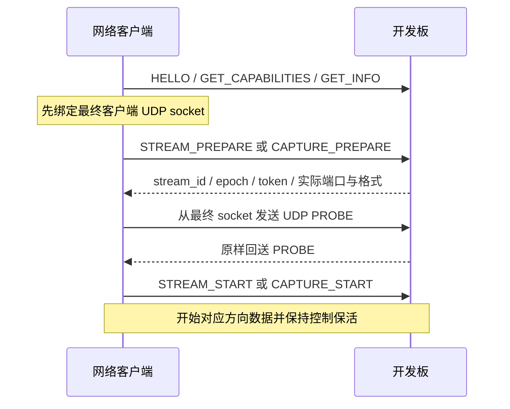

# 通信协议

适用基线：2026-10-22，VERSION 0.12.12。返回 [文档导航](../README.md)。本页汇总当前已实现的通信方式；历史设计稿中的保留命令不能直接作为当前接口使用。联调应先读 `GET_CAPABILITIES`，再验证实际返回。

## 1. 协议总表

| 名称 | 传输与方向 | 当前用途 |
| --- | --- | --- |
| UABD v1 | UDP 49160 双向广播 | 发现和UDP 广播网络维护，56 B 固定头 + TLV |
| UABC v1 | TCP 49161，客户端发起 | 控制、能力、配置、统计和事件，32 B 固定头 + JSON |
| UABA v1／v2 | UDP，板 → 客户端 | 双声道播放；v1 PCM，v2 IMA ADPCM，48 B 头 |
| UABF v1 | 与播放相同 UDP 通路 | 可选 XOR4 播放修复包，40 B 头 |
| UABM v1 | UDP，客户端 → 板 | 单声道麦克风 PCM，48 B 头 |
| UABT v1 | 复用播放 UDP socket | 可选时间与源样本观测，固定 104 B |
| Engine IPC v4 | Windows 本机命名管道 | 前台与 Engine 的内部通信，4 B 长度 + JSON |
| USB UAC1／HID | USB Host ↔ 开发板 | 标准音频／Feature Unit 与有限媒体按键，独立于网络封装 |

**网络二进制头和 TLV 数值用大端；PCM 样本用小端；Windows IPC 长度用小端。** 按偏移编码，不能直接发送结构体内存。协议不是 HTTP／WebSocket，不宣称 RTP、AES67 或 Dante 互通。

源码入口：[Wire.cs](../../SoundConvertClient/Core/Wire.cs)、[Network.cs](../../SoundConvertClient/Core/Network.cs)、[CaptureFormat.cs](../../SoundConvertClient/Core/CaptureFormat.cs)、[uab_network.c](../../SoundConvertBoard/uab_network.c)。

## 2. 端口和身份

TCP 控制固定 49161，UDP 发现固定 49160。正式 Runtime 默认将播放与麦克风的板端、软件端四项 UDP 策略都设为自动。软件端绑定端口 0 后读取系统分配值；板端在 49152–65535 中有界选择，避开保留端口及其他活动 socket。

两种 PREPARE 的 `source_port` 都指**板端 UDP 端口**，`receive_port` 都指**客户端实际绑定端口**。录音方向板端端口实际是数据目的端口，字段名仍保持兼容。

| `source_port` 的值 | 语义 |
| --- | --- |
| 缺失或 null | 旧客户端兼容：板端播放 49162、麦克风 49163 |
| 0 | 明确请求板端自动分配 |
| 1024–65535 | 请求固定板端端口，保留／占用／绑定失败时拒绝 |

`udp_port_negotiation_v1`／`port_configuration` 能力表示会话级 UDP 配置，不表示能修改 TCP 或发现端口。旧固件缺少能力时可使用它返回的兼容端口；请求非兼容固定端口必须确认响应，不能把固件忽略请求当作成功。Core 构造器和旧 CLI 仍有固定默认参数，不能据此判断 GUI Runtime 的默认策略。

| 身份字段 | 作用 |
| --- | --- |
| `device_id` | 由板载唯一标识派生的 128-bit 稳定标识，32 个小写十六进制字符 |
| `boot_id` | 每次启动生成的非零 64-bit 标识 |
| `config_revision` | 成功提交持久配置后的版本号 |
| `emulation_revision` | USB 模拟状态版本，防止基于过期状态操作 |
| `stream_id`／`epoch` | 流及其格式／样本时间轴代次 |
| `session_token` | 当前流的 64-bit 随机标识，用于旧包与无关包过滤 |

JSON 中 uint64 使用十进制字符串；二进制头使用固定宽度整数。设备 ID、challenge 和 token 不构成密码学认证。当前是局域网免配对、无认证尾、无传输加密的直接连接模式。

## 3. UABC 控制帧

### 32 字节头

| 偏移 | 字节 | 字段 | 当前规则 |
| ---: | ---: | --- | --- |
| 0 | 4 | magic | ASCII `UABC` |
| 4 | 1 | major | 1 |
| 5 | 1 | kind | 1 请求、2 响应、3 事件 |
| 6 | 2 | flags | 0，不带旧认证尾 |
| 8 | 4 | payload_bytes | JSON 字节长度，最多 8192 |
| 12 | 4 | request_id | 请求非零，响应对应；事件为 0 |
| 16 | 8 | message_seq | 每方向递增，HELLO 为 0，之后从 1 开始 |
| 24 | 8 | boot_id | HELLO 请求为 0，后续匹配设备当前 boot |
| 32 | N | payload | UTF-8 JSON object |

TCP 必须处理拆包、粘包和 EOF。完整读取头后先检查长度，再读取 body。拒绝非法 UTF-8、重复键、非对象 JSON、嵌入 NUL 等不合法输入；当前 JSON 深度限制为 16。不能把一次 `Read()` 当作一个完整帧。

请求结构为 `op`、`args`，持久配置校验／准备另带顶层 `expected_revision`。响应包含 `ok`、`code`、`message`、`data` 和配置 revision；事件包含 `event`、`data`。成功响应也要区分受理、临时应用和真正提交。

### 握手和请求顺序

HELLO 的 JSON 示例：

```json
{"op":"HELLO","args":{"protocol_min":1,"protocol_max":1,"client_id":"SoundConvertClient","connection_mode":"open"}}
```

其帧 `request_id=1`、`message_seq=0`、`boot_id=0`。响应返回 device_id、boot_id、protocol、connection_mode 和 owner。客户端校验响应类型、请求 ID、序号、头／body 的 boot 一致性后，才进入正常会话。

首个会话获得管理权，其他会话只读；目前有两个 TCP 槽。只有 owner 可以启停、配置和发送运行控制，竞争时返回 `BUSY_OWNER`。握手不会启动已手动停止的 USB 模拟。

后续请求 ID 不重复，序号单调递增；响应与主动事件共享设备发送序号。客户端等待某个响应时可能先读到事件，必须处理后继续匹配请求。现有客户端连接／握手超时为 5 秒，普通控制请求超时为 3 秒；超时后查询实际结果，不盲目重发切换动作。

### 命令分组

| 分组 | 已实现命令 | 开发注意 |
| --- | --- | --- |
| 查询 | `GET_INFO`、`GET_FIRMWARE_VERSION`、`GET_CAPABILITIES`、`GET_CONFIG`、`GET_STATUS`、`GET_STATS`、`GET_OPERATION` | INFO 含身份与完整状态；日常轻量监视优先 STATUS |
| 持久配置 | `VALIDATE_CONFIG`、`PREPARE_CONFIG`、`APPLY_CONFIG`、`CONFIRM_CONFIG`、`ROLLBACK_CONFIG` | USB／网络写需要停止模拟，按 revision 和事务 ID 检查 |
| USB 模拟 | `USB_EMULATION_START`、`USB_EMULATION_STOP` | 带 `expected_emulation_revision`，异步过渡后读回状态 |
| 运行格式设置 | `USB_SET_FORMATS`、`USB_SET_CAPTURE_FORMATS` | STOPPED 下执行，检查模拟 revision，不写 Flash |
| 播放会话 | `STREAM_PREPARE`、`STREAM_START`、`STREAM_KEEPALIVE`、`STREAM_STOP` | 需要 PROBE，匹配实际 USB 格式 |
| 麦克风会话 | `CAPTURE_PREPARE`、`CAPTURE_START`、`CAPTURE_KEEPALIVE`、`CAPTURE_STOP` | 独立单声道会话，profile 需支持录音 |
| 运行控制 | `SET_INTERNAL_VOLUME`、`USB_SET_CAPTURE_VOLUME`、`USB_HOST_KEY`、`SET_CLOCK_OBSERVATION` | 不走持久配置保存；受理后读取实际状态 |
| 诊断维护 | `SUBSCRIBE_STATS`、`RESET_STATS`、`IDENTIFY`、`REBOOT` | 订阅可设 0 关闭，非零 500–60000 ms；重启是有副作用操作 |

历史 `USB_SET_VOLUME` 已删除；`SET_RUNTIME_AUDIO`、`FACTORY_RESET` 和 `FW_UPDATE_*` 不能因出现在早期设计稿就当作现行可用命令。USB／UF2 烧写窗口使用 ROM 启动盘，不依赖网络升级命令。

当前客户端按保存集合与电脑能力的交集选择运行格式。固件 `USB_SET_FORMATS` 另检查不能超出保存的播放集合；`USB_SET_CAPTURE_FORMATS` 当前检查录音 mask 合法性和模拟 revision，没有同样的保存集合子集检查。开发新客户端时仍应遵循已保存偏好，不能把两条命令的固件校验视为完全相同。

固件对一般有副作用操作保存 32 项有限结果缓存、保留 60 秒。相同 ID／相同内容可返回既有结果；相同 ID／不同内容拒绝。保活、内部音量、录音增益、HID 和时钟绑定等运行控制不占该持久操作缓存，但仍受请求与会话顺序约束。

### 三个运行控制示例

```json
{"op":"SET_INTERNAL_VOLUME","args":{"volume_percent":80,"mute":false}}
```

```json
{"op":"USB_SET_CAPTURE_VOLUME","args":{"volume_q8":-2304,"mute":false}}
```

```json
{"op":"USB_HOST_KEY","args":{"key":"play_pause"}}
```

内部百分比必须为 0–100 整数，`mute` 为布尔，默认 80%，重启恢复。录音 `volume_q8` 为 −15360..0，即 −60..0 dB，示例为 −9 dB；可被 Host 覆盖。HID 白名单为 `play_pause`、`next_track`、`previous_track`、`volume_up`、`volume_down`、`mute`；结果未知时不能自动补发切换键。

## 4. UABD 发现和 UDP 广播维护

发现与未连接网络配置统一从选定电脑 IPv4 向 `255.255.255.255:49160` 发送 UABD。非关键请求 TLV `0x0010` 指定 2 字节大端回复端口；板卡即使尚无 IP 也在链路就绪时接收请求，并通过 UDP 广播回复。接收套接字绑定 ANY，通过 IP_PKTINFO 限定原网卡；发送套接字绑定精确源 IPv4。广播不跨普通路由器或隔离 VLAN。W5500 MACRAW 仅保留 ARP 地址冲突探测，不再承载自定义发现或配置。

### 56 字节头

| 偏移 | 字节 | 字段 |
| ---: | ---: | --- |
| 0 | 4 | `UABD` |
| 4／5 | 各 1 | version=1／消息类型 |
| 6／8／10 | 各 2 | header_bytes=56／total_bytes／flags |
| 12 | 8 | 请求关联 ID，应答原样回显 |
| 20 | 16 | 目标 device_id；发现请求可全零，应答填本设备 ID |
| 36 | 16 | 随机 nonce／设备短期 challenge |
| 52／54 | 各 2 | auth_bytes=0／reserved=0 |
| 56 | 可变 | 升序 TLV，应用报文总长不超过 1024 |

flags 应答位为 bit0。每项 TLV 为大端 uint16 type + uint16 length + value，无对齐。单值字段不能重复，未知 critical（type 最高位为 1）拒绝；未知非 critical 可跳过。UDP 长度必须与 total_bytes 精确匹配。

| TLV | 内容 | 编码 |
| --- | --- | --- |
| 0x0001／0x0002 | 型号／固件 | UTF-8，分别最多 64 B |
| 0x0003／0x0004／0x0005 | IPv4／前缀／网关 | 4 B／1 B／4 B |
| 0x0006／0x0007 | 地址来源／控制端口 | 1 B／uint16 |
| 0x0008／0x0009／0x000A | boot／config revision／MAC | uint64／uint64／6 B |
| 0x000B／0x000C／0x000D | 结果码／原因／网络状态 | uint16／UTF-8／1 B |
| 0x0010 | 请求回复端口 | uint16，大端，1024–65535 |
| 0x8010／0x8011 | expected revision／配置事务 ID | uint64／16 B |
| 0x8012／0x8013／0x8014／0x8015 | 请求模式／IP／前缀／网关 | DHCP=1、static=2／4 B／1 B／4 B |
| 0x8016／0x8017 | 确认窗口／目标 boot | uint16 秒／uint64 |

消息类型：DISCOVER=1、INFO=2、NET_PREPARE=3、NET_APPLY=4、NET_CONFIRM=5、NET_ROLLBACK=6、NET_RESULT=7。写请求精确绑定 ID、MAC、原网卡、boot、revision 和 challenge。设备 challenge 约 30 秒有效，客户端更早拒绝过期信息；缓存搜索结果只可加速打开编辑器，提交前仍刷新核对。

源码：[UdpDiscovery.cs](../../SoundConvertClient/Runtime/UdpDiscovery.cs)、[IpAddressEditor.cs](../../SoundConvertClient/Runtime/IpAddressEditor.cs)。设备身份、原网卡 IPv4、boot、revision、challenge 和事务均需校验。搜索与连接可取消；后台断开时界面清除过期忙碌状态，未结束的连接/搜索随管道关闭取消。

## 5. 双向流建立



播放 PREPARE 示例中的格式必须来自当前 GET_INFO，而不是直接照抄：

```json
{"op":"STREAM_PREPARE","args":{"direction":"playback","receive_port":52000,"source_port":0,"packet_frames":48,"buffer_ms":4,"format":{"sample_rate":48000,"channels":2,"sample_format":"S16LE"},"follow_usb":true,"fec_mode":"none","codec":"pcm"}}
```

这里的 `52000` 仅为示例，必须替换为实际绑定端口；`buffer_ms=4` 不能当作 PC 播放页的 20／40／80 ms 缓冲上限。START 使用返回的 stream_id／epoch。未通过 PROBE 不能开始；源 IP 和端口必须与协商绑定一致。

播放 `follow_usb=true` 只有响应明确确认才启用：订阅保留目的地址、stream 和 token，Host 停播／重新送数时按新的 USB generation 建立时间轴。接收端仅接受合法前进代次并重新检查格式，不能把所有 epoch 不同的包都当成新包。停止模拟、停止流、保活超时、网络或管理权失效会终止订阅。

录音 PREPARE 使用 `format={sample_rate,bits,channels:1,sample_format}` 和 `priority=playback_first|balanced`，随后以 UABM PROBE 完成同样的端点确认。`CAPTURE_START` 以 stream_id 开始，keepalive 读回 Host 活动状态及录音代次。两方向均有约 5 秒保活失效规则；正常客户端定期保持，不能把持续音频数据代替控制保活。

## 6. UABA 播放数据

### 48 字节头

| 偏移 | 字节 | 字段 |
| ---: | ---: | --- |
| 0 | 4 | `UABA` |
| 4／5 | 各 1 | version／header_bytes=48 |
| 6 | 2 | flags：bit0 DISCONTINUITY、bit1 SILENCE、bit2 END、bit3 PROBE |
| 8／12／16 | 各 4 | stream_id／epoch／sequence |
| 20 | 8 | sample_index，本包首个采样帧索引 |
| 28／32 | 4／2 | sample_rate／frames |
| 34／35 | 各 1 | channels=2／源格式码 |
| 36 | 2 | payload_bytes |
| 38／39 | 各 1 | v1 保留零；v2 codec ID=1、reserved=0 |
| 40 | 8 | session_token |
| 48 | 可变 | 数据载荷 |

格式码 1 为 S16LE，每样本 2 B；2 为 S24LE_PACKED，每样本 3 B，解码需符号扩展。没有当前可用的 32-bit 格式。PCM 载荷交错 L、R，长度必须为 `frames × channels × bytes_per_sample`，报文精确等于 48 + payload_bytes，总长不超过 1200。

源格式目录与 mask bit：0=48k/16，1=96k/24，2=44.1k/16，3=44.1k/24，4=48k/24，5=88.2k/16，6=88.2k/24，7=96k/16，8=176.4k/16，9=192k/16。**bit 顺序与 UI 按采样率排序的显示顺序不同**，见 [AudioFormat.cs](../../SoundConvertClient/Core/AudioFormat.cs) 和 [usb_formats.h](../../SoundConvertBoard/usb/usb_formats.h)。

约 1 ms 封包：48k/16 为 48 帧、192 B PCM、240 B UABA；96k/24 为 96 帧、576 B PCM、624 B UABA。44.1k 等非整数千赫兹采样率用 floor／ceil 帧数维持累计样本数，不能每包都截成固定 44 帧。

PROBE 使用 v1，flags=8、总长 48，除身份外的音频字段为零，不推进 sequence。END 可无载荷但保留格式；SILENCE 普通包仍需完整全零 PCM。PROBE 和 END 不得同时设置。已知缺帧保留 sample_index 间隙，未知时间轴损失换代次。

### IMA ADPCM 与 XOR4

ADPCM 通过 `codec=ima_adpcm` 明确协商，数据采用 UABA v2；只允许数据 flags=0，PROBE／END 保持 v1。压缩载荷长度为 `frames+7`：前 8 B 是 L／R 各自的 S16 首样本、步长索引和保留字节，其后每 B 的低 4 bit 为左声道、高 4 bit 为右声道。每包自包含，不能当作 WAV IMA 或 RTP DVI4 解码。24-bit 先量化至 16-bit，不保留原 24-bit 精度。

XOR4 通过 `fec_mode=xor4` 明确协商。UABF 头为：magic@0、版本1@4、组大小4@5、头长40@6、stream@8、epoch@12、base_sequence@16、token@20、四个 uint16 原包长度@28、XOR长度@36、保留0@38；40 后是四个**完整 UABA 包**补零后的逐字节 XOR。最大 856 B，base_sequence 低两位为 0。

只恢复同组一个缺包；原始包到达立即交付，不等待组齐。最多保留 32 组，100 ms 无活动过期。恢复后必须重新做 UABA 校验，晚于播放期限仍丢弃。不能恢复板端还未发送或已经过期的数据。源码：[AudioFec.cs](../../SoundConvertClient/Core/AudioFec.cs)、[ImaAdpcm.cs](../../SoundConvertClient/Core/ImaAdpcm.cs)。

## 7. UABM 反向麦克风

头布局对应 UABA，magic 为 UABM、version=1、channels=1、flags 只允许 0 或 PROBE=8、38–39 固定零。数据为小端单声道 PCM，sample_index 以**转换后的录音采样帧**推进，不是电脑采集原始帧索引。

录音 mask bit 顺序：0=48k/16、1=16k/16、2=8k/16、3=32k/16、4=44.1k/16、5=96k/16、6=48k/24、7=44.1k/24、8=96k/24；默认 mask=1。发送前检查板端实际录音格式不超过所选电脑输入源上限。

板端验证源 IP／端口、身份、代次、格式和长度，以 32 槽队列有界重排。旧包、晚包、缺帧、补零和重缓冲分别统计。当前不支持反向压缩或 FEC。源码：[MicrophoneSender.cs](../../SoundConvertClient/Core/MicrophoneSender.cs)、[uab_capture_reorder.h](../../SoundConvertBoard/uab_capture_reorder.h)。

## 8. 配置事务

持久保存顺序为：读 GET_CONFIG／GET_INFO → 停止 USB 并确认 STOPPED → VALIDATE → PREPARE → APPLY → 确认状态 → CONFIRM。失败或取消使用 ROLLBACK；丢失响应用 GET_OPERATION 查询。

一次 candidate 当前不能同时包含 USB 与 network 变更，且只能存在一个未完成配置事务；按两类配置分别提交。

以 USB 名称为例，以下仅是 VALIDATE／PREPARE 的 JSON 结构示意，revision 必须替换为实际读回：

```json
{"op":"VALIDATE_CONFIG","expected_revision":"12","args":{"expected_emulation_revision":"7","candidate":{"usb":{"product_name":"我的 USB 声卡"}}}}
```

PREPARE 返回 transaction_id 后，APPLY／CONFIRM 的 args 携带该 ID；USB 事务还带原 expected_emulation_revision。CONFIRM 写 Flash 成功才提升 config_revision。USB 配置下次 START 重新枚举生效；当前指示灯配置也在 CONFIRM 后应用。

网络 candidate 使用 `network.mode`、`ip`、`prefix_length`（或连续 mask）、`gateway`、`dns`。APPLY 临时改址，按稳定 ID 重新发现，不把 TCP 断开视为成功；候选地址有效后才能 CONFIRM。静态确认窗通常 30 秒，DHCP 120 秒；超时／回滚恢复旧策略，DHCP 不保证取得原 IP。UDP 广播路径对应 NET_PREPARE／APPLY／CONFIRM／ROLLBACK，并保持 USB 停止。

## 9. UABT 可选时间观测

正常播放 START 后，owner 使用 `SET_CLOCK_OBSERVATION` 绑定 `enabled`、version=1、boot_id、stream_id、epoch、session_token。未声明 `clock_observation_v1` 时不开启。停流、代次变化、失去 owner 或网络失效撤销绑定。

| 偏移 | 字节 | 字段 |
| ---: | ---: | --- |
| 0／4／5／6 | 4／1／1／2 | UABT／version=1／kind 请求1回复2／length=104 |
| 8／16／20／24 | 8／4／4／8 | boot／stream／epoch／token |
| 32／40 | 各 8 | 递增 request_id／p1_echo |
| 48／56 | 各 8 | b2_us／b3_us 板端软件采点 |
| 64／72 | 各 8 | anchor_sample_index／anchor_extract_us |
| 80／84 | 各 4 | anchor_generation／sample_rate |
| 88／90 | 各 2 | anchor_frames／flags，仅 bit0 有效锚点 |
| 92 | 12 | 保留全零 |

请求 48–103 全零；无效锚点回复不能当作有效零样本。时间包复用播放 socket，不进入音频 FEC 字节域。板端 100 μs 软件工作预算超限会撤销观测并锁存流身份，不能以反复开关或 RESET_STATS 清除。b2／b3／提取采点均不是硬件时间戳，不可直接用不同设备时钟相减宣称单向延迟。

客户端默认 Legacy；ObserveOnly 不调速，ClockAssistExperimental 受资格门控。源码：[ClockObservationProtocol.cs](../../SoundConvertClient/Core/ClockObservationProtocol.cs)、[ClockObservationSession.cs](../../SoundConvertClient/Runtime/ClockObservationSession.cs)。

## 10. Windows 内部 IPC

命名管道仅限当前用户并按登录会话派生命名。每条消息为 **4 B 小端有符号长度 + UTF-8 JSON**，允许长度 1–1 MiB；它不使用 UABC 头，安卓网络客户端无需实现这套 IPC。

`EngineRequest` 带 Operation、Name、Value／Changes、OperationId、EngineInstanceId 和创建时间。先 snapshot 握手校验协议 v4、发布版本与进程身份；业务操作返回 OperationTicket，再查询 Completed／Failed／Unknown／Canceled 等终态。Queued、Executing、Accepted 不等于最终成功。后台实例变化后不重放旧操作。

`set` 可合并连续属性最新值，但媒体按键逐项发送且过期不发送；完整保存命令应携带整个草稿，避免“字段 set 尚未到达就执行保存”的竞态。源码：[EngineProtocol.cs](../../SoundConvertClient/Runtime/EngineProtocol.cs)。

## 11. 联调必须覆盖的异常

至少覆盖：TCP 分段／粘包／超长帧、重复 JSON 键、uint64 精度、非法格式、旧 boot／token／epoch、未 PROBE 就 START、指定端口冲突、只读 owner 写入、配置 revision 冲突、APPLY 后断线及回滚、Host 换格式、保活失效和未知操作结果。

统计分清：板端构造／提交／SENDOK、客户端有效／非法／旧包、播放期限后永久缺口、FEC 修复、欠载和模拟输出。任何一项计数成功都不能独立证明用户实际听到了连续音频。运行方式见 [构建测试与发布](05-构建测试与发布.md)。
