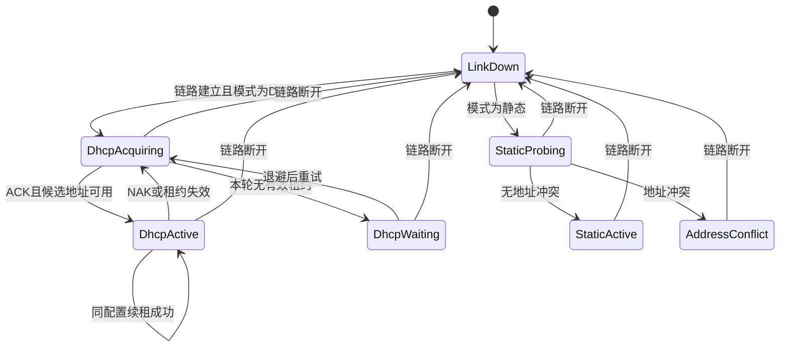

# 固件与网络层开发

> 当前实现变更（2026-10-18）：0.4.0-dev 起已移除配对码、配对文件和 AUTH/HMAC 凭据流程。搜索选择设备即可直接连接；旧设计中的配对要求不再适用。设备所有权、序号、boot/revision、网络 challenge 与配置确认/回滚仍保留。以[当前协议](03-通信协议规范.md)及上位机/固件 README 为准。

修订日期：2026-10-18。网络实现统一为 **W5500 硬件 TCP/UDP Socket + WIZnet ioLibrary**。默认 DHCP，保留用户主动选择的静态 IPv4；不使用 lwIP，不实现无 DHCP 自动 LLA，也不开发跨路由器/VLAN 自动发现。

本文说明整机集成。可脱离 USB 音频先行开发的步骤、接口、Socket 分配和验收见 [单片机以太网开发指南](06-单片机以太网开发指南.md)。协议字节布局以 [通信协议规范](03-通信协议规范.md) 为准。文中预算均需实物测量。

## 网络方案与职责

| 层次 | 责任 |
| --- | --- |
| W5500 硬件 | TCP、UDP、IPv4、正常 ARP、MAC/PHY、Socket 收发缓冲 |
| ioLibrary / 项目传输适配 | 寄存器与 SPI 访问、Socket 操作；按本项目要求限制等待和排队 |
| DHCP 客户端 | 在 MCU 上协商租约，通过硬件 UDP 68/67 通信 |
| 地址管理 | DHCP/静态模式、租约期限、地址切换、改址确认与回滚 |
| 应用协议 | TCP 控制、UDP PCM、UDP 发现、认证与状态 |
| Socket 0 MACRAW | 同二层发现/改址，以及地址冲突探测所需原始 ARP；不承载音频 TCP/IP 栈 |

硬件方案减少 MCU 组装 IP/TCP/UDP、维护软件连接及网络缓冲池的工作，但仍需驱动、DHCP 与应用状态机。不能据此保证固定降低多少毫秒。[W5500 官方规格](https://docs.wiznet.io/Product/Chip/Ethernet/W5500)

同二层指同一广播域，例如同一普通交换网络里的 `192.168.1.x` 与 `192.168.2.x`。此类发现与改址保留；MACRAW 只能放在 Socket 0，硬件协议与 MACRAW 的过滤/缓冲配合必须实测。[W5500 寄存器定义](https://raw.githubusercontent.com/Wiznet/ioLibrary_Driver/master/Ethernet/W5500/w5500.h)

## 固件执行域

先分别验证 USB 与以太网，再按下表集成。首版无需 RTOS。

| 执行域 | 职责 | 约束 |
| --- | --- | --- |
| Core 0：USB owner | USB IRQ、TinyUSB task、按音频时基消费、PCM 入队、USB 状态 | 不等网络，不写 Flash，不做阻塞日志 |
| Core 1：network owner | SPI/W5500、DHCP、Socket 状态机、协议、发现 | 所有 W5500 访问由此统一拥有；不无限等待 SENDOK |
| 跨核队列 | 有界 SPSC PCM、短命令、统计快照 | 原子索引与 acquire/release，明确 DMA/消费者的缓冲所有权 |
| 维护状态 | 配置保存、身份修改、固件更新 | 暂停音频并协调双核，不在实时回调中擦写 XIP Flash |

W5500 INTn ISR 只记录事件，主循环读取并处理寄存器；定期轮询作为丢中断兜底。DMA 回调不能直接进入业务协议解析。`volatile` 不代替跨核原子同步。

整机上电由 Core 0 加载已提交配置并启动 USB 模拟，网络独立初始化；USB 启动不依赖 DHCP、网线或上位机认证。以后手动 START/STOP 经命令队列串行执行，认证重连不改变模拟状态。STOP 完成需 USB 逻辑断开、在途处理/PCM 清理，不能由网络核心只停止 UDP 就伪造 STOPPED。

USB 参数写入只在已确认 STOPPED 时允许，PREPARE/APPLY/CONFIRM 检查模拟代次并与 START 互斥。保存后保持停止；网络控制继续运行，Host 线无需拔出。PC 控制掉线按原规则结束音频流，但不自动改变模拟开关；手动停止后重连也不会自动重新开始。

生产者不得擅自移动消费者的读指针。PCM 队列满可丢弃新块并计数；消费者发现积压时自行跳过过期块，随后标记 DISCONTINUITY。网络失效不停止 USB 服务，也不积攒数秒音频等待补发。

## W5500 板级初始化

1. 按本板接线初始化 SPI0：GPIO16 MISO、17 CSn、18 SCLK、19 MOSI，GPIO20 RSTn、21 INTn。
2. 按数据手册复位时序启动，读取 `VERSIONR=0x04`。失败时先排查供电、板型、片选和 SPI，不进入 DHCP。
3. SPI 请求速率先用 10 MHz 验证，再评估 25 MHz、37.5 MHz；记录实际设置值。不能只因芯片标称 80 MHz 就直接使用该速度。
4. 设置唯一 MAC，按文档 06 的表为各 Socket 分配 TX/RX。每方向总量不超过 16 KiB，不能再给 S0 独占全部缓冲。
5. 配置 INTn、中断掩码与 PHY 监控，打开 S0 MACRAW 本地管理路径；其他业务 Socket 等地址有效后开放。
6. 按已保存模式进入 DHCP，或对静态候选地址做冲突检查后应用。

SPI DMA 是搬运优化，不是完整的异步驱动。标准 ioLibrary burst 回调具有同步完成语义，必须在回调返回、CSn 释放前完成相应传输；不能启动 DMA 就返回。生产数据路径的分步发送状态机见文档 06。

## Socket 与端口

| Socket | 模式 | 默认用途 | 本地端口 |
| --- | --- | --- | ---: |
| S0 | MACRAW | 同二层发现、改址、ARP 探测 | 无 |
| S1 | UDP | USB 声音到 PC；音频 PROBE | 49162 |
| S2 | TCP | 控制连接槽 A | 49161 |
| S3 | UDP | DHCP 客户端，仅 DHCP 模式运行 | 68 |
| S4 | UDP | 普通发现 | 49160 |
| S5 | UDP，首版关闭 | 可选麦克风回传 | 49163 |
| S6 | TCP | 控制连接槽 B | 49161 |
| S7 | 关闭/预留 | 后续扩展 | 无 |

S2/S6 合计最多两个 TCP 会话，其中最多一个写入所有者；监听与连接转换使用原 Socket，不按操作系统的 accept 模型额外假设存在无限连接。音频、控制、发现是不同业务端口；Socket 编号只是芯片内部资源号。

## DHCP 与静态地址状态机

- 出厂 `network.mode=dhcp`。无租约时对外状态为 `DHCP_WAITING`，有效地址为 `0.0.0.0`，只运行 DHCP 与本地二层管理，音频/TCP 控制不启动。
- 保留有限速率的 DHCP 重试；不自动切换静态模式，不使用过期租约，也不自动分配备用 IP。
- 用户可以通过已认证的二层管理切换到手动静态 IP，或接入有 DHCP 的网络。直接连接电脑时，电脑“自动获取 IP”不等于电脑提供 DHCP 服务。
- DHCP 正常同地址、同掩码、同网关续租不打断音频；实质配置变化时停止旧会话、增加 `network_generation`、重新发现及建流。
- 收到有效 NAK 或租约到期必须撤销地址；不能只看库返回 `DHCP_IP_LEASED` 就一直认为租约有效。
- 静态模式停用 DHCP，使用独立静态配置。切回 DHCP 后静态值可保留供下次编辑，但不会自动作为回退地址。
- 两种模式都需要地址冲突处理。静态地址已被占用时拒绝应用，保留 S0 管理入口。

ioLibrary 提供 DHCP 初始化、周期处理、回调和租约读取接口，但项目仍需审计所锁定版本的续租、超时和等待行为。[DHCP 接口](https://raw.githubusercontent.com/Wiznet/ioLibrary_Driver/master/Internet/DHCP/dhcp.h)

## 局域网发现与管理

| 状态 | 普通 UDP 发现 | S0 二层发现与改址 |
| --- | --- | --- |
| 有效 DHCP/静态 IP，PC 同子网 | 可用，受防火墙影响 | 可用 |
| 同一二层网络，PC 与板 IP 子网不同 | 不保证回复可达 | 通过 MAC/device_id 定位和认证改址 |
| DHCP 等待、尚无有效 IP | 不对普通 UDP 发现承诺响应 | 仍可报告等待状态并切换静态模式 |
| 静态地址冲突 | 停止使用冲突地址 | 仍可管理 |

PC 二层管理使用 Npcap 或经验证的等价原始帧接口，普通 UDP 音频与 TCP 控制不依赖 Npcap。驱动安装/权限不足时只禁用二层功能，明确提示原因。二层管理以有线物理 NIC 为验收基线；隔离端口或某些 Wi-Fi 网络可能阻挡原始帧。

产品发现范围限定本地广播域；不提供跨路由器/VLAN 自动发现、发现代理或中继配置。已有可达 IP 的普通单播可按路由工作，但不扩大自动发现范围。

## 低延迟网络调度

默认 1 ms PCM 包，调试可用 2 ms。48k/16-bit/2ch 每包 192 B PCM，加 UAB 48 B 头为 240 B UDP 应用数据；硬件 Socket 发送该应用数据，芯片生成网络头。UDP 应用数据上限 1200 B，不依赖 IP 分片。

优先处理到期音频，同时给 DHCP、ARP 管理和短控制消息保留工作配额。控制 TCP、统计和日志不能持有跨核锁，也不能把大 JSON 一次阻塞写完。每个 Socket 同一时刻只允许一个被跟踪的发送操作。

官方 `sendto()` 内有等待空间、命令完成和 SENDOK/超时的路径；不能把设置非阻塞标志等同于全部路径都立即返回。生产实现应使用有期限的发送状态机，并审计 DHCP 等库调用是否仍进入阻塞路径。[ioLibrary Socket 实现](https://raw.githubusercontent.com/Wiznet/ioLibrary_Driver/master/Ethernet/socket.c)

启动音频前完成 PROBE 和网络可达性确认。稳态音频过期即丢弃；若持续无法发送，结束该流、重置相关 Socket 并回到准备阶段，不能让新包永久排在失败包后面。UDP SENDOK 仅说明本地发送完成，不代表 PC 已收到或播放。

USB 音源、板端反馈消费时基和 PC 声卡时钟仍可能不同，PC ASRC、抖动缓冲与流时间轴继续保留；硬件 TCP/IP 不替代音频时钟补偿。

## 配置与维护

地址变更仍执行准备、临时应用、确认、持久化。静态试用默认 30 秒，DHCP 默认 120 秒；期限内取不到地址则不能确认成功，应回滚到原模式。切回旧 DHCP 模式不保证拿到旧地址；可能恢复为 DHCP 等待，但二层入口持续可用。

切换公共 IP/掩码/网关寄存器前关闭业务 Socket、废弃旧 stream token/epoch；配置写入后再创建业务 Socket。只改 DHCP 租期、不改网络参数时不关闭业务。

持久化仍采用两个独立 Flash 擦除区的版本化记录，含 schema、generation、长度、CRC 和提交标记；临时试用值不覆盖最后提交值。RP2350 XIP Flash 擦写须进入维护状态协调双核，不能承诺不中断音频。

首版升级使用 BOOTSEL/UF2 或 SWD。网络 OTA 如以后增加，另行验证镜像空间、签名、断电和回滚。

## 资源与诊断

删除软件 TCP/IP 池预算，改为固定应用缓冲。初始 MCU SRAM 预算：USB/FIFO 24 KiB、PCM 环 16 KiB、网络收发暂存及状态 16 KiB、控制与配置 48 KiB、双核栈 24 KiB、诊断 24 KiB，共约 152 KiB；不含未纳入统计的库静态数据和对齐，最终看 map 与高水位。W5500 自己的 32 KiB 缓冲另算。

PCM 容量不等于目标延迟，板端正常驻留争取 1–2 ms，超出约 4 ms 开始淘汰过期数据。保留 USB/SPI/发送超时、队列水位、PHY、DHCP 状态、租约剩余时间、地址冲突、配置 generation、流丢弃与复位原因。

统计每秒合并快照，日志不逐包输出。看门狗检查两个核心都在推进。硬件网络移植、协议互通和台架验收细节统一见 [文档 06](06-单片机以太网开发指南.md)。
