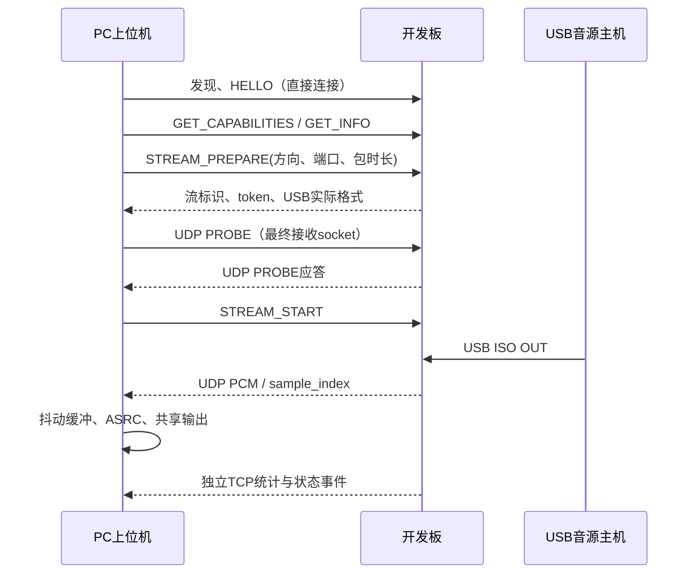
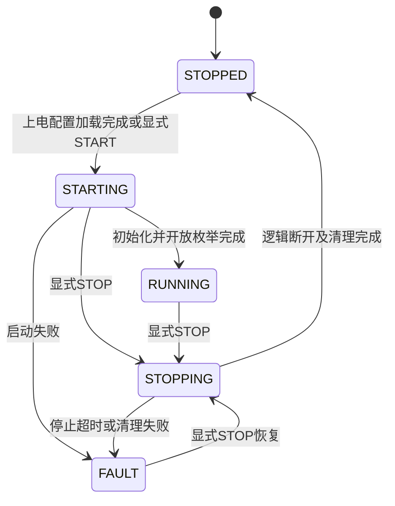

# USB Audio Bridge 通信协议规范

**V0.12.0 UDP 端口增量（统一交付 V0.12.1）**：`STREAM_PREPARE`／`CAPTURE_PREPARE` 新增可选 `source_port`，支持自动或指定声卡音频端口，见[端口协商验收](44-UDP端口自动协商与配置验收.md)。TCP 控制和 UDP 发现入口保持固定；本页旧版本的固定音频端口描述仅适用于旧固件或兼容请求。

**当前软件协议增量 V0.9.4**：保持UABC/UABA/UABM与UAC1，内部IPC3；独立SET_INTERNAL_VOLUME及已删除的歌曲／Host绝对音量接口见末节。当前测试范围见[文档24](24-协议功能精简与内部音量验收.md)。

V0.3.0 历史增量：UAC1 双向音频、麦克风UDP49163、CAPTURE操作及配置v5见本文末节和[文档15](15-双向音频与麦克风实施验收.md)。下方旧开发版本的播放单向限制为历史说明。

协议名：UAB；设计版本：1.0 draft r3，2026-10-18。本文保留完整协议契约；当前开发版只宣告已实现的能力，实际范围与实机证据见 [文档 09](09-实施与实机验收记录.md)。全篇“必须”用于约束双方实现，能力为 false 的扩展不能当作可用功能。

历史0.5.0-dev增加格式位图、USB_SET_FORMATS、Flash v3与可变一毫秒帧包；旧播放FU网络设置在当前版本已删除。下文带版本标注的早期双档描述只作历史记录，现行独立内部音量见末节。

旧固件 0.3.0-dev 默认使用 UAC1、48k/16/2ch 兼容档。持久化 `usb.hi_res_enabled=true` 后额外宣告 96k/24-bit packed/2ch；USB Host 决定实际 alternate setting 和格式，开关不强制 Host 切到高规格。UAC2、录音回传等仍未实现；不实现运行时 UAC 版本切换。

网络后端改为 W5500 硬件 TCP/UDP，默认 DHCP、保留手动静态 IP；自动发现仅限本地广播域。32/48/56 B 包头和现有业务端口保持不变，硬件资源映射见 [独立以太网文档](06-单片机以太网开发指南.md)。

## 传输与端口

### 2026-10-18 开发版 JSON 字段补充

二进制 32/48/56 字节头保持下文定义；0.4.0-dev 起改为免配对直接连接，控制与二层报文不再携带认证尾。当前双方实现冻结以下 JSON 拼写，避免仅凭设计中的概念名推测字段：

- HELLO 的 args 为 `protocol_min`、`protocol_max`、`client_id`、`connection_mode="open"`；当前仅支持 major 1。响应 data 返回 `device_id`、十进制字符串 `boot_id`、`protocol`、`connection_mode="open"`、`owner`，直接建立会话。
- GET_CONFIG 的 data 包含 `usb`、`network` 和字符串 `config_revision`；名称字段为 `product_name`、`manufacturer_name`、`playback_name`。仅发送变更字段，省略保持原值。
- 当前网络候选字段为 `mode`、`ip`、`mask` 或 `prefix_length`、`gateway`、`dns`。`mask` 必须连续并满足 /1–/30；双方当前使用 `ip`/`prefix_length`，不发送旧草稿概念名 `ipv4`/`prefix`。网络写入当前需要 USB STOPPED，以安全提交 Flash；能力 `network_config_write_policy=stopped_only` 明示此条件。
- STREAM_PREPARE 的 args 包含 `direction="playback"`、`receive_port`、`packet_frames=48或96`、`buffer_ms` 和与实际 USB Host 一致的 `format`（48k/S16LE 或 96k/S24LE_PACKED，2 channels）。data 返回 `stream_id`、`epoch`、字符串 `session_token`、`source_port`、实际 `format` 和 `waiting_usb`。uint32 数字可由 JSON 编码器表示为科学计数，接收方只接受其精确整数值及范围。
- GET_INFO 的标准 USB 开关对象为 `usb_emulation`；同时保留 `usb` 的 mounted/streaming/suspended/generation 诊断。`network` 返回当前模式、来源、状态、有效 `ip`/`mask`/`gateway`、`network_generation` 和字符串 `lease_remaining`。
- `GET_CONFIG.usb.hi_res_enabled` 默认 false；通过 STOPPED 下的 `candidate.usb.hi_res_enabled` 布尔字段事务保存，省略保持原值。旧 v1 Flash 配置迁移时保持所有名称/网络/revision，并把新字段置 false。`declared_formats` 是下次枚举宣告组合；GET_CONFIG 中保留的 `format` 是兼容默认参考，不代表 Host 当前格式。
- 关闭高规格时只宣告 alt1=48k/S16LE；开启时增加 alt2=96k/S24LE_PACKED。`GET_CAPABILITIES.hi_res_supported=true`，其 `formats` 为当前已提交档位的宣告列表。`GET_INFO.usb.format`、`alternate_setting` 与 `format_selected` 表示 Host 当前选择；alt0 的 format 是待选兼容参考，不能标为已播放。`usb.serial` 是板载唯一 ID 原始字符串，用于匹配同机 USB 音频端点。
- USB Feature Unit只提供master mute/volume，L/R不宣告。GET_INFO／GET_STATS.usb_control只读包含revision、master_mute、master_volume_q8、master_volume_db、minimum_db=-60、maximum_db=0、step_db=1/256、source=usb_host和write_policy=usb_host_only。标准Host Q8.8及GET_RES=1保持；内部播放百分比通过单独internal_volume提供。
- USB Host管理自身标准Feature Unit，软件仅保留音量±／静音等六种HID键；不设置Windows Host端点绝对音量。板内独立百分比与Host增益相乘，Host写入不覆盖板内值。电脑耳机端点和本地监听增益仍独立。
- 二层 NET_APPLY 的响应会明确 `RECONNECT_REQUIRED_USB_STOPPED`，维护期间停止 USB，提交后不自动开始；所有二层写仍须通过 challenge、boot/revision、事务和所有权校验。
- V0.12.0 起 `udp_port_negotiation_v1=true`、`port_configuration=true` 表示支持每次音频会话选择 UDP 端口；不表示支持修改 TCP 控制或 UDP 发现端口。`factory_reset=false`，未实现命令仍返回 NOT_IMPLEMENTED。

### V0.5.0 USB Host 媒体键（第一批）

管理命令 `USB_HOST_KEY` 的 `args.key` 仅接受：

| key | Consumer Usage | 意义 |
| --- | --- | --- |
| `play_pause` | `0xCD` | Host 播放／暂停切换 |
| `next_track` | `0xB5` | Host 下一曲 |
| `previous_track` | `0xB6` | Host 上一曲 |
| `volume_up` | `0xE9` | Host 音量加 |
| `volume_down` | `0xEA` | Host 音量减 |
| `mute` | `0xE2` | Host 静音键 |

`GET_CAPABILITIES.host_control_keys` 从固件同一张白名单产生；`host_volume_keys_supported=true` 兼容旧客户端，`host_control_result="accepted_not_player_state"`、`player_state_supported=false` 明示结果边界。旧固件只声明音量键时，客户端只开放旧音量键。能力表示固件接受，不表示 Host／播放器已验证响应。

`GET_INFO`、`GET_STATUS`、`GET_STATS` 的 `host_control` 提供 ready、pending、queued、completed、dropped、last_usage、transport=hid_consumer 和 system_volume_known=false；completed 表示一个按下及释放已完成 USB 传输，不表示播放器状态。按键要求管理权限、USB RUNNING、已枚举、未挂起且 HID ready；不要求 PCM streaming，暂停后可请求恢复播放。

成功返回 `data={"accepted":true,"key":"play_pause","meaning":"one_host_key_press"}`，仅表示进入8项有界队列。非法值返回 INVALID_ARGUMENT，未就绪返回 HOST_CONTROL_NOT_READY，队列满返回 HOST_CONTROL_BUSY，观察会话沿用 BUSY_OWNER。按下至少10 ms后发释放，断开／重置／挂起丢弃待发键，重连先发中立报告。

按键逐项执行，不使用滑块最新值合并，不占配置事务结果缓存。已发送请求若结果未知，客户端不重放；不可用新 request_id 盲目补发播放／暂停切换。前后台命令 HostPlayPauseCommand／HostNextTrackCommand／HostPreviousTrackCommand／HostVolumeUpCommand／HostVolumeDownCommand／HostMuteCommand 逐一映射上述值，IPC 回应在本次网络请求完成后返回。

旧USB_SET_VOLUME管理命令已删除；板端内部音量由SET_INTERNAL_VOLUME独立配置，上电80%。按键不读取歌曲或确定的播放器状态，设备预设见后续协议章节。

### 端口表

| 功能 | 传输 | 默认端口 | 行为 |
| --- | --- | ---: | --- |
| 正常发现 | UDP | 49160 | PC 在选定 NIC 上广播，设备单播应答 |
| 控制与状态 | TCP | 49161 | 设备监听，上位机连接；配置、协商、统计事件 |
| USB 主机声音 → PC | UDP | 49162 | 板从该端口发送，PC 默认也在该端口接收；可协商 PC 接收端口 |
| PC 麦克风 → USB 主机 | UDP | 49163 | 板在该端口接收；独立 stream_id 和队列 |
| 二层恢复发现/改址 | Ethernet | 无 TCP/UDP 端口 | 实验阶段 EtherType `0x88B5` + UAB 专用 magic |

49160–49163 是项目建议的动态/私有端口，不宣称是 IANA 为本产品注册的服务。允许用户修改业务端口，范围 1024–65535；同设备各功能端口在项目规则上要求不重复。49160 作为兼容发现入口默认保留，关闭它必须有明确高级设置；二层发现不依赖任何 IP 端口。

实验 EtherType 与其他本地实验协议可能共存，必须进一步验证 magic、版本、目标 device_id 和长度。量产时重新审查所用以太网协议标识的分配方式。[RFC 7042](https://www.rfc-editor.org/rfc/rfc7042)

所有多字节**协议头和 TLV 数字使用网络字节序（大端）**。PCM payload 单独定义为 little-endian。不得直接发送 C/C# 内存结构体；须按偏移编码，避免对齐和端序差异。

## 身份与能力

| 字段 | 定义 |
| --- | --- |
| `device_id` | 128-bit 永久设备标识，持久化；恢复出厂保留 |
| `boot_id` | 每次启动新建的随机 64-bit 标识；不能用 IP 替代 |
| `network_generation` | 地址/路由实质改变时递增 |
| `config_revision` | 每次成功提交配置递增的 uint64 |
| `stream_id` | 当前 boot 内分配的非零 uint32 |
| `epoch` | 每个 stream 的格式/时间轴代次，uint32 |
| `session_token` | 每次流准备时生成的随机 64-bit 标识，用于过滤过期或无关 UDP |

JSON 中 uint64 统一使用**十进制字符串**，避免某些客户端浮点 JSON 解析丢精度；二进制头仍为 uint64。128-bit 标识用 32 个小写十六进制字符，随机 nonce/密钥证明用明确编码的 Base64 字符串。

`GET_CAPABILITIES` 必须返回固件当前实际支持的：UAC 版本、USB 速度、档位、方向、采样率集合、采样格式、声道布局、可用同步方式、最大端点包长、最大 UDP 包长、目标缓冲范围、协议版本、发现能力和是否支持安全维护。

网络能力固定声明 `network_backend=w5500_hardware`、`address_modes=[dhcp,static]`、`discovery_scope=local_l2`。`GET_INFO` 分别返回配置模式、实际地址来源、网络状态、有效地址和租约剩余时间；DHCP 等待时有效地址为 0.0.0.0，不能把历史地址作为当前地址。状态枚举为 `LINK_DOWN`、`DHCP_ACQUIRING`、`DHCP_WAITING`、`DHCP_BOUND`、`STATIC_PROBING`、`STATIC_ACTIVE`、`ADDRESS_CONFLICT`、`FAULT`。

能力应给出**合法格式组合列表**，不能分别列采样率/位深/声道后让 UI 自行做笛卡尔积。例如支持 96k/24/2ch 与 48k/16/4ch，不代表支持 96k/24/4ch。

### LD2 指示灯配置（V0.12.2）

`GET_CAPABILITIES` 增加 `indicator_configuration_supported=true` 和 `indicator_modes=["auto","off","on","breathe","blink"]`。`GET_CONFIG.usb.indicator_mode` 为已提交模式，默认 `auto`。不声明能力的旧固件由客户端禁用配置，且保存其他声卡参数时不发送此字段；未知模式保留原值并要求用户明确选择，不能静默改成自动。

写入使用现有 `VALIDATE_CONFIG → PREPARE_CONFIG → APPLY_CONFIG → CONFIRM_CONFIG`，候选示例 `{"usb":{"indicator_mode":"off"}}`，仍要求 USB STOPPED 和配置／模拟 revision 匹配。CONFIRM 落盘成功后才更新灯效；回滚与失败不改变已保存模式。Flash 记录 v8 有效载荷 796 字节，在 v7 尾部追加 1 字节，读取 v1–v7 默认自动，保留名称、类型、HID、音频格式及网络配置。

自动模式以 USB 声卡 RUNNING、mounted 且未 suspended 为连接条件。播放 OUT 新接收字节或麦克风 IN 实际发送帧触发约 3.1 Hz 闪烁；约 200 ms 无新音频数据后返回 2.4 秒周期的呼吸，alt0／未连接／停止／挂起熄灭。静音数据仍算传输，控制请求、TCP 管理连接和网口活动不触发音频灯态。`off` 常灭、`on` 常亮、`breathe` 持续呼吸、`blink` 每秒闪烁一次。

`IDENTIFY` 保留默认 5 秒、范围 1–30 秒，临时以 5 Hz 覆盖所有模式，结束后恢复最新已提交模式（包括常灭），不写 Flash。仅控制 LD2，不改变电源灯和网口灯。Core 0 独占 PWM，每 10 ms 进行一次有界更新，不使用延时等待、PWM 中断或音频样本扫描；Core 1 仅发布原子配置／识别请求。

## TCP 控制帧

USB 模拟生命周期与配置写入的附加约束见下方“USB 声卡模拟开关与配置写入条件”；仍使用本节的控制帧，不新增端口或二进制包头。

### 固定 32 字节头

| 偏移 | 字节 | 字段 | 规则 |
| ---: | ---: | --- | --- |
| 0 | 4 | magic | ASCII `UABC` |
| 4 | 1 | major | 1 |
| 5 | 1 | kind | 1=request，2=response，3=event |
| 6 | 2 | flags | 固定为 0；拒绝旧版带认证尾的帧 |
| 8 | 4 | payload_bytes | UTF-8 JSON 长度，最大 8192，不包括头 |
| 12 | 4 | request_id | 请求非零；响应相同；主动事件为 0 |
| 16 | 8 | message_seq | 每方向独立单调递增，握手后从 1 开始 |
| 24 | 8 | boot_id | HELLO 请求可为 0；后续必须匹配设备 |
| 32 | N | payload | 单个 JSON object，UTF-8，无 BOM |

TCP 接收方先累积 32 字节头，校验字段，再累积完整 body；必须处理拆包与粘包。超过长度上限立即拒绝，不能按不可信长度分配大块内存。UTF-8 非法、重复 JSON key、超深嵌套、NaN/Infinity、未知必须字段均拒绝。

连接上限初始 2，未完成 HELLO 的连接 5 秒超时；普通请求 3 秒超时，维护请求返回 operation_id 后查询状态。控制不追求音频级延迟，但不允许无限等待。

### JSON 语义

请求包含 `op`、`args`，写配置同时带 `expected_revision`；响应包含 `ok`、`code`、`message`、`data`、`config_revision`。事件包含 `event`、`data`。成功是完整操作阶段的成功，不混淆“收到请求”“已应用”“已落盘”。

同一连接会话内新的请求不得复用 request_id。设备缓存最近 32 个有副作用请求的操作摘要与有限结果，至少保留 60 秒，每条结果上限 256 B，较大结果返回 operation_id 后查询；重试相同 ID/相同内容返回缓存结果，相同 ID/不同内容返回 `REQUEST_ID_REUSED`。只读请求重试使用新 request_id，不缓存任意大小的整份 GET 响应。重连后用 operation_id/transaction_id 查询结果，禁止盲目重放升级或改址。

32 条缓存均在保留期内时，新的有副作用操作返回 RESOURCE_LIMIT 或等待客户端稍后重试，不提前淘汰未过期记录。request_id 去重不代替会话帧的 message_seq 校验。

### 控制命令

| 命令 | 核心输入 | 输出/行为 |
| --- | --- | --- |
| `HELLO` | protocol_min/max、client_id、connection_mode="open" | 返回 device_id、boot_id、protocol=1、connection_mode="open"、owner；直接建立会话 |
| `GET_INFO` | 无 | 型号、固件、启动、USB/网络当前状态 |
| `GET_CAPABILITIES` | 无 | 合法组合、限制、功能标记 |
| `GET_CONFIG` | section 或 all | 已提交配置、待应用配置、revision，秘密字段不返回 |
| `VALIDATE_CONFIG` | candidate、expected_revision；USB 变更另带 expected_emulation_revision | 字段错误、状态限制、资源预算与生效方式 |
| `PREPARE_CONFIG` | candidate、expected_revision；USB 变更另带 expected_emulation_revision | transaction_id、影响预览、确认窗；USB 变更只允许 STOPPED |
| `APPLY_CONFIG` | transaction_id；USB 事务另带 expected_emulation_revision | 网络配置临时应用；USB 配置只准备隔离候选，保持 STOPPED |
| `CONFIRM_CONFIG` | transaction_id；USB 事务另带 expected_emulation_revision | 持久化、revision+1；USB 配置下次开始模拟生效 |
| `ROLLBACK_CONFIG` | transaction_id | 恢复之前配置，取消待提交值 |
| `GET_OPERATION` | operation_id/transaction_id | 当前阶段、期限、最终结果 |
| `USB_EMULATION_START` | expected_emulation_revision | 开始声卡模拟；异步结果见 operation_id/事件；不自动开始 PC 监听 |
| `USB_EMULATION_STOP` | expected_emulation_revision | 停止模拟并清理旧流；完成 STOPPED 后才允许修改 USB 参数 |
| `STREAM_PREPARE` | direction、期望格式、PC 接收端口、packet_frames、buffer_ms | 实际格式、stream_id、epoch、token、源/目标端口 |
| `STREAM_START` | stream_id、epoch | 启动已准备并通过 UDP 探测的流 |
| `STREAM_STOP` | stream_id | 幂等停止，清空相关队列 |
| `STREAM_KEEPALIVE` | stream_id | 续订流所有权，避免失联持续发送 |
| `SET_RUNTIME_AUDIO` | mute、gain、channel map | 若修改板端 USB 参数须先 STOPPED；PC 本地监听设置不经此命令 |
| `GET_STATS` / `SUBSCRIBE_STATS` | 周期，最低 500 ms | 计数、水位、漂移、链路状态 |
| `RESET_STATS` | 无 | 清运行计数，不重置永久故障记录 |
| `IDENTIFY` | 持续秒数 ≤30 | LED 闪烁识别 |
| `REBOOT` | 原因 | 应答后受控重启 |
| `FACTORY_RESET` | 一次性确认凭据 | 清用户配置、保留身份 |
| `FW_UPDATE_*` | 镜像元信息等 | 首版 `NOT_IMPLEMENTED`；能力宣告支持后才允许 |

只允许一个控制写入所有者；观察会话只读。两个上位机竞争时返回 `BUSY_OWNER`，不抢占现有播放。所有权断线后留短恢复窗，不能永远锁死。

## 直接连接与所有权

0.4.0-dev 起，PC 搜索到设备后发送 HELLO，args 包含 connection_mode="open"。设备直接返回永久 device_id、boot_id、protocol=1、connection_mode="open" 和 owner；HELLO 请求的 boot_id/message_seq 为 0，响应 message_seq 为 0、boot_id 为设备当前值。不再发送 AUTH，也不生成或保存配对码、配对文件、证明或方向密钥。上位机和固件必须同步升级，旧版配对协议不作为回退路径。

HELLO 后每个方向 message_seq 从 1 开始，设备严格校验请求序号递增、boot_id、长度、JSON 与请求 ID。响应和事件共享设备发送序号。首个会话取得管理所有权，后续会话只读；写入仍检查 BUSY_OWNER、配置 revision、USB 状态和事务，连接不会隐式启动手动停止的 USB 模拟。设备 ID 用于选择和记忆设备，不代表密码学身份认证。

控制 flags 和发现 auth_bytes 固定为 0，消息不带认证尾。SHA-256 仅用于永久设备标识派生和重复请求摘要。会话序号、challenge 与音频 token 保留用于区分旧会话及无关报文；局域网内可达的客户端均可连接。

## UDP 音频帧

### 48 字节固定头

| 偏移 | 字节 | 字段 | 规则 |
| ---: | ---: | --- | --- |
| 0 | 4 | magic | ASCII `UABA` |
| 4 | 1 | major | 1 |
| 5 | 1 | header_bytes | v1 固定 48 |
| 6 | 2 | flags | bit0 DISCONTINUITY；bit1 SILENCE；bit2 END；bit3 PROBE；其余 0 |
| 8 | 4 | stream_id | 控制协商值 |
| 12 | 4 | epoch | 控制协商的时间轴代次 |
| 16 | 4 | sequence | 每个生成的音频包递增，uint32 模回绕 |
| 20 | 8 | sample_index | 本包首个“采样帧”的索引，按声道组合为一帧 |
| 28 | 4 | sample_rate | 当前采样率 Hz |
| 32 | 2 | frames | 本包采样帧数 |
| 34 | 1 | channels | 声道数 |
| 35 | 1 | sample_format | 见下表 |
| 36 | 2 | payload_bytes | PCM 长度 |
| 38 | 2 | reserved | 0 |
| 40 | 8 | session_token | 协商随机值 |
| 48 | N | payload | 连续、交错声道、little-endian PCM |

格式编码：

| 值 | 名称 | 容器及有效位 |
| ---: | --- | --- |
| 1 | S16LE | 2 字节有符号 16-bit |
| 2 | S24LE_PACKED | 3 字节有符号 24-bit，解码时符号扩展 |
| 3 | S24_IN_32LE_MSB | 4 字节，24 有效位放高 24 位，低 8 位为 0 |
| 4 | S32LE | 4 字节有符号 32-bit |

声道顺序由流协商给出，默认双声道 L、R。格式 3 明确采用高位对齐，不得与符号扩展到 32-bit 的低位有效表示混用。当前实现格式 1，以及高规格开关启用后的格式 2；格式 3/4 仍未支持。必须依据实际 Host 格式和能力协商，保留枚举值不等于声称已支持。

普通包必须满足 `payload_bytes = frames × channels × container_bytes`；`48 + payload_bytes ≤ 1200`；UDP datagram 长度必须恰好等于头加载荷。启用 IPv4 UDP checksum，协议 v1 不另外加 PCM CRC。Ethernet FCS/UDP checksum 用于错误检测，不代替身份认证。

当前 1 ms 包：48k/16/2ch 为 48 帧、192 B PCM、240 B UDP 应用载荷；96k/24-packed/2ch 为 96 帧、576 B PCM、624 B UDP 应用载荷。2 ms 聚合仅为扩展设计，当前固件只接受实际采样率对应的 1 ms 帧数。44.1k 的 1 ms 档允许 44/45 帧，必须保持连续 sample_index。

### PROBE、END 与静音

PROBE 是唯一允许 `frames=0、payload_bytes=0、sample_rate=0、channels=0、sample_format=0` 的探测包之一；携带已协商 stream_id/epoch/token，sequence/sample_index 置 0。准备状态下 PC 从最终接收 socket 发给板的相应音频端口，板返回同样 PROBE 包；它不推进声音序号。

END 包也允许 frames/payload 为 0，但格式字段保持协商值，sample_index 指向流末尾。正常 SILENCE 包仍携带规定长度的全零 PCM，不允许通过省略载荷制造格式歧义。PROBE/END 不得同时置位。

板默认将正常音频目标 IP 绑定到控制连接的对端 IP。跨 NIC 或第三方接收地址需显式高级授权并验证地址归属，避免把设备配置成任意 UDP 放大器。

### 顺序、时间轴与异常规则

- sequence 每生成一个计划发送的音频包递增，即使本地发送因拥塞丢弃，也留下可诊断的跳号。
- sample_index 以 USB 音源的真实采样帧推进。已知丢失帧数时保留间隙，接收方在播放期限补静音/短淡化；未知丢失长度时结束该 epoch，不能伪造连续音频。
- 接收端按 sample_index 放入抖动缓冲，sequence 用于包级去重和统计；同一范围不同数据、非法重叠、字段与协商不符均丢弃并计数。
- 乱序只在有限窗口内接受，默认不超过 32 包且不超过 10 ms；过播放期限直接丢弃。包序号比较使用模运算，合法窗口小于 2^31。
- 格式、UAC 重枚举、USB reset、无法确定时间轴的暂停后，新建 epoch 或 stream；旧 token/epoch 的包不进入新缓冲。
- sample_index 是音频时基，不是 UTC。不得用 PC 当前时刻减板端时间戳宣称得到了单向延迟。
- 默认连续 50 ms 无数据进入失流静音；恢复需重新达到目标预填充，平滑淡入。确切超时可配置。
- 不进行 TCP 音频重传，也不等待丢包 NACK。FEC/压缩若以后加入必须提升能力和编码定义，v1 不宣称 RTP/AES67/Dante 兼容。

## 流建立与变化



USB 主机有权选择已宣告的 alternate setting/采样率，上位机不能单方面把正在接收的 48k 标为 96k。USB 未开始流时 `STREAM_PREPARE` 可以返回 `WAITING_USB`；用户启动监听后等待主机送数，UI 明确显示状态。

模拟为 STOPPED 时 STREAM_PREPARE/START 返回 USB_EMULATION_STOPPED，不通过监听请求隐式开启模拟；STARTING/STOPPING 返回 USB_EMULATION_TRANSITION_BUSY。模拟为 RUNNING、Host 尚未配置或送音频时才使用 WAITING_USB。

USB 主机切换格式时板发送 `FORMAT_CHANGED`，结束旧 USB 时间轴。未协商下面扩展时，PC 重新准备和开始旧版网络流。格式变化即使 TCP 事件迟到，UDP 头也必须让 PC 拒绝按旧格式解码。

### V0.0.4 起：跨分段播放的持久订阅

`STREAM_PREPARE.args.follow_usb=true` 请求在 USB 音源停播、恢复或切换格式时保留监听目的地址、stream_id 和 token。只有应答明确包含 `follow_usb=true` 才启用；旧固件不返回该字段时仍走原有协商流程。请求的初始格式仍需匹配 GET_INFO 中观察到的格式。

- PROBE 和 STREAM_START 仍使用 PREPARE 返回的初始 epoch；探测和管理权限检查不变。模拟 STOPPED、显式 STREAM_STOP、保活超时、网络或管理所有权失效仍会停止订阅。
- 数据包 epoch 使用每个 USB 音频块的 generation，sequence 在同一订阅中连续递增。alt 0 只表示音源空闲，不撤销订阅；不会为了保活伪造音频。
- 新数据代次由完整且合法的数据包确认。客户端继续校验源地址/端口、stream_id、token、PCM 长度及已支持格式，仅允许同代次或按 uint32 回绕规则向前推进的代次。仅在新代次才可切换格式；迟到旧代次包被拒绝。代次写在每个包中，丢失首包也不会拼接旧 PCM。
- 客户端依据实际包的格式重置 ASRC 输入时间轴，电脑 WASAPI 输出保持运行，不依赖 TCP 状态轮询。已协商的新格式不会冒充先前格式。USB 采集器已有的队列过期和世代校验继续生效。

本扩展解决短提示音在等待保活及 GET_INFO/PREPARE/PROBE/START 时丢失开头的问题。它不承诺零网络丢包或物理模拟输出的完整性；验收见文档 09。

每方向单独分配 stream_id。首版最多一个 PC 音频订阅者；多订阅是后续能力，不静默复用同一 token。PC 每 1 秒发送 keepalive；失联 5 秒停止网络流。TCP 短断线可保留 2 秒重连窗，恢复失败则停止并释放所有权。

## UDP 与二层发现协议

UDP 和 Ethernet 共用以下应用消息；Ethernet 增加标准 MAC 头，IP/UDP 路径不携带 MAC 头。

### 56 字节发现头

| 偏移 | 字节 | 字段 | 规则 |
| ---: | ---: | --- | --- |
| 0 | 4 | magic | ASCII `UABD` |
| 4 | 1 | major | 1 |
| 5 | 1 | message_type | 见下表 |
| 6 | 2 | header_bytes | 56 |
| 8 | 2 | total_bytes | 从 magic 到最后一个 TLV 的总字节数，最大 1024 |
| 10 | 2 | flags | bit0=response，其他 0 |
| 12 | 8 | transaction_id | 请求随机 ID，应答原样带回 |
| 20 | 16 | target_device_id | 请求可全 0 表示发现全部；写入必须精确指定 |
| 36 | 16 | nonce | 发现请求为客户端随机值；响应为设备提供的短期 challenge |
| 52 | 2 | auth_bytes | 固定为 0，无认证尾 |
| 54 | 2 | reserved | 0 |
| 56 | 可变 | TLVs | 末尾无认证尾 |

以太网最小帧可能带 padding，按 total_bytes 取应用报文，padding 不参与解析；UDP datagram 必须等于 total_bytes。发现应答的 target_device_id 填应答设备自身 ID，作为返回身份。

| type | 消息 | 鉴权要求 |
| ---: | --- | --- |
| 1 | DISCOVER | 只读，直接搜索 |
| 2 | INFO | 对 DISCOVER 的应答，包含 challenge |
| 3 | NET_PREPARE | 无需配对，校验设备/challenge/boot/revision/事务 |
| 4 | NET_APPLY | 无需配对，校验设备/challenge/boot/revision/事务 |
| 5 | NET_CONFIRM | 无需配对，校验设备/challenge/boot/revision/事务 |
| 6 | NET_ROLLBACK | 无需配对，校验设备/challenge/boot/revision/事务 |
| 7 | NET_RESULT | 应答或事务状态 |
| 8 | IDENTIFY | 直接访问；受限于设备实现 |

每个 TLV = type:uint16 + length:uint16 + value，无对齐填充，按 type 升序。最高位为 critical 标志；遇到未知 critical type 返回错误，未知非 critical 可跳过；已定义的单值字段重复则拒绝。

| TLV type | 内容 | 编码 |
| --- | --- | --- |
| `0x0001` | model | UTF-8，≤64 B |
| `0x0002` | firmware | UTF-8，≤64 B |
| `0x0003` | current IPv4 | 4 字节 |
| `0x0004` | prefix length | uint8 |
| `0x0005` | gateway | 4 字节 |
| `0x0006` | address source | 0=none，1=DHCP，2=保留且不发送，3=static |
| `0x0007` | control port | uint16 |
| `0x0008` | boot_id | uint64 |
| `0x0009` | config_revision | uint64 |
| `0x000A` | device MAC | 6 字节 |
| `0x000B` | status/result code | uint16，按下方错误表 |
| `0x000C` | reason | UTF-8，≤128 B |
| `0x000D` | network state | uint8：0=LINK_DOWN，1=DHCP_ACQUIRING，2=DHCP_WAITING，3=DHCP_BOUND，4=STATIC_PROBING，5=STATIC_ACTIVE，6=ADDRESS_CONFLICT，7=FAULT |
| `0x8010` | expected_revision | uint64，写必需 |
| `0x8011` | config transaction_id | 16 字节，APPLY/CONFIRM 必需 |
| `0x8012` | requested mode | uint8，1=dhcp，2=static |
| `0x8013` | requested IPv4 | 4 字节，static 必需 |
| `0x8014` | requested prefix | uint8，static 必需 |
| `0x8015` | requested gateway | 4 字节 |
| `0x8016` | trial timeout seconds | uint16，30–120 |
| `0x8017` | target boot_id | uint64，写必需 |

DISCOVER 使用 UDP `255.255.255.255:49160`，按选定 NIC 分别发送，辅助发送该接口定向广播。PC 使用支持接收接口信息的方式去重，应答发送到请求源 IP/端口；异网段应答不可达时使用 L2，不能依赖广播响应绕过路由。

L2 DISCOVER 的目的 MAC 为全 FF，设备在 0–250 ms 随机延迟后按请求源 MAC 单播应答。多 NIC 结果以 device_id 去重，保留每条发现路径和 interface index。每 NIC 首轮建议 3 次，间隔 500 ms；平时按需刷新，不每秒全网洪泛。

未取得有效地址时不启动普通 UDP 发现/TCP/音频服务；S0 二层 INFO 返回 `address source=none`、`current IPv4=0.0.0.0` 和真实网络状态，客户端仍可将配置切换为静态 IP。自动发现不经路由/VLAN 中继，不提供发现代理协议。

### 二层改址校验

INFO 返回短期 challenge（16 B，30 秒有效）和 boot_id。写请求在 nonce 中带该 challenge，auth_bytes 固定为 0，不带 HMAC。设备核对精确 device_id、boot_id、revision、challenge 和事务；有效操作后响应携带新 challenge。相同 request_id/同内容重试返回缓存结果，不再次执行；不同内容复用 ID 拒绝。设备重启后旧 challenge 失效。UDP 与二层使用同样的免配对事务检查，自动搜索仍只读取状态。

## 网络改址事务

1. PC 获取 INFO/challenge，显示选中的永久 ID、MAC、当前 IP 与发现 NIC。
2. `NET_PREPARE`/`PREPARE_CONFIG` 校验 revision、静态 IP、掩码连续性、网关、端口冲突，返回配置 transaction_id；只有一个未完成配置事务。
3. `APPLY` 应答中给出断连预告和确认期限。设备保留旧持久化配置，把候选放 RAM，并停止旧音频会话。
4. 静态地址先做冲突探测，失败返回 `ADDRESS_CONFLICT`；自动地址只执行 DHCP。事务期间 S0 二层服务继续运行。
5. PC 用 device_id 经新 IP 或 L2 重新找到设备，显示候选地址及剩余确认时间。确认不是只看 TCP 已断开。
6. `CONFIRM` 经新控制连接或 L2 到达，且候选模式已有有效地址后，设备进入短维护状态保存候选，校验成功才提升 revision 并回复 COMMITTED。仍在 DHCP 等待时返回 `NETWORK_NOT_READY`，不将申请失败记为改址成功。
7. 超时、存储失败或主动回滚则恢复旧模式；重启/断电由于候选未持久化也恢复旧值。

static 确认窗默认 30 秒，dhcp 默认 120 秒。确认窗口内不反复擦写 Flash。原模式为 DHCP 时，“恢复旧值”指恢复 DHCP 策略，不保证服务器再次发回原租约地址；没有租约时应报告 DHCP_WAITING 和无有效地址。静态配置只有用户明确选择后生效，不作为 DHCP 失败的自动回退。

首版静态前缀限定 `/1`–`/30`，默认 `/24`；不支持 `/31` 点到点或 `/32` 特例。拒绝全零、环回、组播、广播、所选子网网络地址及保留的链路本地范围；非零网关须为同子网有效单播地址。字段限制以后扩展时通过能力查询公开。

改端口沿用相同事务。临时应用后旧 TCP 可断开，同一广播域内通过普通发现或 L2 获取新端口。修改公共 IP/掩码/网关前由网络 owner 关闭旧业务 Socket，应用地址后再重开；S0 不重置为普通 IP Socket。

## 开放配置契约

### USB 声卡模拟开关与配置写入条件

**当前规则（v8，上电自运行）：每次上电或整机重启，Core 0 先加载已提交名称/参数，再自动开始一次 USB 声卡模拟；不等待上位机、TCP 认证、DHCP 或网线。只有完成停止模拟后，上位机才能修改声卡名称和参数。** USB Host 数据线可以保持连接。v7 的“首次认证管理连接后自动开始”已被本规则取代；其验收记录保留为历史证据，不用于证明 v8 的上电行为。

上位机的 HELLO 直接建立连接并申请管理权限，不触发 USB 启动。发现广播、观察会话、控制重连和 USB Host resume 同样不会重新启动已手动停止的模拟。显式 USB_EMULATION_START/STOP 仍执行状态和所有权检查。

| 模拟状态 | 含义 | USB 配置写入 |
| --- | --- | --- |
| `STOPPED` | 尚未启用 USB，或已经逻辑断开、排空在途访问并失效旧 PCM | 允许，仍需权限、能力、事务和 revision 校验 |
| `STARTING` | USB owner 正在初始化或启用连接 | 禁止 |
| `RUNNING` | 允许 USB Host 枚举并使用声卡，不要求已经播音 | 禁止 |
| `STOPPING` | 正在断开和清理旧流/回调 | 禁止，不能提前报告已停止 |
| `FAULT` | 无法证明启动/停止状态可靠 | 禁止，先恢复到可确认的 STOPPED |



START 仅从稳定 STOPPED 进入 STARTING，已 RUNNING 时按目标已达成处理；FAULT 必须先成功 STOP 恢复，不直接从未知状态启动。配置事务占用期间不执行 START。

每次上电或整机重启先在 STOPPED 初始化 USB owner，读取持久化配置并建立名称快照，然后由 Core 0 投递并处理一次自动 START；随后才启动网络核心。`auto_start_pending` 在这次启动请求消费前为 true，消费后为 false。上一次手动 STOP 不持久化为下次上电仍停止：重新上电会再次自动开始。启动失败报告原因，不循环重试；本次 boot 内手动 STOP 后，页面刷新、控制重连、DHCP 续租、USB 插拔或 Host resume 均不重新自动开始，需显式 START。

控制连接掉线不自动关闭已经运行的 USB 模拟；网络音频按原 keepalive/失联规则停止传输，无订阅时 USB 按既定时基消费并丢弃 PCM。**开始模拟不等于开始 PC 监听；STREAM_STOP/停止监听不等于停止模拟。** PC 的 `auto_start_audio` 偏好只控制本地监听，不修改设备的一次性自动启动策略。

能力增加 `usb_emulation_control=true`、`usb_config_write_policy=stopped_only`、`usb_auto_start_policy=power_on`。GET_INFO 和 USB_EMULATION_CHANGED 至少返回：

| 字段 | 类型/含义 |
| --- | --- |
| `usb_emulation.state` | 上表枚举 |
| `usb_emulation.revision` | boot 内单调递增 uint64，JSON 十进制字符串；每次状态转换更新 |
| `usb_emulation.auto_start_pending` | bool，本次上电自动启动请求是否尚未消费；管理服务可查询时正常已为 false |
| `usb_emulation.can_modify_usb_config` | bool，仅 STOPPED 且没有其他配置写事务时为 true |
| `usb_emulation.block_reason` | 不可编辑的状态/故障/事务原因，允许时为空 |

mounted、suspended、alt setting 为独立诊断项。Host 停播、alt0、挂起、暂未枚举、物理拔线，都不把 RUNNING 自动变成允许修改的 STOPPED。

START/STOP 按目标状态定义，不使用重试可能反向操作的 toggle。请求带 `expected_emulation_revision`，同一 request_id 重试使用既有幂等规则；过期状态代次返回 REVISION_CONFLICT。进行中的操作返回 operation_id，用 GET_OPERATION/事件查询最终结果。START 遇到待提交 USB 配置返回 USB_CONFIG_BUSY；STOP 由 USB owner 取消未完成 START 或进入 STOPPING，达到目标状态后才报告完成。

所有上位机对 `usb.*` 的实际变更，包含名称、接口、格式、声道、同步、Feature Unit 能力/初始值、身份和功耗维护字段，统一走以下流程：

1. 用户显式停止模拟并等待 STOPPED；“应用配置”不得暗中执行停止、修改和重新启动。
2. 读取 config_revision 与 usb_emulation.revision。VALIDATE/PREPARE 带候选和 `expected_emulation_revision`，设备检查 STOPPED、权限与全部字段。
3. PREPARE 保留 USB 配置事务，阻止另一客户端 START 或并发 USB 写入。USB 配置与网络改址必须拆成两个事务，混合变更返回 INVALID_FIELD。
4. APPLY 再次校验状态/代次，只生成并验证隔离的候选描述符，不 attach、不覆盖旧回调引用的内存。
5. CONFIRM 再次校验，持久化成功后切换稳定描述符快照，config_revision 递增，返回 `activation=next_emulation_start`，模拟状态仍为 STOPPED。
6. 用户点击开始模拟，Host 再次枚举并读取新参数。保存成功不依赖 Host 当前是否接线或是否播放。

USB 事务的 APPLY/CONFIRM 也带 `expected_emulation_revision`；同一事务可继续操作自己的锁，但必须始终满足 STOPPED。事务超时只丢弃未提交候选，不自动开始模拟。START、STOP、配置提交由同一协调器串行裁决，UI 预检查不能替代固件最后一刻的校验。

配置导入、批量保存、恢复出厂和维护入口不得绕过此条件。运行中写 USB 参数返回 USB_EMULATION_NOT_STOPPED，不改变有效配置、Flash、描述符或 revision，也不把写入延期排队。SET_RUNTIME_AUDIO 若目标是板端 USB 参数也受限；电脑本地监听音量/静音不经过此命令。

USB Host 按现有描述符发出的合法 UAC mute/volume、SET_INTERFACE 等类请求仍正常处理，这是正常声卡运行交互。停止后的网络配置也不能超出能力，序列号/VID/PID 不因停止就自动成为普通可编辑项。

### 声卡名称修改

普通“声卡名称”输入同时提交 `usb.product_name` 与 `usb.playback_name`；高级界面分别编辑时展示字段差异，省略字段保持原值。出厂两者均为 `W5500-EVB-Pico2`，厂商名、网络别名和 PC 本地备注独立。

名称去除首尾空白后应为 1–63 个 UTF-16 code units，拒绝控制字符、NUL、非法 UTF-8 与不完整代理项；UTF-8 配置正确转换为 USB UTF-16LE。保存失败保留旧值，重启/升级不覆盖自定义名称。Host 可能缓存或附加系统标签，验收同时核对描述符与系统展示。

### 配置字段

配置需采用 schema 版本与能力驱动 UI；仅更新请求中显式字段，省略字段保持原值。`null` 只在字段允许清空时有效。导入时返回字段级校验结果，不用默认值覆盖未知/缺失设置。

| 配置组/字段 | 默认/范围建议 | 生效方式 |
| --- | --- | --- |
| `identity.alias` | 用户设备别名，≤63 UTF-16 units | 网络显示即时 |
| `usb.profile` | compat-uac1 / desktop-uac1 / extended-uac2 / custom | 重新枚举 |
| `usb.uac_version` | 首版固定 1.0；2.0 仅保留能力枚举 | 首版只读；扩展后变更需重枚举 |
| `usb.hi_res_enabled` | 默认 false；开启仅增加 96k/24-packed/2ch alt2，保留 16/48 alt1 | STOPPED 事务提交，下次 START 枚举；实际选择归 Host |
| `usb.product_name` | 默认 `W5500-EVB-Pico2`；可编辑，1–63 UTF-16 units | 仅 STOPPED；对应 iProduct，下次开始模拟枚举 |
| `usb.manufacturer_name` | 厂商名独立配置，可编辑，≤63 UTF-16 units | 仅 STOPPED；下次开始模拟生效，提醒缓存 |
| `usb.playback_name` | 默认 `W5500-EVB-Pico2`；档位内可编辑 | 仅 STOPPED；播放展示名下次开始模拟生效 |
| `usb.capture_name`、`language_ids` | 档位内可编辑；录音方向仅在实现后开放 | 仅 STOPPED；下次开始模拟生效，非 ASCII 需验证 |
| `usb.serial` | 稳定唯一 | 维护模式；常规 UI 只读 |
| `usb.vid`、`pid_profile_map`、`bcd_device` | 由产品身份配置 | 维护模式；不得未经授权使用他人 ID |
| `usb.playback_enabled`、`capture_enabled` | true / false | 接口拓扑改变，重新枚举 |
| `usb.advertised_formats` | 能力返回的合法组合子集 | 重新枚举 |
| `usb.preferred_rate` | 48000 | 仅偏好；USB 主机最终选择已宣告值 |
| `usb.channel_layout` | stereo L/R；录音可 mono | 重新枚举 |
| `usb.sync_mode`、`feedback_mode` | 按已验证档位 | 重新枚举；不提供任意寄存器值 |
| `usb.feature_unit.mute`、`volume` | 启用已实现控制 | 是否宣告需重枚举，当前值可即时 |
| `usb.volume_min_db`、`max_db`、`step_db` | 如 -60/0/1；以能力为准 | 控制能力变化需重枚举 |
| `usb.power_attributes`、`max_power_ma` | 由实物供电测量确定 | 维护模式，重枚举；不能为兼容性虚报 |
| `audio.monitor_gain_db`、`mute` | 0 dB / false | PC 即时，独立于 USB 主机音量 |
| `audio.channel_map` | 原顺序 | 即时短淡化，映射须合法 |
| `stream.packet_ms` | 1；支持 1/2/4 但须满足 1200 B | 重新准备流 |
| `stream.max_datagram_bytes` | 1200，能力允许范围内降低 | 重新准备流 |
| `stream.jitter_target_ms` | 4；建议 2–20 | PC 平滑调整或重建流 |
| `stream.max_buffer_ms` | 20，必须 ≥target | 即时容量策略或重建 |
| `stream.loss_policy` | silence_fade | PC 即时；不默认重复旧包 |
| `stream.asrc_enabled`、`max_drift_ppm` | true / 初始 500 | PC 平滑调整；超限提示时钟异常 |
| `stream.disconnect_ms` | 50，范围 20–500 | 即时 |
| `network.mode` | 默认 dhcp；可 static | 网络事务；无租约保持等待 |
| `network.ipv4`、`prefix`、`gateway`、`dns` | 持久化的静态设置，仅 static 模式应用 | 网络事务；DHCP 有效租约另作为只读运行状态 |
| `network.hostname` | 稳定短名称 | DHCP/发现刷新，必要时重连 |
| `network.mac` | 稳定本地管理单播地址或合法分配地址 | 维护模式；防止重复 MAC |
| `network.control_port`、音频端口 | 49161/49162/49163 | 网络事务 |
| `network.discovery_enabled` | true | 高级修改，保留恢复能力 |
| `network.dscp` | 0；可测试其他值 | 下个流；交换网络不保证优先级 |
| `network.multicast_audio` | false，v1 不支持 | 返回 NOT_IMPLEMENTED |
| 管理所有者 | 首个连接取得管理权限 | 其余连接只读观察，断开后可重新申请 |
| `maintenance.log_level`、统计周期 | info / 1000 ms | 即时，实时日志限流 |
| `app.output_endpoint_id`、fallback | 保存稳定设备 ID，回退须可见 | PC 输出切换 |
| `app.auto_reconnect`、`auto_start_audio` | true / false | PC 行为；首次不自动播放 |
| `app.start_in_tray`、`minimize_to_tray`、`close_to_tray` | false / false / true | PC 窗口策略 |

硬件不支持或未实现的字段必须出现在能力说明中并显示原因，不能“保存成功但无效果”。USB 音量如果宣告了可设置，就应实际应用到 PCM 或与明确的单一增益处理点联动；防止固件与 PC 重复衰减。主机改音量和控制端改音量共享一个带版本的运行状态。

本修订中网络模式字符串只接受 `dhcp`、`static`。旧草稿的其他自动地址模式值返回 INVALID_FIELD，不静默解释成另一种行为；导入工具展示差异后由用户选择当前合法模式。取消自动备用地址的相关字段和 UI，不仅修改默认值。

本表全部 `usb.*` 写入均受 STOPPED 前置条件约束；表中“重新枚举”指用户下次显式开始模拟后的枚举，不表示允许在线热改。USB 配置保存或回滚后仍保持停止，流程以前述“USB 声卡模拟开关与配置写入条件”为准。

## 错误码与事件

| 数值 | code | 含义 |
| ---: | --- | --- |
| 0 | OK | 当前操作阶段成功 |
| 1 | BAD_MESSAGE | magic/长度/编码/结构非法 |
| 2 | UNSUPPORTED_VERSION | 协议主版本不支持 |
| 3 | UNAUTHORIZED | 保留旧错误码；当前使用所有权检查 |
| 4 | AUTH_FAILED | 保留旧错误码；当前不执行配对认证 |
| 5 | INVALID_FIELD | 字段错误，附 field path |
| 6 | UNSUPPORTED_FORMAT | 合法格式组合不支持 |
| 7 | RESOURCE_LIMIT | 端点、内存、包长或会话资源不足 |
| 8 | REVISION_CONFLICT | 配置版本变化，请重新读取 |
| 9 | BUSY_OWNER | 已有管理/音频所有者 |
| 10 | ADDRESS_CONFLICT | 候选 IPv4 已占用 |
| 11 | WAITING_USB | USB 未配置或尚未开始音频 |
| 12 | NEED_REENUMERATION | 需要 USB 重枚举，附影响 |
| 13 | NEED_RECONNECT | 网络地址/端口变化 |
| 14 | TIMEOUT | 操作超时 |
| 15 | ROLLED_BACK | 事务已恢复旧配置 |
| 16 | STORAGE_ERROR | 持久化失败 |
| 17 | NOT_IMPLEMENTED | 当前固件未实现 |
| 18 | REQUEST_ID_REUSED | 同 ID 内容不同 |
| 19 | STALE_SESSION | boot/epoch/token 已失效 |
| 20 | NETWORK_NOT_READY | 无有效地址或候选配置尚未可用 |
| 21 | DHCP_UNAVAILABLE | 本轮未获得租约，后续继续退避重试 |
| 22 | DHCP_LEASE_EXPIRED | 租约已失效，旧地址与业务会话已撤销 |
| 23 | LINK_DOWN | 物理链路未连接 |
| 24 | USB_EMULATION_NOT_STOPPED | 模拟未完成停止，拒绝 USB 配置写入 |
| 25 | USB_EMULATION_TRANSITION_BUSY | 模拟正在开始/停止，请查询状态 |
| 26 | USB_CONFIG_BUSY | USB 配置事务占用，拒绝开始模拟或其他写入 |
| 27 | USB_EMULATION_FAULT | 无法证明启动/停止状态，禁止修改配置 |
| 28 | USB_EMULATION_STOPPED | 模拟已停止，不能开始音频流 |

事件至少包括 `USB_STATE_CHANGED`、`USB_EMULATION_CHANGED`、`FORMAT_CHANGED`、`NETWORK_CHANGED`、`STREAM_STATE_CHANGED`、`CONFIG_APPLIED`、`CONFIG_COMMITTED`、`CONFIG_ROLLED_BACK`、`STATS`、`FAULT`。USB_EMULATION_CHANGED 带状态、模拟 revision、原因（auto/controller/fault）及 operation_id（如有）；事件丢失或重连后通过 GET_INFO/GET_CONFIG/GET_STATS 重建状态，不假定事件日志完整。

## 首批互通检查向量

| 向量 | 预期 |
| --- | --- |
| 48k/16/2ch，frames=48，payload=192，总 UDP=240 | 接受；sample_index 下包 +48 |
| 同上但 payload=191 | 拒绝 BAD_MESSAGE，不向音频设备输出半帧 |
| 44.1k，先44后45帧 | 按真实 sample_index 连续处理，不固定包长 |
| 新 epoch 后迟到旧包 | 丢弃，增加 stale 计数 |
| sequence 从 0xFFFFFFFF 到 0 | 在同 epoch 下正常回绕 |
| 协商 S16，UDP 头变为 S24 | 拒绝，不能自行切格式 |
| 网络改址 APPLY 后立即断电 | 重启恢复最后提交配置 |
| 改 IP 后丢失所有 TCP ACK | 通过 L2 查询事务，不重复创建改址操作 |
| 重放上次 boot 的 L2 写入 | 拒绝丢弃，不执行写入 |
| 流未认证、没有 PROBE、目标 IP 为第三方 | 不开始发送 |
| 无 DHCP 时查询二层 INFO | 有效 IP 为 0，状态为 DHCP_WAITING，可认证改为静态 |
| 切 DHCP 后确认窗内没有租约 | CONFIRM 返回 NETWORK_NOT_READY；到期回滚 |
| DHCP 有效租约到期 | 撤销旧地址和流，不自动改用静态设置 |
| 上电只接 USB Host，不启动上位机/不接网线/无 DHCP | 已提交名称加载完成后自动枚举声卡，模拟进入 RUNNING |
| 本次 boot 首次认证管理连接 | 仅建立管理权限，不改变 USB 模拟状态 |
| RUNNING 下通过导入/API 改名 | 拒绝，内存/Flash/描述符/revision 不变 |
| 高规格关闭时请求 alt2 / 96k | 拒绝，保持兼容档 |
| 开启高规格但 Host 选择 alt1 | 实际状态与 UDP 仍为 16/48，不伪报 24/96 |
| Host alt1/alt2 切换 | generation/epoch 失效，旧流停止，PC 重新协商；不拼接旧 PCM |
| Windows 写合法非整数 Q8.8 主音量 | 接受并回报精确 Q8.8/dB；只应用一次共享主增益 |
| 仅停止 PC 监听，再写 USB 参数 | 仍拒绝，STREAM_STOP 不等于停止模拟 |
| STOP 完成后改名并保存 | 保持 STOPPED；手动 START 后 Host 读取新名 |
| 手动 STOP 后控制重连或 Host resume | 不自动开始模拟；整机重新上电后再次自动开始 |
| 配置事务与另一个客户端 START 竞争 | 串行裁决，事务期间 START 被拒绝 |

双方共享的字节级检查应包含非零头字段、大端 uint64、中文 UTF-8、24-bit 负数、免配对 HELLO 与旧版认证头拒绝；实际已执行的检查以文档 09 的本次记录为准。


## V0.0.1：版本查询和二层改址补充（2026-10-18）

固件版本独立于 UABC/UABD 协议号（仍为 1）和 Flash 配置格式版本。发布值来自根目录 `VERSION`，当前为 `V0.0.1`，GET_INFO 的 `firmware`/`firmware_version`、HELLO 的 `firmware_version`、串口启动日志及发现 TLV 0x0002 保持一致。

UABC 握手后新增只读操作 `GET_FIRMWARE_VERSION`，管理及观察会话均可调用：

```json
{"op":"GET_FIRMWARE_VERSION","args":{}}
```

成功应答的 `data` 包含 `device_id`、十进制字符串 `boot_id`、`model`、`firmware_version:"V0.0.1"`、整数 `major:0`、`minor:0`、`patch:1`、`protocol:1`。GET_CAPABILITIES 的 `firmware_version_query:true` 表示支持此命令。上位机 CLI 为 `firmware --host IPv4`，软件自身版本为 `--version`。

UDP 发现和 EtherType 0x88B5 二层发现使用同一版本字段及网络元数据。0x0002 是 UTF-8 固件版本（最多 64 字节），上位机在未连接的搜索列表中显示它。增加以下非关键 TLV：

| 类型 | 长度 | 值 |
|---|---|---|
| 0x000E | 1 | 当前配置模式：1=DHCP，2=静态；无有效地址时仍上报 |
| 0x000F | 1 | 最近配置事务阶段：0=无，1=PREPARED，2=APPLIED，3=COMMITTED，4=ROLLED_BACK |

已存在事务时，发现应答也返回 0x8011（16 字节事务 ID）；新客户端识别此字段，用于查询确认应答丢失后的实际结果。旧客户端可能拒绝该关键字段，因此建议同步升级。事务阶段是本次 boot 的运行态记录，重启后不保证保留。0x0004 前缀、0x0005 网关、0x000D 网络状态继续用于填充弹窗及验证新地址。

“修改 IP 地址”在未建立 TCP 连接时通过精确设备 ID、MAC 和选中 Npcap 网卡工作。客户端刷新 challenge，再 NET_PREPARE → NET_APPLY → 二层轮询，核对 boot、revision、事务 ID、模式和 NETWORK_READY 状态后 NET_CONFIRM。静态地址必须与请求一致；DHCP 必须获得有效租约。跨网段也无需修改电脑 IP。设备在应用时暂停 USB 模拟，提交后保持停止。

同一写请求最多原 ID 重发三次；不在结果未知时重新创建写请求。CONFIRM 应答超时后，只有匹配 boot、事务 ID、COMMITTED 阶段和递增 revision 才认定成功。未决事务保存到本地，二层恢复可查询、确认或回滚；未确认静态/DHCP 候选分别在 30/120 秒后自动回滚。更改网络不会重置 USB 名称、格式或 DNS 偏好。

## V0.1.0：可选 XOR4 与音频诊断

UABC/UABA 协议号仍为 1，Flash 配置布局保持兼容。`GET_CAPABILITIES` 增加 `fec_supported:true`、`fec_mode:"xor4"`。`STREAM_PREPARE.args.fec_mode` 可为 `none` 或 `xor4`，省略时为 `none`；响应显式返回实际模式，幂等响应缓存保留该字段。客户端请求 XOR4 但响应未确认时明确失败，不把纠错显示为已启用。

原始 UABA 不变，发送后立即交付接收侧样本时间轴。源序号按 `base=sequence & ~3` 分组，四个包成功提交后生成一个 UABF 修复包；不是对尚未从 USB 收到或板端已过期数据的修复。UABF 所有整数大端：

| 偏移 | 长度 | 内容 |
| --- | --- | --- |
| 0 | 4 | ASCII `UABF` |
| 4 | 1 | 版本 1 |
| 5 | 1 | 组大小 4 |
| 6 | 2 | 头长度 40 |
| 8 | 4 | stream_id |
| 12 | 4 | epoch / USB generation |
| 16 | 4 | base_sequence，低两位为 0 |
| 20 | 8 | session_token |
| 28 | 8 | 四个原始 UABA 完整包长度，各 uint16 |
| 36 | 2 | XOR 区长度，为四个源包最大长度 |
| 38 | 2 | 保留 0 |
| 40 | 可变 | 四个完整 UABA 包逐字节 XOR，短包以零补至最大长度 |

最大 UABF 为 856 B。每四个原始包多一个包，包数增加 25%；包含 UABF 头的字节增幅不同：48/16 为 29.17%，96/24 为 26.60%，192/16 为 26.23%，均未计以太网/IP/UDP 开销。它只能恢复同组一个缺包，连续多包损失可能不可恢复。

接收侧最多缓存 32 组，未活动组 100 ms 过期；不等待整组才放行原始音频，也不增加第二层播放等待。恢复包必须重新通过原始 AudioCodec 的端点、token、代次、格式、长度和样本头校验。超过现有播放期限的恢复包仍作为晚包处理。切换 stream/token 清空缓存，epoch 分组隔离。修复包自身有从生成时刻开始的 4 ms 发送期限，不能挤占原始音频的既有期限。

新增板端统计包括 `spi_actual_hz`、`audio_send_completions`、`audio_send_timeouts`、`fec_packets_sent/expired`、`usb_irq_section_max_us`、稳定增益三条路径计数、队列峰值和最大块年龄。`usb_feedback_*_q16` 是 TinyUSB 内部 Q16.16 的 samples/ms；Full-Speed 反馈线上为 3 B Q10.14，不可直接比较两个原始整数。FIFO 平均值/阈值单位为字节，`usb_fifo_generation_histogram[16]` 按整数毫秒分箱，末箱含所有 ≥15 ms，换 generation 重置；最大值与当前值不是累加丢失计数。

PC 诊断分开 `permanent_gap_source_frames`（已越过播放提交点的源帧缺口）、`late_dropped_source_frames`、`repaired_before_playback_frames`、FIR 受缺口影响的输出帧、回调欠载及重新缓冲。源缺口计数不能单独证明缺失发生在网络哪一段。序号跳变历史最多保存 32 个事件，可能被后续乱序/FEC 补齐；`fec_repaired_packets` 与注入测试的 `injected_loss_packets` 单独报告。

`prefill_trimmed_source_frames` 是低缓冲在尚未播放的启动/重缓冲阶段为批量到包预留空间而选择较新起点的源帧数，单独报告，不混入网络丢包或 PLC。正式测量窗口仍要求该增量为 0；不能用这项统计掩盖活动播放缺口。高余量档预填充在 80 ms 配置下通常约 56 ms，另留输出 refill、FIR 和包边界空间；用户配置的是上限，实际目标/启播参考分别可查。

USB 当前公共预算见 `usb/usb_timing.h`：12352 B FIFO、约 6 ms 反馈目标，提取后的网络块期限仍为 4000 μs。Host 启动预热与正式测量窗口分别统计。W5500 SENDOK 仅表示硬件发送完成，不代表 PC 或耳机已收到。

## V0.2.0：可协商传输压缩与起播水位

控制协议 UABC 仍为 1，PCM 数据 UABA 仍为版本 1；仅压缩数据采用 **UABA 版本 2**，避免旧接收器把压缩字节误当 PCM。Flash 配置布局不变，传输选择是每次监听协商和 PC 本地设置，不写入 USB 持久配置。

`GET_CAPABILITIES.audio_codecs` 返回 `["pcm","ima_adpcm"]`。`STREAM_PREPARE.args.codec` 省略时为 `pcm`，显式值只能为这两项；响应、STREAM_START 和紧凑幂等缓存均记录实际 codec。新客户端请求 ADPCM 而旧固件未确认时失败，不静默降级。PCM 与 ADPCM 均可独立协商 `fec_mode:"xor4"`。

压缩 UABA 的 48 B 头沿用原字段，变化为：偏移 4 为版本 2；偏移 38 为 codec ID 1（IMA ADPCM），偏移 39 为 0。偏移 35 仍为 USB **源格式**代码 1/2；payload_bytes 是压缩后长度。sample_index、frames、sample_rate、epoch、stream/token 的含义不变。PROBE/END 仍使用 v1 控制包，压缩数据只允许 flags=0。

IMA payload 长度严格为 `frames + 7`：

| payload 偏移 | 长度 | 含义 |
| --- | --- | --- |
| 0 | 2 | 左声道第一个样本，S16LE |
| 2 | 1 | 左声道初始 step index，0–88 |
| 3 | 1 | 保留 0 |
| 4 | 2 | 右声道第一个样本，S16LE |
| 6 | 1 | 右声道初始 step index，0–88 |
| 7 | 1 | 保留 0 |
| 8 | frames−1 | 每字节低 nibble=左、高 nibble=右，依次编码帧 1..N−1 |

每包完整携带两个初始样本和索引，接收方不依赖上一包解码状态；编码器可延续步长索引改善稳定段质量，丢包/乱序不会污染下一包。24-bit 源先按有符号整数除以 256 量化为 S16，再有损编码；解码恢复原源格式容器时乘以 256，不宣称保留 24-bit 精度。每包仍为原有约 1 ms，未增加 5/20 ms 编码收集或前瞻。

这是 UAB 自定义双声道封装，**不是 WAV IMA 或 RTP DVI4**。[RFC 3551 §4.5.1](https://www.rfc-editor.org/rfc/rfc3551#section-4.5.1) 描述了 DVI4 包携带预测器/索引的状态边界，也指出其与 IMA 文件块表示不同；本项目不因采用 IMA 算法而宣称第三方格式互通。

48/16 的 48 帧包：PCM payload 192 B、UABA 240 B；ADPCM payload 55 B、UABA 103 B。UABA 字节减少 57.08%，尚未计 UDP/IP/Ethernet 和可选修复包。网络统计 `audio_wire_bytes` 计已构造的完整 UABA 字节，`audio_pcm_bytes` 计编码前 PCM，不含 FEC；只有发送无过期/丢弃的窗口才可据此估算发送流量。`audio_encode_max_us` 为当前流从封包/编码入口到退出的墙钟峰值，包含预热，STREAM_START 重置；它不是平均 CPU 用时。

PC 起播/重缓冲只在未播放状态选择较新的游标，水位不高于 `min(prefillCeiling,targetFrames+PacketFrames)`；跳过的帧记入 `prefill_trimmed_source_frames`。之后才绑定独立漂移参考，活动播放不按动态 target 裁剪或追赶。FIFO、编码、FEC 和端点缓冲分别计量，压缩不能替代 USB 弹性缓冲。

## V0.3.0：UAC1 麦克风反向通路

本批只实现 UAC1，不包含 UAC2。AC=接口0，播放AS=接口1，麦克风AS=接口2；OUT `0x01`、反馈IN `0x81`、麦克风IN `0x82` 相互独立。播放出厂保存mask=147（48/96 kHz × 16/24-bit双声道），已有保存配置保留；录音新增独立mask，默认1（48 kHz/16-bit单声道）。录音目录顺序为48/16、16/16、8/16、32/16、44.1/16、96/16、48/24、44.1/24、96/24，9位mask最大0x1ff。

| 方向 | 板端 | 软件端默认 | 数据 |
| --- | --- | --- | --- |
| 控制 | TCP49161，socket2/6 | TCP临时源端口 | 共享所有权控制 |
| 播放：板→软件 | UDP49162，socket1 | UDP49162 | 既有UABA/UABF |
| 麦克风：软件→板 | UDP49163，socket5 | UDP49164 | UABM v1，PCM |

`GET_CAPABILITIES`新增 `capture_supported:true`、`runtime_status_supported:true`、`capture_formats`、`capture_port`。`GET_INFO`含设备MAC、USB声明版本、UAC版本、握手速度、ports和capture状态；普通界面轮询使用不重复身份信息的`GET_STATUS`。详细监视默认关闭，开启后5秒一次GET_STATS，界面忙时跳过。完整统计包含capture子对象；生成控制JSON期间定期穿插原播放队列服务，不能将整段控制处理用时直接等同音频阻塞。

新控制操作：

- `CAPTURE_PREPARE`：`receive_port`是软件UDP源端口，`format`含sample_rate/bits/channels=1/sample_format；初始格式必须匹配板端当前麦克风格式。`priority`为playback_first（默认）或balanced。返回stream_id、epoch（USB麦克风generation）、session_token、source_port=49163、packet_frames、format、host_active。幂等缓存单独保留单声道和Host状态，不能回放成播放格式。
- UDP PROBE成功后，`CAPTURE_START(stream_id)`启动反向接收；`CAPTURE_KEEPALIVE(stream_id)`返回实际Host录音状态、格式和代次，5秒未保持则停止。此keepalive不占32条副作用缓存。`CAPTURE_STOP(stream_id)`只停止麦克风，不停止播放。
- `USB_SET_CAPTURE_FORMATS`仅STOPPED、revision匹配时修改本次运行的录音格式子集，不写Flash。持久化使用既有配置事务的`usb.capture_formats_mask`。

UABM固定48 B大端头与UABA字段偏移对应：magic=`UABM`、版本1、头长48，flags仅0或PROBE=8；stream_id@8、epoch@12、sequence@16、sample_index@20、sample_rate@28、frames@32、channels@34固定1、sample_format@35（1=S16LE，2=S24LE_PACKED）、payload_bytes@36、reserved@38固定0、token@40。PROBE是48 B、除会话身份/flags外其余数据字段为0。数据payload为小端单声道PCM，约1 ms，44.1 kHz使用44/45帧。sample_index以转换后的麦克风帧推进。

接收验证源IP/端口、身份/token、代次、长度、格式和采样索引范围。重协商旧包单独记stale_datagrams；不当作坏包或当前声音。反向通路用32槽按样本索引重排，连续数据立即交付；缺包最多等10 ms（在24 ms麦克风播放余量内），之后显式记录missing_frames并补零，大缺口重新预填充。未实现反向FEC或压缩，不能把原播放XOR4能力套用到麦克风。

TinyUSB IN FIFO物理容量16384 B，正常数据目标24 ms，未启动源时保持短静音队列和USB分数帧节拍；容量不是固定等待时长。其IN流控以包长细调跟随PC采集时钟，不调用网络或格式化日志的ISR仅记计数。Core1只写有界SPSC队列，Core0独占TinyUSB API；麦克风网络默认在播放后服务。PC侧WASAPI采集与独立发送线程/UDP socket分开，发送线程默认BelowNormal，播放接收保留原MMCSS/优先级。定时使用进程内高精度waitable timer，不改系统全局timer resolution。

软件读取PKEY_AudioEngine_DeviceFormat与MixFormat的交集上限，开发板录音格式不得超过所选PC输入源当前采样率/精度；多声道源下混为单声道，可降采样并量化到所选低规格。这里的“最大”是当前配置/采集通路上限，不是ADC物理极限。USB Host实际选择以capture.active/alternate_setting/format为准，Windows混音容器不能代替该字段。

Flash新记录版本5、payload793 B，保留原两槽提交/校验机制。v1–v3迁移录音mask=1，名字/网络/播放偏好不变；兼容曾使用790 B的v4实验记录但忽略其已删除协议字段，始终使用UAC1。本批启动/读取不自动重写旧记录，明确保存配置才写新版。

## V0.4.0 历史运行音量补充（播放FU网络设置已移除）

当前SET_INTERNAL_VOLUME不占持久事务结果缓存，与STREAM_KEEPALIVE／CAPTURE_KEEPALIVE一样保留临时控制语义；仍要求管理权限、单调request_id、当前boot_id及合法message_seq。旧USB_SET_VOLUME不再接受。GET_STATS保留usb_fifo_phase_waits、usb_fifo_phase_wait_max_us等真实欠载／重同步／丢包诊断。


## V0.8.0：设备类型与麦克风控制

板端控制仍为 UABC v1，既有 UABA/UABM 包头及 PCM 数据通道不变；没有恢复 UAC2。

`GET_CONFIG.usb` 与配置事务新增：

| 字段 | 类型／值 | 含义 |
| --- | --- | --- |
| `device_profile` | `desktop_speaker` / `speaker` / `headphones` / `headset` | 类型预设，非法值拒绝；省略保持原值 |
| `hid_consumer_compat` | bool | 显式 Consumer Control 兼容，省略保持原值 |
| `capture_formats_mask` | 1..0x1ff | 耳机模式仍保存偏好，但不暴露麦克风接口 |

能力新增 `usb_device_profiles`、`hid_consumer_compat_supported:true`、`capture_volume_supported:true`。耳机预设 `capture_supported:false`，`directions` 不含 capture，`CAPTURE_PREPARE` 返回 `UNSUPPORTED_DIRECTION`。实际枚举状态为 `GET_STATUS.usb.active_device_profile`、`active_hid_consumer_compat`、`capture_interface_present`，不以草稿推断。

四预设共用完整 staging 生成／校验／提交，必须 STOPPED；持久化使用既有配置事务。桌面／通用音箱分别为0x0304/0x0301并有独立麦克风；耳机0x0302仅播放；耳麦0x0402双向互关联。耳机接口总数3，HID接口2；其余4接口，HID接口3。OUT01、反馈81、麦克风82、HID83保持独立。序列号不随类型变化，正式 bcdDevice=0x0600。

Flash 记录版本7，显式 payload795字节：v5/793尾部追加 profile 得v6/794，再追加兼容位。旧v1—v6可读取并在RAM迁移；无自动启动擦写。新保存写v7。旧固件不保证识别v7，降级前恢复升级前配置备份；发布版本和记录版本是不同字段。

麦克风新增独立 FU7、主通道0，USB `GET/SET_CUR` 的音量为有符号 Q8.8 dB，正常范围−60至0，Host 可表示−∞。FU2 播放状态相互独立。网络命令：

```json
{"op":"USB_SET_CAPTURE_VOLUME","args":{"volume_q8":-2304,"mute":false}}
```

命令要求管理权限，运行期有效且不写Flash；两个字段均需合法，volume_q8 为−15360..0。耳机模式拒绝。返回 accepted 及作用域 `usb_microphone_feature_unit_host_may_override`，最终状态读取 `capture.usb_control` 的 `volume_q8`／`mute`／`source`／`revision`。同 STREAM_KEEPALIVE 一样不占32条持久事务结果缓存，仍校验请求顺序，不自动重放未知结果。网络／设备改值可被Host后续控制覆盖，dB不等于Host系统百分比。

UAC1 状态通知为编译期开关 `UAB_USB_CONTROL_NOTIFY=ON` 的独立研究原型，默认OFF。原型 bcdDevice=0x0700、AC状态中断IN84，UAC1两字节实体通知，GET_STAT确认；实体合并、500ms限频、每实体最多20次尝试，复位／挂起清理。发送、完成、确认分别计数；不能因有传输完成就声称Host读取或系统界面同步。

### V0.8.0 最终控制调度补充

Core1控制响应和事件使用项目内逐字段序列化，标量仍由原cJSON处理，报文字段、转义和数值不变。分配及序列化字段边界按500µs门限服务播放／录音，再继续控制工作，未扩大4ms播放块期限。修复前后同条件结果及原始失败见文档18；控制处理总耗时不等于最长音频服务间隔。USB回调仍不分配、不格式化日志、不调用网络或Flash。


## V0.9.3：独立内部播放音量与功能精简

删除旧USB_SET_VOLUME命令及usb_master_control_supported能力，未知命令返回既有错误。播放FU2标准UAC1 GET/SET_CUR由USB Host独占；GET_INFO/STATUS/STATS.usb_control只读反映Host状态，source=usb_host，write_policy=usb_host_only。保留USB_SET_CAPTURE_VOLUME及USB_HOST_KEY的六种HID键。

GET_CAPABILITIES.internal_volume_control_supported=true声明独立板内播放增益：

```json
{"op":"SET_INTERNAL_VOLUME","args":{"volume_percent":80,"mute":false}}
```

管理会话、当前boot及请求顺序校验保持不变；percent必须整数0–100，mute必须bool，字段缺失／越界／小数拒绝。命令不占32项持久副作用缓存，响应accepted表示Core1提交邮箱；最终应用状态从GET_INFO/STATUS/STATS.internal_volume读取：percent、mute、revision、default_percent=80、scope=internal_playback_runtime。Core0消费邮箱后revision递增；USB回调不阻塞、不分配、不发送网络、不写Flash。

内部音量上电80%及非静音，USB软断连保留，不写Flash；重启恢复默认。Host FU的变化不改写内部值。最终PCM增益一次计算为Host FU线性增益×percent/100，任一路静音均为0，沿用1ms渐变及16/24-bit处理；不影响反向麦克风。

电脑内部IPC=3。删除歌曲字段、来源／会话操作、封面路径、元数据服务与Windows Host端点绝对音量设置属性。保留处理／电平、内部音量BoardVolumePercent/BoardMuted以及六键命令。前台与Engine须一起升级，49165媒体服务及相关TLS/WSS端点不再存在。

## V0.11.0：可关闭的 UDP 时间观测 UABT v1

`GET_CAPABILITIES.clock_observation_v1=true` 表示支持以下可选侧带。UABA/UABF、原播放 4 ms 期限、UAC1、编码和音频目的地址保持原语义。未协商时板端不主动发送 UABT；旧客户端缺省不启用，旧固件缺少能力时客户端应标不支持，不反复重试。所有 8 个 W5500 socket 和各 16 KB TX/RX 已分配，时间侧带复用播放 socket 1／UDP49162；不新增 socket 或控制连接。

owner 在既有 `STREAM_PREPARE`／UDP PROBE／`STREAM_START` 成功后调用：

```json
{"op":"SET_CLOCK_OBSERVATION","args":{"enabled":true,"version":1,"boot_id":"72623859790382856","stream_id":287454020,"epoch":1432778632,"session_token":"1161981756646125696"}}
```

`boot_id`、`session_token` 是十进制 uint64 字符串；`stream_id`、`epoch` 为当前 uint32。`enabled` 必须 bool，`version` 必须整数 1。请求必须属于当前 owner、当前 TCP peer 和已 PROBE/START 的播放接收地址；boot、stream、token、有效 epoch 必须全部匹配。follow_usb 的有效 epoch 为当前 USB generation，其余为协商 epoch。字段类型错误返回 `INVALID_FIELD`；会话/代次不符或未 START 返回 `STREAM_NOT_FOUND`；其他管理者沿用 `BUSY_OWNER`。成功响应的 `data`：

```json
{"enabled":true,"version":1,"boot_id":"72623859790382856","stream_id":287454020,"epoch":1432778632,"session_token":"1161981756646125696","request_bytes":104,"source_port":49162,"max_requests_per_second":4,"max_pending_us":2000}
```

用相同身份和 `enabled:false` 停止观测。该命令属于运行期控制，不写 Flash、不占 32 条持久副作用缓存；仍校验控制请求顺序，重试需新 request_id。同一身份重复 enable 不清除包重放或速率状态。owner 断开、stream stop/重建、USB generation 改变、网络失效或重启均撤销观测。USB 代次变化后只重新协商时间功能，不要求重建仍健康的音频订阅。

单次时间接收／回复服务使用固定 100 µs 软件预算，100 µs 可继续，超过100 µs记录 `service_budget_breaches` 并立即撤销观测，保留健康的音频订阅和 owner；最终提交前也检查已用预算。超限锁存完整 offending stream identity，同身份重新 enable 返回 `CLOCK_SERVICE_BUDGET_EXCEEDED`，不能通过 disable／enable、重连同身份或 `RESET_STATS` 绕过。只有验证后的新 stream／epoch／boot／token 身份可清锁重新尝试；不能因为时钟预算失败主动重建健康音频来绕过锁。已在单个不可拆分SPI提交内发生的超限无法撤回已提交包，完成后立即停止后续时间工作并保留失败。此预算包含各处理入口内的墙钟耗时，受抢占影响；不是硬实时完成保证，实际实板结果需单列。

请求和回复严格等长 104 B，所有多字节元数据均大端：

| 偏移 | 字段 | 语义 |
| --- | --- | --- |
| 0–3 | magic | `UABT` |
| 4 / 5 / 6–7 | version / kind / length | 1；请求1／回复2；104 |
| 8–15 | boot_id | 当前 boot uint64 |
| 16–19 / 20–23 | stream_id / epoch | uint32 当前绑定 |
| 24–31 | token | uint64 当前会话 token |
| 32–39 | request_id | 非零 uint64，当前绑定严格递增；达到最大值后重新建立观测绑定 |
| 40–47 | p1_echo | PC 单调微秒，原样回显，可为0 |
| 48–55 / 56–63 | b2_us / b3_us | 板卡读到请求后／最终提交尝试前的软件微秒采点 |
| 64–71 / 72–79 | anchor_sample_index / anchor_extract_us | 最近可用音频块起点／FIFO提取完成软件采点，uint64 |
| 80–83 / 84–87 | anchor_generation / sample_rate | uint32，锚点有效时 generation 等于 epoch |
| 88–89 / 90–91 | anchor_frames / flags | uint16；flags 仅 bit0 表示锚点有效 |
| 92–103 | reserved | 12 B 固定零 |

请求的 48–103 必须全零。回复锚点无效时 64–89 全零且 flags=0；不能把它作为有效的零样本锚点。有效锚点要求块帧数/采样率非零、代次一致、采点不在未来且距 B3 不超过 4 ms。重复锚点不得作为多个独立样本拟合。严格长度／版本／kind／身份／保留位错误、重复或过期请求均不回复。线上 token 绑定会话，不是加密鉴权。

Core0 在非 ISR 提取路径恢复 USB IRQ 后读取 `time_us_64()`，随整个不可变 `usb_audio_block_t` 写入既有 8 槽 SPSC 队列，再 release 发布 write_index；Core1 acquire 后整块复制，复制结束才 release read_index 允许槽重用。因而 64 位字段不依赖 RP2350 的天然原子读取，无额外跨核自旋。Core1 独占缓存锚点，附加 boot/stream 身份；原 32 位 captured_us 和期限无修改。此锚点是 FIFO 提取完成的软件时刻，不能称为 USB Host 原始采样时刻。

Core1 是 audio socket 的唯一 reader。每个网络主循环最多处理一个时间请求；同一绑定按 250 ms 间隔、突发1限流。最多保留一个请求，等待超过2 ms在下一服务点丢弃，不追补。回复目的地址始终为已验证的 stream.ip/stream.port，不使用请求内容或未经验证的来源地址。时间服务前后穿插音频；待发 PCM、FEC、USB队列非空时音频优先。USB正在供给时，仅最近一次提取后前500 µs的候选空隙可尝试提交，为下个约1 ms块保留软件余量；实际SPI／调度非干扰需实板对照验证。busy后重试重新生成B3，超期作废；不sleep或等待SENDOK。

UDP completion 保留 `OTHER/AUDIO/FEC/PROBE/CLOCK` kind 至真实 SENDOK。CLOCK 的完成／忙／过期／超时不计入原 audio_packets_sent、audio_send_completions、audio_send_timeouts、udp_software_timeouts 或 socket1普通发送计数。CLOCK 已提交但2 ms仍无完成时，在下次Core1服务点关闭／重开硬件 socket1 并撤销观测；保留原 stream 的 prepared/running/probed、目的地址和 owner，避免一次时间故障沿用1 s看门狗或主动重协商正常音频。此恢复仍可能暴露真实网络故障造成的音频缺口，必须保留计数和失败，不能据此宣称无损恢复。普通音频/FEC/PROBE的既有1 s完成看门狗及原失败语义不变。

`GET_STATS.clock_observation` 包含 `enabled/pending/version/stream_id/epoch`、`time_requests_accepted`、`time_rx_invalid`、`time_identity_rejected`、`time_replay_rejected`、`time_rx_limited`、`time_tx_busy`、`time_tx_skipped`、`time_tx_expired`、`time_packets_submitted`、`time_send_completions`、`time_send_timeouts`、`revocations`、`processing_max_us`、`service_budget_us=100`、`service_budget_breaches`、`budget_latched`、`budget_latched_us` 和 `anchor_sample_point=usb_fifo_extract_complete_software`。普通音频统计保持原口径；`RESET_STATS` 同时清时间计数但不撤销绑定／重放保护，不清除预算锁和超限耗时。精细日志由PC有界保存，不新增逐包串口或JSON日志。

跨语言黄金向量位于 `SoundConvertBoard/tests/clock_observation_vectors.json`。宿主检查覆盖定长／保留位／最大uint／身份／来源授权门控／重放／限流／两毫秒期限／音频优先预算／32位回绕及completion kind。这些是生产纯逻辑加替身时钟检查；不覆盖真实跨核、SPI、Host驱动或耳机物理验收。实板结果分别记录在本批验收文档。

### 2026-10-22 独立候选：SEND grace 40 µs

当前内部 `audio_tx_grace_us=40`：普通音频发送提交后不足40 µs，仅检查内存并让出，不消耗该锚点的唯一SPI preflight机会；无pending或CLOCK kind不受该等待约束。这是安排尝试时机的启发式，**不是100 µs时间包服务安全预算**，也不保证芯片已发送完成。实际提交仍须通过SENDOK、CR、SR、FSR和RD/WR所有权检查；未完成则计busy并放弃该锚点，不增加尝试次数。

本候选仅将此前100 µs grace改为40 µs；保留提取后200–500 µs资格窗口、2 ms回复期限、每锚点一次、完整RX/TX服务100 µs及原音频4 ms期限、32样本／30秒／60秒拟合门槛。48k/16当前包上线约24 µs仅为候选选择依据，不作硬件完成保证。100 µs旧候选与低可用性证据保留于验收记录及 `B2/sideband-short-09`；修改后的短筛选与至少180秒Full验证完成前，不宣称回复率或资格稳定性改善。


## V0.11.1：有限 HID 控制位与发现网卡身份

`USB_HOST_KEY` 的六个字符串、能力字段及 usage 语义保持不变。USB HID IN83 的两字节报告改为有限 Consumer 位图：bit0 播放／暂停(0xCD)、bit1 下一曲(0xB5)、bit2 上一曲(0xB6)、bit3 音量加(0xE9)、bit4 音量减(0xEA)、bit5 静音(0xE2)，bit6..15 为恒零填充。无 Report ID；释放为全零。`host_control.last_usage` 仍报告 usage 数值，而非位图。四种应用集合及 Consumer 兼容开关继续生效。正式 bcdDevice 更新为 0x0800，状态通知研究原型为 0x0900，以区分旧报告布局；序列号不变。本段取代旧版本的当前描述符修订说明，历史验收仍按其原版本理解。

发现及网络配置统一比较 Windows 网卡 GUID 与 `\Device\NPF_{GUID}` 的身份，忽略 GUID 格式／大小写，但不允许子串匹配或跨网卡回退。搜索同时启动选定网卡的 IPv4 与可用 Npcap 扫描，同一设备 ID 合并为一行，保留二层配置身份。写入仍须刷新 challenge 并核对设备、MAC、boot、revision 和事务，不根据列表地址直接改写。
