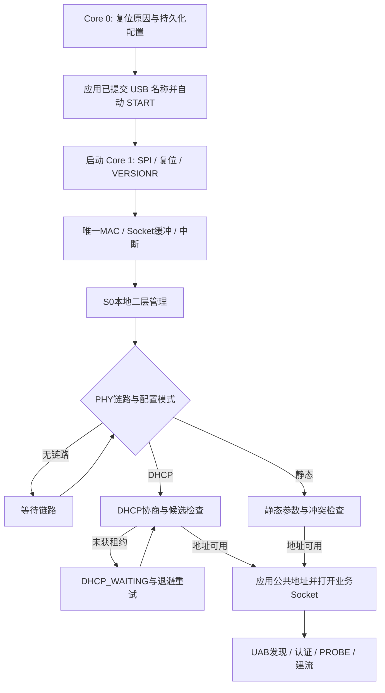

# 单片机以太网开发指南：RP2350 + W5500 硬件 Socket

> 当前实现变更（2026-10-18）：0.4.0-dev 起已移除配对码、配对文件和 AUTH/HMAC 凭据流程。搜索选择设备即可直接连接；旧设计中的配对要求不再适用。设备所有权、序号、boot/revision、网络 challenge 与配置确认/回滚仍保留。以[当前协议](03-通信协议规范.md)及上位机/固件 README 为准。

修订日期：2026-10-18。适用板：W5500-EVB-Pico2。本文保留完整开发规格；当前实现位于 `SoundConvertBoard`，已完成的实板项目与未测边界见 [实施与实机验收记录](09-实施与实机验收记录.md)。下文准备阶段的“未来获取”“本次未执行”描述属于编写规格时的历史背景，不代表当前代码状态。

## 目标与协议边界

以 **WIZnet ioLibrary + W5500 硬件 TCP/UDP** 实现网络。默认 DHCP，同时保留手动静态 IPv4。无 DHCP 时停留在等待/重试状态，不自动生成备用地址。自动发现仅覆盖本地广播域；保留同二层、不同 IPv4 子网的原始帧发现和改址，不开发路由器/VLAN 发现代理。

默认音频参数为 UAC1、48 kHz、16-bit、2ch、单向；`usb.hi_res_enabled` 打开后额外支持 Host 选择 96 kHz、24-bit packed、2ch。网络模块通过有界 PCM 队列接入，每块携带实际 sample_rate/sample_format/generation，不能把配置偏好当成实际格式。调试阶段可使用明确标识的合成数据源验证，不伪装成 USB 已连接。

应用协议沿用 [UAB 通信协议规范](03-通信协议规范.md)，本文件规定硬件映射与调度，不能另造一份不同的包头：

| 通道 | 默认端口/类型 | UAB 数据结构 |
| --- | --- | --- |
| 正常发现 | UDP 49160 | `UABD`，56 B 头 + TLV，应用报文 ≤1024 B |
| 控制 | TCP 49161 | `UABC`，32 B 头 + JSON ≤8192 B + 可选 32 B HMAC |
| 主机声音到 PC | UDP 49162 | `UABA`，48 B 头 + PCM，应用报文 ≤1200 B |
| 可选录音回传 | UDP 49163，首版关闭 | 独立 stream_id，仍为 UABA |
| 本地二层管理 | S0 MACRAW；实验 EtherType `0x88B5` | Ethernet 头后承载同一个 UABD |
| DHCP | UDP 客户端 68、服务器 67 | 标准 DHCP，不包装为 UAB |

头字段大端，PCM 小端；音频端口不接 JSON，控制端口不传音频。DHCP 67/68 是固定标准端口，不跟随用户设置的业务端口变化。

## 硬件与库的边界

W5500 支持 8 个硬件 Socket、16 KiB TX 加 16 KiB RX、IPv4 TCP/UDP 和 SPI；业务程序仍负责 DHCP 客户端及自己的消息协议。[芯片规格](https://docs.wiznet.io/Product/Chip/Ethernet/W5500)

| 工作 | 执行方 |
| --- | --- |
| 音频 UAB 头、采样序号、PCM、认证 | MCU 应用 |
| DHCP 报文、租约计时、静态配置、配置事务 | MCU 网络模块 |
| 正常 IPv4/UDP/TCP 网络头、普通 ARP 与 TCP 状态 | W5500 硬件 |
| 二层管理帧、地址冲突探测所需 ARP | MCU 经 S0 MACRAW |
| SPI 搬运、寄存器与 DMA | MCU HAL + ioLibrary/项目适配 |
| 播放抖动缓冲、ASRC、WASAPI | PC 上位机 |

S0 只处理少量管理/探测，不运行软件 TCP/IP 栈。普通硬件业务收发不经 S0 重新组装 Ethernet/IP 头。MACRAW 的硬件过滤只能减少流量，不能按本项目 EtherType 完成全部筛选，软件仍需及时丢弃无关帧。

## 开发环境与工程接入

使用 VS Code + Raspberry Pi Pico 官方扩展，Pico SDK 的 RP2350 Arm 平台。首次移植用保守 SPI、单核网络验证；通过后再使用 DMA 和双核。详细插件见 [平台文档](01-平台与USB开发.md)。

未来获取网络参考工程的命令如下，本次未执行：

```powershell
git clone --recurse-submodules https://github.com/WIZnet-ioNIC/WIZnet-PICO-C.git
```

检查该版本顶层 CMake，将唯一生效的板型设为 `W5500_EVB_PICO2`。本次读取的上游使用普通 `set(BOARD_NAME ...)`，不能假定 `-DBOARD_NAME=...` 可以覆盖它。该分支选择 RP2350 与 W5500；不要保留其他板型的默认值。[上游 CMake](https://raw.githubusercontent.com/WIZnet-ioNIC/WIZnet-PICO-C/main/CMakeLists.txt)

从 Pico 扩展工具环境配置和构建上游示例：

```powershell
cmake -S . -B build -G Ninja
cmake --build build --target help
cmake --build build
```

先选择实际存在的 DHCP、UDP/TCP loopback 示例，记录 SDK、ioLibrary 和编译器版本。示例通过后，正式模块只纳入必需的 `Ethernet/wizchip_conf`、`Ethernet/socket`、`Ethernet/W5500` 与 `Internet/DHCP` 及板级 HAL；不复制整个 HTTP/MQTT/SSL 示例集合。原有 SDK 中即使附带其他网络库，本项目 target 也不引用其 TCP/IP 实现。

检查映射文件与链接依赖，确认最终没有软件 IP 栈目标、netif/pbuf 或相应内存池。所有对上游的后续适配都记录在独立补丁和版本说明中，避免更新依赖后丢失等待上限或租约修复。

## 板级 HAL

| 管脚 | 连接 | 初始化要点 |
| --- | --- | --- |
| GPIO16 | SPI0 MISO | SPI 输入 |
| GPIO17 | W5500 CSn | GPIO 输出，空闲高电平，低电平选中 |
| GPIO18 | SPI0 SCLK | SPI 时钟 |
| GPIO19 | SPI0 MOSI | SPI 输出 |
| GPIO20 | W5500 RSTn | 低有效复位，遵守手册时序 |
| GPIO21 | W5500 INTn | 低有效中断，不能只依赖边沿而不检查当前电平 |

本板引脚依据 [官方板页](https://docs.wiznet.io/Product/Chip/Ethernet/W5500/w5500-evb-pico2)。SPI Mode 0 起步，模式、时钟、片选持续时间以实测和数据手册为准；GPIO 电平不能按 USB 5 V 处理。

HAL 至少提供初始化、复位、片选、字节读写、连续读写、单调时钟和中断事件。ioLibrary 的 `reg_wizchip_cs_cbfunc`、`reg_wizchip_spi_cbfunc`、`reg_wizchip_spiburst_cbfunc`、必要的临界区回调由此接入；具体声明以锁定头文件为准。[ioLibrary 配置接口](https://raw.githubusercontent.com/Wiznet/ioLibrary_Driver/master/Ethernet/wizchip_conf.h)

SPI 初始化请求 10 MHz，验证后再升到 25/37.5 MHz 等平台可实现值。记录实际返回频率。设置优化等级、burst 大小和 DMA 前后，分别测量寄存器读回与长时间包错误，不把更高时钟默认为更低系统延迟。

### DMA 与并发

标准 burst 回调返回时应已完成传输，ioLibrary 之后可能立即更新指针或释放 CSn。不能将该回调简单改成“启动 DMA 然后返回”。

两种可审查的实现方式：短 SPI 事务内部同步完成 DMA，并对轮询设置上限；或在项目驱动层显式拆成启动/完成阶段，并调整所有依赖该事务的调用者。后一种是接口改造，不是换一个回调即可。

所有 Socket 与全局寄存器操作归网络 owner。USB 核只投递队列；不同时从 IRQ、DHCP 和控制线程调用 W5500 API。不要在关闭中断的临界区里等待同核 DMA 中断通知，否则可能死锁；也不要持有双核共享锁等待 SPI。

## Socket 与芯片缓冲分配

建议初始分配如下，每项单位 KiB，值必须是芯片支持的离散容量。未启用的业务可保持 Socket 关闭并预留内存。

| Socket | 模式/用途 | TX | RX | 端口 |
| --- | --- | ---: | ---: | --- |
| S0 | MACRAW：管理、ARP 探测 | 2 | 2 | 无 |
| S1 | UDP：音频发送/PROBE | 4 | 2 | 49162 |
| S2 | TCP：控制槽 A | 2 | 2 | 49161 |
| S3 | UDP：DHCP | 2 | 2 | 68 |
| S4 | UDP：普通发现 | 2 | 2 | 49160 |
| S5 | UDP：可选回传，首版关闭 | 2 | 4 | 49163 |
| S6 | TCP：控制槽 B | 2 | 2 | 49161 |
| S7 | 关闭、预留 | 0 | 0 | 无 |
| **合计** | 每方向容量上限分别计算 | **16** | **16** | |

S0 的 2 KiB 能容纳常规单个 Ethernet 帧，但在广播拥塞下会迅速占满；必须有过滤、及时排空、限额处理和溢出计数。需要增加 S0 RX 时必须从其他 Socket 调整，总量仍不超过 16 KiB。

S2/S6 可分别监听同一控制端口。某槽从 LISTEN 进入 ESTABLISHED 后由该槽继续处理，另一空闲槽维持监听；最多两个会话，不存在额外 accept 生成的新硬件 Socket。两槽满时不挤占音频/DHCP Socket。关闭后重新打开监听，并验证所锁定驱动与硬件的同端口多连接行为。

W5500 缓冲不是应用消息长度上限：8192 B JSON 可以通过 TCP 分段接收并在 MCU 拼帧，但不能要求 2 KiB TX 一次写入完整控制消息。

## 上电顺序与模块接口



读取 `VERSIONR` 预期为 `0x04`，异常直接进入可诊断硬件故障。MAC 在调用 DHCP_init 前设置，不能依赖示例内的默认地址。开发用 MAC 可从稳定设备 ID 派生本地管理单播地址，并检查重复；恢复出厂保留 device_id/MAC。

建议模块接口按以下职责划分，名称仅为设计约定，不是已创建函数：

| 接口职责 | 输入/输出契约 |
| --- | --- |
| Initialize | 板级参数、持久化配置；输出硬件初始化结果 |
| Poll | 当前单调时间与有限工作预算；每次及时返回 |
| SubmitAudio | PCM 块、格式、首帧索引；结果为 accepted/full/not_ready；不等网络 |
| ApplyNetworkCandidate | 配置事务；由 owner 停流并调整寄存器 |
| QueryStatus / QueryStats | 返回不可变快照，不让读取者直接访问寄存器 |
| Stop | 有期限地停止业务，回收队列；需要时保持二层管理 |

当前 v8 采用上电自运行：Core 0 先加载持久化配置并应用 USB 名称，再执行一次自动 START，最后才启动 Core 1 的网络初始化。USB 枚举不等待 W5500、链路、DHCP 或任何管理认证；已识别的 W5500 初始化故障保持网络 FAULT 并继续网络核心心跳/有界队列回收，不反复重启整机打断 USB。HELLO/AUTH 只建立管理权限。后续 USB_EMULATION_START/STOP 仍通过短命令队列送到 Core 0，网络上下文不直接调用 TinyUSB。v7 首次认证触发启动的验收记录仅作为历史保留。

网络管理中的 Stop/STREAM_STOP 只结束网络流，不等于 USB_EMULATION_STOP。后者最终状态以 USB owner 的清理完成通知为准，网络端在此之前拒绝 USB 参数写入。USB 已停止时仍保留 TCP/发现服务供改名改参；配置提交与 START 互斥，保存完成不自动开始模拟。手动停止后控制重连不得再次触发自动启动；整机重新上电或重启会再次加载配置并自动开始。

错误传播分层：硬件故障、地址未就绪、传输失败和协议错误分别计数。PHY 已连接但 DHCP 等待不应报“USB 声卡故障”。

## DHCP 开发步骤

DHCP 是 MCU 客户端使用硬件 UDP 的服务，不是 W5500 自动完成的启动功能。采用 ioLibrary 接口作为基础：

| 接口 | 用途 |
| --- | --- |
| `DHCP_init(S3, buffer)` | 初始化客户端，使用持久有效且足够大的 DHCP 缓冲 |
| `reg_dhcp_cbfunc` | 注册地址分配、更新、冲突回调 |
| `DHCP_time_handler()` | 按接口要求提供 1 秒节拍 |
| `DHCP_run()` | 在网络执行域推进客户端 |
| `getIPfromDHCP` / `getSNfromDHCP` | 读取候选地址与掩码 |
| `getGWfromDHCP` / `getDNSfromDHCP` | 读取网关与 DNS |
| `getDHCPLeasetime()` | 读取租期，单位秒 |
| `DHCP_stop()` | 切静态、停机或重新初始化前停止客户端 |

接口依据 [dhcp.h](https://raw.githubusercontent.com/Wiznet/ioLibrary_Driver/master/Internet/DHCP/dhcp.h)。DHCP 报文缓冲建议先预留 1 KiB，并按锁定版本的结构体大小、最大接受报文与长度检查确认充足。

### 地址生效契约

1. 上电选择 DHCP 时清除旧有效 IP/网关，启动客户端。只保留“最后看到的地址”用于诊断，不把它当租约。
2. owner 定时调用 DHCP 处理；1 秒计时不能因界面、网络重试或日志而漏走。生产非阻塞实现可由单调时钟补偿经过的整秒。
3. 回调先登记“候选更新”事件，owner 统一校验并应用，避免回调里重入关闭其他 Socket。
4. ACK 后检查地址、掩码、租期和冲突，再设置 `SIPR/SUBR/GAR`，保存 DNS 元信息，打开 S1/S2/S4/S6。
5. 只从回调/实际有效配置判定首次分配；不能依赖枚举中存在 `DHCP_IP_ASSIGN` 就假定每个版本都会按同一路径返回它。
6. 无服务器时进入 DHCP_WAITING，有效 IP 保持 0；一轮失败后建议用带随机扰动的 5/10/20/30 秒上限退避重新尝试，不快速无限发送 DISCOVER。
7. 服务器后来出现，成功后正常开放业务。无有效 IP 时 S0 仍允许发现、识别和已认证的静态配置。

### 租约维护必须验证

独立保存单调的 lease 起点、T1、T2 和 expiry，不与库内部会被重置的重试 tick 共用一个计数。核实所锁定版本是否解析服务器 T1/T2；缺少必要行为时补齐适配，不仅测试第一次获得 IP。[DHCP 标准状态定义](https://www.rfc-editor.org/rfc/rfc2131.html)

同地址/掩码/网关的有效 ACK 只更新租期和元数据，不重置音频；T1 续租、T2 重新绑定时在租约仍有效的前提下继续使用地址。有效 NAK 或 expiry 后立即停业务、撤销地址、增加网络代次并重新获取。无限租期按协议值单独处理。地址变化后重新认证/建流，不复用旧 token。

### ioLibrary 等待行为是移植重点

本次读取的上游 `DHCP_run()` 会调用冲突检查；该检查通过 `sendto()` 探测、临时改全局 RCR，并包含冲突后的秒级循环等待。[dhcp.c](https://raw.githubusercontent.com/Wiznet/ioLibrary_Driver/master/Internet/DHCP/dhcp.c)

因此“DHCP 是状态机”不代表每次调用都立即返回。台架初次获取地址可先跑原版，但与实时音频集成前必须审查/改造这些路径：将等待改为 owner 可推进的状态、为候选检查设置期限、避免运行中临时改变所有 Socket 共享的超时参数。

不能把通用 sendto 改成返回“尚未完成”，却不修改 DHCP 中把返回值当成最终成功/失败的调用者。应保留原同步接口供有限场景使用，另外定义提交/查询完成接口，并逐处适配 DHCP 状态，或完整修改选定模块且测试全部调用点。

## 静态地址与改址事务

`network.mode=static` 时关闭 S3 DHCP，读取用户明确提交的静态 IP/前缀/网关/DNS。前缀支持 `/1`–`/30`，默认 `/24`；拒绝全零、环回、组播、广播、子网网络地址及保留链路本地范围。非零网关须在同子网；不需要访问其他子网时允许网关为 0。

候选地址生效前，经 S0 发送 ARP Probe 并观察冲突，成功后公告；本地地址冲突的探测/防御参考 RFC 5227。这是对候选地址的可用性检查，不产生随机回退地址。[IPv4 地址冲突检测](https://www.rfc-editor.org/rfc/rfc5227.html)

检查时防止硬件以旧/候选 IP 自己应答导致误判：停止业务，明确当前公共寄存器状态，忽略本机 MAC 的帧；同时探测和对方已占用两种冲突都测试。上线后冲突不能只依赖一个中断位而忽略状态恢复。

上位机改址沿用 PREPARE → APPLY → CONFIRM/ROLLBACK：

- APPLY 前保留最后提交配置，发送影响提示并停止当前音频流。
- 临时应用静态候选时做冲突检查；切 DHCP 时重新获取地址。S0 管理保持可用。
- 静态默认确认窗 30 秒、DHCP 120 秒。只有目标模式获得有效地址且确认来自认证通道，才进入持久化。
- DHCP 仍等待时可查询/取消事务，但不能用 L2 确认把“没有租约”标为测试成功。
- 超时、冲突或保存失败恢复旧模式。旧模式为 DHCP 且网络没有服务器时，回滚结果为 DHCP_WAITING，并如实报告。
- 改 IP、掩码或网关前关闭 S1/S2/S4/S5/S6，处理 S3 状态，再更新公共寄存器；不要在旧 TCP 连接运行时直接改全局 IP。
- 原静态设置可在 DHCP 模式下保留作为编辑草稿，但绝不自动作为获取失败的回退。

## UDP 音频发送状态机

硬件 Socket 的操作顺序为：检查空间 → 写 TX 缓冲 → 提交指针 → SEND → 观察完成/超时。每次处理一步或有限次工作，不在 USB 回调中循环到完成。

| 状态 | 行为与离开条件 |
| --- | --- |
| Idle | 只接受有效地址、已准备的 stream、完成 PROBE 的目标 |
| Queued | 检查包龄；过期直接丢弃，保留序号/采样索引间隙 |
| WaitSpace | 读取稳定的 `Sn_TX_FSR`；不足时返回主循环，超过包期限则丢弃 |
| Transfer | burst/DMA 写完整 48 B UAB 头和 PCM；DMA 完成前不复用缓冲 |
| IssueSend | 更新 TX 写指针，清理已消费的旧发送事件，再下发 SEND |
| WaitComplete | 在后续循环读取 SENDOK/TIMEOUT/Socket 状态；不忙等 |
| Recover | 失败计数，必要时关闭并重开 S1、废弃旧流状态、重新 PROBE |

`Sn_TX_FSR` 等硬件变化中的 16-bit 寄存器应按手册/锁定驱动的稳定读取方式访问。TX/RX 环形指针回绕和内存容量由驱动处理，不以普通线性地址越界写入。

当前默认 1 ms 包：兼容档 48 帧、192 B PCM + 48 B UAB = 240 B；高规格档 96 帧、576 B PCM + 48 B UAB = 624 B。网络按真实 USB block 格式编码，1 ms 节奏不变；当前不提供 2 ms 聚合档。发送长度必须完整，若库因 TX 容量截断长度必须当错误处理，不能把一半音频当成合法 datagram。稳态排队期限可从约 4 ms 起测试，持续失败时退出流；不要反复发送已超过播放期限的积压。

ARP 可达性准备使用较长但有界的初始化期限；不能在尚未完成 ARP 时每 4 ms 重开 Socket 使解析永远无法完成。达到 STREAM_START 后再按音频包期限运行；途中失去可达性则回到准备阶段。

默认 SEND 让硬件处理 ARP；不为追求延迟直接启用永久固定 MAC。若以后用 SEND_MAC，应另行设计邻居更新、网关 MAC 与失效恢复。全局 RTR/RCR 的调整影响 TCP 和其他 Socket，不能为 S1 的音频期限随意修改；软件期限与芯片重试参数分开。

`SENDOK` 不是 PC 播放确认。传输成功计数、接收统计和实际播放欠载分开报告。官方 Socket 实现的等待路径及命令语义应结合 [socket.c](https://raw.githubusercontent.com/Wiznet/ioLibrary_Driver/master/Ethernet/socket.c) 和 [W5500 数据手册](https://docs.wiznet.io/img/products/w5500/W5500_ds_v110e.pdf) 核对。

## UDP 接收与 TCP 控制

硬件 UDP 收包含芯片的 8 B 接收元信息（源 IPv4、端口、数据长度），它不是 UAB 包头。驱动剥离后，才按 UABD/UABA 解析。拒绝超限包时仍需正确消费该 datagram 或重置对应接收状态，不能把剩余字节当下一包头。

S4 只处理发现；S1 只处理该流的 PROBE 等协商允许报文；S5 首版关闭。校验魔数、版本、实际长度、来源、stream_id、epoch、token，全部通过才触发行为。任何未知包不能让 PC 目标地址被改写。

TCP 为字节流：每槽保留接收状态，先 32 B 头，再 body/tag；拆包、粘包和分段应答都必须支持。单个控制帧最大 8256 B，独立于芯片 2 KiB RX。超限、未认证超时、持续不读响应的慢客户端应有限关闭，不能占住公共发送缓冲或管理权限。

发送控制应答按有限块（如最多 512 B/轮）推进，处理部分写入并记录偏移。S2/S6 共享命令执行层；认证状态、收发 sequence 和 framing 状态分别保存，最多一个配置写入所有者。

## 本地二层发现

S0 打开 MACRAW，启用合适的 MAC 过滤、允许广播，按需求阻挡无用多播/IPv6。先剥离芯片 MACRAW 长度信息，再读取标准 Ethernet 头：

- EtherType `0x88B5`：检查 UABD，再进入发现/配置状态机。
- ARP：仅交地址管理所需的冲突观察；避免与硬件普通 ARP 重复应答。
- 其他帧：快速消费并丢弃，不进入另一个 TCP/IP 栈。

以太网长度、FCS 和 padding 的处理以所用驱动约定为准，应用按 UABD.total_bytes 取正文，不猜测包尾。PC 多 NIC 的源 MAC/接口信息随发现结果保存。

无有效 IP 时 INFO 的 current IPv4=0、address source=none，附 `DHCP_WAITING` 等网络状态；已配对上位机可在相同广播域切换为静态地址。写入仍需 challenge/HMAC、boot_id、device_id 和 revision，不能因为“本地二层”就免认证。

广播搜索应答加入 0–250 ms 随机延迟，并按请求源 MAC 单播；不能在处理函数里 sleep。限流、延时队列和去重均有上限。未知 EtherType、畸形 TLV、重放写请求必须在有界工作量内拒绝。

## 调度与内存

每轮建议按紧急硬件/地址事件、到期音频、有限 RX、DHCP/控制步骤、统计的顺序推进；所有类有配额，不能音频无限占优导致续租饿死。单次 Poll 最长时间、每轮处理包数、SPI DMA 最长时间都纳入统计。

可以从“每次网络 Poll 目标数百微秒、稳态音频期限约 4 ms、统计 1 秒”开始测量，这些是目标而非当前性能结论。大 TCP 请求、恶意广播和 DHCP 续租压力下都要测最坏值。

初始 MCU 网络资源建议：DHCP 1 KiB、两块 MTU 级 RX 暂存、两块 ≤1200 B 音频发送暂存、Socket 状态与小型队列，总网络专用预算约 16 KiB；控制拼帧/事务另计。禁止逐包 malloc。

控制层可规划两个各 8256 B 的 RX 区、一个共享 8256 B TX 工作区、有界 JSON 解析、写事务摘要缓存及配置存储。幂等缓存只保存有副作用请求的有限结果，不能缓存 32 份任意 8 KiB 响应后仍声称只占少量内存。缓冲上限、分配失败和高水位应可见。

## 可独立实施的验证顺序

| 步骤 | 验证对象 | 完成标准 |
| --- | --- | --- |
| N0 | SPI/复位/PHY | VERSIONR 正确，反复复位、不同 SPI 速率无异常 |
| N1 | 静态 IP UDP/TCP loopback | 有效单播收发、包边界、TCP 分段正确 |
| N2 | DHCP | 初次租约、重试、同址续租、NAK、到期、服务器后来上线 |
| N3 | UAB 发现与控制 | 56/32 B 头互通、认证、能力查询、两控制槽 |
| N4 | 合成 PCM UDP | 48 B 音频头、sample_index、sequence、PROBE、每秒约1000包 |
| N5 | S0 管理 | 有/无有效 IP、同二层异子网发现和认证改址 |
| N6 | 地址事务 | 静态冲突、DHCP申请失败、超时回滚、掉电恢复 |
| N7 | 接入 TinyUSB | 网络不可达时 USB 仍及时服务，音频端到端正确 |
| N8 | 稳定性 | 广播/控制/续租/拔网线压力下队列有界、恢复可重复 |

合成 PCM 模式只用于标明测试身份的台架固件，不把输入来源误报成真实 USB。正式固件的 STREAM_PREPARE 在没有 USB 数据源时仍按协议返回 WAITING_USB。

台架至少包含：有 DHCP 的交换网络、禁用 DHCP 的网络、两个静态子网但同一二层的有线接口，以及可以占用候选静态 IP 的测试设备。关闭 DHCP 或制造地址冲突只在专用实验网络进行。

## 关键验收与诊断

| 故障/场景 | 预期与证据 |
| --- | --- |
| 没有 DHCP | 不出现自动备用地址；S0 返回等待状态，重试有限速 |
| 无 DHCP 切静态 | 已认证改址后可连接；若未确认按期回滚 |
| 相同租约续租 | 不关闭 S1/S2/S4/S6，音频不中断；记录真实参数比较 |
| NAK/到期/换子网 | 停业务、清旧地址、废弃旧流、重新获取 |
| 静态地址冲突 | 拒绝使用候选，仍能二层找到设备 |
| 正常数据 | 兼容档 240 B / 高规格档 624 B UDP 应用包，网络头由芯片生成，格式以 Host 实际选择为准 |
| ARP 无应答/拔线 | 等待有上限，USB不被sendto拖住，不补发旧音频 |
| S0 广播压力 | 无关帧及时丢弃；S1音频、DHCP和控制仍得到调度 |
| 控制响应大于芯片TX容量 | 分段发完，不截断 JSON，不阻塞音频 |
| 非法UDP长度/残包 | 丢弃完整datagram后能正常处理下一包 |
| MACRAW和业务并存 | 无重复ARP/数据解释，芯片缓冲分配总量正确 |
| 二层驱动缺失 | IP正常功能可用；上位机清楚标明二层不可用 |

统计至少包括每 Socket RX/TX、SEND_TIMEOUT、RX invalid length、SPI/DMA timeout、S0丢弃/限流、DHCP attempt/state/lease剩余、地址冲突、network_generation、PCM丢弃/最大包龄和 Poll 最大耗时。

保存固件/库提交号、实际 SPI 频率、内存 map/高水位、Wireshark 抓包及测试时长。编译成功、loopback通过与真实 USB 多主机音频验收分开记录。

## 与其他 MCU 的移植边界

换成 STM32、其他 Arm MCU 等平台时，保留 UAB、地址与 Socket 状态机，替换 SPI/CS/复位/时钟/DMA/中断 HAL。单核平台用短 ISR 和有界轮询，RTOS 平台使用单个网络任务拥有芯片；不因换平台而让多个任务直接抢 ioLibrary。

引脚、电压、SPI上限、cache/DMA一致性和编译器原子实现必须按目标 MCU 复核。本板的双核与管脚结论不能原样套给其他单片机。
