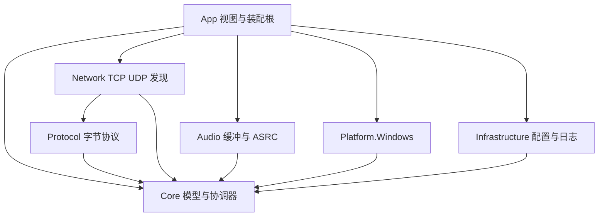
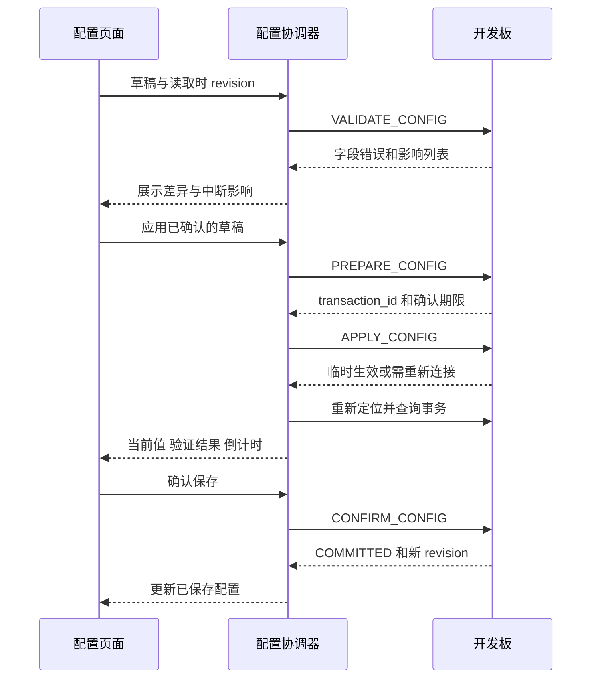

# USB Audio Bridge 上位机开发指南

> 当前实现变更（2026-10-18）：0.4.0-dev 起已移除配对码、配对文件和 AUTH/HMAC 凭据流程。搜索选择设备即可直接连接；旧设计中的配对要求不再适用。设备所有权、序号、boot/revision、网络 challenge 与配置确认/回滚仍保留。以[当前协议](03-通信协议规范.md)及上位机/固件 README 为准。

修订日期：2026-10-18。技术方案：Avalonia 12 + .NET 10。首发平台：Windows 11 x64。当前 UI 参考工程：`D:\GithubClone\ControllerForwardingTool`（MIT）；早期 CommunicationTool 方案仅作为设计历史。

本文是独立的上位机实施规格，覆盖工程划分、通信接入、实时播放、页面交互、配置持久化、托盘生命周期、部署和验收。软件接收 W5500-EVB-Pico2 转发的 USB PCM，在电脑现有声卡上播放，并管理开发板。当前采用 UAC1、双声道、单向监听：兼容档为 16-bit / 48 kHz，开启高规格配置后额外声明 packed 24-bit / 96 kHz。实际流格式由 USB Host 选择，上位机按板端实际格式协商接收；不再把当前实现描述为固定 16/48。网络默认 DHCP，允许用户主动设置静态 IPv4。

状态：完整设计规格保留，当前工程已实现于 `SoundConvertClient`，实际目录与下文计划结构有所不同。桌面、音频和硬件的逐项结果见 [实施与实机验收记录](09-实施与实机验收记录.md)，不能把本指南全部条目视为已验收。协议线上字段以 [UAB 通信协议规范](03-通信协议规范.md) 为基线；当前实现的补充字段与限制见工程 README 和验收记录。

## 当前已实现界面与操作入口

实际工程是 [`SoundConvertClient`](../SoundConvertClient/README.md)。当前界面已按 Controller Forwarding Tool 源码和用户截图重绘：216/72 DIP 展开/收起侧栏、64 DIP 顶栏、浅灰工作区、白色卡片、相同字体与按钮状态；不再使用大标签 TabControl 作为主导航。页面为概览、开发板连接、声音、USB 声卡、网络、日志、更新日志、设置、关于。

以下操作描述当前实现；后文保留的分层、测试矩阵和交付要求是工程规格，不表示每项设计目标都已验收。当前视图、行为与依赖以源码和[工程说明](../SoundConvertClient/README.md)为准。

### 从主页连接并开始监听

1. 在“概览”点击“快速搜索开发板”，到“开发板连接”页选择发现路径；也可以输入可达 IPv4、接收网卡地址与控制端口。
2. 首次输入本板配对码或选择配对文件。认证成功后记录永久设备 ID、地址和路径，配对秘密使用当前用户 DPAPI 独立保存。
3. 已记住的开发板可在主页“一键连接”。若 DHCP 地址变化导致旧地址不可达，重新搜索并选择新路径，不修改电脑网卡地址。
4. **取得管理权限后**，程序确认可用的电脑输出，播放本地生成的原创中文女声连接提示，然后自动建立监听。自动恢复不反复播报；提示可在“设置”中关闭。
5. 观察会话只读，不播放“已接管”式提示、不启动监听，也不抢占现有管理者。连接已认证、监听已建立和正在接收音频分别显示。

电脑输出会排除当前开发板自己的 USB 渲染端点，避免回授；没有安全的耳机/扬声器输出时保持已连接并提示选择，不把音频送回开发板。GUI 初始化脱离控制台，CLI 诊断分支仍保留控制台输出。

### 声音页：Host 音量优先，本地增益独立

- 主音量区域显示真实 USB Host 控制状态。板端依据 `usb_control.master_volume_db`、`master_mute` 和 `revision` 报告读数；来源不是 PC 监听增益。
- 当这块板的 USB Host 就是当前 Windows 电脑时，`HostVolumeBridge` 通过 USB 序列号和实际 PnP 父级确认端点，再使用该端点的 Windows 音量/静音接口，让 Host 发出真实 UAC 控制。百分比来自对应端点，不把 dB 随意换算成另一种“系统音量”。
- Host 是 NS、手机或另一台电脑时，只展示板端读回的 dB/静音，并提示在 Host 上调整；不伪造远端百分比，不写普通电脑扬声器的系统音量。
- “高级：本地监听增益与诊断”中的增益、静音只影响本机播放，默认 100% 保持输入幅值，与 Host 音量分开。
- “正在监听”要求 Host streaming/format_selected、当前接收流 RUNNING、无恢复/故障且最近有效包龄不超过 250 ms。alt 0、停播或旧累计包数不能让状态永久保持活跃；会显示“监听已建立，等待 USB 主机播放”。

### 开放 24-bit / 96 kHz

1. 在“USB 声卡”页点击“停止模拟”，等真实状态变成 STOPPED，配置区解锁。
2. 打开“高规格模式：开放 24-bit / 96 kHz”，按需修改声卡名称，点击“校验并保存 USB 配置”。配置字段为 `usb.hi_res_enabled`，通过 VALIDATE/PREPARE/APPLY/CONFIRM 和 revision 校验提交。
3. 保存后仍保持停止。点击“开始模拟”（或整机重启）重新枚举，再由 USB Host 选择所需格式。
4. 分别检查“设备已声明格式”和“Host 当前选择”：前者来自 `GET_CONFIG.usb.declared_formats`/能力，后者来自 `GET_INFO.usb.format_selected`、`alternate_setting` 和 `format`。声明两档不表示正在播放 96 kHz；alt 0 会明确显示尚未选择。
5. 关闭高规格后只声明兼容 16/48；开启后同时保留 16/48 和 24/96。当前不扩展到 UAC2、录音或任意格式笛卡尔积。

在本机曾验证 Windows 端点链路经过 Intel USB 智音/Intel SST 处理，Windows API 请求 96 kHz 后 USB 线上仍可能被转换为 48 kHz。只有实际拓扑/驱动证据匹配时才归因于该链路，不将此结论泛化到所有 Intel 或 USB 声卡。若开启高规格后仍显示 48 kHz，检查 Host 的格式选择、音效和驱动处理链路，并以开发板实际 alt/格式与 UABA 数据为准；修改或临时禁用驱动是另外的显式维护操作，应用不会自动执行。

### 布局、截图与 QA

- [界面 QA 报告](../SoundConvertClient/design-qa.md)：参考图、归一方法、已修复项、原生 GUI 过程与剩余验证范围。
- [概览](../SoundConvertClient/artifacts/ui-redesign/00-概览.png)、[开发板连接](../SoundConvertClient/artifacts/ui-redesign/01-开发板连接.png)、[声音](../SoundConvertClient/artifacts/ui-redesign/02-声音.png)、[USB 声卡](../SoundConvertClient/artifacts/ui-redesign/03-USB%20声卡.png)。
- [网络](../SoundConvertClient/artifacts/ui-redesign/04-网络.png)、[日志](../SoundConvertClient/artifacts/ui-redesign/05-日志.png)、[设置](../SoundConvertClient/artifacts/ui-redesign/06-设置.png)、[关于](../SoundConvertClient/artifacts/ui-redesign/07-关于.png)。
- [收起导航](../SoundConvertClient/artifacts/ui-redesign/10-collapsed.png)、[小窗口声音页](../SoundConvertClient/artifacts/ui-redesign/11-small-audio.png)、[停播状态回归](../SoundConvertClient/artifacts/ui-redesign/13-idle-after-audio-page.png)。
- [MIT 来源与署名](../SoundConvertClient/THIRD_PARTY_UI_NOTICES.md)。截图为本地原生渲染与明确标记的离线状态；不能用离线图代替硬件音频验收。

## 阅读入口与范围

| 开发任务 | 优先阅读 |
| --- | --- |
| 创建工程与分配职责 | 技术栈与依赖、解决方案结构、模型与服务契约 |
| 对接开发板 | 通信协议接入、设备发现与连接、配置事务、协议联调前需冻结的细节 |
| 实现实时播放 | 音频数据路径、线程与内存、播放状态机 |
| 实现 Avalonia 界面 | ControllerForwardingTool 视觉规范、主窗口与导航、各页面规格 |
| 完成产品行为 | 本地设置、托盘与生命周期、日志与诊断、发布与升级 |
| 制定开发任务和验收 | 分阶段实施、测试矩阵、首版交付清单 |

### 首版必须完成

- 本地广播域设备搜索、手动 IPv4 连接、多网卡路径选择和按永久身份去重。
- 配对认证、能力查询、控制会话、单写入所有权和单音频订阅者约束。
- UDP PCM 接收、有限乱序、丢包补静音、ASRC 时钟补偿和 WASAPI 共享输出。
- 开始、停止、静音、本地监听音量、输出设备选择、状态和统计。
- 能力驱动的声卡配置，以及 DHCP/静态地址的试用、确认、回滚。
- 同二层异网段发现与改址；依赖可选 Npcap 后端，未安装时明确提示功能不可用。
- 软件设置、日志、诊断导出、系统托盘、用户登录自启、单实例和有序退出。
- 可重复的离线验证、协议互通、真实 Windows 桌面和实机长时间播放验收。

### 后续独立扩展

UAC2 切换、麦克风回传、虚拟录音设备、多个 PC 同时订阅、多流混音、OTA、跨平台音频后端和跨路由器/VLAN 自动发现不属于首版。首版不创建 Windows Service，不编写内核声卡驱动，不把录音或采集电脑系统声音默认打开。

### 设计依据与优先级

| 依据 | 上位机必须遵守的内容 |
| --- | --- |
| [总览](README.md) | UAC1 首版、DHCP/静态、同二层发现、Windows 首发 |
| [平台与 USB](01-平台与USB开发.md) | USB Full-Speed 和合法声卡档约束；USB 主机决定实际流格式 |
| [固件与网络层](02-固件与网络层.md) | W5500 硬件 Socket、无租约等待、网络变化使会话失效 |
| [通信协议](03-通信协议规范.md) | 端口、字节序、身份、认证、消息、音频头和事务规则 |
| [上位机与 UI 概览](04-上位机与UI设计.md) | C# 首版、WASAPI/ASRC、产品范围和生命周期原则 |
| [整体验收](05-开发阶段与验收.md) | 主机兼容、延迟测量、24 小时稳定性和真实桌面验收 |
| [单片机以太网](06-单片机以太网开发指南.md) | 板端 Socket/队列边界、DHCP 和二层恢复能力 |
| [USB 声卡开发指南](08-USB声卡开发指南.md) | USB 消费时基、音量处理、内部 generation 与线上 epoch 的交接 |
| ControllerForwardingTool 当前源码及用户截图 | 当前界面壳、颜色/字体/按钮、页面节奏和图标；保留 MIT 声明 |

协议布局发生冲突时以文档 03 为准，网络行为以本轮统一的 DHCP/静态方案为准。本项目不提供 LLA/AutoIP 自动回退，不修改 PC 网卡地址，不将“发现了设备”解释为“可以播放声音”。

## 技术栈与依赖

### 技术决策

| 项目 | 首版选择 | 实施约束 |
| --- | --- | --- |
| SDK | .NET 10 SDK | `global.json` 固定经过 CI 验证的完整 SDK 版本；仅允许选定策略内滚动 |
| UI | Avalonia 12、FluentTheme、自有 Workspace 样式 | 沿用 ControllerForwardingTool 的浅色桌面工作区，不引入另一套主题框架 |
| MVVM | 当前实现为 INotifyPropertyChanged + UiCommand | 强类型编译绑定；共享 MainViewModel 按职责拆为 partial 文件，服务不引用 ViewModel |
| 主程序 TFM | `net10.0-windows` | Windows 平台功能集中封装；首发 RID `win-x64` |
| 通用库 TFM | `net10.0` | Core、Protocol、Network、Audio 不引用 Avalonia 或 Windows COM |
| JSON | System.Text.Json | 明确字段名、深度、整数字符串转换、重复 key 校验和未知字段策略 |
| TCP/UDP | System.Net.Sockets | 有界读写、取消与超时；音频不走 HTTP/WebSocket |
| 输出 | WASAPI 共享、事件驱动 | `IAudioClient3` 能力探测；失败时使用已验证的共享后端降级 |
| 音频封装 | 优先评估 NAudio；缺少所需 API 时补薄 COM 适配 | 必须验证实际版本能否查询/选择周期，不以 latency 参数代替实测 |
| ASRC | 可连续变比率的重采样实现 | 保留跨块状态、限制 ppm/变化率；正式算法在音频里程碑冻结 |
| 二层恢复 | Npcap 的独立 Windows 适配器 | 按需加载；正常 TCP/UDP 收听不依赖 Npcap |
| 日志 | 当前实现为结构化 JSONL + 有界 UI 列表 | 最近 200 条界面记录；磁盘日志轮转，诊断不导出秘密或音频 |
| 秘密存储 | Windows 用户级 DPAPI | 独立秘密文件；普通 JSON 只保存引用 |
| 测试 | 选定稳定测试框架 + 离线模拟器 | 协议/音频纯托管测试与 Windows 实机测试分开 |

本项目当前锁定 Avalonia `12.1.1` 与 .NET SDK `10.0.401`，构建使用实际 `Directory.Packages.props`/锁文件。ControllerForwardingTool 的视觉源码可复用，但不照搬其版本、依赖或业务模块；当前 UI 使用本项目的 INotifyPropertyChanged/UiCommand。Avalonia 12 与 .NET 10 的平台说明见官方发布说明。[Avalonia 12 官方发布说明](https://avaloniaui.net/blog/avalonia-12/)

`Avalonia`、`Avalonia.Desktop`、`Avalonia.Themes.Fluent`、`Avalonia.Fonts.Inter` 应对齐同一 12.x 版本；控件、诊断和测试扩展也须确认支持该版本，不能让传递依赖混入 11.x。优先使用编译绑定，并为 View 和 DataTemplate 设置 `x:DataType`；局部反射绑定必须说明必要性。[Avalonia 数据绑定](https://docs.avaloniaui.net/docs/data-binding/introduction-to-data-binding)

### 依赖管理规则

建立 `Directory.Packages.props` 集中管理 NuGet；提交锁文件，CI 使用锁定还原。SDK、Avalonia、音频封装、重采样器和 Npcap 适配均记录版本、许可证、上游链接和验证结果。不要复制 CommunicationTool 的所有 ProjectReference；串口、Ping、转发和原生抓包引擎不是本产品依赖。

SDK 固定版本和 `rollForward` 一并评审，避免开发机自动跳到下一大版本。开发用 SDK 与用户机器运行时是不同要求；自包含发布后仍须验证系统原生依赖。[Microsoft SDK 版本选择](https://learn.microsoft.com/en-us/dotnet/core/versions/selection)

NAudio 是 WASAPI 等 Windows 音频 API 的候选封装；具体共享周期、事件线程、关闭唤醒和端点切换能力需要针对选定版本验证。[NAudio 官方仓库](https://github.com/naudio/NAudio)

## 解决方案结构

当前代码在 `SoundConvertClient/App`、`Core`、`Checks`，固件在 `SoundConvertBoard`。以下 `host` 树保留为原始长期分层规划，不是构建命令应使用的路径，也不表示各库已按该树拆分：

```text
host/
├─ UsbAudioBridge.slnx
├─ global.json
├─ Directory.Build.props
├─ Directory.Packages.props
├─ src/
│  ├─ UsbAudioBridge.App/
│  │  ├─ App.axaml / App.axaml.cs / Program.cs
│  │  ├─ Composition/          服务装配与应用生命周期
│  │  ├─ Models/               只用于展示的模型
│  │  ├─ ViewModels/            页面、导航、对话框
│  │  ├─ Views/                MainWindow 与各页面
│  │  ├─ Controls/             IPv4、状态条、音量和电平等控件
│  │  ├─ Styles/Workspace.axaml
│  │  └─ Assets/               产品图标和发布资源
│  ├─ UsbAudioBridge.Core/      领域模型、会话协调、平台抽象
│  ├─ UsbAudioBridge.Protocol/  编解码、DTO、认证、错误映射
│  ├─ UsbAudioBridge.Network/   UDP/TCP、发现、请求关联
│  ├─ UsbAudioBridge.Audio/     时间轴、缓冲、PCM、ASRC、统计
│  ├─ UsbAudioBridge.Platform.Windows/
│  │  ├─ Audio/                WASAPI 和端点通知
│  │  ├─ Discovery/            Npcap 二层适配
│  │  ├─ Security/             DPAPI
│  │  └─ Shell/                单实例、Startup、系统事件
│  └─ UsbAudioBridge.Infrastructure/
│     ├─ Settings/             JSON、迁移、导入导出
│     └─ Logging/              JSONL、缓存、诊断包
├─ tests/
│  ├─ UsbAudioBridge.Protocol.Tests/
│  ├─ UsbAudioBridge.Audio.Tests/
│  ├─ UsbAudioBridge.Core.Tests/
│  ├─ UsbAudioBridge.App.Tests/
│  └─ UsbAudioBridge.Windows.Tests/
├─ tools/UsbAudioBridge.Simulator/
├─ testdata/                   协议向量、PCM、小型异常序列
├─ packaging/                  发布和安装器脚本
└─ artifacts/                  本地构建、报告，默认不入库
```

### 引用方向



Core 定义平台和传输抽象，协调器通过接口工作；App 在启动时注册具体实现。Protocol 不打开 Socket，Audio 不访问 UI，Network 不持有 WASAPI，Windows 适配器不引用 App。启动装配完成后不得从页面直接 `new Socket`、打开音频端点或读取秘密文件。

只有测量证明托管停顿、DSP 热点或封装限制妨碍目标时，再增加 `UsbAudioBridge.Native`。原生边界使用版本化 C ABI、SafeHandle 和明确释放流程，接口只覆盖创建、配置、启动、停止、统计和销毁，不按每包回调 UI。

## 模型与服务契约

### 核心模型

| 模型 | 最少内容 | 规则 |
| --- | --- | --- |
| `DeviceIdentity` | device_id、model、alias、MAC | 永久 ID 是主键；别名/IP/MAC 不能替代它 |
| `DiscoveryPath` | NIC 稳定 ID、当前 index、本地 IPv4、UDP/L2、设备地址、最后发现时间 | 同设备可有多条路径，选中路径显式保存 |
| `DeviceSnapshot` | identity、boot_id、network_generation、USB/网络状态、读取时间 | 不可变快照，过期显示时间；无租约 IP 为 0.0.0.0 |
| `DeviceCapabilities` | 协议范围、合法格式组合、功能标志、字段范围 | UI 选项与校验的共同来源 |
| `DeviceConfigSnapshot` | schema、revision、已提交值、待应用事务 | 与本地编辑草稿分离 |
| `AudioFormat` | rate、channels、sample_format、channel_layout | 验证整个组合；计算字节数用 checked |
| `StreamDescriptor` | boot、stream_id、epoch、token、源/目标端点、格式 | 建流成功后不可随 UDP 包自动改写 |
| `PlaybackSnapshot` | 状态、端点、实际周期、水位、计数、漂移 | UI 只读，统计基于同一个会话代次 |
| `OperationResult` | code、字段错误、operation_id、transaction_id、阶段 | 将已接受、临时生效、已提交和结果未知区分 |
| `SettingsDraft` | 已保存值、编辑值、dirty paths、校验错误 | 保存失败保留编辑内容及旧的有效配置 |

`device_id` 建议封装为固定 16 字节/32 位小写十六进制值；不要直接用默认 `Guid.ToByteArray()` 充当网络字节序。`boot_id`、revision、message_seq 等 uint64 在 JSON 内用十进制字符串，内部用 `ulong`；UI 展示层不转成 double。

### 服务职责和生命周期

| 服务 | 关键职责 | 生命周期 |
| --- | --- | --- |
| `DeviceCatalog` | 合并发现结果、管理本地收藏和路径 | 应用级 |
| `IDiscoveryService` | 搜索、取消、能力状态、分 NIC 结果 | 应用级，搜索任务按轮次创建 |
| `IControlSession` | 握手、认证、请求/事件关联、关闭 | 每个连接一实例 |
| `DeviceSessionCoordinator` | 当前设备、所有权、连接重试、状态刷新 | 应用级，首版一条活动管理会话 |
| `IAudioDatagramReceiver` | 最终 UDP Socket、PROBE、校验与缓冲所有权 | 每次流一实例 |
| `PlaybackCoordinator` | 串行处理开始/停止/切换/重同步 | 应用级，不随页面销毁 |
| `IAudioOutput` | 枚举/打开端点、事件输出、设备变化、释放 | 一条活动输出流 |
| `IAdaptiveResampler` | 连续变比率和滤波状态 | 每个音频格式代次 |
| `ConfigurationCoordinator` | 校验、准备、应用、确认、回滚、未知结果恢复 | 每设备至多一笔事务 |
| `ISettingsStore<T>` | 读取、迁移、原子保存、备份 | 应用级，写入串行 |
| `IPairingStore` | 用户级秘密读取/删除 | 应用级，仅认证服务可取秘密 |
| `ApplicationLifetimeCoordinator` | 启动、托盘、睡眠/恢复、有序退出 | 应用级 |

异步服务方法接收 `CancellationToken`，输出结构化结果。业务拒绝用结果码，非预期 I/O/平台异常在服务边界转为带上下文的错误。取消本地等待不表示板端写入已取消；超时后的事务必须查询。

### 事件和并发约束

设备会话和播放协调器各有一条串行命令通道；开始、停止、切设备和改输出不并发执行。UI 禁用重复操作只是反馈，服务本身仍必须防止重入。

每次连接/流重建递增本地 `SessionGeneration`。后台完成回调、统计和接收块均关联此代次，旧代次结果不得覆盖新状态。只有协调器可以提交状态变化；多个工作线程不得分别给界面写“已连接”“播放中”。

状态快照通过有界、可合并的通知发布给 UI。高频水位只保留最新值；故障和事务结果按事件记录，不能因统计合并而丢失。所有 Avalonia 集合及绑定属性在 UI Dispatcher 更新。

## 连接与播放状态机

### 分开表示三种状态

| 维度 | 状态示例 | 用途 |
| --- | --- | --- |
| 连接 | Offline、Discovered、Connecting、Authenticating、Ready、Observer、Reconnecting、Faulted | 描述 IP 控制与权限 |
| 播放 | Stopped、Preparing、WaitingUsb、Probing、Buffering、Playing、Rebuffering、OutputUnavailable、Stopping、Faulted | 描述音频端到端准备过程 |
| 配置 | Idle、Validating、Prepared、Applying、AwaitingConfirm、Committing、Committed、RollingBack、Unknown、Failed | 描述一笔写事务 |

这些是本地状态名，不增加协议枚举。例如板端 `DHCP_WAITING` 是设备网络状态，应显示在设备快照中，不能替代连接维度的 `Discovered`。

### 开始监听

1. 校验用户选中的设备、发现路径、输出策略和格式能力。未配对时引导配对；观察会话或 `BUSY_OWNER` 不开始。
2. 绑定所选 NIC 对应的本地 IPv4 和最终 UDP 接收端口。默认 49162；端口占用时显示具体冲突，用户选择替代端口后参与协商。
3. 枚举目标输出端点，准备输出格式与可用周期。端点不可用时在启流前失败，不让板端持续发无消费者的声音。
4. 发送 `STREAM_PREPARE`，验证实际格式、端口、stream_id、epoch、token、包长和缓冲限制。
5. `WAITING_USB` 进入等待状态；停止按钮可取消。USB 就绪后的继续方式按冻结后的协议执行，不假定失败响应中一定带有效流标识。
6. 从最终接收 Socket 发 PROBE，核对返回的源 IP/端口、stream_id、epoch、token 和 PROBE 字段；探测失败不能显示正在播放。
7. 发送 `STREAM_START`，仅接收当前会话数据，预填充目标水位后启动声音输出并短淡入。
8. 每秒续订流所有权，订阅不快于 500 ms 的统计；UI 默认每秒刷新综合状态，电平 25 Hz。

当前 1 ms 包在 48 kHz 时为 48 帧，在 96 kHz 时为 96 帧；接收端按实际格式准备流。其他 packet_frames 仅在能力允许且头加载荷不超过 1200 B 时使用，不能把 48 kHz 的包时长设置不加校验地套到 96 kHz/24-bit。协议返回值需再次核对。

启动任一步失败均反向释放已获得的资源，必要时发送幂等 `STREAM_STOP`。不得因第二次点击开始留下第二个 Socket、输出线程或 keepalive 定时器。

### 播放期间的变化

| 触发 | 必须执行的处理 | 用户可见结果 |
| --- | --- | --- |
| 连续 50 ms 无有效音频 | 进入失流静音，停止消费旧时间轴，恢复后重新预填充 | “等待音频恢复”，增加失流计数 |
| 短缺包但未失流 | 到播放期限补零/短淡化，继续推进采样时间轴 | 分别统计缺失帧与欠载 |
| USB reset、格式变化或未知时长中断 | 停止旧代次，释放旧格式状态，按协商建立新流/epoch | “USB 状态变化，正在重新准备” |
| TCP 断开 | 进入恢复窗，重新认证并核对状态；不盲用旧 token | “控制连接恢复中” |
| 2 秒控制恢复窗未恢复 | 停止本地监听并释放旧资源；后续普通重连可继续 | “连接已中断” |
| boot_id 改变 | 撤销全部旧请求、challenge、事务缓存和流描述 | “设备已重启” |
| network_generation 改变 | 停旧流，重新定位地址/端口和本地 NIC，再协商 | “网络已变化” |
| 输出端点失效 | 默认停播；允许回退时重新开端点并淡入 | 显示原设备、实际新设备和原因 |
| 用户点击停止 | 立即撤销本轮自动恢复意图，停止流和本地输出 | “已停止”，后续重连不自行播音 |

协议的板端失联保护为 keepalive 超过 5 秒停止流；它不是 PC 可以等待 5 秒才释放本地音频的理由。首版本地 2 秒恢复窗到期后停止，后续重连成功必须根据用户保留的播放意图重新准备，不能绕过所有权检查。

一般重连建议以 1、2、4、8、15 秒封顶的带随机抖动退避进行；这是 PC 策略，不改变板端超时。认证失败、版本不匹配、用户停止、所有权被其他客户端占用不无限自动重试。

## 通信协议接入

### 端口和帧上限

| 通道 | 传输 | 默认目标/监听 | 上位机实现要求 |
| --- | --- | --- | --- |
| 发现 | UDP | 设备 49160 | 从各选定 NIC 发送，响应回请求源端口 |
| 控制 | TCP | 设备 49161 | 设备监听；PC 不另开控制服务器 |
| 音频与 PROBE | UDP | 板源/目标 49162，PC 默认收 49162 | PC 接收端口可协商；PROBE 使用同一 Socket |
| 麦克风回传 | UDP | 49163 | 首版不绑定、不开放对应防火墙端口 |
| 二层管理 | Ethernet | 实验 EtherType 0x88B5 | 同广播域，Npcap，进一步校验 UABD |

| 帧 | 固定头 | 体与总长限制 |
| --- | ---: | --- |
| UABC | 32 B | JSON ≤8192 B，认证尾 0/32 B，完整认证帧最多 8256 B |
| UABA | 48 B | 头加 PCM ≤1200 B，UDP 长度严格相等 |
| UABD | 56 B | 头、TLV、认证尾合计 ≤1024 B；以太网 padding 单独处理 |

协议头及 TLV 数字大端，PCM 小端。编解码使用 Span 和 BinaryPrimitives 按偏移读取；禁止 Marshal 原样映射结构体。接收长度、乘法、偏移相加都先做范围检查，错误消息不能驱动大内存分配。

### TCP 接收与请求关联

接收循环先读取完整 32 B 头，验证 `UABC`、major、kind、flags、payload_bytes 和会话字段，再读完整 JSON/tag。一次 Receive 可以只有半个头，也可以包含多帧；使用增量状态机，不把一次 Receive 当成一条消息。EOF 在半帧中发生时，当前请求失败并关闭该连接。

发送由一条队列串行化，避免两个请求的头和体交叉写入。首版同时未完成请求建议上限 16；为 keepalive 和停止预留调度机会，普通状态轮询不堆积。连接超时初值 2 秒，普通请求 3 秒；握手总过程必须适配设备 5 秒未认证空闲限制，配对码应在建连前取得。

响应按 request_id 关联，事件 request_id=0 分流。请求超时后移除等待者但保存有副作用请求的有限结果上下文；迟到响应可更新操作记录，不得回填给新的同号请求。会话内 request_id 不复用，uint32 将耗尽时主动重建会话。

JSON 顶层必须为 object，使用严格 UTF-8；遍历所有对象层级检查重复 key。建议最大深度 32，禁止额外顶层值和无效数字。未知必要字段拒绝，兼容性可选扩展按冻结后的 schema 处理，不能随意把默认值补成“解析成功”。

### 认证实现

实现协议规定的 HELLO nonce、transcript、HKDF-SHA-256、AUTH proof 和方向独立 HMAC。保留 HELLO 帧和接收 JSON 的原始字节用于认证，不重新序列化后计算 tag。nonce 使用密码学随机源，认证比较用恒定时间方法。

AUTH 的 message_seq=0，成功后双方各方向从 1 开始。重试写请求若仍在同一认证会话，保留业务 request_id/操作内容，但使用新的 message_seq 和重新计算的认证 tag。重连后先查 operation_id/transaction_id；不得盲目重发改址、重启或维护命令。

固件每次上电或整机重启自动开始 USB 声卡模拟，不依赖上位机连接或认证。认证完成后上位机读取 GET_INFO 并订阅 USB_EMULATION_CHANGED，不因认证或重连主动发送 USB_EMULATION_START。用户手动 STOP 后保持停止，直到显式 START 或整机重启；发现、认证、刷新和 USB Host 插拔均不撤销手动停止。板端自动模拟不代表应用启动即连接；用户成功建立管理连接后，当前产品会播放连接提示并自动建立本地监听。若模拟已手动停止，则保持等待，不隐式发送 USB_EMULATION_START。

上位机需要同时遵守三层约束：request_id 关联/幂等，message_seq 防重放，expected_revision 防并发覆盖。三者不能互相替代。

### UDP 头实现清单

| 偏移 | 字节数 | 字段 | 校验重点 |
| ---: | ---: | --- | --- |
| 0 | 4 | magic | UABA |
| 4 / 5 | 1 / 1 | major / header_bytes | 1 / 48 |
| 6 | 2 | flags | 仅允许 DISCONTINUITY、SILENCE、END、PROBE |
| 8 / 12 / 16 | 各 4 | stream_id / epoch / sequence | 匹配流；sequence 做模回绕比较 |
| 20 | 8 | sample_index | 当前 epoch 的输入采样帧位置 |
| 28 | 4 | sample_rate | 等于协商格式 |
| 32 | 2 | frames | 正常包大于 0；特殊包按协议处理 |
| 34 / 35 | 1 / 1 | channels / sample_format | 当前双声道；兼容档 S16LE=1，高规格档 S24LE_PACKED=2，以协商为准 |
| 36 / 38 | 2 / 2 | payload_bytes / reserved | 与帧数一致 / 0 |
| 40 | 8 | session_token | 当前准备得到的 token |

正常数据包要求 `payload_bytes = frames × channels × container_bytes`。默认 48 帧 × 2 声道 × 2 B = 192 B PCM；加头为 240 B UDP 载荷，每秒约 1000 包。2 ms 为 96 帧、432 B 总载荷；4 ms 若协商支持则为 192 帧、816 B 总载荷。不能把 IP/UDP/Ethernet 开销计入 payload_bytes。

PROBE 为零帧/零格式字段的专用探测，不推进统计时间轴；END 可无 PCM，但保留协商格式及流末 sample_index；两标志不能同时置位。SILENCE 必须带足量全零 PCM。特殊包使用独立分支，不能通过放松普通包校验来兼容。

UABA 没有 boot_id 字段，接收方依赖本地连接代次、stream_id、epoch、token 和源端点共同隔离。设备重启后即使数值 stream_id 相同，也必须先撤销旧接收上下文。

### 错误分类

| 类别 | 代表错误 | UI 和恢复 |
| --- | --- | --- |
| 用户输入 | INVALID_FIELD、UNSUPPORTED_FORMAT | 标到字段，保留草稿，不自动重试 |
| 并发与所有权 | REVISION_CONFLICT、BUSY_OWNER | 刷新差异或只读观察，不覆盖/抢占 |
| 连接条件 | NETWORK_NOT_READY、DHCP_UNAVAILABLE、LINK_DOWN | 显示真实原因及 NIC/网络状态 |
| 生命周期 | WAITING_USB、NEED_REENUMERATION、NEED_RECONNECT | 显示等待/影响，进入对应状态机 |
| USB 模拟与配置 | USB_EMULATION_NOT_STOPPED、USB_EMULATION_TRANSITION_BUSY、USB_CONFIG_BUSY、USB_EMULATION_FAULT、USB_EMULATION_STOPPED | 显示模拟状态，保留草稿；先完成停止才能改参，不自动用 START/STOP 绕过错误 |
| 协议与认证 | BAD_MESSAGE、UNSUPPORTED_VERSION、AUTH_FAILED、STALE_SESSION | 丢弃或关闭会话，限流记录，重新协商 |
| 事务 | TIMEOUT、ROLLED_BACK、STORAGE_ERROR | 查询真实结果；不把超时显示为未执行 |
| 平台 | 输出失效、端口占用、Npcap 不可用 | 给出本地可执行的恢复操作 |

## 设备发现与连接

### 网卡选择和普通发现

界面默认列出可用以太网/Wi-Fi 网卡，回环不参与广播；VPN、虚拟网卡可展开选择。以网卡稳定 ID 保存偏好，interface index 只作为本轮运行信息，不能假定重启后不变。

每张选中的 NIC 使用明确本地地址发送 `255.255.255.255:49160`，可辅助发送定向广播。每轮 3 次、间隔 500 ms，接收窗口建议 2 秒；搜索可取消，下一轮递增搜索代次。响应以 device_id 合并，保留路径及首次/最后发现时间；不每秒自动全网广播。

手动输入 IP/端口只建立待验证入口。HELLO 取得 device_id 后才合并到设备列表；发现 IP 对应另一台设备时不得复用原配对秘密或原配置草稿。

控制 Socket 与音频 Socket 使用相同选定本地 IP，避免多网卡时控制走 A、音频绑定 B。地址消失或路由改变后重选并重新协商；禁止悄悄向第三方接收 IP 开流。

### 二层恢复

只有用户搜索、异网段配置或恢复事务需要时才打开 Npcap 句柄。将系统 NIC 与 pcap 设备建立可验证映射，展示名称、MAC、稳定 ID 和绑定接口；按 Ethernet 链路类型处理，首版在普通未标记以太网环境验收，不宣称任意 VLAN 封装可用。

捕获筛选 0x88B5，应用层继续验证 UABD、版本、长度、目标 ID、nonce、TLV 和认证。发现响应按设备实际源 MAC 关联路径；不能把本机发出的广播捕获副本当作设备响应。Npcap 后端仅封装枚举、发送、接收和释放，不执行配置业务。[Npcap 开发指南](https://npcap.com/guide/npcap-devguide.html)

UABD 的 transaction_id 是 8 字节单次消息关联值，TLV `0x8011` 的配置 transaction_id 是 16 字节事务身份，使用不同类型封装。TLV 必须升序；未知 critical 拒绝，未知可选跳过，单值重复拒绝。以太网仅解析 total_bytes，尾部 padding 不参与 HMAC；UDP 长度必须等于 total_bytes。

无 DHCP 时，设备没有有效 IP，不启动普通发现/TCP/音频。板端 USB 仍按上电策略自动运行。此时 UI 可通过二层显示 `DHCP_WAITING / 0.0.0.0`，认证后设置静态地址；NET_PREPARE 可在 USB 运行时准备，用户点击二层试用前须清楚显示“将停止 USB 模拟”，NET_APPLY 执行停止并返回 `RECONNECT_REQUIRED_USB_STOPPED`，CONFIRM 在 STOPPED 后保存，保存后仍停止；未安装 Npcap 时，提供“安装二层恢复组件”或“接入有 DHCP 的网络”的操作说明，不把设备显示为损坏。

### 配对与身份提示

首次配对展示设备永久 ID 短码、MAC、发现网卡和型号，再录入预置配对码。秘密只由认证服务读取，页面离开时清除输入框内容；保存失败应允许重试且不写入普通配置。

“删除本机配对”只删除当前用户秘密和相应连接偏好；“设备恢复出厂”是独立维护操作，按固件要求进行物理确认。普通未认证发现结果只能用于展示与发起验证，不能直接标成已认证可信设备。

## 音频数据路径


### 格式和音量

一帧包含同一时刻所有声道样本，48 kHz 双声道是每秒 48000 帧，而不是 96000 帧。S16LE 以有符号 little-endian 解码，转 float 采用 `sample / 32768.0f`；S24LE_PACKED 使用连续 3 字节、24 位符号扩展，转 float 采用 `sample / 8388608.0f`。L/R 交错，水位与时长按当前采样率计算，不能写死除以 48。

内部使用 float 处理，按输出端点的实际格式转换。输入可为 48 kHz 或 96 kHz，输出以真实端点采样率为准；96→48 等降采样需要抗混叠滤波，输入输出同采样率也仍需要微量时钟漂移补偿。输出设备为多声道时按已确认布局把 L/R 放入正确声道，其他声道置零；不按声道数盲目复制。

“高级本地监听增益”是 PC 本地增益，默认 0 dB，可先提供 -60 至 0 dB，静音独立保存；增益系数 `10^(dB/20)`。改变增益、静音、输出切换都短淡化，初值 5 ms，可在音频测试后调整。电平显示以本地监听增益之后为主，诊断可另看原始电平，避免静音后 UI 仍像在发声。

USB Feature Unit 音量、板端运行增益与 PC 监听音量必须有独立语义。当前声音页主控是已确认的 USB Host 端点音量；高级本地监听增益不发送 `SET_RUNTIME_AUDIO`，也不修改 Windows 系统主音量。上位机写板端 USB 参数的独立控件只在 STOPPED 可用，按协议明确单一增益处理点；Host 正常 UAC 音量控制不受此网络配置限制，避免两端重复衰减。

### 抖动缓冲与期限
当前 Windows/Realtek/Wi-Fi 已观察到较大的到包批量与调度空窗。实现保留默认 20 ms 低延迟上限，并提供明确可选的本机 Wi-Fi 40 ms 与高余量 80 ms 配置，不静默扩大上限。选择 40 ms 或以上时，初始预填充至少为上限的一半加 1.5 ms：40 ms 档至少 21.5 ms，80 ms 档至少 41.5 ms；仍取实际输出块、到包空窗和批量估计所需的更高值，并受所选上限约束。这样较大容量不会仍以 14 ms 的低水位启动。界面和诊断同时展示保守下限、实际预填充、当前水位、建议上限、欠载和重同步。40 ms 在本机已有一次 10 秒真实网络回环通过的证据，不代表所有 Wi-Fi 网络或长时间播放均已通过。

初始参数为 1 ms 包、4 ms 目标预填充、20 ms 最大音频积压、32 包且 10 ms 以内的乱序窗口；必须同时满足包数和时间两个窗口。4 ms 目标为 192 个输入帧，20 ms 为 960 帧，双声道 S16 分别对应 768 B 和 3840 B 有效 PCM，不含元数据和重采样历史。

32 包不是额外增加 32 ms 缓冲。乱序窗口决定允许插入的范围，播放期限决定还能不能输出，最大积压约束队列与 jitter 中全部未播放音频的时间跨度。首版低延迟档以 4 ms 为期望目标，实际输出周期和网络调度可能要求更高预填充；不能据此宣称当前电脑 Wi-Fi 可在 4 ms 下稳定播放。

4 ms 是期望值，必须服从输出端点实际供数周期。输出初始化后核对一次输出请求换算到输入侧所需的帧数及重采样预热量；若当前目标不足，明确显示计算后的有效预填充/安全水位并调整。若超过配置的最大积压，则选择可用的更小输出周期、由用户提高允许的缓冲上限，或拒绝该低延迟配置；不能每周期固定补零还报告正常播放。UI 同时保留用户期望值和实际采用值。

处理规则：

1. 首个合法数据包建立该 epoch 的时间轴起点；不强制首包 sequence/sample_index 为零。
2. 按 sample_index 放置数据，sequence 用于去重和包级统计。uint32 序号回绕采用差值模比较，活动窗口远小于 2^31。
3. 相同包重复到达只计 duplicate；不同数据覆盖同一采样范围、非法部分重叠或格式冲突直接丢弃。
4. 只在播放期限到达后判定缺失并补静音；暂时 sequence 跳号不能立即永久计为丢包，因为后续可能乱序到达。
5. 迟于已播放游标的数据不补播，单独计 late drop；未来位置超过上限时按异常/积压策略处理，不能按巨大 sample_index 分配空洞数组。
6. 有效数据不足时输出线程仍按时供静音；连续失流达到 50 ms 后转 Rebuffering，恢复时从新的有效窗口预填充、淡入，不把断网期间旧声音追赶播放。
7. 严重积压时执行显式重同步，清理过期窗口、复位漂移积分并淡入；记录原因与丢弃帧数，稳态不得定期丢整包校时。

`DISCONTINUITY` 的已知缺口按 sample_index 补缺；无法确定断点后时间轴时停止旧 epoch，按协议重新准备。END 只在匹配当前流时结束；晚到的旧 END 不得停掉新流。

### ASRC 控制

定义转换比率 `r = 每输出一帧所消耗的输入帧数`。名义比率 `r0 = input_sample_rate / output_sample_rate`。缓冲高于目标时需要增大 r，低于目标时减小 r；把方向写入单元测试，避免补偿方向反了。

初步控制设计：以输出设备的消费时钟为基准，结合输入 sample_index 的长时间趋势和低通后的水位误差估算速率偏差；每 100 ms 左右更新控制量，初始最大修正 ±500 ppm。比例、积分、低通时间常数和每秒修正变化限幅在测试后冻结，不把未经调优的常数当成声音质量保证。

```text
e = filtered_input_buffer_frames - target_input_buffer_frames
ppm = clamp(Kp * e + integral, -max_ppm, +max_ppm)
r = r0 * (1 + ppm / 1_000_000)
```

上式是控制方向示意，Kp 的单位为 ppm/帧，积分按真实采样时间更新并做抗饱和。断流、预填充、端点切换、格式变化或显式重同步期间冻结/复位积分，不能把网络突发抖动误当作时钟频差。

100 ppm 在 48 kHz 下相差 4.8 帧/秒，约 10 秒积累 1 ms。验收用 ±100/±300 ppm 的长序列证明水位收敛；超出配置上限时报告时钟异常并重同步。算法必须支持连续调整比率，不能每次修改比率就创建新重采样器。

早期可用简单插值验证控制环路，正式听音需评估连续变比率多相 FIR 等合适实现。冻结算法时记录滤波器群延迟、历史长度、启动预热、端点处理、CPU 和许可证；ASRC 所需历史不计入“未播放网络积压”，但其延迟要在诊断中单列。

### WASAPI 输出

以稳定 endpoint ID 打开输出；用户选择“跟随系统默认输出”时另存策略和角色，默认按多媒体角色，不把当前解析到的 endpoint ID 当成永久固定选择。

对于目标格式查询 `GetSharedModeEnginePeriod` 的 default/fundamental/min/max。请求周期以采样帧表示，必须落在 min/max 之间且为 fundamental 的整数倍；从用户期望延迟选最近的合法值，显示实际采用值。[Microsoft 共享周期查询](https://learn.microsoft.com/en-us/windows/win32/api/audioclient/nf-audioclient-iaudioclient3-getsharedmodeengineperiod)

以事件模式初始化共享流；设备/引擎限制导致期望格式或周期不可用时，查询实际共享格式/周期再降级，不能只重复同一初始化。实际缓冲由 API 和设备决定，不能等同于 UI 设置的毫秒数。[Microsoft 共享流初始化](https://learn.microsoft.com/en-us/windows/win32/api/audioclient/nf-audioclient-iaudioclient3-initializesharedaudiostream)

专用输出线程等待“音频事件或停止事件”，每次查询可写帧数并写入相应数据；无数据补零，不等待网络或 UI。COM 初始化、端点对象创建/释放、回调注销遵循选定封装的线程要求。输出设备变化通知只投递协调器，不在系统回调中同步重建流。

共享模式用于与电脑其他声音混音，独占模式仅作为以后高级测试。小周期是否可用由驱动和设备决定；先用有线耳机或音箱验收，蓝牙延迟另计。[Microsoft 低延迟音频说明](https://learn.microsoft.com/en-us/windows-hardware/drivers/audio/low-latency-audio)

## 线程与内存

### 执行上下文

| 上下文 | 工作 | 禁止事项 |
| --- | --- | --- |
| UI 线程 | 导航、表单、快照显示、电平 25 Hz | 等待 TCP、解析 PCM、同步写日志 |
| 控制收发任务 | 认证、请求/事件、keepalive、超时 | 持有音频队列锁等待响应 |
| UDP 接收循环 | 收包、头校验、提交固定槽位 | 每包分配 byte[]、更新 UI 集合、逐包日志 |
| 专用音频线程 | 乱序消费、补缺、转换、ASRC、WASAPI | 文件 I/O、网络等待、长锁、普通线程池定时输出 |
| 配置/发现任务 | 低频扫描、事务查询、设置保存 | 同时反复触发两笔设备写入 |
| 日志/诊断工作线程 | 批量写盘、导出、压缩 | 反向阻塞音频线程 |

### 缓冲所有权

接收器使用预分配槽位或池化块，校验完成后向有界单生产者/单消费者队列移交所有权。音频线程消费后归还；接收器不能在队列仍引用某块时再次 Receive 覆盖。停止时先结束生产者，再等待消费者退出，最后回收残余槽位。

建议首版预分配 64 个最大 1200 B 的 datagram 槽位，纯字节存储 76800 B；槽位总数包含接收队列和待排序块共用的池，不能各自无限扩张。这是内存上限建议，不是允许积压 64 ms；每次入队和消费均检查用户明确配置的音频时长上限；20 ms 是默认低延迟选项，当前本机交付选择 80 ms，不能把存储容量当成允许积压时长。

池耗尽时接收器丢当前包并计 `receiver_overflow`，不阻塞 USB 网络链路；音频消费者发现过期积压时主动淘汰并重同步。计数通过原子数值累加，日志工作线程按窗口聚合。所有缓冲返回路径覆盖正常停止、异常、取消和启动中失败。

运行中调整最大缓冲、格式和端点时，由协调器创建新实例并切换，不在回调里扩容。每个版本记录预分配大小、内存高水位、每秒分配量、GC 暂停与音频 deadline miss 的相关性。需要低延迟时优先消除热路径分配；不长期启用 NoGCRegion 或将进程设为实时优先级。

## 配置事务

### 编辑模型

同时维护 `Committed`、`Draft`、`PendingTransaction` 三份不同语义的数据。用户改表单只修改 Draft，只有服务端确认 COMMITTED 且 revision 提升后才替换 Committed。其他客户端事件或自动刷新不能覆盖未保存 Draft，应提示“设备配置已更新，比较差异”。

提交采用显式变更字段；省略保持原值，null 仅用于协议允许清空的字段。读取到不认识的可选字段保留于缓存/导出并标注，不在重新保存时用默认对象覆盖它们。

### 常规配置流程



影响预览列出会中断声音、USB 重枚举、网络断连、需要重新定位的具体字段。PREPARE 不改变运行配置；APPLY 成功不代表写入 Flash；CONFIRM 的最终结果必须查询/验证后再显示“已保存”。

以上为通用事务图。USB 参数事务有额外前置条件：先由用户停止模拟，等待真实 STOPPED；VALIDATE/PREPARE/APPLY/CONFIRM 都带 expected_emulation_revision。APPLY 只准备隔离候选，CONFIRM 成功后仍停止，生效方式显示“下次开始模拟”。网络改址与 USB 参数拆成两个事务，不按图中“临时生效”理解为允许在线更换描述符。

超时只表示结果未知。协调器保存 device_id、boot_id、transaction_id、原 revision、候选摘要和阶段，用 GET_OPERATION 或协议明确的二层恢复查询重新核对。恢复信息不含配对秘密，应用重启时先解决遗留事务，再允许新写入。

### 网络改址

网络模式只有 DHCP、静态 IPv4。DHCP 租约字段只读；切换模式不删除之前保存的静态草稿，但绝不在 DHCP 失败后自动使用它。

静态输入要求前缀 /1–/30，默认 /24；拒绝全零、环回、组播、广播、网络地址和保留链路本地范围。非零网关必须是同子网有效单播地址；网关留空应在序列化前按冻结的协议约定转换，不能发送含义不明的 null。DNS、主机名和端口按能力验证，业务端口 1024–65535 且同设备各用途不重复。

确认窗静态默认 30 秒、DHCP 默认 120 秒；UI 用单调时钟估算剩余时间，并以设备返回期限/查询结果校正，不能因 PC 系统时间改变而延长事务。应用网络配置前停止旧音频会话，保留二层管理路径。

重新发现必须匹配 device_id 和本轮事务；不能因为候选 IP 能 ping 通就确认。DHCP 尚无有效地址时禁用“确认保存”，显示 `NETWORK_NOT_READY`。回滚到旧 DHCP 模式并不保证恢复同一个租约地址，UI 重新读取实际地址。

同二层异网段路径可以用于认证确认；若尚未验证候选 IP 控制/音频连通性，明确显示“二层可达，IP 路径尚未验证”。只有候选模式已有有效地址且用户理解当前验证范围时才提交。绝不为了让测试通过而自动更改电脑 IP。

### 声卡配置

当前固定协议为 UAC1、双声道；兼容 16/48 与可选 24/96 按合法组合显示。`hi_res_supported` 决定高规格开关是否可用，`usb.hi_res_enabled` 只能在 STOPPED 的配置事务中写入；已声明格式与 Host 实际选择分开显示。USB 产品名、厂商名、播放接口名等只有固件支持时可编辑，按协议限制 UTF-16 units，不能用 UTF-8 字节数误算字符上限。序列号、VID/PID、供电属性默认只读维护信息。

USB 产品名与播放接口名的出厂默认值均为 `W5500-EVB-Pico2`，对应 `usb.product_name`、`usb.playback_name`。编辑页以设备返回的当前配置为准；默认值用于首次初始化或用户明确恢复出厂，不在刷新、重连、升级或省略字段时覆盖已保存的自定义名称。

USB 名称、网络设备别名和 PC 本地备注分别编辑/保存，恢复软件默认设置不改写设备名称。

新增“开始模拟 / 停止模拟”控制，和 PC“开始监听 / 停止监听”分开。名称、格式、声道、接口及其他板端 USB 参数只在模拟 STOPPED 时允许编辑和提交；USB Host 线可保持连接。RUNNING 即使没有 Host、已经停播或处于挂起，也不能修改参数。

用户点击停止模拟后等待 STOPPING→STOPPED；请求 ACK、停止 UDP、STREAM_STOP 或本机静音都不是停止完成证据。保存名称时普通输入显式提交 usb.product_name 与 usb.playback_name，字段上限按协议校验，持久化成功后仍保持 STOPPED。用户显式开始模拟或整机重启后，Host 才枚举新参数；保存动作本身不启动模拟。

上位机保存 config_revision 与 usb_emulation.revision，提交前重新检查有效连接和状态；UI 灰显不能替代固件检查。只要状态未知、重连中、STARTING/STOPPING/FAULT 或另一事务占用，即锁定 USB 配置。被拒绝时保留本地草稿，但不延后自动提交。恢复出厂/导入含 USB 字段时同样先停止，不能从其他页面绕过。

手动停止后刷新或重连不触发 START；只有显式 START 或整机重启才再次开始模拟；上位机不能用 autoStartAudio 等本地偏好或重新认证绕过手动停止。控制掉线停止的是网络流/本地监听，已经运行的模拟开关保持原状态。未保存草稿或待提交事务存在时，开始模拟先要求用户保存或放弃草稿，不静默自动保存。

## ControllerForwardingTool 视觉规范

### 当前参考与落点

| 实际参考文件 | 复用内容 | 当前实现 |
| --- | --- | --- |
| `D:\GithubClone\ControllerForwardingTool\ControllerForwardingTool\App.axaml` | Light、FluentTheme、颜色、字体、导航/按钮/卡片状态 | `SoundConvertClient/App/App.axaml`、`Styles/AudioWorkspace.axaml` |
| `Views/MainWindow.axaml` | 216/72 侧栏、64 顶栏、20 内容边距、原导航 chevron 路径 | `App/MainWindow.axaml` |
| `Views/OverviewPage.axaml` | 蓝色引导区、01–04 步骤卡、右侧操作 | `App/Views/OverviewPage.axaml` |
| `Views/SettingsPage.axaml` | 设置分组、显式保存、目录入口 | `App/Views/SettingsPage.axaml` |
| `Views/AboutPage.axaml` | 1120 最大宽度、36/40 内边距、图标与详细信息节奏 | `App/Views/AboutPage.axaml` |

完整来源与 MIT 许可见 [THIRD_PARTY_UI_NOTICES](../SoundConvertClient/THIRD_PARTY_UI_NOTICES.md)。仅复用视觉与界面壳，不复制手柄协议、驱动管理或品牌身份。Segoe Fluent Icons / Segoe MDL2 Assets 使用 Windows 系统字体，不随包重新分发字体文件。

### 当前颜色和尺寸

| 项目 | 当前值 |
| --- | --- |
| Canvas / Surface | #F4F7FB / #FFFFFF |
| Border / ShellBorder | #DFE6EF / #E4E9F0 |
| 主文字 / 次要文字 | #172033 / #667085 |
| Accent / AccentStrong / AccentSoft | #1677FF / #0958D9 / #E8F1FF |
| 成功文字/底色 | #18794E / #EAF7EF |
| 窗口字体 | Microsoft YaHei UI, Segoe UI |
| 页面标题 / 小节标题 | 24 Bold / 16 SemiBold |
| caption | 12，行高 19，自动换行 |
| 顶栏标题 / 导航标签 | 17 SemiBold / 14 Medium |
| 导航图标 | 19，宽 22；系统图标字体，折叠仍保留 Tooltip 与可访问名称 |
| 普通按钮 | 最小高 36、圆角 6、内边距 14,7 |
| 导航按钮 | 高 44、圆角 8、行间距 6、水平内边距 14 |
| card | 白底、1 DIP 边框、圆角 10、默认内边距 16 |
| 主页步骤卡 | 36×36 数字标记、40/*/150 列、18 列间距 |
| About 主卡 | 36,40 内边距、168/* 列、40 列间距、160 图标区 |

尺寸均为 DIP。业务内容、设备状态与参考手柄产品不同是有意适配；不再照搬旧 CommunicationTool 的 `pageTitle`/`Workspace*` 资源名或大标签布局。当前资源与强类型绑定已编译，具体实现直接查看 `App.axaml`、`Styles/AudioWorkspace.axaml` 和 `Views`，不要用旧计划片段替换实际文件。

## 主窗口与导航

### 外壳布局

初始窗口 1400×860，最小尺寸目标 1050×680；导航展开 216、收起 72，导航按钮展开 196、收起 52。顶部高 64、左右边距 24，内容区外边距 20。参考工程内容最小宽 820；本项目在窄窗口和高 DPI 下允许列重排/侧栏收起，不能将这个固定值变成强制裁切。

```text
┌──────────────┬────────────────────────────────────────────────────────┐
│ 设备概览     │ 实时监听       客厅 NS2 · 播放中    打开日志   收起托盘 │
│ 设备管理     ├────────────────────────────────────────────────────────┤
│ 实时监听     │ 实时监听                                               │
│ 声卡配置     │ USB 音源到当前电脑输出                                 │
│ 网络配置     │ ┌────────────────────────────────────────────────────┐ │
│ 诊断         │ │ 音源 客厅 NS2       输出 USB 耳机                  │ │
│ 日志         │ │ 开始监听  停止  静音        监听音量 ───────       │ │
│              │ └────────────────────────────────────────────────────┘ │
│              │ ┌──────────────┬──────────────┬─────────────────────┐ │
│              │ │ USB 格式     │ 缓冲水位     │ 输出状态            │ │
│              │ └──────────────┴──────────────┴─────────────────────┘ │
│              │ L 电平 ━━━━━━━━━       R 电平 ━━━━━━━━━               │
│              │ ▸ 播放统计与高级缓冲                                  │
│──────────────│ ▸ 输出设备详情                                        │
│ 更新日志     │                                                        │
│ 设置         │                                                        │
│ 关于         │                                                        │
│ 收起导航     │                                                        │
└──────────────┴────────────────────────────────────────────────────────┘
```

页面标题使用自然功能名称；概览中的 01–04 引导按参考 OverviewPage 保留，业务页不再增加大标签导航。上方导航可滚动，底部软件入口保持可见。收起导航后保留图标、Tooltip 和 AutomationProperties.Name；重启恢复折叠偏好，当前页面和选中设备保持一致。

顶部显示当前页面、当前活动设备及简短状态，长状态截断但可通过 Tooltip 查看；“打开日志”定位当前设备的相关日志，“收起托盘”只执行本次隐藏，不改设置。临时错误在页面内显示可操作提示，不用 MessageBox 连续打断音频。

### 导航和页面绑定

| 当前导航 | View | 主要内容 |
| --- | --- | --- |
| 概览 | OverviewPage | 快速搜索、记住设备、一键连接、当前桥接状态 |
| 开发板连接 | DevicesPage | UDP/L2 发现、手动地址、配对、管理/观察连接 |
| 声音 | AudioPage | USB Host 音量、电脑输出、实际音源、缓冲与高级本地增益 |
| USB 声卡 | UsbPage | 模拟启停、名称、高规格开关、声明与实际格式、事务 |
| 网络 | NetworkPage | DHCP/静态试用、查询/确认/回滚、二层恢复 |
| 日志 | LogsPage | 有界事件列表、板端统计、脱敏导出、原始诊断 |
| 更新日志 | ChangelogPage | 当前功能更新与范围 |
| 设置 | SettingsPage | 启动、窗口、提示音、本地数据与退出 |
| 关于 | AboutPage | 版本、依赖、MIT 来源和验收边界 |

当前 `MainWindow` 显式声明这些 UserControl，通过共享 `MainViewModel` 的强类型绑定和导航命令切换可见页面；按职责使用 partial 文件，不反射加载任意页面类。页面切换不重建音频会话。此前 DashboardView/MonitorView 等独立 ViewModel 名称是分层规划，不能当作当前目录或类型名。
### 缩放与键盘

在 100%、125%、150%、200% DPI 和跨屏移动时检查实际可用工作区。窗口尺寸与最小尺寸要在高 DPI、小屏幕上钳制到工作区；不能将窗口还原到不可见显示器。三列卡片在可用内容宽度不足时改两列/单列，表单标签与控件允许上下排列。

页面自身负责垂直滚动，避免外层和内层双重纵向滚动；设备/日志长列表单独虚拟化，不能外套无限高 StackPanel 破坏虚拟化。核心开始/停止、应用/回滚操作始终可到达，水平滚动仅用于详细表格。

Tab 顺序按阅读顺序，Enter 只提交当前明确动作，Esc 关闭非破坏性对话框；网络试用中的 Esc 不代表已经回滚，应发出回滚并等待结果。所有纯图标按钮都有可访问名称，焦点框清晰；错误文案直接标到相关字段。

## 各页面规格

### 设备概览

当前概览采用参考工程的蓝色引导区、四步卡片和已记住设备列表，提供快速搜索与一键连接。已连接但 Host 未播放时明确等待，不用累计包数或零值把链路显示成正在发声；统计详情位于声音页。

“系统与软件资源”集中展示 CPU、进程内存、运行时版本、日志容量和 Npcap 状态；网卡信息放在此区的默认折叠 Expander。音频统计按快照刷新，系统资源 1 秒刷新，网卡详情在初始化或显式刷新时更新，避免详情采集占用高频路径。

本机资源与开发板资源分组命名，例如“电脑 CPU 占用”和“开发板网络队列”。离线缓存带最后读取时间，不显示正在增长的虚假运行时间。

### 开发板连接

页面顺序为搜索工具栏、能力/错误提示、设备列表和选中设备详情。

| 控件/区域 | 字段或动作 | 交互约束 |
| --- | --- | --- |
| 搜索工具栏 | NIC 多选、搜索、取消、手动 IP、二层恢复开关 | 搜索中禁用重复发起，保留取消 |
| 依赖状态 | 普通发现可用、Npcap 缺失/权限受限/可用 | 缺少 Npcap 不禁用正常 IP 连接 |
| 设备列表 | 别名、永久 ID 短码、IP、地址来源、固件、USB 状态、连接/配对 | device_id 唯一行，多路径折叠 |
| 设备详情 | 完整 ID、MAC、型号、boot、revision、发现 NIC、路径 | 可复制，路径可选择 |
| 操作 | 配对、连接/断开、只读观察、闪灯识别、配置网络 | 权限与能力驱动可用性 |
| 收藏管理 | 本地备注、记住设备、删除收藏 | 不修改板端别名或清设备配置 |

同二层异网段设备标注“已发现，IP 控制不可达”；DHCP 等待设备显示“等待 DHCP，无有效地址”。两种情况下可在认证及二层后端可用时进入网络配置，不启用“开始监听”。

切换活动设备时，如果当前正在播放，提示将停止当前监听，确认后由协调器完成停止、断开、切换。列表选择只改变查看对象；必须执行明确“连接/设为当前设备”动作才能更换会话，避免键盘移动选中行就打断声音。

配对输入、维护恢复和输出切换采用宿主内对话框，关闭后恢复焦点。长别名截断加 Tooltip，完整 ID 在详情里显示；不以列表行的 IP 作为永久引用。

### 声音

当前常用区为 USB Host 音量/静音、实际音源、电脑输出、开始/停止和稳定性指标；PC 本地监听增益移入独立高级区，不能与 Host 音量混同。统计和高级参数放下方折叠区。开始/停止条件从 PlaybackCoordinator 状态派生，不由页面猜测。

| 状态 | 主操作 | 文案/显示 |
| --- | --- | --- |
| 无设备/未认证 | 开始不可用，显示连接入口 | “先连接一个已配对设备” |
| 已就绪、已停止 | 开始可用、停止不可用 | 当前输出和 USB 格式 |
| Preparing/Probing | 开始不可用、停止可用 | 当前准备步骤，不显示成功色 |
| WaitingUsb | 停止可用 | “等待 USB 主机送出音频”，是否已准备依协议结果显示 |
| Buffering | 停止可用 | 目标/当前水位 |
| Playing | 停止、静音、音量可用 | 实际输出、L/R 电平和状态 |
| Rebuffering | 停止可用 | “音频暂时中断，正在重新缓冲” |
| OutputUnavailable | 选择输出、重试 | 保留原 endpoint ID 和具体错误 |
| Stopping | 禁用重复开始/停止 | “正在释放音频资源” |

“高级缓冲”展示 packet_ms、jitter_target_ms、max_buffer_ms、disconnect_ms、max_drift_ppm、输出期望周期。点击“应用播放参数”时列出哪些可平滑调整、哪些需要重建流。首版不对外提供关闭 ASRC 的普通开关；开发诊断若关闭，必须标注不能作为长时稳定性结果。

统计包括接收包、有效 PCM 帧、丢失帧、重复、乱序、晚包、非法包、旧会话包、接收溢出、输出欠载、重同步、水位、估计漂移。清本地统计与清板端统计为独立动作，不顺带重置永久故障信息。

延迟区域分别显示目标网络缓冲、实际网络水位、输出引擎周期、ASRC 算法延迟和端到端测量。后者无记录时显示“未测量”，不能随意相加前几项。正常页不堆放 token 和原始包头等实现细节。

### 声卡配置

顶栏显示设备、读取时间、config_revision 和刷新。三组卡片为“USB 身份”“声卡能力”“待应用变更”。能力只允许 UAC1 时，显示只读“UAC1 兼容模式”；未实现 UAC2、录音、更多格式不出现可保存的假控件。

顶栏新增“声卡模拟：已停止/启动中/运行中/停止中/故障”和开始/停止按钮。名称/描述符旁显示“仅停止模拟后可修改，保存后下次开始模拟生效”；运行中字段只读并提示先停止。格式选项仍来自合法组合，维护项默认折叠只读，不因停止就扩大权限。

按钮为重新读取、检查配置、应用变更、放弃编辑，另有独立的开始模拟/停止模拟；配置按钮只在已确认 STOPPED 且权限/事务允许时可用。提交中展示阶段、倒计时、确认保存、恢复原配置。重新读取遇到草稿先处理保留/放弃；保存成功不自动开始模拟，不要求拔 USB 线。停止超时显示故障或状态待核实，不提前解锁。

### 网络配置

顶部摘要显示链路、速度/双工、配置模式、实际地址来源、有效 IPv4、租约剩余时间、控制端口和发现路径。板端链路信息来自设备状态，不根据 PC 网卡速度推测。

编辑区单选“自动获取地址 DHCP”或“静态 IPv4”。DHCP 运行信息只读；静态区包含 IPv4、前缀/掩码、网关及固件支持的 DNS。IPv4 采用参考工程四段输入交互，支持粘贴完整地址、键盘跨段、非法字符提示，最终由领域校验器校验完整地址。

“高级网络”折叠展示 hostname、控制/音频端口和支持的选项；MAC 等维护信息另设说明。首版无 multicast、LLA/AutoIP、跨网段代理开关，不让用户在默认页轻易关闭唯一可用发现入口。

点击“应用并测试”后固定显示：目标身份、原/候选配置、事务阶段、实际发现地址、确认倒计时、IP/二层可达性和恢复按钮。切页/隐藏窗口不停止事务，全局顶部和托盘提醒待确认；退出须进入事务退出流程。

### 诊断

采用音频链路、USB、网络与 W5500、电脑输出、系统资源、最近操作等折叠分类。默认展开音频链路和最近故障，网卡与资源详情折叠。

| 分类 | 主要内容 |
| --- | --- |
| 音频链路 | 会话代次、格式、sample_index 进度、包率、水位、缺失/欠载、ASRC ppm |
| USB | configured/alternate setting、reset/挂起计数、实际格式、已验证档位 |
| 网络与 W5500 | 地址状态、generation、链路、租期、板端队列/SPI 超时 |
| 电脑输出 | endpoint ID、mix format、实际共享周期、后端类型、失效原因 |
| 系统资源 | CPU/内存、GC、系统版本、网卡详情、Npcap 状态 |
| 最近操作 | 配置事务、重连、重同步、输出切换及错误码 |

固件没有提供的计数显示“固件未提供”，不能用 0 代替。趋势图使用固定时长环形数据，建议最近 60 秒、每秒一个汇总点；逐包波形不放首版。

“导出诊断包”生成版本、能力、脱敏配置、统计和有限日志，不默认包含声音。“保存音频样本”若以后实现，需独立开始/停止、可见录制状态和时长/磁盘上限；写盘失败不阻塞监听。

### 日志

过滤时间、级别、模块、设备、会话和关键字；可暂停自动滚动、清当前视图、打开目录和导出筛选结果。暂停显示不暂停写日志，清视图不删除文件，文案体现区别。

列表虚拟化并批量追加，初始内存容量建议 10000 条；详情显示完整错误、阶段和上下文。可跳转到相关页面，找不到设备时仍能查看历史，不因日志中有地址就自动连接。

### 设置

分为启动与窗口、连接与播放、日志与数据三组卡片；修改后点击“保存软件设置”，显示未保存标志。目录入口和基本说明沿用参考工程风格。

| 设置 | 初始值 | 行为 |
| --- | --- | --- |
| 登录后启动 | 新安装不创建，显示真实启动项状态 | 以实际 Startup 入口为准 |
| 启动后收起托盘 | false | 下次启动生效，首次配置/早到激活优先 |
| 最小化收起托盘 | false | 默认普通最小化 |
| 关闭窗口保留后台 | true | 托盘可用时隐藏并继续监听 |
| 自动重连 | true | 恢复明确连接意图，鉴权/所有权错误不无限重试 |
| 用户管理连接成功后的自动监听 | 当前开启 | 认证、权限和安全输出确认后自动监听；观察连接不接管，程序启动本身不自动连接 |
| 连接/断开中文提示 | true，可在设置关闭 | 原创女声，管理连接成功播放“声卡已连接”；主动断开或控制连接失效播放一次“声卡已断开”。两者共用开关；只读观察、停止监听、音源停播和应用退出不播报断开；恢复成功不重复播放连接提示 |
| 输出策略 | 固定端点或显式选择跟随系统默认 | 固定端点丢失默认停止 |
| 固定端点丢失时回退 | false | 开启后显示实际切换，不悄悄改为扬声器 |
| 日志保留 | 建议 14 天、总量 200 MiB | 任一上限触发清理，仅清本产品日志 |
| 日志级别 | Info | Debug 限时，实时路径仍聚合 |

导入先预览差异和不支持字段；恢复软件默认不清板端网络/USB 配置或配对。删除本地配对、清日志和恢复设备出厂为独立动作。

### 更新日志与关于

更新日志按版本/发布日期列出功能、修复和兼容性影响；关于显示软件版本、构建标识、.NET/Avalonia 版本、UAB 支持范围、许可证和数据位置。不得把模拟器通过展示成“所有主机兼容”。

## 本地设置与数据

### 目录和文件

```text
%LOCALAPPDATA%\UsbAudioBridge\
├─ Settings\
│  ├─ software.json          窗口偏好、日志策略
│  ├─ host.json              导航、窗口、当前页面
│  ├─ devices.json           收藏、路径、配对引用
│  ├─ audio.json             输出策略、增益、播放参数
│  └─ pending-operation.json 未完成事务的恢复上下文
├─ DeviceCache\             按 device_id 保存能力/配置只读缓存
├─ Secrets\                 DPAPI 保护内容，普通导出排除
├─ Logs\                    JSONL 滚动日志
└─ Diagnostics\             用户显式导出的诊断包
```

Windows 自启真实入口不由 JSON 的布尔值伪造，进入设置时查询。设备缓存带固件版本、boot_id、revision 和读取时间；重连先从板端读取有效状态，不能自动把缓存写给设备。

### 播放设置示例

以下是本地 `audio.json` 建议 schema，不是 TCP 命令 JSON；线上名称由 Protocol DTO 显式映射。

```json
{
  "schemaVersion": 1,
  "selectedDeviceId": null,
  "output": {
    "selectionMode": "systemDefault",
    "endpointId": null,
    "defaultRole": "multimedia",
    "fallbackToDefault": false,
    "requestedPeriodMs": null
  },
  "monitor": {
    "gainDb": 0.0,
    "mute": false,
    "channelMap": [0, 1]
  },
  "stream": {
    "receivePort": 49162,
    "packetMs": 1,
    "jitterTargetMs": 4,
    "maxBufferMs": 20,
    "disconnectMs": 50,
    "asrcEnabled": true,
    "maxDriftPpm": 500
  },
  "connection": {
    "autoReconnect": true,
    "autoStartAudio": false
  }
}
```

初始 systemDefault 用于首次展示可用输出，第一次开始前明确显示实际端点。导入 autoStartAudio=true 不绕过配对/输出检查；用户停止撤销本次进程内播放意图，不擅自更改下次启动偏好。

### 字段归属

| 字段范围 | 保存位置 | 应用方式 |
| --- | --- | --- |
| 导航、窗口、托盘、日志策略 | 本地 Settings | 本地保存成功后生效 |
| 监听增益、静音、输出端点、回退 | 本地 audio | 本机运行参数，不写板 Flash |
| jitter、ASRC、失流阈值 | 本地 audio | 本地播放管线，必要时重建 |
| packet_ms、接收端口、实际流格式 | 本地偏好 + 会话 | STREAM_PREPARE 协商 |
| 板别名、USB 描述符、网络模式/端口 | 板端已提交配置 | 设备事务与 revision，本地只缓存 |
| USB 模拟开关、上电自运行策略 | 每次 boot 自动运行；手动停止仅维持到显式 START 或整机重启 | START/STOP 命令与模拟 revision；认证不再触发启动 |
| pairing secret | DPAPI Secrets | 专用配对流程，不进普通 JSON |

协议开放配置表同时描述 PC 和板端功能，不能将整张表发给 PREPARE_CONFIG。冻结字段归属和 DTO 映射，省略字段保留原值。

### 保存与迁移

同文件写入串行化，在同目录创建唯一临时文件，序列化校验后刷写，使用经过测试的替换/重命名策略保存，成功后更新内存有效配置。保留最近有效备份；异常保留原文件和草稿，并显示具体错误。

schema 逐版本逐字段迁移，先备份；未知新 schema 不直接覆盖，进入只读/导入模式。导入缺字段保留当前值，null 按可清空语义处理。损坏一个分组只影响该分组，不重置全部设备/配对。

保存 Startup 时先记录旧入口，修改本产品快捷方式，再持久化偏好；失败恢复入口并显示回滚结果。多分组导入需本地提交记录/备份集合，防止半新半旧；板端导入逐设备走独立事务。

## 托盘与应用生命周期

### 单实例与播放所有权

参考工程以目录哈希命名管道唤醒，未获 ACK 时允许新实例启动；不能直接满足音频独占。本项目首版以“产品 + Windows 用户”建立跨安装目录的一份设置写入所有权和主实例标识，激活管道限当前用户。

启动先取得互斥所有权、建立管道，再加载配置、装配服务、创建窗口/托盘。第二实例激活后退出；主实例存在但激活失败时，显示错误后结束第二实例，不另起引擎或同时写设置。互斥对象/ACL 按选定 Windows 会话范围验证；不同用户的竞争仍由板端 BUSY_OWNER 裁决。

旧实例终止后新实例可获所有权，检查遗留事务并重新握手。本地单实例与跨电脑的板端所有权/流租约都要实现。

### 托盘菜单和隐藏

菜单顺序为打开主窗口、当前设备/状态、开始或停止、静音、设备管理、实时监听、日志、设置、退出。可用性来自同一协调器快照，托盘不维护第二套状态。

默认关闭隐藏继续播放，默认最小化保持任务栏。手动收起不改偏好。托盘不可用时关闭执行退出、收起降级为最小化，始终有可恢复入口。

使用显式桌面生命周期，Window 不拥有音频引擎。首次打开后执行启动隐藏，待处理激活优先；恢复正常/最大化状态和当前页面。首次配置未完成时显示窗口。

### 真正退出

1. 设置退出标志，停止接受新开始、配置、重连，防止重复退出。
2. 临时配置未结束时先尝试回滚并查询；无法确认则保存恢复上下文，显示待设备超时回滚的状态。
3. 取消重连/发现/统计，尽力发送 STREAM_STOP；本地停止不依赖远端 ACK。
4. 唤醒并停止 UDP/音频线程，等待消费者和缓冲回收，释放 WASAPI、Socket、Npcap 及通知订阅。
5. 保存已确认本地状态、刷有限日志，释放托盘/激活管道/主实例所有权，再 Shutdown。

协作期限初值 8 秒，分组件记录阶段/耗时；它不是强杀。线程未退出不得卸载其仍调用的 DLL 或复用缓冲。保持错误反馈并允许重试/用户明确结束进程；OS 强制结束不保证清理完成，依赖板端租约和未确认配置回滚兜底。

### 系统事件

| 场景 | 行为 |
| --- | --- |
| 锁屏 | 默认保持监听，记录设备策略变化 |
| 睡眠/休眠 | 停止当前流，保留播放意图；恢复重新枚举并完整建流 |
| Explorer 重启 | 恢复托盘，失败仍能二次启动唤醒 |
| 音频服务重启 | 枚举端点并按策略恢复，不叠加订阅 |
| 网卡/地址变化 | 撤销旧路径 Socket，重新发现/协商 |
| 注销/关机 | 有限时间尽力停止保存，不阻塞系统退出 |
| 自启 | 当前用户 Startup 指向本产品，不默认要求管理员 |

自动重连只恢复本次已有监听意图；用户管理连接成功触发当前产品的自动监听，程序启动并不等于已认证或应播放。恢复时固定端点丢失仍遵守默认停止/可选回退。

## 日志与诊断

### 事件结构

日志包含 UTC 时间、本地展示时间换算、level、module、event、device_id、会话代次、请求/操作/事务关联值、code、message 和必要异常。device_id 可供本地诊断，导出允许脱敏；秘密、会话密钥、AUTH proof、原始认证包和音频内容不记录。

| 模块 | 代表事件 |
| --- | --- |
| Application | Started、SettingsLoaded、TrayUnavailable、ShutdownTimedOut |
| Discovery | ScanStarted、DeviceFound、L2Unavailable |
| Control | Connected、Authenticated、RequestTimedOut、OwnerBusy、Disconnected |
| Playback | Prepared、Started、WaitingUsb、Rebuffered、Stopped |
| Audio | OutputInvalidated、UnderrunSummary、ClockOutOfRange、Resynchronized |
| Configuration | Prepared、Applied、CommitUnknown、Committed、RolledBack |

每包异常只加计数，按秒聚合；重复故障限流并记录压制数量。控制应答完整内容不默认记录，避免带出秘密或巨大 JSON。

### 统计口径

| 指标 | 定义 |
| --- | --- |
| received_datagrams | Socket 实收 datagram，含后续被拒绝者 |
| accepted_audio_packets | 通过校验的普通音频包，排除 PROBE/END |
| missing_frames | 播放期限确实缺失的输入帧，不按暂时跳号直接累计 |
| late_packets / duplicate_packets | 超过播放游标 / 已有同包，分别计数 |
| stale_packets / invalid_packets | 旧会话 / 结构或格式非法 |
| receiver_overflow | 槽位/队列满造成的丢弃 |
| output_underrun | 未得到足量有效音频的输出周期数，另记补零帧 |
| rebuffer_count / resync_count | 失流重新预填充 / 主动重建时间轴 |
| buffer_ms | 当前可播放输入帧水位换算，不含已消费 ASRC 历史 |
| estimated_drift_ppm | 控制环估算值，正值代表输入需更快消费 |

接收损失、输出欠载与内容静音分开，合法 SILENCE 包不是欠载。区分当前会话计数和应用累计；丢包率的分母、窗口和推算方式放在 Tooltip。

### 导出与性能分析

诊断 zip 包含 manifest、版本/依赖、能力、脱敏配置、统计窗口、事务阶段和限定大小日志。导出前展示清单、时间范围、预计大小，不自动抓取其他目录或上传网络。

性能记录硬件、系统、驱动、端点、输入/输出格式、包时长、水位、实际周期和负载。使用 ETW/EventPipe/WPA 将 GC/调度与欠载对齐，不能因 UI 显示 CPU 低就认为实时性通过。

## 安全与依赖边界

首版面向可信 LAN，HMAC 保障控制身份/完整性但不加密控制或 PCM；token 隔离无关流。UI 不使用“加密音频”字样。不可信网络接入需另行设计标准安全传输和性能预算。

秘密按当前用户保护并限制文件访问，日志/导出统一脱敏。端点取自选定设备及验证后的会话；诊断文本地址不自动执行，消息内容不作为本机命令或路径。

普通运行无需管理员。防火墙规则针对实际安装程序、选定网络配置文件和必需 UDP 接收端口，包含发现响应路径。TCP 控制是出站连接，不额外开放入站 TCP 49161，首版不用 49163；自定义接收端口变化需同步规则并验证。

Npcap 安装/权限失败只影响二层路径，不静默安装未知驱动。分发第三方二进制前依据所用版本的实际许可决定随包或引导安装，发布清单记录选择。新增原生依赖时再补架构、运行库及 DLL 加载验证。

## 协议联调前需冻结的细节

现有协议已定义头、核心命令与约束，以下语义还需双方共同补齐。未冻结前可通过接口/模拟数据开发页面，不能宣称互通完成。

| 待冻结项 | 必须交付的契约 | 上位机处理原则 |
| --- | --- | --- |
| 各 op 的完整 args/data/event | 字段表或 schema、必需/可选、单位、类型、正反例 | 不凭命令表猜字段名 |
| 能力/统计字段 | 合法组合模型、Feature Unit 增益归属、统计口径 | 未提供显示不可用 |
| HELLO/AUTH framing 边界 | HELLO seq/flags、AUTH flags/tag、失败响应和认证向量 | 不以宽松解析反推标准 |
| 写入所有权/观察者/释放 | 取得时机、所有者标识、恢复窗与拒绝示例 | BUSY_OWNER 后只读，不发明抢占命令 |
| WAITING_USB 继续流程 | 是否返回流描述、哪个事件后重试、是否重新 PREPARE | 可取消等待，不用无效 ID 发 START |
| 断线与格式变化恢复 | 是否恢复旧流、如何确认新 epoch、失败回收 | 默认重新准备，不拼凑 resume 命令 |
| 二层事务查询与重试 | NET_RESULT 请求/响应方向、查询报文、challenge 更新及响应向量 | 结果未知不报告成功 |
| 事务期限与最终状态 | deadline/remaining、最终状态编码、GET_OPERATION 保留期 | 本地倒计时只是估算 |
| PC/板端字段分界 | 字段归属、patch、null/省略、DNS/空网关编码 | 不整份推送 audio.json |
| 发现可选展示字段 | 别名/能力/租期经 INFO 或后续查询取得的方法 | 不添加猜测的私有 TLV |

冻结后的 golden vectors 与协议修订一起提交。文档 03 负责线上契约，本文件负责上位机实现和展示，不形成另一套分叉协议。

## 分阶段实施

| 阶段 | 工作 | 依赖 | 退出条件 |
| --- | --- | --- | --- |
| H0 工程与契约 | 工程、锁定依赖、模型、补齐协议 schema | 当前文档 | 构建通过，关键 schema 有双方确认记录 |
| H1 UI 外壳 | Workspace、导航、页面结构、模拟快照 | H0 | 样式对照、DPI/窄窗基本通过 |
| H2 协议与模拟器 | UABC/UABD/UABA、认证、异常注入 | H0 | 字节向量通过，模拟身份明显 |
| H3 最短播放 | 手动连接、S16 UDP、缓冲、WASAPI、停止释放 | H2 | PCM 声道/幅值正确，可重复播放 |
| H4 稳定音频 | ASRC、失流、切端点、统计、压力 | H3 | ±ppm 收敛，队列有界，连续 2 小时证据 |
| H5 设备与配置 | 发现、多 NIC、配对、能力、事务、L2 | H2/固件能力 | DHCP/静态/异网段/回滚通过 |
| H6 桌面行为 | 托盘、自启、单实例、睡眠、迁移、日志 | H4/H5 | 真实 Windows 生命周期通过 |
| H7 发布联调 | 干净机器、24 小时、主机兼容、延迟 | H6/固件验收 | 发布清单与已测试限制齐全 |

H1/H2 可在职责隔离后并行开发，模拟数据必须标识；H5 模拟器只能验证软件状态机，仍须板端真实改址验收。每阶段交付实现、测试、手工记录、版本和已知问题；不要提前扩张到 UAC2、回传或整个网络工具箱。

## 测试矩阵

### 协议与状态机

| 编号 | 场景 | 通过标准 |
| --- | --- | --- |
| P01 | TCP 逐字节拆包、多帧粘包、半帧 EOF | 正确组帧或有界失败，无误关联 |
| P02 | 非法长度/flags/UTF-8、重复 key、过深 JSON | 拒绝且无异常内存增长 |
| P03 | uint64、中文、大端、device_id 顺序 | 与固件向量逐字节一致 |
| P04 | AUTH 正反例、方向反转、旧 seq/boot | 非法写入无副作用 |
| P05 | 超时迟到、取消、ID 重用 | 不污染新请求，写结果可查 |
| P06 | revision 冲突、两客户端竞争 | 不覆盖、不抢占 |
| P07 | TLV 重复/critical/乱序/截断、padding | 长度/类型校验正确 |
| P08 | L2 challenge 过期、消费、旧 boot 重放 | 重放拒绝，合法重试仅执行一次 |
| P09 | 连续开始、准备中停止、切设备旧任务完成 | 至多一个有效流，释放后资源归零 |
| P10 | APPLY 断线、CONFIRM 丢 ACK、应用崩溃 | 查询实际阶段，Unknown 不当成功 |
| P11 | 确认窗到期、断电、DHCP 回滚换租约 | 展示最后提交配置和真实地址 |
| P12 | 未实现 UAC2/回传/多播 | 无假控件，能力约束正确 |

### 离线音频与模拟器

| 编号 | 场景 | 通过标准 |
| --- | --- | --- |
| A01 | S16LE 正负极值、左右交替 | 符号、声道、幅值、帧数正确 |
| A02 | payload 差 1 B、格式不符、超长 | 不输出半帧/未初始化内容 |
| A03 | sequence FFFFFFFF→0、首 sample_index 非零 | 时间轴连续，无负水位 |
| A04 | 重复、乱序、重叠、巨大未来索引 | 去重/拒绝有界，计数正确 |
| A05 | 0.1%/1% 丢包、20–100 ms 暂停 | 到期补零、重新预填充，不追播 |
| A06 | 旧 token/epoch、晚到 END、非法 PROBE | 不影响新流，特殊包不推进 PCM 计数 |
| A07 | ±100/±300 ppm 持续输入 | 控制方向正确、水位收敛 |
| A08 | 超出 ±500 ppm、长期满/空 | 告警/重同步，无无限积分 |
| A09 | 48k→44.1k 和微变比率 | 状态连续，不每块重建 |
| A10 | 静音/增益阶跃、映射、输出重开 | 短淡化，其他声道无脏数据 |
| A11 | 池满/队列满、各阶段取消 | 无悬挂引用/双重归还 |
| A12 | 模拟器断线、格式变化、重启 | 新代次正确，模拟身份可见 |

模拟器发送确定性正弦、左右交替、脉冲及指定异常，记录种子和计划。常规测试使用回环或指定实验地址；模拟器通过不证明 W5500、USB 或声卡硬件表现。

### Windows 与真实网络

| 编号 | 场景 | 通过标准 |
| --- | --- | --- |
| W01 | 共享监听与电脑其他声音同时播放 | 共存，显示实际端点/周期 |
| W02 | 端点不支持期望周期/格式 | 可解释降级或明确失败 |
| W03 | 拔输出、改默认、重启音频服务 | 策略正确，无双重输出 |
| W04 | 网线拔插、IP 改变、多 NIC/VPN | 路径正确，旧会话清理 |
| W05 | DHCP 有/无、到期、同地址续租 | 无租约等待，正常续租不无故断音 |
| W06 | 同二层不同子网、直连无 DHCP | 可认证改址，不改 PC 地址 |
| W07 | 候选 IP 冲突、DHCP 试用失败 | 不错误确认，按期回滚 |
| W08 | 无 Npcap、权限不足、防火墙阻 UDP | 降级明确，PROBE 错误可定位 |
| W09 | 两台 PC 同时控制/监听 | BUSY_OWNER，失联后可释放 |
| W10 | 提交成功后重启板端 | 读回新 revision 和配置 |
| W11 | USB reset/挂起、停止模拟后配置 | 新 epoch 正确；仅 STOPPED 可写，Host 线可保留 |
| W12 | 开发 2 小时、发布 24 小时运行 | 内存有界、漂移受控，完整报告欠载 |
| W13 | 上电只接 Host/仅发现/认证管理连接 | 上电即自动运行；三种情况下均不依赖认证触发启动 |
| W14 | 手动停止后刷新/重连/USB拔插/整机重启 | 刷新、重连和插拔保持停止；显式 START 或整机重启才重新运行，草稿不自动提交 |
| W15 | RUNNING API改参、STOP中改参、事务与START竞争 | 固件拒绝，旧配置/revision不变；STOP完成后可保存 |

### UI 与生命周期

| 编号 | 场景 | 通过标准 |
| --- | --- | --- |
| U01 | 样式对照、折叠、长中文名称 | 配色/尺寸/状态一致，Tooltip 可读 |
| U02 | 100/125/150/200% DPI、小屏跨屏 | 可见、可操作、不截断 |
| U03 | 切页、隐藏、频繁打开日志 | 音频不因 View 生命周期停止 |
| U04 | 关闭托盘、最小化、真正退出 | 偏好正确，端口和线程释放 |
| U05 | 托盘失败、Explorer 重启 | 无不可恢复隐藏进程 |
| U06 | 同时双击、不同目录、权限/会话差异 | 无重复引擎/设置写入 |
| U07 | 自启、保存失败、启动项回滚 | 真实状态正确，不碰其他产品入口 |
| U08 | 睡眠、锁屏、注销/关机 | 策略正确，旧流不复用 |
| U09 | 缺字段、坏文件、高 schema、写盘失败 | 保留字段和备份，不重置全部 |
| U10 | 脱敏导出、日志上限、磁盘满 | 无秘密/音频泄漏，不阻塞播放 |
| U11 | 未保存草稿、事务中切页/退出 | 草稿不丢，有全局提醒和恢复上下文 |
| U12 | 键盘、图标按钮、状态色 | 焦点和名称正确，不只靠颜色 |

### 延迟与性能报告

受控有线 LAN/输出下，新增桥接延迟约 10–20 ms 是优化目标，不是预填测试结果。依整体验收文档，以同步参考音/桥接输出双通道采集、校准后互相关测量；软件回环仅作为限定范围的估计。

报告样本量、P50/P95/P99/max、包时长、水位、ASRC 延迟、输出周期、丢失帧、欠载/重同步、CPU、内存、GC。不能用板端 sample_index 与 PC UTC 相减得到单向延迟。

每项结论为通过、失败或未测试，并附环境/证据。离线、无头 UI、真实桌面、板卡/主机测试分别列出，不混为“全部测试通过”。

## 构建与发布

### 工程建立后的验证命令

以下命令使用已经存在的当前工程。控制台 Checks 是项目的可重复回归入口；构建或离线通过不代替桌面和实板验收。

```powershell
Set-Location D:\Github\NS2_Sound_Convert\SoundConvertClient
dotnet --info
dotnet --list-sdks
dotnet restore .\UsbAudioBridge.slnx --locked-mode
dotnet build .\UsbAudioBridge.slnx -c Release --no-restore
dotnet run --project .\Checks\UsbAudioBridge.Checks.csproj -c Release --no-build
dotnet list .\App\SoundConvertClient.csproj package --include-transitive
```

首次建立锁文件先普通 restore 并审核，此后 locked-mode。Windows 测试独立分类；无声卡 CI 不执行的真实设备项标为未测试，不能用跳过后的成功返回冒充通过。

自包含目录发布便于定位 DLL/资源；首版暂不引入裁剪、单文件和 NativeAOT 变量。

```powershell
dotnet restore .\App\SoundConvertClient.csproj -r win-x64 --locked-mode
dotnet publish .\App\SoundConvertClient.csproj -c Release -r win-x64 --self-contained true --no-restore -p:PublishSingleFile=false -p:PublishTrimmed=false -o .\artifacts\publish\win-x64
```

RID 依赖须包含在审核过的锁文件流程中。locked-mode 不匹配时回依赖冻结阶段修正并提交，不在发布脚本中悄悄禁用锁定。

### 安装与升级

首版可采用便携目录和 Inno Setup 安装包；安装范围、快捷方式、自启、Npcap 引导、防火墙规则分项配置。普通用户启动，不照搬参考工程的管理员兼容性标记。

升级先请求实例有序退出，确认句柄释放后替换程序。保留 LocalAppData 设置、配对、日志，逐字段迁移；未明确修改的自启选择保留。卸载默认保留用户数据，删除需独立明确动作。

在没有 .NET SDK 的干净 Windows 11 x64 验证安装、配对、正常 IP 监听、托盘、自启和卸载。另测有/无 Npcap、普通权限、自定义端口、防火墙配置文件。发布附版本、SHA-256、依赖/许可和已知限制。

## 首版交付清单

| 交付物 | 完成条件 |
| --- | --- |
| 工程 | 分层清楚、版本锁定、Release 可复现 |
| UI | ControllerForwardingTool 参考样式、九页导航、主页连接与 Host 音量/格式操作完整，证据见 design-qa.md |
| 协议 | schema 冻结、共享字节向量通过、未知结果可恢复 |
| 音频 | 兼容 16/48 与可选 24/96 的实际格式协商、共享输出、ASRC 与有界缓冲；长时结果按档位分别记录 |
| 网络 | DHCP/静态、无租约等待、同二层恢复、事务通过 |
| 生命周期 | 托盘、单实例、自启、睡眠、退出实机记录 |
| 测试 | 自动化、24 小时统计、延迟、主机兼容清单 |
| 发布 | 干净机器、版本/哈希、许可、升级恢复说明 |

当前工程与重绘 UI 已存在于 `SoundConvertClient`。后续按阶段补齐仍未验收的长期、平台和安装场景；不要重新创建旧规划 `host` 树，也不要将某一档位或短时测试推广为所有配置已通过。


## V0.5.0 媒体键与音量

主页、播放页的 USB Host 播放器按钮通过独立后台发送离散 HID 命令。固件能力、管理权限、USB 枚举／挂起及 HID 就绪决定启用；PCM 暂停不禁用恢复播放键。

USB Host 滑块仅对应准确匹配 USB 序列号的本机 Windows 端点。远端系统音量未知，通过 Host 音量键控制；板端 Feature Unit 独立使用 dB 滑块及静音，电脑输出音量仍使用所选输出端点。按键不进入 LatestValueWriter，已发结果未知不重放。完整说明及实板边界见 [文档17](17-USB媒体键与音量语义首批验收.md)。
