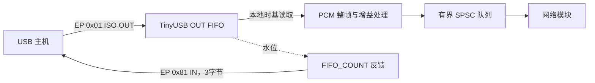

# USB 声卡开发指南：RP2350 + TinyUSB UAC1


V0.3.0现状补充（2026-10-19）：本项目已增加UAC1麦克风IN、PC采集/反向UDP和双向并发；当前不包含UAC2。下文保留早期播放优先架构的开发过程，最新实现、默认格式及实板限制以[文档15](15-双向音频与麦克风实施验收.md)为准。
修订日期：2026-10-18。目标板：W5500-EVB-Pico2。当前目标：USB Full-Speed、UAC1，默认 48 kHz/S16LE/双声道；开启高规格后额外宣告 96 kHz/S24LE_PACKED/双声道，由 Host 选择实际档位，将真实 PCM 格式交给网络模块。

本文覆盖 USB 源码定位、工程接入、描述符、控制请求、反馈、PCM 交接及验收。准备阶段的路径和命令保留为历史参考；实际实现位于 `SoundConvertBoard/usb/`。截至 2026-10-18，已有固件构建及 Windows 枚举、PCM 接收证据；本次主音量兼容修复后的实机幅度和长时间验证须单独记录，不能沿用旧镜像结果。

系统选型见 [文档 01](01-平台与USB开发.md)，网络实现见 [文档 02](02-固件与网络层.md) 和 [文档 06](06-单片机以太网开发指南.md)，网络字段以 [文档 03](03-通信协议规范.md) 为准，整机验收见 [文档 05](05-开发阶段与验收.md)。USB 模块不直接操作 W5500。

## 1. 当前基线与交付范围

### 1.0 当前 0.3.0-dev：可选 24-bit/96 kHz 与 Host 主音量

`usb.hi_res_enabled` 默认 false，仅允许 STOPPED 事务提交。关闭时仅 alt1=16-bit/48 kHz；打开后保留 alt1 并增加 alt2=24-bit packed/96 kHz。两档都有显式反馈，Host 决定实际格式，软件开关只改变宣告集合。配置 Flash v2 增加一字节选项；读取 v1 时逐字段保留旧名称、网络与 revision，新选项为 false，下一次明确提交才写 v2。

兼容/高规格配置描述符总长为 122/174 B，bcdDevice 分别 0x0102/0x0103。USB OUT 最大包 196/582 B，实际 1ms PCM 消费块为 192/576 B；队列每块携带实际采样率、格式与 generation。切 alt、reset、无法定位的缺样会废弃旧代次，网络必须重新协商，不能混拼旧 PCM。

Windows 标量音量 API 可以产生非整数 dB；当前接受范围内全部 Q8.8，GET_RES=1（1/256 dB），不再用整数 dB 取模拒绝合法请求。GET_INFO/GET_STATS.usb_control 返回真实 master_mute、master_volume_q8、master_volume_db、revision，usb.serial 用于精确匹配本机 Host endpoint。同机Windows经WASAPI端点写入并读回；NS/手机等外部Host保持其自身UI权威，板端网络不伪造音量setter。

为减少可定位的阶跃，主音量及静音变化在1ms块内渐变，稳定静音为全零；源代次开始从静音淡入。USB不足完整1ms块时结束旧代次并重新预填充，不将部分数据伪装为连续完整块。这些变化不等于已经证明所有偶发爆音消失，仍需结合USB计数、网络丢包、PC欠载和实测波形诊断。

### Windows Host 24-bit 测试结构

24-bit应用侧格式应同时核对WAVEFORMATEXTENSIBLE的PCM子格式、有效位、容器位数和声道mask，不能只记录“24bit/96k”。微软[Usbaudio.sys官方说明](https://learn.microsoft.com/en-us/windows-hardware/drivers/audio/usb-audio-class-system-driver--usbaudio-sys-)记载Windows2000及以后使用WAVEFORMATEXTENSIBLE，而不支持24-bit的packed WAVE_FORMAT_PCM结构。这里区分的是Windows Host API描述结构，不表示USB线上禁止3-byte packed PCM。

因此诊断应以正确的EXTENSIBLE结构重新查询和初始化，再持续读取板端alt/rate；若3-byte容器不受支持，可独立探测32-bit容器/24有效位的Host请求，但不能把Host容器布局直接冒充USB/UABA格式。Intel/厂商音频路径还可能影响实际选择；IsFormatSupported和WasapiOut报告的应用格式都不能取代真实USB alternate及UABA元数据证据。

### 1.0.1 master-only 拓扑与历史原因

首版最终采用 **master-only Feature Unit**：Entity 2 仅 channel 0 提供 mute/volume，channel 1/2 的控制位图均为 0，所有对应 GET/SET 请求均拒绝。音频本身仍为 L/R 双声道，实际 16/48 或 24/96 取决于当前 Host alt；控制范围调整不改变声道数。主增益在 PCM 入队前对每个声道只应用一次，音量/静音用一块内平滑过渡，之后稳定静音全零。

修复原因来自本机实测：旧描述符同时宣告 master、L、R 音量，Windows 设置 −20 dB 时控制 revision 增加 3，接收 PCM 的 RMS 比约为 `0.0097366`，表现为接近 −40 dB 的重复衰减。证据见 `artifacts/acceptance/usb-control-final.jsonl`。[XMOS 官方设计指南](https://www.xmos.com/file/sw_usb_audio-sw_usb_audio-design-guide)也记录了 Windows XP `usbaudio.sys` 同时支持 master/channel 控制时音量过敏的历史限制；本项目当前 Windows 的结论以本机记录为依据，不把该历史说明扩大为所有版本的保证。

当前实现及核对点：

- `SoundConvertBoard/usb/usb_descriptors.c`：Feature Unit 的 master 位图为 `0x0003`，L/R 位图为 `0x0000`；兼容/高规格配置为 122/174 B，USB `bcdDevice` 为 `0x0102/0x0103`；v7/v8 的 0x0101 记录是历史。
- `SoundConvertBoard/usb/usb_audio.c`：仅接受 channel 0，音量 Q8.8 为 −60～0 dB、1/256 dB 步长；共享主增益分别乘左右样本一次，不再叠加声道增益。状态数组为兼容网络快照保留三个槽，但 index 1/2 始终为零/false，不代表可写能力。
- `SoundConvertBoard/tests/usb_audio_host_test.c`：覆盖 L/R mute/volume GET/SET 拒绝、拒绝后状态不变、−20 dB 幅度约 0.1、静音全零和恢复 0 dB 幅度 1；当前 USB 回归 95 项，包含 packed 24-bit 符号/增益、两档切换、反馈参数和非整数主音量；此前 65 项记录属于 v7/v8。
- `SoundConvertBoard/tests/check_usb_descriptors.py`：直接解析 ELF 内的真实描述符，检查两个真实链接 profile 的 master-only 位图、16/48 与 24/96、196/582 B OUT、3 B feedback。

修复后的实机验收须重新枚举并导出描述符，确认 L/R 控制位图为零；比较同一测试音的 0 dB、−20 dB、静音、恢复 0 dB PCM，目标幅度比依次约为 1、0.1、0、1。量化误差与平滑过渡应与稳态测量分开；随后对最终镜像重新执行长测。

### 1.1 准备阶段读取的本地工程（历史基线）

| 项目 | 当前实际状态 | 后续动作 |
| --- | --- | --- |
| TinyUSB | `D:\GithubClone\tinyusb`，分支 `master` | 以完整 SHA 锁定；不要在排障中随意 pull 或切标签 |
| TinyUSB HEAD | `2f675abdd182163d03d4b25b47ad03497da23b1a` | 纳入构建与测试记录 |
| `git describe` | `0.21.0-605-g2f675abdd` | 它不是 `0.21.0` 正式标签；头文件版本仍为 `0.21.0`，只记宏版本不足以复现 |
| 应用工程 | `D:\Github\NS2_Sound_Convert\SoundConvert\SoundConvert` | 接入既有工程，不再要求重新创建空项目 |
| 当前 CMake | `sdkVersion 2.3.1`、`toolchainVersion 15_2_Rel1`、`PICO_BOARD pico2`；链接 `pico_stdlib/hardware_spi/hardware_dma`；USB stdio 已关闭 | 尚未链接 `tinyusb_device`，未指定外部 TinyUSB |
| 当前程序 | SPI 初始化、内存到内存 DMA 演示、每秒打印 | 尚无 UAC 描述符、TinyUSB 初始化或音频任务；这段 DMA 不是 W5500 SPI DMA 驱动 |
| 本机 Pico SDK | 已读取 `C:\Users\user\.pico-sdk\sdk\2.3.1` 的 TinyUSB 集成 CMake 与 `pico2.h` | SDK 提交 SHA、实际编译器版本和组合可编译性仍需构建时记录 |

本次源码阅读时 TinyUSB 的 `git status --short` 无输出。文档引用以此提交为边界；换版本后需复核宏、回调签名和生命周期。

首版必须完成：独立枚举、正确接收 PCM、显式反馈、有效静音/音量、模拟启停开关、停止后配置、恢复、统计和有界跨核交接。**当前 v8 上电自运行：加载已提交名称后立即自动开始模拟，不等待上位机认证、网络或 DHCP；本次运行中手动停止后需显式开始，重新上电再次自动开始。** v7 首次认证触发的记录保留为历史，不作为新策略验收。 本段为早期v8记录；V0.3.0已增加USB麦克风IN和多格式，见文档15。UAC2与运行时协议切换不在当前实现中。

### 1.2 “移植教程”在本项目中的含义

本次采用克隆自带的 `docs/integration.rst`、`docs/porting.rst` 与官方在线 [集成教程](https://docs.tinyusb.org/en/latest/integration.html)、[移植教程](https://docs.tinyusb.org/en/latest/porting.html)。前者讲应用集成，后者主要讲为新 MCU 编写底层 DCD。本项目已有 RP2350 支持，主要工作是应用集成与板级配置。

| 教程步骤 | 在本项目中怎么做 | 不能机械照抄的部分 |
| --- | --- | --- |
| 引入栈源码 | 通过 Pico SDK 的 `PICO_TINYUSB_PATH` 和 `tinyusb_device` target | 不递归添加所有厂商 DCD，也不同时链接 SDK 内置和外部两份栈 |
| 新 MCU/寄存器/DCD | 复用 `src/portable/raspberrypi/rp2040/` | 不新造 `OPT_MCU_RP2350`，不清空现有驱动重新实现 |
| BSP、时钟和引脚 | Pico SDK board 配置 + 可选 `tinyusb_board` | Pico 2 默认 Flash 是 4 MiB，本板资料为 2 MiB；不能只改项目名称 |
| 初始化端口 | 原生控制器 `rhport=0`，Device、Full-Speed | 教程双端口 Host/Device 和 High-Speed 示例不适用 |
| USB IRQ | 当前 DCD 的 `dcd_init()` 自动安装共享 `USBCTRL_IRQ` handler | 不在应用再安装独占 USB handler 或重复转发中断 |
| 周期任务 | Core 0 运行 `tud_task()`/`tud_task_ext()`，持续服务音频消费 | 不能保留当前主循环的 `sleep_ms(1000)` |
| 事件/回调 | 以当前 `audio_device.h`、`usbd.h` 为签名依据 | 当前收包接口为 `tud_audio_rx_done_isr()`；旧版 pre/post-read 回调不可直接搬用 |
| ISO alternate setting | 由类驱动调用已有 `dcd_edpt_iso_alloc/activate` | 应用不手动开关底层端点 |

当前 `hw/bsp/rp2040/family.cmake` 即使目标是 RP2350，也传入 `CFG_TUSB_MCU=OPT_MCU_RP2040`；Pico 2 board 文件另行选择 `PICO_PLATFORM=rp2350-arm-s`、`PICO_BOARD=pico2`。目录和 MCU 宏名是共用驱动入口，不是编译错芯片。

## 2. 源码阅读地图

下表路径均相对 `D:\GithubClone\tinyusb`。永久上游入口为 [本次提交](https://github.com/hathach/tinyusb/tree/2f675abdd182163d03d4b25b47ad03497da23b1a)，本地文件才是本次核对对象。

| 层次 | 文件 | 要查看的内容 |
| --- | --- | --- |
| 集成教程 | `docs/integration.rst`、`docs/porting.rst` | 应用接入与新 DCD 移植的边界 |
| 构建 | `hw/bsp/rp2040/family.cmake` | `tinyusb_device_base`、`tinyusb_bsp`、MCU/OS 编译宏 |
| 板选择 | `hw/bsp/rp2040/boards/raspberry_pi_pico2/board.cmake` | RP2350 Arm；应用通过 SDK 集成时用 `boards/pico_sdk` |
| 板支持 | `hw/bsp/rp2040/family.c` | LED/UART、唯一 ID、IRQ 由驱动安装的说明；BOOTSEL 读取会短暂干预 XIP |
| USB 控制器 | `src/portable/raspberrypi/rp2040/dcd_rp2040.c`、`rp2040_usb.c` | IRQ、ISO、VBUS 限制、DPRAM 搬运；不修改这些文件作为集成起点 |
| 核心 | `src/device/usbd.c`、`usbd.h`、`dcd.h` | 标准请求、事件 hook、reset、任务与音频 ISR 分发 |
| 音频类 | `src/class/audio/audio_device.c`、`audio_device.h` | UAC1/UAC2、读 FIFO、反馈、控制回调签名 |
| 描述符宏 | `src/device/usbd.h`、`src/class/audio/audio.h` | `TUD_AUDIO10_*`、`TUD_AUDIO_EP_SIZE`、请求/selector 常量 |
| 示例配置 | `examples/device/uac2_speaker_fb/src/tusb_config.h` | Audio、HID、端点/FIFO 宏 |
| 示例描述符 | 同目录 `usb_descriptors.c/.h`、`common_types.h` | FS UAC1、端点、Feature Unit、接口号、长度 |
| 示例行为 | 同目录 `main.c` | 44.1k 初值、控制请求、FIFO feedback、dummy 消费 |
| 并发 | `docs/reference/concurrency.rst`、`src/osal/osal_pico.h` | task/ISR 区别；Pico OSAL 队列接收当前为非等待方式 |

阅读顺序：示例 CMake → `tusb_config.h` → 描述符 → `main.c` → `audio_device.h/.c` → Pico family/DCD。先找到公开入口，再读底层，不从寄存器改动开始。

### 2.1 当前示例与目标的差异

| 项目 | 当前示例事实 | 项目修改任务 |
| --- | --- | --- |
| 名称 | 目录叫 `uac2_speaker_fb`，FS 返回 UAC1，HS 才返回 UAC2 | RP2350 使用它的 FS UAC1 分支 |
| 格式 | FS 描述符宣告 44.1k/48k；初值 44100 | 默认只宣告48000；高规格profile增加96000/24-bit独立alt，控制、消费、反馈、网络同步调整 |
| HID | `CFG_AUDIO_DEBUG` 默认 1，带 HID 接口 | 设为 0，并核对接口数、总长度与 class 宏 |
| 消费 | 毫秒轮询读取 dummy buffer，忽略 `tud_audio_read()` 返回值 | 用本地时基调度、按实际读到字节处理、交给应用 PCM 队列 |
| 时钟 | FIFO_COUNT feedback，默认目标为 FIFO 一半 | 明确消费时钟、初始水位和超期策略 |
| 软件 FIFO | `max(4×FS包长, 32×HS包长)`；当前参数计算为 1664 B | 裁剪HS参数；当前按最大582B包分配2328B，目标水位按实际档位设置 |
| 控制 | 已有 channel 上界及若干 `wLength` 检查 | 仍需检查采样率白名单、mute 值、音量范围和所有请求组合 |
| 音量 | UAC1 宣告 -90～+30 dB、步进 0.5 dB；SET 后除以 256 存整 dB | 统一 Q8.8 保存与范围，实际处理 PCM，不照搬演示行为 |
| 字符串 | 32 字符缓冲，ASCII 逐字节扩展 | 项目若支持 63 UTF-16 code units/UTF-8 配置，须扩容并真正转码 |
| 电源 | 配置描述符示例填 100 mA | 以 W5500 全板功耗和供电结构测定，不能继承为已测结果 |

## 3. 工程接入步骤

### 3.1 先记录来源

下面是将来开发时运行的 PowerShell 命令，不会在本文交付中执行构建或下载依赖：

```powershell
$tinyUsbRoot = 'D:\GithubClone\tinyusb'
$firmwareRoot = 'D:\Github\NS2_Sound_Convert\SoundConvert\SoundConvert'
$picoSdkRoot = Join-Path $env:USERPROFILE '.pico-sdk\sdk\2.3.1'
git -C $tinyUsbRoot rev-parse HEAD
git -C $tinyUsbRoot describe --tags --always --dirty
git -C $tinyUsbRoot status --short
Test-Path "$picoSdkRoot\pico_sdk_init.cmake"
cmake --version
ninja --version
arm-none-eabi-gcc --version
```

从 Pico 扩展的终端运行，让工具链在 PATH 中；命令不存在时先修复工具环境。不要把下载依赖、CMake 配置、编译、烧录四个阶段混为“验证成功”。当前 `tools/get_deps.py rp2040` 还会选择 FreeRTOS/Pico-PIO-USB 等依赖；本项目的原生 USB Device/no-RTOS 不以它作为安装 Pico SDK 的替代步骤，不必为此抓取所有平台依赖。

### 3.2 先运行上游示例作对照

纯 USB 对照可从当前 clone 配置到应用树的独立 build 目录，避免污染上游源码：

```powershell
cmake -S "$tinyUsbRoot\examples\device\uac2_speaker_fb" `
  -B "$firmwareRoot\build-usb-reference" -G Ninja `
  "-DPICO_SDK_PATH=$picoSdkRoot" `
  -DBOARD=raspberry_pi_pico2 -DPICO_FLASH_SIZE_BYTES=2097152 `
  -DCMAKE_BUILD_TYPE=Release -DLOG=0
cmake --build "$firmwareRoot\build-usb-reference" --target uac2_speaker_fb
```

此对照仍是 **44.1/48k + HID 的上游示例**；不能用它证明最终最小声卡档已完成。`2097152` 依据本板 2 MiB 资料，烧录前核对实物，并检查生成的 Flash 宏与 linker MEMORY 长度。独立板头还需核对 GPIO、晶振、电源和 Flash 启动配置；此容量参数不是完整板适配。

### 3.3 接入既有 SoundConvert

建议先用 SDK 的 `tinyusb_board` 复用示例 BSP，后续有明确需要再替换成项目板支持。**不把上游 `main.c` 整个加入现有 target**，否则会有两个 `main()`；只迁移必要回调和描述符。

计划新增文件（均尚未创建）：

```text
SoundConvert/SoundConvert/
├─ CMakeLists.txt                 现有文件，增加 USB 来源/target 配置
├─ SoundConvert.c                 现有入口，改为无阻塞调度
├─ usb/
│  ├─ tusb_config.h               栈与 Audio 配置
│  ├─ usb_descriptors.h/.c        UAC1 描述符和稳定字符串
│  ├─ usb_audio.h/.c              状态、控制回调、PCM 消费
│  └─ usb_audio_stats.h/.c        计数与快照
├─ audio/
│  └─ pcm_queue.h/.c              跨核块队列
└─ boards/
   └─ w5500_evb_pico2.h           最终板配置，完成后再切 PICO_BOARD
```

下面是**现有 CMake 的增量示意**，不是完整替换文件。保留 Pico 扩展生成区与已有 SPI/DMA 库。外部路径应在 `pico_sdk_init()` 之前给定，也可由下方命令行 `-D` 提供：

```cmake
# 放在 pico_sdk_init() 之前；正式构建允许由命令行指定。
set(PICO_TINYUSB_PATH "D:/GithubClone/tinyusb" CACHE PATH "TinyUSB source")

# 放在既有 add_executable(SoundConvert ...) 之后，文件实现后再加入。
target_sources(SoundConvert PRIVATE
    usb/usb_descriptors.c
    usb/usb_audio.c
    usb/usb_audio_stats.c
    audio/pcm_queue.c)
target_include_directories(SoundConvert PRIVATE
    ${CMAKE_CURRENT_LIST_DIR}/usb
    ${CMAKE_CURRENT_LIST_DIR}/audio)
# 沿用现有 target_link_libraries 的 plain 写法，避免混用签名。
target_link_libraries(SoundConvert tinyusb_device tinyusb_board)
pico_enable_stdio_usb(SoundConvert 0)
```

若改用 `PRIVATE/PUBLIC` 的 keyword 写法，应同时调整该 target 的全部 `target_link_libraries` 调用，不要混用两种签名。

应用文件实现后，在新 build 目录配置：

```powershell
cmake -S $firmwareRoot -B "$firmwareRoot\build-usb-uac1" -G Ninja `
  "-DPICO_SDK_PATH=$picoSdkRoot" "-DPICO_TINYUSB_PATH=$tinyUsbRoot" `
  -DPICO_BOARD=pico2 -DPICO_PLATFORM=rp2350-arm-s `
  -DPICO_FLASH_SIZE_BYTES=2097152 -DCMAKE_BUILD_TYPE=Release -DLOG=0
cmake --build "$firmwareRoot\build-usb-uac1" --target SoundConvert
Select-String -Path "$firmwareRoot\build-usb-uac1\CMakeCache.txt" `
  -Pattern 'PICO_SDK_PATH|PICO_TINYUSB_PATH|PICO_BOARD|PICO_PLATFORM|PICO_FLASH_SIZE_BYTES'
Select-String -Path "$firmwareRoot\build-usb-uac1\compile_commands.json" `
  -Pattern 'audio_device.c|dcd_rp2040.c|CFG_TUSB_MCU|CFG_TUSB_OS'
```

配置输出应显示外部 TinyUSB 可用路径；编译数据库中 USB 源码应全部来自该 clone，且有 `OPT_MCU_RP2040`、`OPT_OS_PICO` 和 RP2350 平台定义。不要只因 clone 存在就认定工程已引用它。SDK 构建系统可能列出禁用 class 的源文件，由宏裁剪；这不等于设备实际暴露了 CDC/HID。

`PICO_BOARD` 是 SDK 板型；上游独立示例的 `BOARD=raspberry_pi_pico2` 是另一入口。通过 SDK 集成后由 SDK 设置 `BOARD=pico_sdk`，不要额外把上游示例的整个 CMake 再 `add_subdirectory()` 进来。

### 3.4 栈配置建议

下列宏依据本次头文件，供编写 `usb/tusb_config.h` 使用；须加正常 include guard。不要照搬旧文章中的每功能 `DESC_LEN/N_AS_INT/CTRL_BUF_SZ` 宏。

```c
// CFG_TUSB_MCU、CFG_TUSB_OS、CFG_TUSB_DEBUG 由 Pico family 编译参数提供。
#define CFG_TUD_ENABLED                         1
#define CFG_TUD_MAX_SPEED                       OPT_MODE_FULL_SPEED
#define CFG_TUD_ENDPOINT0_SIZE                  64
#define CFG_TUD_AUDIO                           1
#define CFG_TUD_CDC                             0
#define CFG_TUD_MSC                             0
#define CFG_TUD_HID                             0
#define CFG_TUD_MIDI                            0
#define CFG_TUD_VENDOR                          0
#define CFG_AUDIO_DEBUG                         0
#define CFG_TUD_AUDIO_CTRL_BUF_SZ               64
#define CFG_TUD_AUDIO_ENABLE_EP_IN              0
#define CFG_TUD_AUDIO_ENABLE_EP_OUT             1
#define CFG_TUD_AUDIO_ENABLE_FEEDBACK_EP         1
#define CFG_TUD_AUDIO_FUNC_1_N_CHANNELS_RX       2
#define CFG_TUD_AUDIO_FUNC_1_N_BYTES_PER_SAMPLE_RX 3
#define CFG_TUD_AUDIO_FUNC_1_RESOLUTION_RX       24
#define CFG_TUD_AUDIO_FUNC_1_MAX_SAMPLE_RATE_FS  96000
#define CFG_TUD_AUDIO_FUNC_1_EP_OUT_SZ_FS \
  TUD_AUDIO_EP_SIZE(false, 96000, 3, 2)
#define CFG_TUD_AUDIO_FUNC_1_EP_OUT_SZ_MAX \
  CFG_TUD_AUDIO_FUNC_1_EP_OUT_SZ_FS
#define CFG_TUD_AUDIO_FUNC_1_EP_OUT_SW_BUF_SZ \
  (4 * CFG_TUD_AUDIO_FUNC_1_EP_OUT_SZ_FS)
```

同时裁剪应用中的 HS 描述符及相关引用，不能删除 HS 配置宏却留下无条件引用。当前 Pico family 默认 `OPT_OS_PICO`，不需要 FreeRTOS；示例 `tusb_config.h` 中的 `OPT_OS_NONE` 只是未传入 OS 宏时的 fallback。

## 4. UAC1 描述符契约

USB 的 IN/OUT 按主机方向命名：**主机播放到板 = OUT；板到主机 = IN**。反馈 IN 只发送速率，不是录音数据。



首版保持 UAC1 拓扑：Input Terminal ID 1 → Feature Unit ID 2 → Output Terminal ID 3。Feature Unit 仅保留 master 的 mute/volume；L、R 控制位图必须为零，同时保留两个物理声道的 PCM 格式。

| 项目 | 首版值/检查点 |
| --- | --- |
| 配置/接口 | 1 个 configuration；AC interface 0；AS interface 1；总接口数 2 |
| Audio Class | AC `bcdADC=0x0100`；接口使用 UAC1 protocol |
| AS alt 0 | 0 个端点，零带宽 |
| AS alt 1 | 2 个端点：音频 OUT 和反馈 IN |
| 格式 | PCM Type I，2 channels；alt1: 2 bytes/16 bits；高规格启用时 alt2: 3 bytes/24 bits |
| 离散采样率 | alt1仅48000（`80 BB 00`）；alt2仅96000（`00 77 01`）；不能跨alt接受错误频率 |
| 数据端点 | `0x01`，ISO asynchronous，`bInterval=1`，`bSynchAddress=0x81` |
| 数据最大包长 | alt1为196B（名义192）；alt2为582B（名义576），均允许额外一个采样帧的反馈余量 |
| 反馈端点 | `0x81`，3 B，沿用当前 UAC1 sync endpoint 宏 |
| EP0 | 64 B；标准控制由核心处理，类控制由项目回调处理 |
| HS 能力 | RP2350 为 FS-only，不提供伪造的 HS qualifier/other-speed configuration |
| Device class | 先保留示例值作对照；若为兼容性改为逐接口声明，作为独立描述符版本验证，不同时改变同步方式 |
| 身份/功耗 | 自有或获准的 VID/PID、稳定唯一序列号；功耗字段按全板实测设计 |

将 `TUD_AUDIO10_SPEAKER_STEREO_FB_DESCRIPTOR(..., 44100, 48000)` 改为只传 `48000` 时，长度也必须改为 `TUD_AUDIO10_SPEAKER_STEREO_FB_DESC_LEN(1)`。沿用本提交的三通道控制位图、无 HID 时：

```text
Audio function 长度 = 9 + 9 + 12 + 9 + 13 + 9 + 9 + 7 + 11 + 9 + 7 + 9 = 113 B
Configuration 总长度 = 9 + 113 = 122 B
AC class-specific wTotalLength = 9 + 12 + 9 + 13 = 43 B
```

保留 `TU_VERIFY_STATIC(sizeof(desc_uac1_configuration) == CONFIG_UAC1_TOTAL_LEN, ...)`，再用主机导出的真实描述符确认长度、端点方向和采样率。若改了 Feature Unit 或接口结构，重新计算，不能永久硬写 122。

**兼容性实验点：**当前示例 `usb_descriptors.h` 明确说明反馈 `bRefresh=0` 是 workaround，其注释称规范范围为 1～9。先记录为上游行为，并把 NS/移动主机兼容性与规范复核列为独立验收；不能把上游桌面测试声明当成本板测试。不要仅凭此值推定目标主机成功或失败。

## 5. 初始化、回调与生命周期

### 5.1 单一 USB owner

Core 0 拥有 TinyUSB API、状态和 PCM 消费；Core 1 只通过队列收 PCM/命令。初始化也在 Core 0 完成，使 USB IRQ 归属一致。**Core 0 先加载已提交配置并应用名称，再立即执行本次上电的自动 START，最后启动网络核心。** 首次 attach 使用持久化名称，不先以默认名称枚举再 detach；网络初始化与认证都不是 USB 启动前置条件。当前调度入口示意：

```c
uab_config_t boot_config;
uab_boot_initialize(&boot_config); // Core 0: USB owner、持久化名称、一次 START
uab_network_prepare(&boot_config); // 将已加载配置交给网络 owner
// 配置双核 Flash lockout / 看门狗，再启动网络 Core 1。
multicore_launch_core1_with_stack(uab_network_main, core1_stack, sizeof(core1_stack));
for (;;) {
  usb_audio_task();                 // Core 0 处理 USB、命令与 PCM
  uab_watchdog_core0_poll();
  tight_loop_contents();
}
```

这些 `uab_boot_*`/`usb_audio_*` 是项目接口，不是 TinyUSB 已有 API。`uab_boot_initialize()` 先完成 USB owner 初始化、配置读取和名称应用，再投递 START 并立即运行一次 `usb_audio_task()`；首次进入 STARTING 时由 Core 0 调用 `tusb_init(0, &init)`（Device、Full-Speed）。当前 DCD 初始化末尾会 `dcd_connect()`，所以首次初始化必须在已提交名称应用之后。后续正常启停使用 connect/disconnect，不反复初始化栈。

`tud_task()` 在当前 Pico OSAL 下也能使用，显式 `tud_task_ext(0, false)` 表达不等待事件的意图；事件过多仍需测量单次运行时间，可评估 `CFG_TUD_TASK_EVENTS_PER_RUN`。停止后若栈已初始化，仍要有界处理必要事件；不能只是停止调用 task 就宣称 USB 已断开。

### 5.2 回调职责

| 回调/API | 当前入口与项目职责 |
| --- | --- |
| `tud_descriptor_device_cb/configuration_cb/string_cb` | 返回生命周期足够长的对象；拒绝无效索引；不返回栈上数组 |
| `tud_mount_cb()` | 标记 configuration 已生效；不等于已经开始播音 |
| `tud_audio_set_itf_cb()` | 识别 AS interface 1 的 alt 0/1，维护启动/停止状态 |
| `tud_audio_set_itf_close_ep_cb()` | 停流/切 alt 的清理通知，短操作，不访问网络 |
| `tud_audio_set/get_req_ep_cb()` | UAC1 采样率控制 |
| `tud_audio_set/get_req_entity_cb()` | Feature Unit mute/volume |
| `tud_audio_feedback_params_cb()` | 填 FIFO_COUNT、当前alt对应48000/96000 Hz、384/1152 B目标水位 |
| `tud_audio_rx_done_isr()` | IRQ 上下文，仅收包计数/长度异常标记；一般返回 true；不能在此发 UDP、写 Flash、分配内存或格式化日志 |
| `tud_suspend_cb()/tud_resume_cb()` | 停止消费、标记时间轴失效；恢复后根据实际配置/alt/收包状态重新预填充 |
| `tud_umount_cb()` | 能收到时处理卸载；不能作为所有断连/reset 的唯一来源 |
| `tud_event_hook_cb(rhport,eventid,in_isr)` | 捕获 reset/unplug 等事件，原子设置 pending 标志；真正清理交给 Core 0 循环 |

当前音频数据通过 `usbd.c` 的 `audiod_xfer_isr` 路径处理；类驱动把 OUT 数据写入 FIFO、重挂接收、更新反馈后调用 RX ISR 回调。因此“所有 TinyUSB 回调都在 task 上下文”不成立。主线程与 IRQ 之间也要同步，不能因同一核心就忽略并发。

### 5.3 状态与恢复

音频运行子状态为 `DETACHED/CONFIGURED/PRIMING/RUNNING/SUSPENDED/FAULT`，与模拟总开关 `STOPPED/STARTING/RUNNING/STOPPING/FAULT` 分开；模拟 RUNNING 仅代表允许枚举，不保证音频子状态已 RUNNING。同时保存 configured、AS alt、经验证的连接观测、是否收数据、usb_generation。Host alt0/挂起/拔线不自动把模拟总开关切成 STOPPED，也不自动开放配置。

1. 配置完成但 alt 0：等待主机开始流，网络侧可显示 `WAITING_USB`。
2. alt 1：建立新代次、复位消费 deadline，预填充约 384 B，再进入 RUNNING。超时无数据仍显示等待，不发送旧 PCM。
3. 主机发全零 PCM：这是有效静音流，必须继续推进帧索引；不能用“样值全零”判停流。
4. alt 0、挂起、reset、重枚举或实际拔线：停止旧代次，丢弃应用残留；网络 owner 处理结束/重新建流。
5. 恢复：按照当前配置/alt 与新收包重新预填充，不重复播放中断前的队列。resume 不保证主机会重新发送 SET_INTERFACE，不能只等待该回调恢复。

**当前源码的两个重要限制：**

- `usbd.c` 的 `DCD_EVENT_BUS_RESET_START/END` 分支会重置类状态，但不是每次都调用 `tud_umount_cb()`。使用 event hook 标记 reset；兼容别名 `DCD_EVENT_BUS_RESET` 等于 END，不要在 switch 里重复 case。hook 在事件入队时触发，不表示重置处理已完成，应在 task 处理后收敛状态，合并 START/END 为一次逻辑失效。
- `dcd_rp2040.c` 当前固定 `FORCE_VBUS_DETECT=1`，物理拔线可能表现为 suspend，不能只依赖 umount，也不能直接把该宏改为 0。另据本地 V1.0 原理图，GPIO24 的 R2/R4 分压上端接在 D2 后与 VSYS 同节点；独立供电时不能据此证明连接器侧 VBUS 是否存在，需实物复核或独立检测电路。模拟开关由主动逻辑断开及清理结果判断，不依赖 GPIO24 或物理拔线。纯 USB 供电拔线掉电时，下次启动使用新的 boot 身份，并在初始化/配置加载完成后自动开始 USB 模拟。

全板挂起功耗涉及 W5500/PHY，不能因 RP2350 停止音频就认为满足 USB 挂起电流要求；纳入电源实测。无数据超时只是应用停流依据，不自动等于物理拔线。

## 6. 控制请求实现任务

核心处理标准枚举、地址、配置；项目只处理明确宣告的音频控制。拒绝非法请求应返回 false 让栈处理 STALL，而不是触发断点或无限等候。

| 控制 | 首版契约 | 校验 |
| --- | --- | --- |
| Endpoint Sampling Frequency | EP 0x01，GET_CUR/SET_CUR，3字节小端，值匹配当前alt的48000或96000 | direction/type/recipient、endpoint、selector、长度、固定频率白名单 |
| FU Mute | Entity 2，仅 channel 0，GET_CUR/SET_CUR，1 字节 | mute 值只接受 0/1；拒绝 channel 1/2、未知 bRequest |
| FU Volume | Entity 2，仅 channel 0；GET_CUR/MIN/MAX/RES、SET_CUR | 有符号 16-bit 小端，单位 1/256 dB；-60～0 dB、1/256 dB 步长；拒绝 channel 1/2 |
| SET_INTERFACE | 由核心/类驱动分派；AS 1 默认支持alt0/1；高规格开关开启后另支持alt2 | 不把未知 alt 视为已经开始流 |

每个非零alt只有一个合法采样率：alt1为48000、alt2为96000。GET返回实际频率；SET拒绝0、44100、与当前alt不匹配或未宣告的值。同频SET不复位正在播放的流；alt切换由USB owner更新实际格式并失效旧generation。

3 字节采样率应按 `buf[0] | ((uint32_t)buf[1] << 8) | ((uint32_t)buf[2] << 16)` 解码，不要求调用者允许读第 4 字节。SET payload 必须满足固定长度；GET 按已支持的请求构造正确大小的响应，由控制传输 API 限制主机所求长度，不因合法短读发生越界。未知长度/selector/channel/entity 的具体拒绝规则应覆盖单元测试。

音量状态统一保存为 Q8.8 dB，不先除以 256 丢精度。板端在 PCM 入队之前只应用一次 master 增益：L/R 使用同一个主增益，音量/静音均平滑到目标，按实际档位饱和为int16或有符号24-bit packed。PC 的 monitor gain 是另一个用户功能，不应重复应用 USB 主机增益。控制值变化时计算增益并在一块内平滑切换，不在每个 sample 调用 `pow()`。

本实现已选择 master-only，并同步收紧 FU 控制位图、请求支持和测试。网络 `SET_RUNTIME_AUDIO` 当前未提供实现，不能借此绕过控制范围；以后扩展也不能由两个核心直接改同一音量数组。

## 7. 采样时钟、FIFO 与反馈

### 7.1 三个时间域

- USB 主机发送包的节奏和每包帧数。
- 板端本地时钟驱动的消费节奏；FIFO feedback 调整主机平均发送速率使其匹配。
- PC 输出声卡时钟；由 PC ASRC 处理与源音频之间的长期漂移。

纯数字桥可以没有 I²S/DAC，但只要使用异步 OUT + FIFO_COUNT，就仍然必须有独立、稳定的本地消费节奏。不得因为 UDP 能发就不断读空 FIFO，也不得因为网线断了就停止读取；这都会把网络状态错误地转成 USB 速率反馈。

### 7.2 初始预算

| 项目 | 建议起点 | 说明 |
| --- | ---: | --- |
| 1个采样帧 | 4/6 B | 16-bit或24-bit packed的L/R组合 |
| 名义每1ms消费 | 48帧/192B 或96帧/576B | USB传输包可因反馈多/少一个帧，应用从FIFO按固定消费节奏取块 |
| OUT最大包长 | 196/582 B | 分别49/97帧容量 |
| TinyUSB OUT软件FIFO | 2328 B | 按4×最大582B分配；兼容档不因此增加目标预填充 |
| feedback目标水位 | 384/1152 B | 两档均约2ms，单位字节 |
| 应用暂存 | 576 B最大PCM块 | 使用实际帧数/格式，不发送未覆盖尾部 |
| 跨核PCM队列 | 8个最大96帧槽位 | 4608 B纯PCM加元数据，最多8ms，不是常态延迟目标 |
| USB owner 服务间隔 | 初期争取 <250 µs，记录 max | 工程目标，需实测，不是栈保证 |

反馈回调建议填：

```c
feedback_param->method = AUDIO_FEEDBACK_METHOD_FIFO_COUNT;
feedback_param->sample_freq = alt == 2 ? 96000 : 48000;
feedback_param->fifo_count.fifo_threshold = alt == 2 ? 1152 : 384;
```

栈内部反馈值采用 16.16；当前 `audiod_fb_send()` 按 **UAC 版本**编码：UAC1 发 3 字节 10.14，UAC2 发 4 字节。兼容档48 frames/ms的名义UAC1反馈为 `48 << 14 = 0x0C0000`，线上小端 `00 00 0C`。高规格96 frames/ms名义值为`96 << 14 = 0x180000`，线上`00 00 18`。FIFO_COUNT 会围绕名义值变化，不能把“每个反馈包必须恒定”作为验收条件，也不要额外调用手动 feedback API 与该算法竞争。

### 7.3 消费与超期

初版用微秒单调时钟和绝对 deadline 驱动 1 ms 消费；每次递增 deadline，不能简单令 `next=now+1000` 使主循环延迟不断累积。定时 IRQ 如有使用，只发布到期事件，不成为第二个 FIFO reader。

每次到期先处理生命周期pending，再检查active状态，按实际格式读取192或576B，并验证4或6B帧对齐。短于完整1ms块视为源连续性失效：增加欠载/重同步计数、失效旧generation、重新预填充，不能把缺少的时间轴拼成连续音频或发送未覆盖尾部。

欠载/超期分开处理：

- 已知丢弃了哪些完整采样帧：推进源索引并保留间隙，交给网络的 DISCONTINUITY/补静音策略。
- 只知道调度迟到了，无法知道 USB 实际缺失了多少：不要按“迟到毫秒×名义每毫秒帧数”伪造已接收帧数；结束旧时间轴、重新预填充，通知网络 owner 建新 epoch。
- 小幅超期可以有限次数补做消费；上限须固定，例如最多 2 次，超过就重同步，不能在一个循环追赶无限积压。
- 网络队列满：按时消费 USB，丢弃网络副本并记录明确丢弃帧数；不移动消费者读指针。

### 7.4 当前 TinyUSB FIFO 的溢出行为

当前 `audiod_init()` 以 `tu_fifo_config(..., true)` 创建 OUT FIFO，**它允许覆盖旧数据**。仅检查 `tud_audio_read()` 返回长度或 `tud_audio_available()` 不能证明没有丢样，RX 回调也不是完整的溢出报告接口。

实施时至少记录 RX 实际字节、消费字节、水位、最长消费间隔和重同步次数；在一致快照下核对接收/消费/库存的差额。满水位、对齐异常、无法解释的差额必须触发可诊断的失连续状态；无法准确定位丢失量时更换 epoch，不能继续宣称 bit-perfect。若需要精确逐包丢失计数，再设计最小的上游插桩补丁并单独维护，本文不假定现有 API 已提供该计数。

## 8. 与网络模块的边界

USB 独立开发时，消费端可以是校验/统计丢弃器；网络模块也可以先用模拟 PCM。两边只通过固定内存接口汇合。

| 交接内容 | 责任 |
| --- | --- |
| PCM block | 自有存储、有效帧数、源首帧索引、USB generation、必要状态标志 |
| 数据格式 | 每块携带实际sample_rate/sample_format；48k/S16LE或96k/S24LE_PACKED，2ch、交错小端 |
| `sample_index` | USB owner 按真实音源帧推进，网络丢弃不把后续索引压缩 |
| `stream_id/epoch/token/sequence` | 网络 owner 按文档 03 管理；USB generation 仅是内部代次，不替代线上 epoch |
| USB generation 变化 | 网络停止旧流、清理聚合残留，按协议重新准备；旧块即使迟到也丢弃 |
| 无订阅/未获 IP | USB 继续按时消费并计数，可在交接前丢弃；不无限缓存 |
| 网络 2 ms 聚合 | 同一代次最多合并连续 96 帧；不得跨 reset/代次拼包 |
| 已入队块 | producer 发布后不再修改，consumer 使用完才释放；DMA 未完成前不得重用 |

SPSC 用 C11 原子或经验证的 Pico 同步机制，发布/读取索引具备 acquire/release 顺序。producer 只改 write index，consumer 只改 read index；要丢旧数据由 consumer 执行。清空队列通过代次和消费端确认，不让两个核心同时重置索引。64-bit sample_index 不应被另一核无保护直接读取，随完整块发布或通过一致快照传递。

对应1ms UDP：兼容48帧×4B=192B PCM，总应用载荷240B；高规格96帧×6B=576B PCM，总应用载荷624B。**USB 最大包 196 B、USB 消费块 192 B、UDP payload 240 B 是三个不同概念。**

本文小缓冲参数是 USB 独立开发起点；文档 02 的 USB/PCM KiB 数字是整机预留预算，不要求按预留上限排满音频。消费端仍按文档 02 的约 4 ms 过期策略淘汰积压，8 槽容量不能当作持续保留 8 ms 音频的目标。

## 9. 模拟启停、名称配置和维护

USB 声卡出厂默认名称为开发板名称 **`W5500-EVB-Pico2`**：`usb.product_name` 默认采用此值，由设备描述符的 `iProduct` 索引返回对应字符串；`usb.playback_name` 默认同名，播放接口/终端如提供名称字符串也使用该值。迁移上游示例时替换产品与播放展示字符串（例如 `TinyUSB Speaker`、`UAC1 Speaker`），厂商名独立配置。

默认值只用于首次初始化或明确恢复出厂；已有自定义名称在重启、升级、配置刷新及省略字段的更新中保持原值。网络别名与 PC 本地别名不随 USB 默认名称自动改写。主机可能附加“扬声器”等系统标签或缓存旧名，验收同时核对 USB 描述符和主机实际展示。

启动时把已提交配置转换成稳定描述符对象；控制传输期间不能由网络核心改写字符串缓冲。保留稳定 device_id/MAC/serial，产品名修改不生成新身份。

### 9.1 上电自运行与手动启停

上电时 Core 0 初始化 USB owner、加载已提交名称/参数、应用描述符名称，然后立即提交并消费一次 START；此流程在网络 Core 1 启动之前完成。没有上位机连接、网线、DHCP，甚至 W5500 初始化失败时，USB 仍独立运行。HELLO/AUTH 不再触发 START。能力 `usb_auto_start_policy=power_on`；具体状态字段见文档 03。

首次 START 才初始化 TinyUSB；初始化成功并开放枚举后进入模拟 RUNNING。Host 未连接时也可显示“模拟已开启，等待 USB Host”，不能混同“正在播放”。已有栈的后续 START 使用当前已提交快照与 `tud_connect()`，等待下一轮枚举；旧 PCM/旧控制消息不能跨代次复用。

自动启动每次 boot 最多触发一次，失败显示故障/原因，后续由用户明确重试。手动 STOP 后控制重连、Host resume、USB 插拔、DHCP 恢复均不自动 START；整机再次上电或重启会再次自动执行一次 START。控制掉线不会关闭已经开始的 USB 模拟，网络数据流按独立的失联策略结束。

### 9.2 停止模拟的完成条件

STOP 不是停播、静音、停止 UDP 或暂停 task。由 Core 0 串行完成：

1. 标记 STOPPING，撤销尚未执行的启动意图，拒绝新的 USB 配置写入。
2. 已初始化时调用 `tud_disconnect()` 关闭 pull-up，使 Host 看到逻辑拔出；尚未初始化时保持未启用状态，不调用无效端口 API。
3. 停止旧音频消费代次，通知网络 owner 失效 token/epoch，按所有权回收 PCM/DMA 块；不等待失联 PC 的 ACK。
4. 有界排空或终止在途 EP0/ISO 处理，确保旧字符串/描述符快照不会再被回调写入或被修改后读取；旧事件不得重新 enable pull-up。
5. 完成必要的断开观察窗口和本地清理后才进入 STOPPED 并发事件；已初始化场景可从 300 ms 观察窗口起做兼容测试，不能在 UI 线程 sleep。

本地 `usbd.c` 的 `tud_disconnect()` 立即调用 DCD 并返回，DCD 只是清除 pull-up 位；返回 true 不证明 Host 已识别或在途处理已结束。上述清理和状态完成是应用职责。若不能在限定时间内证明清理完成，进入 FAULT、拒绝参数修改，不能超时后强行标成 STOPPED。[本地 USB 核心](/D:/GithubClone/tinyusb/src/device/usbd.c)、[本地 RP2350 共用 DCD](/D:/GithubClone/tinyusb/src/portable/raspberrypi/rp2040/dcd_rp2040.c)

### 9.3 停止后的配置事务

USB Host 线可以继续插着。普通声卡名称由上位机同时更新 product_name/playback_name；默认 `W5500-EVB-Pico2`，已保存自定义值保持。名称、采样格式、声道、接口、同步方式、Feature Unit 配置及其他 `usb.*` 都只能在模拟 STOPPED 下通过 VALIDATE/PREPARE/APPLY/CONFIRM 修改，不能只依赖界面灰显。

PREPARE 保留配置事务；APPLY 只生成隔离候选，CONFIRM 校验模拟状态/代次后持久化并更新稳定快照。事务期间 START 被拒绝；多个客户端由配置 revision、模拟 revision 和 owner 串行裁决。成功或回滚后仍保持 STOPPED，下一次显式 START 才让 Host 枚举新参数，不自动复连。

上位机配置导入、恢复出厂与维护写入口同样受限，不支持“运行中先保存，下次停止偷偷生效”。USB Host 正常的 UAC 音量/静音/接口请求仍按协议处理；PC 本地监听增益与此配置锁无关。USB 停止模拟不关闭网络控制，板可由原有 USB 电源供电，无需为了配置强制拔掉电源线。

Flash 保存安排在维护状态并协调双核，避免 XIP 擦写阻塞实时 IRQ；不要在 SET_CUR 回调中保存每次音量变化。不要用反复 `tusb_init()` 代替重枚举；当前 Audio `audiod_deinit()` 仍返回未实现状态，不能假定任意反初始化/再初始化路径已具备完整清理语义。

## 10. 开发任务与退出条件

下表保留分阶段任务及验收退出条件。当前代码实现和本次修复范围见 1.0；已编译、主机模拟回归和实机验证必须分别记录，不能把所有阶段一并标为通过。

| 任务 | 具体产物 | 退出条件 |
| --- | --- | --- |
| U0 来源与板型 | SHA 清单、工具版本、板 Flash/电源/引脚核对 | 外部 TinyUSB 路径唯一；明确 RP2350 Arm/2 MiB 配置 |
| U1 构建与枚举 | 项目 CMake、tusb_config、UAC1 描述符、初始化 | ELF/UF2 可生成，Windows 识别 48k/16/2ch；无 HID/CDC；描述符导出存档 |
| U2 控制面 | 请求校验、静音/音量状态及实际 PCM 增益 | 合法控制有效，非法长度/索引/频率被拒绝且后续正常请求仍可用 |
| U3 数据与反馈 | 消费时基、784 B 初始 FIFO、反馈参数、统计 | 无网络下连续播放至少 30 分钟；无未解释的覆盖/欠载；长时速率与水位稳定 |
| U4 生命周期与配置 | 模拟启停、上电自动开始、reset/alt/suspend/resume、停止后参数事务 | STOP 完成后才可改；保存不自动 START；无旧 PCM 混入新代次 |
| U5 网络交接 | PCM 块/SPSC/代次映射、无订阅与拥塞策略 | 网络停收、未获 IP、断网时 USB 保持服务；恢复不补播旧声音 |
| U6 主机兼容与长测 | Windows 基线，再 NS1/NS2/手机逐项记录 | 每个平台有描述符、固件 SHA、系统/连接方式及通过/失败记录 |

不得把“枚举成功”直接勾成 U3；主机声卡面板出现设备也不能证明音量或反馈有效。

## 11. 验证方法与记录

### 11.1 无板卡时可做的检查

1. 宏与配置描述符长度静态断言；解析编译后的 descriptor 数组，核对 interface/alt/endpoint/采样率/总长度。
2. 对采样率、Q8.8 音量、mute 和非法 entity/channel 的解析做有意义的边界测试，GET 短读与 SET 错长分开覆盖。
3. 用固定 PCM 测试声道顺序、负数、静音、增益饱和、部分读取；对队列满、跨代次、有限追赶和未知缺失时间轴做状态测试。
4. 生成编译数据库与 map，确认只使用一份 TinyUSB、Flash/SRAM 占用与配置一致。

以上仅证明代码与构建路径，不能证明 USB 线上兼容或时钟稳定。

### 11.2 首块板 Windows 验收

| 步骤 | 操作 | 保留的证据 |
| --- | --- | --- |
| 枚举 | 分别关闭/开启高规格并导出全部描述符 | 默认alt0/1、196B/3B；启用后另有alt2 24/96、582B/3B；Host可继续选兼容档 |
| 播放 | 选择系统输出，播放左右交替/固定频率/静音/脉冲 | RX/消费帧数、左右次序、数据摘要；关闭系统音效，记录共享或独占模式 |
| 控制 | 主机调 mute/volume，验证 PCM 实际变化 | 控制前后状态和幅度；不只截图滑块 |
| 反馈 | USB 抓包与板端 FIFO 水位统计对照 | 3 B 反馈格式、水位趋势、实际帧数分布 |
| 无网络 | 拔网线/停止网络消费 | USB 服务间隔和消费速率不跟网络停顿 |
| 恢复 | alt0/1、设备禁用启用、拔插、主机睡眠、SWD reset | generation/epoch、旧数据清除、重新预填充 |
| 上电策略 | Host 线保持连接，关闭上位机后重新上电，并分别验证不接网线/无 DHCP | 已保存名称直接枚举，模拟 RUNNING；认证不改变状态；手动 STOP 后重连仍 STOPPED，重启再次自动开始 |
| 改名与参数 | RUNNING 时写入应失败；STOP 完成后保存；再手动 START | 原配置未被拒绝请求改变；保存后保持停止；新枚举读取新名称 |
| 手动停止保持 | STOP 后刷新、重连、Host suspend/resume、拔插 | 不再次自动 START；用户显式开始才恢复 |
| 停止失败/并发 | 延迟在途回调、注入停止超时、另一客户端同时 START/改参 | 未达到 STOPPED 不允许写；事务串行，无旧描述符内存误用 |

USBPcap/Wireshark 能辅助检查 URB/控制请求，不能代替总线分析仪证明每个 SOF 的精确线上时序。UART/SWD 输出限频；满速打印会改变被测结果。运行 `usbtest` 是底层驱动诊断的额外手段，只有以后修改 DCD 或出现控制器问题时按上游教程单独安排，不能替代 UAC 播放验收。

### 11.3 统计与故障注入

建议统计：`rx_packets/rx_bytes`、消费帧数、`short_read`、异常包长/对齐、FIFO 当前/峰值/低水位、最大 task/消费间隔、网络丢弃帧数、重同步、reset/suspend/resume、当前 alt/代次、控制拒绝计数。计数按 IRQ/main/core1 的所属执行域采样汇总，避免实时路径争长锁。

必测：暂停网络 100 ms、队列满、无 DHCP 地址、USB 快速启停、外部供电下拔 USB、睡眠恢复、控制请求压力、主动制造消费超期。P3 按整机文档先 2 小时，发布前代表性平台至少 24 小时；没有结果的格子填“未测试”。

### 11.4 常见故障定位

| 现象 | 优先检查 |
| --- | --- |
| 没枚举 | 线材/供电/Host 角色、真实 build 路径、tusb_init 返回值、task 是否执行、是否重复 IRQ、USB 时钟 |
| 找不到音频类或描述符错误 | 采样率数量与长度、总接口数、HID 残留、descriptor 数组、旧 SDK 内置栈被误链接 |
| 播放几十毫秒后断续 | 是否仍有 sleep/阻塞日志、feedback 格式/端点、消费 deadline、FIFO 被读空或覆盖 |
| 有计数但声音错误 | 实读长度、4/6B帧对齐、S16LE/S24LE_PACKED符号、声道顺序、旧 dummy 数据、重复增益 |
| 拔线没有 umount | 本提交 FORCE_VBUS_DETECT 限制，检查应用 VBUS/suspend/reset 路径 |
| reset 后发旧声音 | reset 没有使应用代次失效、跨核队列/网络聚合未拒绝旧块 |
| USB 很稳，PC 周期跳音 | 网络包序/丢弃、PC ASRC 与输出时钟、接收缓冲；不要先更改 USB 同步方式 |
| NS/手机不识别但 PC 正常 | 最小接口、48k、电源与连接模式、反馈 bRefresh、身份缓存；一次只改一个因素 |

测试记录至少含：日期、板/供电/USB 主机与系统、SDK/TinyUSB/固件 SHA、编译选项、描述符 hash、反馈/FIFO/队列配置、日志与抓包路径、持续时长、统计差值、恢复用例结果。延迟报告须包含 FIFO 目标约 2 ms 这一环节，不能只测 UDP 网络延迟。

## 12. 后续扩展边界

首版通过后再考虑：44.1k 分数帧累积、同步 OUT 兼容实验、UAC2-FS、麦克风 IN。每项都要重新核对描述符、请求、反馈与帧预算；不能只改 UAC 版本号。上游目录名中的 `uac2` 不代表 RP2350 自动启用 UAC2，更不代表本项目已经实现双向音频。

本次交付证据仅为本地源码/教程/既有工程的核对及文档一致性检查；本机 SDK 与 clone 的实际构建组合、硬件枚举、音频数据与所有目标主机均待按上述任务验证。
