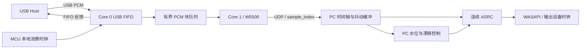

# 音频缓冲、时钟漂移、重采样与 USB 声卡：开源实现对照及改进方案

分析日期：2026-10-19。项目源码基线：根目录 `VERSION=0.0.9`。

后续 V0.1.0 的实际实施和前后指标见 [12-音频升级前后指标与实板验收](12-音频升级前后指标与实板验收.md)。本文保留改进前的源码分析与行号，当前实现变更后以文档 12 和函数名定位为准。

本文是实施前的源码分析与改进方案。本次只新增文档和隔离的离线分析证据，没有修改生产代码、构建发布版本或烧写开发板，因此不递增软件/固件版本。后续实施时，按实际修改批次执行根目录 AGENTS.md 的版本、更新日志和验收记录规则。

## 1. 结论与优先顺序

当前工程已经具备完整的低延迟音频基本结构：USB 与网络分核、异步 USB 反馈、有界 PCM 队列、UDP 样本时间轴、按播放期限处理缺口、连续 sinc ASRC、带抗积分饱和的 PI 漂移控制。建议在此基础上做有针对性的改善。

第一优先级是修复容量正确性，随后改善缓冲与漂移控制的耦合、补齐重采样频响指标，以及量化 USB/网络调度余量。Roc、Snapcast、ScreamRouter 的算法和测试都适合作为参考，但不能直接继承其参数、默认缓冲或测试结论。

| 编号 | 优先级 | 建议 | 依据与当前结论 |
| --- | --- | --- | --- |
| B01 | P0 | 使物理环形容量覆盖所有允许的采样率/缓冲组合及 FIR 历史 | 已用生产源码复现：192 kHz、100 ms 配置预填充 90 ms 后，896 帧被覆盖，溢出计数仍为 0 |
| B02 | P1 | 以样本时间轴、到包时间和单调时钟建立抖动统计 | 当前按相邻到包间隔和突发量估算，存在包数相关衰减、固定 50 ms 截断等边界 |
| C01 | P1 | 分开“时钟偏差补偿”与“目标水位调整” | 当前每个回调重算预填充目标，再直接送入同一个 PI；可能把目标变化解释为漂移，影响程度需模型/回放验证 |
| R01 | P1 | 先建立重采样频响/相位/CPU 基准，再增加可选质量档 | 系数分析发现 44.1→48 kHz 的 20 kHz 响应约 -1.99 dB；这是质量边界，不是对主观听感的判定 |
| R02 | P1 | 预热滤波器、测量并缩短音频锁占用 | 当前首次建表发生于 Add 的锁内；Read 持锁完成整个 FIR 输出块 |
| U01 | P1 | 建立真实 USB 反馈、FIFO 水位与生命周期验收 | 已有反馈实现正确地使用字节单位；宿主替身尚不能证明 Host 的真实反馈响应 |
| U02 | P1 | 根据高规格音频建立 SPI/USB/队列时限预算 | SPI 当前 10 MHz，192 kHz/16-bit 的音频包纯数据 SPI 写入下限约 652.8 μs/ms，不能忽略寄存器和控制开销 |
| U03 | P1 | 扩展真实描述符子集、长时间计数回绕与 Host 兼容验证 | 保留当前十格式和 generation 机制；增加最终描述符及 NS2 实板证据 |
| C02 | P2 | 增加只观察的时间戳频率估计器 | 借鉴 ScreamRouter StreamClock；先评估与 PI 的差异，不直接叠加第二个调速器 |
| N01 | P2 | 基于实际丢包数据评估小块 FEC 或 RTP 接口 | 借鉴 Roc/ScreamRouter；避免叠加第二层独立等待缓冲 |
| N02 | P3 | 将 Opus/FLAC 作为独立可选实验 | 本地可审阅编解码接入代码；RP2350 实时编码能力尚未验证，不作为当前稳定性修复的前提 |

P0 表示应先修复的确定性边界；P1 表示建议优先实施/验证；P2/P3 表示后续研究。表中的改善目标均不等于已经达到。

## 2. 本次实际审阅范围与证据

### 2.1 本地参考源码快照

以下四个 Git 工作区在核查时均无本地修改。结论针对这些提交，不以仓库名称或此前网页说明代替实际实现。

| 项目 | 本地目录 | HEAD | 本次主要审阅内容 |
| --- | --- | --- | --- |
| Roc Toolkit | `D:/GithubClone/roc-toolkit` | `60db91cbba666972845d190d981bc0d093298699` | FreqEstimator、LatencyTuner、BuiltinResampler、Depacketizer、OpenFEC 适配及音频测试 |
| ScreamRouter | `D:/GithubClone/screamrouter` | `4d3dc1fdef257a0306b78dced516c0e84a4db3e4` | StreamClock、SinkRateController、RTP 重排/插值、AudioProcessor 及相关测试 |
| Snapcast | `D:/GithubClone/snapcast` | `4fed179e177b251c67326e7b62a25c8d8fb2d1a9` | Stream、TimeProvider、soxr 接入、WASAPI、Opus/FLAC 编解码适配 |
| TinyUSB | `D:/GithubClone/tinyusb` | `2f675abdd182163d03d4b25b47ad03497da23b1a` | UAC1/UAC2 音频类、FIFO 反馈、接收 ISR、RP2040/RP2350 DCD、speaker feedback 示例 |

前三个网络音频项目没有提供本工程的 RP2350 UAC1 描述符、Core 0 调度和 W5500 驱动实现；USB 部分的直接上游依据是 TinyUSB。

本机其他下载目录中的 FileZilla、VNC、条码、PROFINET 和控制器转发项目不作为本次音频算法/USB UAC 的证据。现有 WIZnet ioLibrary、Pico SDK 等继续按项目锁定依赖使用，不因引入参考项目更换网络栈。

### 2.2 当前项目的实际实现

| 环节 | 当前代码与行为 |
| --- | --- |
| USB 类与格式 | UAC1、Full-Speed、双声道；16-bit 44.1/48/88.2/96/176.4/192 kHz，packed 24-bit 44.1/48/88.2/96 kHz；按已选格式重编号 AS alternate |
| USB 端点 | 音频 OUT `0x01`；反馈 IN `0x81`，不是麦克风；保留 master-only 音量/静音 |
| USB FIFO 与消费 | FIFO 3088 B；启动至少积累两个最大 1 ms 块；Core 0 按本地微秒时钟消费 floor/ceil 帧，分数帧余数跨块累计 |
| USB→网络队列 | 8 个 SPSC 块；每块最多 192 帧、768 B；旧 generation 或提取后超过 4 ms 的块丢弃；发送 pending 也有 4 ms 时限 |
| 网络 | Core 1 独占 W5500；SPI 10 MHz；音频与控制分开；音频发送不等待 SENDOK，但尚有同步 SPI 和寄存器轮询 |
| 音频协议 | UABA 48 B 头，带 stream、token、epoch/generation、序号和 64-bit sample_index；名义约 1 ms PCM/包 |
| PC 缓冲 | 固定 16384 源帧环形存储，浮点双声道＋绝对帧标签；用户允许 4～100 ms；按真实源/输出采样率换算需求 |
| PC 漂移控制 | 误差归一到 48 kHz 帧单位；约 1 s 一阶低通；P=4、I=0.25；积分限 ±400 ppm；输出限 ±500 ppm，变化率限 100 ppm/s；有条件积分抗饱和 |
| PC 重采样 | 48-tap Blackman sinc，1024 相位；静态截止 `.94 * min(1, Ro/Rs)`；源帧历史 23、前瞻 24；当前相位取表不作相邻相位插值 |
| PC 缺口处理 | 播放期限前允许乱序补齐；短缺口线性插值，较长缺口淡出/淡入；欠载进入重新预填充；保留丢样/修补统计 |
| Windows 输出 | NAudio WASAPI 共享、事件模式；请求 10 ms，记录实际缓冲；等至少三个回调预热后建流；使用端点实际 mix rate |

代码入口：[AudioBuffer](/D:/Github/NS2_Sound_Convert/SoundConvertClient/Core/AudioBuffer.cs:4)、[DriftController](/D:/Github/NS2_Sound_Convert/SoundConvertClient/Core/DriftController.cs:3)、[SincFilter](/D:/Github/NS2_Sound_Convert/SoundConvertClient/Core/SincFilter.cs:3)、[WindowsAudio](/D:/Github/NS2_Sound_Convert/SoundConvertClient/App/WindowsAudio.cs:11)、[USB owner](/D:/Github/NS2_Sound_Convert/SoundConvertBoard/usb/usb_audio.c:11)、[USB 描述符](/D:/Github/NS2_Sound_Convert/SoundConvertBoard/usb/usb_descriptors.c:17)、[网络发送](/D:/Github/NS2_Sound_Convert/SoundConvertBoard/uab_network.c:344)。

旧文档中的 784 B FIFO、只开放两个格式等说明不能作为当前参数。这里以 V0.0.9 源码为准。

### 2.3 本次完成和未完成的核查

- 已读取上述生产实现、参考实现及相关测试源码。
- 已用隔离 .NET 程序直接编译链接生产 Core 源文件，执行容量边界复现和滤波器系数频响计算。
- 没有运行整套产品回归、编译三个上游项目，或测量它们在本机的 CPU/延迟。
- 没有访问 COM8、启动真实 USB/网络音频或烧写开发板；本次结果不是实板验收。

本次离线证据目录：[audio-review-20261019](/D:/Github/NS2_Sound_Convert/artifacts/analysis/audio-review-20261019)。包括分析程序、[结果 JSON](/D:/Github/NS2_Sound_Convert/artifacts/analysis/audio-review-20261019/probe-result.json) 和 [生产源码 SHA256 快照](/D:/Github/NS2_Sound_Convert/artifacts/analysis/audio-review-20261019/source-snapshot.json)。该目录位于既有忽略的 artifacts 下，独立保留，不进入固件或客户端生产工程。

## 3. 应保留的技术边界

### 3.1 三个时钟/调度环节分别处理



USB 反馈调节 Host 向 MCU FIFO 送入的速率；网络抖动影响包的到达时刻；PC ASRC 补偿源样本时钟与输出设备消费的差异。不要将 PC 网络水位直接用于调 USB 反馈，避免网络抖动进入 USB 控制环。

单接收端播放不要求先引入 NTP/PTP。当前 sample_index 足以表达连续性，但不能单独测出真实单向延迟。板端 `captured_us` 是消费任务提取块时记录的时间，未包含可直接溯源的 USB SOF/样本采集时间，不应称作物理采集时间戳。

### 3.2 延迟、存储容量和统计单位分开

- 物理数组容量大于用户允许的积压，不代表提高用户缓冲上限。
- 用户 80 ms 上限、实际预填充、ASRC 前瞻和 WASAPI 实际缓冲是不同量。
- `maxEnd-cursor` 是时间轴跨度，内部可能有缺口，不等于每一帧都已收到。
- `SequenceGapPackets` 当前属于到包时观察到的序号跳变，乱序补齐后不能直接称为永久丢包。
- SENDOK 是 W5500 硬件发送完成，不是 PC 收到，更不是声卡播出确认。

## 4. 缓冲改进

### B01：修复物理环形容量与逻辑上限不一致

**当前位置**：[AudioBuffer.cs:6](/D:/Github/NS2_Sound_Convert/SoundConvertClient/Core/AudioBuffer.cs:6)、[逻辑限制](/D:/Github/NS2_Sound_Convert/SoundConvertClient/Core/AudioBuffer.cs:109)。

`MaximumFrames = MaximumBufferMs * Rs / 1000` 可以大于 `Capacity=16384`，但写入只检查前者，再用 `index % Capacity` 覆盖槽位。绝对帧标签能发现旧样本不见了，却不能防止这次覆盖。

本次复现：逐毫秒送入连续、非零、无丢包的 PCM，先预填充，再读取 10 ms 输出。

| 源/输出采样率 | 配置上限 | 预填充 | 首次读前报告水位 | 首次读发生的修补 | Overflows |
| --- | --- | --- | --- | --- | --- |
| 192 kHz | 100 ms | 90 ms | 90 ms | 896 源帧 | 0 |
| 192 kHz | 80 ms | 80 ms | 80 ms | 0 | 0 |
| 96 kHz | 100 ms | 90 ms | 90 ms | 0 | 0 |

90 ms × 192000 = 17280 帧，超过数组 896 帧，数值与复现吻合。这个场景是人为预填充边界，不表示日常播放一定积压到 90 ms，但它在当前 Core 接受的参数内。

**实施建议**：

1. 第一批可将物理容量设为 32768 源帧，并增加不变量检查；或者在会话准备时按最大允许源率分配，禁止在音频回调中扩容。
2. 预算至少覆盖逻辑最大积压、FIR 历史和边界余量。保守表达式可用 `ceil(Rs*limitMs/1000) + History + LookAhead + maxPacketFrames`，并核查实际读写定义。
3. 继续用原 `MaximumFrames` 决定用户允许积压，不能因数组扩大而悄悄允许更大延迟。
4. 覆盖未消费帧、历史帧失效与正常滚动分别统计；不能把内存覆盖造成的缺失仅记为网络 PLC。

32768 帧足以覆盖当前最高 192 kHz、100 ms 及上述余量；按当前数组元素类型估算，主数组约 576 KiB，尚不包含对象头和滤波器表。此处是 PC 内存，不占 MCU RAM。

**验收**：所有十种格式，4/20/40/80/100 ms，连续顺序包、乱序、FIR 历史跨环、长运行环绕；没有注入丢包时不能凭空产生缺帧。回调需求大于上限的组合应明确失败，不能靠分配更大数组掩盖。

### B02：以时间为基础估计抖动，分清欠载来源

**当前位置**：[AudioBuffer.cs:89](/D:/Github/NS2_Sound_Convert/SoundConvertClient/Core/AudioBuffer.cs:89)。

当前 `estimatedArrivalGapFrames *= .9999` 是按包衰减；`gapMs > .25` 判断突发边界，`gapMs <= 50` 才更新间隔估计。它能处理已测试的突发，但估计衰减速度与包率有关，超过 50 ms 的样本被排除，实际源时间推进也没有参与计算。

**上游参考**：Roc 的 [LatencyTuner](/D:/GithubClone/roc-toolkit/src/internal_modules/roc_audio/latency_tuner.cpp:345) 将队列水位和“最近是否停收包”分开；Snapcast 的 [TimeProvider](/D:/GithubClone/snapcast/client/time_provider.cpp:46) 用历史中位数抑制个别时延样本；ScreamRouter 的 [RTP 重排](/D:/GithubClone/screamrouter/src/audio_engine/receivers/rtp/rtp_reordering_buffer.cpp:119) 处理晚到、重复、回绕和有界等待。

**实施建议**：

1. 记录每个已接受包的 `arrival_ticks、sample_index、frames、generation`。仅用单调时钟计算持续时间。
2. 对同代次、向前推进的样本计算 `Δarrival - Δsample/Rs`；另记乱序、空闲、格式切换，避免污染稳定流估计。
3. 同时维护固定时间窗口的到包偏差分布、停收时长、批量释放帧数和连续可读前沿。EWMA 衰减写成 `exp(-dt/tau)`，不按收到多少包决定遗忘速度。
4. 用播放期限决定何时认定永久缺口；保留当前 sample_index 槽位补齐能力。
5. 统计建议拆为：网络永久缺帧、及时补齐、过期晚包、内存覆盖、板端已丢帧、输出回调欠载、修补样本、实际输出修补帧。

**不能直接照搬**：不要在已有样本缓冲前再无条件增加 ScreamRouter 的独立 `max_delay` 等待，否则两个缓冲可能累加延迟。借鉴它的边界和测试即可。

**验收**：0 漂移下的 1 ms 顺序流、5/10/20 ms 批量到达、短乱序、重复、20/40/60 ms 延迟尖峰及暂停/恢复。条件允许缓存覆盖时保留时间轴；真丢包与晚到补齐必须分别计数。

## 5. 时钟漂移补偿改进

### C01：将漂移估计与目标水位调节解耦

**当前位置**：[AudioBuffer.cs:208](/D:/Github/NS2_Sound_Convert/SoundConvertClient/Core/AudioBuffer.cs:208)、[DriftController](/D:/Github/NS2_Sound_Convert/SoundConvertClient/Core/DriftController.cs:8)。

当前 `targetFrames` 同时包含回调需求、到包调度估计和保守预填充下限；每个 Read 重算后，直接以 `level-targetFrames` 驱动 PI。目标变化和物理时钟偏差被混入同一误差。

例如目标增加 10 ms 时，即使源与输出没有时钟差，控制器也会出现负误差。±500 ppm 最大只能每秒多/少消费约 0.5 ms，调整 10 ms 水位至少要 20 s，尚未算平滑和限速。因此微小漂移控制不能负责迅速消除大水位偏差。

**上游参考**：[Roc FreqEstimator](/D:/GithubClone/roc-toolkit/src/internal_modules/roc_audio/freq_estimator.cpp:104) 先过滤再控制；[LatencyTuner](/D:/GithubClone/roc-toolkit/src/internal_modules/roc_audio/latency_tuner.cpp:389) 按样本推进周期更新；[Snapcast Stream](/D:/GithubClone/snapcast/client/stream.cpp:302) 分开初始/异常硬同步与稳态细调。

**建议结构**：

| 层 | 输入 | 输出/职责 |
| --- | --- | --- |
| 缓冲策略 | 回调需求、抖动分布、显式上限 | 预填充、安全底线、是否需要重新缓冲 |
| 漂移估计 | 稳态窗口内的水位偏差及其长期变化 | 小范围、平滑的 ppm 校正 |
| 状态恢复 | generation、真实欠载、严重超限 | 有理由的淡出/淡入和重新预填充 |

具体步骤：

1. 将 `prefillTarget`、`driftReference`、`hardLimit` 分成不同变量与诊断字段。
2. 启播/重新预填充时建立参考；目标改变采用受控过渡，不在每个回调任意重定义漂移零点。
3. 欠载、代次切换和大量 PLC 期间暂停积分或进入明确恢复状态；恢复时考虑保留可信频率估计并重设水位基准，避免每次都从零学习。
4. 保留当前抗积分饱和、±500 ppm 保护和变化率限制作为初始基线。Roc 的 P/I、抽取倍率和默认 ±0.5% scaling 不直接搬用，二者时间单位和应用目标不同。
5. 比较 5/10/20 ms 固定控制步长与当前按回调 dt 更新。若采用固定步长，按输出样本数推进；不要简单把同一个旧观测补算多次。
6. 参考 ScreamRouter 分离“缓冲目标策略”和“调速执行”的组织方式，但不采用其百分比级追赶速度作为本项目的日常漂移补偿。

本项目的步长定义必须保留清楚：

```text
step = Rs / Ro * (1 + ppm / 1_000_000)
单位：每个输出帧消耗多少源帧。
水位过高 → 正 ppm → 更快消费源数据。
```

libsamplerate 使用的 `src_ratio` 通常是输出/输入比例，和这里方向相反，接入后端时必须显式转换。

**验收**：增加 ±50/±100/±300/±450 ppm、0 ppm 抖动流、目标变化、回调块长变化、暂停恢复和 1200 s 虚拟时间模型。先与当前实现同条件比较；候选指标为稳定后误差不超过 10 ppm、可覆盖抖动下不新增欠载、没有仅因目标变化长期打满 ±500 ppm。指标是待验证要求，不是现有结果。

### C02：时间戳估计先作为旁路观察

ScreamRouter 的 [StreamClock](/D:/GithubClone/screamrouter/src/audio_engine/input_processor/stream_clock.cpp:38) 维护 offset/drift 的 Kalman 状态。可先为 UABA 建立 `arrival ≈ a + b*sample_index` 的低频观察器，与当前 PI 并排记录。

接入限制：

- UABA 已有 64-bit sample_index，不必先改成 RTP 或引入 RTP 回绕逻辑。
- 样本必须按同代次、向前推进的数据更新；乱序、长暂停、批量到包和异常创新量要门控。
- 上游 `StreamClock::update` 对时间戳差使用无符号推进，不能直接向它喂倒退包；Q/R 常量也不是本项目已验证参数。
- 到包时间观测混有网络和 Windows 调度噪声，估计的是源与 PC 单调时钟关系，不能自动等同于输出 DAC 时钟。
- 若将来采用前馈＋水位反馈，应只产生一个最终调速值，并明确符号、置信度、限幅和降级条件。不能把 Kalman ppm、PI ppm 和 USB 反馈重复叠加。

先完成旁路回放与实测相关性分析，再决定是否进入生产控制。

## 6. 重采样改进

### R01：用明确质量指标选择滤波器

**当前位置**：[SincFilter](/D:/Github/NS2_Sound_Convert/SoundConvertClient/Core/SincFilter.cs:5)。目前 48 taps、1024 相位和比例相关截止频率已优于简单线性重采样；需要补充完整可用频段的指标。

本次直接取生产滤波器表，按相位 0、0.25、0.5、0.75 计算幅频响应：

| 源→输出 | 频率 | 四相位增益范围 | 解释 |
| --- | --- | --- | --- |
| 44.1→48 kHz | 18 kHz | -0.00143～-0.00073 dB | 该频点基本平坦 |
| 44.1→48 kHz | 20 kHz | -1.9902～-1.9846 dB | 当前低通边缘已有明显滚降 |
| 48→48 kHz | 20 kHz | -0.00880～-0.00764 dB | 该频点较平坦 |
| 96→48 kHz | 20 kHz | -0.7909～-0.7870 dB | 引擎降采样频响边界 |
| 192→48 kHz | 20 kHz | -2.5361～-2.5287 dB | 大比例降采样，固定抽头数的边界更明显 |
| 192→48 kHz | 28 kHz | -22.6725～-22.6582 dB | 超过输出 Nyquist 的该频点抑制不足以当作高质量抗混叠保证 |

这些是单相位 FIR 表的数学响应，未包含持续变比率时的完整频谱、WASAPI、真实 USB 或听音结果。当前 UI 有禁止降采样/降低位深的策略，后两类降采样结果用于引擎边界研究，不能说成正常 UI 已开放的通路缺陷。44.1 kHz 升采样则属于当前可用通路。

**上游参考**：Roc [BuiltinResampler](/D:/GithubClone/roc-toolkit/src/internal_modules/roc_audio/builtin_resampler.cpp:178) 按比例调整窗口，并提供质量档；[ResamplerConfig](/D:/GithubClone/roc-toolkit/src/internal_modules/roc_audio/resampler_config.cpp:16) 根据需求选择后端。Snapcast [Resampler](/D:/GithubClone/snapcast/common/resampler.cpp:41) 展示 soxr 接入和输出时间戳处理；ScreamRouter [AudioProcessor](/D:/GithubClone/screamrouter/src/audio_engine/audio_processor/audio_processor.cpp:303) 展示 libsamplerate 接入。

**实施建议**：

1. 先固定现有 48-tap 为回归基线，建立 20 Hz～20 kHz 扫频、带外扫频、脉冲、低电平、多音与相位连续性测试。
2. 实验 96/128-tap 质量档及适合过渡带的截止频率；不能只把 `.94` 调大，必须同时检查带外抑制和 CPU。
3. 大比例降采样考虑随比例扩展有效窗口，或使用成熟后端；保持当前 UI 格式策略，单独验收后再讨论开放。
4. 研究相邻相位线性插值以降低相位量化；最后相位到 1.0 的边界要正确平移基准样本，不能直接把相位 0 当作同一基准下的下一表。
5. 后端接口应支持固定输出需求、实际消费/产出帧数、连续 ratio、状态重置及前瞻/算法延迟查询。优先在 PC 侧做原型。
6. 精确同采样率也不能因为名义比为 1 就长期绕过漂移补偿；若设计 unity 快路，须有进入/退出迟滞和无跳变切换。

建议质量目标：20 Hz～18 kHz 幅频误差 ≤0.05 dB；高质量档在 44.1 kHz 源的 20 kHz 处争取 ≤0.2 dB；抗混叠指标指定采样率组合、过渡带和测量方法后确定。先证明这些目标与 CPU/延迟预算能同时满足。

前瞻以源帧计算：当前 24 帧在 48 kHz 为 0.5 ms，在 44.1 kHz 约 0.544 ms。加长滤波器需同步更新历史/前瞻、预填充和容量公式，不能只改 Taps。

### R02：先预热，再优化锁与热点

**当前路径**：`AudioBuffer.Add` 在 gate 内调用 `SincFilter.ForRates`；首次未缓存时会分配约 192 KiB 表并计算三角函数；`ReadCore` 在同一个 gate 内执行整块 FIR 和统计。

**低风险步骤**：

1. 确定输出 mix rate 后，预热本次允许源采样率的滤波器，并完成一次静默计算预热；在正式收音前完成。
2. 格式切换从已准备的 Bank 取引用；未知组合明确进入准备状态，避免首次来包时长时间持锁建表。
3. 相同 cutoff/质量档可共享不可变表。当前所有升采样组合 cutoff 均为 `.94`，按 `(Rs,Ro)` 缓存会保留多份相同系数。
4. 增加 Add/Read 锁等待、锁持有、回调耗时 P50/P95/P99/P99.9、GC 分配和真正超过截止期限的次数；首次 JIT/预热与稳态分别记录。
5. 对性能有证据后，再实验连续工作窗口、系数/样本向量化、减少每个 tap 的槽位验证与模运算。单个输出块的工作窗口要先确定消费期限，再复制或交接所有权，允许期限外的乱序包继续补齐。

不要直接删锁或在网络线程和输出线程上共享可覆盖的 Span。现有 gate 同时保护格式、时间轴、FIR 历史和槽位，替换为 SPSC/双缓冲必须重新证明所有权。也不建议一开始用“后台预渲染队列”换吞吐，因为该队列会增加可见播放延迟。

## 7. USB 声卡改进

### U01：保留当前异步反馈，补上真实闭环证据

**当前位置**：[反馈参数](/D:/Github/NS2_Sound_Convert/SoundConvertBoard/usb/usb_audio.c:270)、[TinyUSB feedback prepare/update](/D:/GithubClone/tinyusb/src/class/audio/audio_device.c:1527)、[上游示例](/D:/GithubClone/tinyusb/examples/device/uac2_speaker_fb/src/main.c:564)。

已核对的重要事实：

- `fifo_threshold` 在此版本 TinyUSB 中是字节数，现有按采样率、双声道和有效字节数计算的阈值单位正确。
- TinyUSB 的 FIFO 反馈已有 `63/64` 一阶平滑和反馈范围限制，不能把它当作“完全没有反馈控制”。
- 名义 1 ms 到包时，该平均器时间尺度约 63.5 ms；它与“目标 FIFO 约 2 ms”是两个不同参数。
- Full-Speed UAC1 反馈为 3 B/10.14；不能把 PC 端 ppm 或 UAC2 的控制请求格式直接写入反馈端点。

**实施建议**：

1. 先保留当前名义约 2 ms 阈值，增加按格式的原始 FIFO min/P50/P95/max、反馈平均水位、反馈值 min/max、短读、溢出和 service gap 统计。
2. 如要观察 TinyUSB 内部平均水位/实际反馈值，通过明确的小补丁/调试接口读取，记录上游补丁；不要在 ISR 中格式化打印或阻塞发日志。
3. 同时采集 Host OUT 包长与反馈 IN，用于确认 Host 是否按反馈调整实际送入帧数。USBPcap 是否能给出所需数据先验证，必要时用硬件 USB 分析仪。
4. 将 FIFO 深度和阈值改写为共享的、按格式计算的预算常量与断言，明确字节、立体声帧和毫秒。
5. 低水位欠载与高水位覆盖分开分类；当前未知 FIFO 覆盖后切 generation 的策略继续保留，避免把无法确认的源样本伪装成连续数据。

当前相同 3088 B FIFO 在不同格式的覆盖时间：

| 格式 | 平均 PCM B/ms | FIFO 覆盖 | 反馈阈值 |
| --- | --- | --- | --- |
| 48 kHz/16-bit | 192 | 16.083 ms | 384 B，约 2 ms |
| 96 kHz/24-bit | 576 | 5.361 ms | 1152 B，约 2 ms |
| 192 kHz/16-bit | 768 | 4.021 ms | 1536 B，约 2 ms |

因此低采样率通过的调度扰动不能直接套用于最高规格。FIFO 字节深度也不总是各 PCM stride 的整数倍，发生覆盖时必须保留对齐故障检测，不能忽略它继续读 packed 24-bit。

**验收**：十格式分别检查 floor/ceil 包长、反馈范围、连续水位和增益；NS2 先以 48 kHz/16-bit 单格式做枚举与持续播放，再扩展能力。替身测试可以验证计算和状态机，不能证明真实 Host 支持所有 alternate 或反馈行为。

### U02：把 USB、SPI 和队列时限作为同一预算核查

**当前位置**：[Core 0 消费与临界区](/D:/Github/NS2_Sound_Convert/SoundConvertBoard/usb/usb_audio.c:147)、[Core 1 pending](/D:/Github/NS2_Sound_Convert/SoundConvertBoard/uab_audio_tx.c:8)、[SPI 初始化](/D:/Github/NS2_Sound_Convert/SoundConvertBoard/uab_network.c:388)。

按当前每包 48 B UABA 头、SPI 10 MHz 核算，以下仅是音频包数据写入的理论下限，不含 SPI 命令、寄存器访问、控制/发现接收和软件开销：

| 格式 | 名义 PCM/包 | UABA/包 | 纯数据 SPI 写入下限 | 每 1 ms 占比 |
| --- | --- | --- | --- | --- |
| 48 kHz/16-bit | 192 B | 240 B | 192.0 μs | 19.20% |
| 96 kHz/24-bit | 576 B | 624 B | 499.2 μs | 49.92% |
| 192 kHz/16-bit | 768 B | 816 B | 652.8 μs | 65.28% |

公式：`bytes * 8 / 10_000_000`。W5500 以太网链路速率不能代替这里的 SPI 预算。

**实施建议**：

1. 复用已有 `stream_control_max_us` 等统计，增加分位数、队列深度和块年龄分布，记录每个过期块的原因；统计按格式/本次流分组。
2. 为 `tud_audio_read` 所在的关中断区记录最长持续时间，优先减少其内的额外诊断计算。不要未经证明移除保护：它同时保障 FIFO/接收计数的一致性。
3. 增益路径增加稳定状态快路：仅当 `applied_gain==target_gain==1` 且未静音时原样交接 PCM；稳定静音时直接清零；增益变化继续执行现有 1 ms 渐变。当前每个块即使 0 dB 也逐样本执行浮点增益和舍入，高采样率下值得先测量这项低复杂度优化。必须保留 master-only、packed 24-bit 和静音渐变回归。
4. 网络 owner 每处理一个有预算的控制步骤后服务音频；限制诊断 JSON、发现和事件的一轮工作量，保留 BUSY pending，不重发已提交的同一音频块。
5. 先测量 10 MHz 的实际余量，再依据 W5500、板卡布线和 datasheet 验证更高 SPI 时钟。需要时在 Core 1 内引入 DMA，处理好 CS、完成、缓冲生命周期和超时；链接了 hardware_dma 不等于当前已使用 DMA。
6. 用同一个明确策略表达 USB 提取队列和 pending 的 4 ms 时限，避免常量分散；两段年龄均从原块 `captured_us` 计算，不是分别得到 4 ms、合计 8 ms。允许改动时须同步时限和诊断定义。
7. 不用把 4 ms 直接放宽到 PC 的 80 ms 来掩盖板端阻塞。8 个 1 ms 队列槽也不意味着所有块都可等待 8 ms。

提取时记录的 `captured_us` 没有算入该块在 USB FIFO 内的既有等待；它适合队列年龄诊断，不能直接作为 USB 输入到网络发出的总延迟。

**验收**：每个目标规格同时进行播放、管理查询、只读观察和发现请求；分别记录 USB FIFO 故障、Core 0 最大 service gap、Core 1 poll 分布、队列/pend 过期和 SENDOK 超时。调高 SPI 或 DMA 只有在这些指标改善且连续性不回退时才保留。

### U03：描述符、生命周期与长期边界

**现有机制应保留**：停止后改描述符/名称、master-only Feature Unit、上电自动模拟、手动停止后的重连不擅自启动、实际 Host 格式驱动音频、generation 隔离旧包。

参考 [TinyUSB 接收 ISR](/D:/GithubClone/tinyusb/src/class/audio/audio_device.c:450) 与 [RP2040/RP2350 DCD](/D:/GithubClone/tinyusb/src/portable/raspberrypi/rp2040/dcd_rp2040.c:26)。当前 DCD 强制 VBUS 检测，不能仅依赖 umount 判定所有拔插/复位；项目已有 event hook、suspend/resume 和 generation，继续验证其组合。

建议补充：

1. 格式目录、描述符 packet size、反馈阈值、FIFO/块最大值建立生成或校验关系，避免 USB 格式列表和客户端列表逐渐不一致。
2. 现有 `usb_descriptor_profiles_test.c` 枚举 1023 个 mask，但使用的是测试构造的描述符源；现有 ELF 检查读取生产模板。两者应补成“生产模板经过生产过滤器后”的端到端检查，覆盖 wTotalLength、AS 重编号、端点、Feature Unit、采样率与字符串。
3. 保留检查最终 ELF/运行时 Host 实际描述符；不要只测试手写预期数组。切换格式子集或名称后，针对 Windows 设备缓存单独验证，不默认修改永久 serial 来规避缓存。
4. 为 START/STOP、alt 0→非零、反复 SET_INTERFACE、总线复位、挂起/恢复、短读和旧队列代次增加故障注入。验证同一事件批次内 bus reset 后的新配置不会被错误清除。
5. 虚拟时钟主动跨越 `time_us_32` 的约 71.58 分钟回绕，并测试接收字节/消费字节 32-bit 回绕。无符号减法可以正确工作，但仍需针对当前实现证明，不能因为有回绕就断言存在错误。
6. 对真实 NS2、Windows、Android/iPhone 分开记录；NS2 只验证具体连接模式、系统版本、格式和操作，不扩写为全平台通用兼容。

## 8. 网络抗丢包与压缩的后续方案

### N01：先定位真丢失，再选 FEC 或协议兼容

Roc 的 [OpenFEC 适配](/D:/GithubClone/roc-toolkit/src/internal_modules/roc_fec/target_openfec/roc_fec/openfec_encoder.cpp) 适合学习冗余恢复。源包已在板端过期且未进入 FEC 编码时，网络 FEC 无法补回；应先处理 U02。

实验时可比较小块 XOR 与 Reed-Solomon，明确保护对象、分组大小和恢复期限。举例：4 个等长源包＋1 个 XOR 包，增加 25% 负载，至多恢复该组丢失的 1 包；若每包 1 ms，需要把分组及 repair 的到达计入恢复等待。不同包长、44.1 kHz floor/ceil、代次变化须定义补齐与清组规则。上述是候选实验，不是当前能力。

FEC 的等待时间必须纳入已有最大缓冲，不能在其前后额外隐藏一段延迟。纯 RTP 本身也不会恢复丢包。

如果只是希望连接 ScreamRouter 等接收端，优先在 PC 做 UABA→RTP 转换桥，验证格式、字节序、时间戳和会话语义，再决定是否增加板端 RTP。板到 PC 仍是 UABA，此桥不会减少这一段流量。

### N02：借鉴编解码接入，单独验证实时编码能力

Snapcast 的 [OpusEncoder](/D:/GithubClone/snapcast/server/encoder/opus_encoder.cpp:154) 展示了低延迟模式和码率/复杂度配置；该实现最小积累 10 ms，再分块编码，不能直接套入当前 1 ms 发送周期。其 [FLACEncoder](/D:/GithubClone/snapcast/server/encoder/flac_encoder.cpp) 可用于学习无损流的接入。

本次没有独立下载和编译 libopus、FLAC、libsamplerate、soxr 的库实现；对它们的分析限于本地项目调用点，不能写成已完成这些库的板端移植。

若进入压缩试验：

1. 先在 PC 上建立同输入的 PCM/Opus/FLAC 对照，确认编码帧长、算法前瞻、封包时间轴和解码重置规则。
2. 再在板端用固定 PCM 输入测编码耗时 P50/P99/最大值、RAM/栈、USB service gap、队列过期；压缩只有在开发板发送前完成，才降低板到电脑的流量。
3. Opus 是有损路线，不能宣称保留 24-bit/96 kHz 原始 PCM；高规格源需明确转换策略。FLAC 无损但压缩率随内容变化，不预设固定流量节省。
4. 保留 PCM 作为默认及回退；控制协议协商 codec、frame_duration、码率/质量和 generation，不把压缩字节继续标成 S16LE/S24LE。
5. 不以压缩代替缓冲、时钟和板端时限修复。当前主要任务仍按 B/C/R/U 顺序推进。

## 9. 不建议直接移植的部分

| 上游做法 | 不直接采用的原因 | 可保留的借鉴 |
| --- | --- | --- |
| Snapcast 默认/较大的多房间缓冲和 TCP 音频链路 | 多端同步目标与单路游戏监听不同，TCP 重传等待不能当作固定实时期限 | 状态划分、时间戳、编解码接口、后端组织 |
| Snapcast 丢/插单帧校时 | 当前已有连续 ASRC；换成离散删/插帧需要重新评估声音连续性 | 稳态/硬同步分离、异常判定 |
| Roc 原样的 P/I、抽取次数和 scaling 保护 | 更新节奏、单位和保护范围与本工程不同 | 滤波后估计、样本时间推进、参数分层 |
| Roc 全部依赖和整套流水线直接搬到 MCU | 没有本板 RAM、栈和最坏执行时间证据 | PC 侧算法对照、小模块实验 |
| ScreamRouter 百分比级 backlog 追赶 | 会产生远大于当前 ppm 控制的速度变化 | 缓冲策略与执行分离 |
| ScreamRouter Kalman 直接吃所有到包 | 倒序、突发、网络抖动与代次语义需要本地门控 | 只观察的时间戳模型、置信度与创新量诊断 |
| ScreamRouter 再叠一层重排缓冲 | 与已有按样本期限缓冲可能重复等待 | 回绕、重复、晚包及插值测试 |
| EQ、归一化、软削波默认开启 | 会改变输入波形，不解决丢包或漂移 | PC 端独立可选 DSP，保持默认透明 |
| 因 RP2350 更快就默认启用 Opus/FEC | 缺少与 USB/网络同时工作的最坏时间证据 | 小型基准、明确资源预算后决定 |

上游测试也有适用边界。例如本地 Roc 的 [test_resampler.cpp](/D:/GithubClone/roc-toolkit/src/tests/roc_audio/test_resampler.cpp:37) 对更广采样率范围保留 FIXME，当前该组 supported_rates 收窄至 44.1/48 kHz；不能把它的测试存在当作本项目十格式已经通过。

## 10. 建议实施批次

| 批次 | 修改范围 | 交付与退出条件 |
| --- | --- | --- |
| A：正确性与观测 | B01；滤波器预热；结构化缓冲/锁/调度统计 | 容量复现转为正式回归；当前通路不回退；日志能定位缺失来源 |
| B：缓冲与漂移 | B02、C01；C02 仅旁路 | 同条件模型/到包回放优于或不差于基线；没有额外隐藏缓冲；目标变化不长期污染漂移 |
| C：重采样质量 | R01 质量档、必要的后端/向量化实验 | 有完整频谱、连续性、CPU 与前瞻预算；低延迟档可回退 |
| D：USB 与板端时限 | U01～U03；按证据决定 SPI/DMA 优化 | 最终固件逐项实板验证；配置保持；NS2 与 Windows 分开记录 |
| E：扩展 | FEC、RTP 兼容、压缩任选其一独立立项 | 需求明确、资源和延迟预算通过，PCM 基线路径保持可用 |

一次批次只递增一次版本，构建重试和同批修复不再递增。具体下一版本从实施当时的 VERSION 决定，本方案不预占版本号。

## 11. 验证方案与验收记录

### 11.1 离线/模型/本机证据

| 范围 | 必要场景 | 判定与记录 |
| --- | --- | --- |
| 物理容量 | 十格式×多档上限、环绕、历史保留、跨格式 | 无注入丢失时无内部覆盖；不超过用户逻辑上限 |
| 抖动缓冲 | 批量到达、短乱序、重复、永久 gap、暂停恢复 | 及时补齐不计永久丢包；恢复不连接旧时间轴 |
| 漂移 | ±50/100/300/450 ppm、0 ppm 抖动、目标变化 | 报收敛曲线、水位分布、限幅驻留、欠载与重缓冲次数 |
| 重采样 | 44.1/48/88.2/96/176.4/192 kHz、不同输出率 | 幅频/带外、立体声串扰、动态 ratio、相位边界、实际消费/产出帧 |
| 实时性 | 稳态、UI 压力、GC、格式切换 | 回调耗时/锁等待分位数、分配率、超期，启动另记 |
| USB 替身 | 全 mask 最终描述符、反馈参数、生命周期、计数回绕 | 覆盖生产生成路径；明确不包含真实 IRQ/Host/总线 |
| 网络替身 | BUSY、SENDOK 延后、超时、generation 变化 | 不重发已提交包；pending 超期独立统计 |

现有扩展入口：[AdvancedAudioChecks](/D:/Github/NS2_Sound_Convert/SoundConvertClient/Checks/AdvancedAudioChecks.cs)、[PlaybackMarginChecks](/D:/Github/NS2_Sound_Convert/SoundConvertClient/Checks/PlaybackMarginChecks.cs)、[AudioThreadingChecks](/D:/Github/NS2_Sound_Convert/SoundConvertClient/Checks/AudioThreadingChecks.cs)、[USB owner 宿主检查](/D:/Github/NS2_Sound_Convert/SoundConvertBoard/tests/usb_audio_host_test.c)、[描述符过滤检查](/D:/Github/NS2_Sound_Convert/SoundConvertBoard/tests/usb_descriptor_profiles_test.c)、[ELF 描述符检查](/D:/Github/NS2_Sound_Convert/SoundConvertBoard/tests/check_usb_descriptors.py)。

本次容量/频响分析可复现：

```powershell
Set-Location D:\Github\NS2_Sound_Convert
dotnet run --project artifacts/analysis/audio-review-20261019/ReviewProbe.csproj -c Release --no-launch-profile -p:UseSharedCompilation=false -p:NuGetAudit=false -p:RestoreIgnoreFailedSources=true
```

该分析只访问本地源代码和内存，不打开音频设备/网络/串口。生产源码修改后结果自然可能变化，应同时保留 source-snapshot.json，不能把新结果归入旧基线。

### 11.2 实板与最终输出

实施后使用 COM8、115200、8N1；烧写前记录现有固件/配置，常规升级保留末尾配置区。测试最少包含：

1. Windows USB Host 基线：48/16、44.1/16、96/24，并根据实际用途扩展高规格；确认板端实际 alt/rate，不能只看 WASAPI 请求成功。
2. NS2 单格式 48/16：开机枚举、游戏持续播放、停播恢复、音量/静音、休眠唤醒、拔插；逐一记录连接方式和系统版本。
3. 有线与 Wi-Fi 接收分开；后台查询/发现压力、输出设备切换、真实断网/USB 断流分开。
4. 稳态短测通过后完成实际 USB→网络→ASRC→WASAPI 的 2 h，再做 24 h；只有 USB→网络计数的长测不能称为最终输出长测。
5. 真实延迟采用同步参考与输出的双通道采集/相关测量，报告 P50/P95/P99、链路范围和输出设备。缓存配置、代码前瞻与 API 延迟不拼成“实测端到端延迟”。

既有 [实施与实机验收记录](/D:/Github/NS2_Sound_Convert/docs/09-实施与实机验收记录.md) 中 V0.0.9 包含离线回归与网卡只读发现，发现返回 V0.0.5 是当次记录，不表示本次重新读取了开发板。本文的新方案均须另建对应版本验收段落。

## 12. 代码复用方式与来源清单

先复用概念、接口划分、边界场景和测试方法；采用第三方实现时，明确模块版本、原始许可证、改动和依赖，不无差别拷贝整套工程。

| 项目 | 本地许可证入口 | 本轮适合复用的层次 |
| --- | --- | --- |
| Roc | [MPL-2.0 LICENSE](/D:/GithubClone/roc-toolkit/LICENSE) | 漂移/延迟设计、重采样质量档、测试；代码复用另核对应模块与第三方依赖 |
| ScreamRouter | [AGPL-3.0 COPYING](/D:/GithubClone/screamrouter/COPYING) | 时钟观察器、重排边界、DSP/后端组织，先以独立原型比较 |
| Snapcast | [GPL-3.0 LICENSE](/D:/GithubClone/snapcast/LICENSE) | 编解码适配、同步状态、后端和测试方法 |
| TinyUSB | [MIT LICENSE](/D:/GithubClone/tinyusb/LICENSE) | 继续使用固定提交；需要诊断补丁时独立记录和回归 |

固定提交的仓库入口：[Roc](https://github.com/roc-streaming/roc-toolkit/tree/60db91cbba666972845d190d981bc0d093298699)、[ScreamRouter](https://github.com/netham45/screamrouter/tree/4d3dc1fdef257a0306b78dced516c0e84a4db3e4)、[Snapcast](https://github.com/snapcast/snapcast/tree/4fed179e177b251c67326e7b62a25c8d8fb2d1a9)、[TinyUSB](https://github.com/hathach/tinyusb/tree/2f675abdd182163d03d4b25b47ad03497da23b1a)。

本次结论的证据优先级为：当前生产源码与直接链接的离线复现 ＞ 本地固定提交上游源码 ＞ 既有版本验收记录。所有尚未实现的参数、结构和性能指标均为待验证方案。
