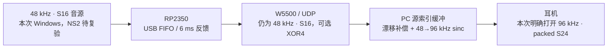

# 音频升级前后指标与实板验收

日期：2026-10-19。当前批次由 V0.0.9 升至 V0.1.0，一次递增。

本记录落实文档 11 的改进和前后对比。原始证据位于 `artifacts/acceptance/audio-upgrade-20261019`，下文简称 E。改进前源码、测量程序和发布程序已冻结，完整 Flash 与配置已备份。离线、宿主替身和真实开发板证据分别记录。

## 测试条件

- 开发板：W5500-EVB-Pico2，设备 ID `aa36483cef4256f169f4f4e5322c6df8`。
- DAP-link SWD；COM8，115200、8N1。
- USB 音源：当前 Windows PC；精确匹配板端 USB serial `E53B126BB2E31A4A` 的声卡端点。
- 板端地址 `192.168.8.73`，有线接收 `192.168.8.74`。
- 播放：用户指定 Realtek 耳机，端点 `{0.0.0.00000000}.{32f84dcf-80da-42e0-86c8-ec92564764aa}`。原对照/长测为 48 kHz 浮点共享混音；另补测明确指定 96 kHz/24-bit 的独占输出，分别列示。
- 测试临时将耳机设为 25%、解除静音，USB 音源设为 0 dB；低幅度左右 440/880 Hz 测试音。每项结束恢复该项开始时两个端点的原始音量和静音，不更改系统默认端点；具体原始值随用户当时设置记录在各日志，不能用第一项的原始音量覆盖后续设置。
- 数字回环只统计，不保存音频。未测物理模拟端到端延迟和主观音质。
- 实板基准协商临时 UDP 接收端口以隔离测量；管理/音频源端口仍为 49161/49162，常规 GUI 默认接收端口为 49162。基准直接使用发布 App/Core 的接收及渲染实现，GUI 交互另做原生替身回归。

测量程序直接请求 USB 已声明的格式，检查实际 Host 格式后才记入结果。GUI 的“按输出能力过滤 USB 格式”策略保留，日常连接后可能隐藏当前耳机不支持的高规格；本次 96→48 kHz 检验底层转换，不宣称 GUI 自动开放了全部格式。

## 改进前基线

实板运行 **V0.0.5**，软件及测量程序链接 **V0.0.9**。这是当前部署组合，不冒充 V0.0.9 固件已烧写。Flash 备份为 2 MiB，配置备份为末尾 8 KiB；SHA256 位于 backup/baseline-manifest.json。

各项正式窗口为 60 秒，另有输出预热。原始窗口前后统计均保存，启动故障与正式窗口增量分开。

| 输入/上限 | 正式窗口输出欠载 | 修补源帧 | 输出溢出 | USB 欠载/重同步增量 | 结果 |
| --- | --- | --- | --- | --- | --- |
| 48 kHz/16-bit，80 ms | 0 | 18432 | 0 | 0/0 | 连续性不通过；序号跳变与样本缺口存在，尚不单凭计数归因于具体网络环节 |
| 48 kHz/16-bit，20 ms | 23 | 0 | 246 | 4/4 | 连续性不通过 |
| 96 kHz/24-bit，80 ms | 0 | 0 | 0 | 0/0 | 本项通过；目标频率能量左/右约 99.928%/99.914% |

离线结果：192 kHz/100 ms 容量边界预填充 90 ms 后产生 896 帧内部缺失；44.1→48 kHz 在 20 kHz 处 FIR 系数增益约 -1.99 dB。1200 秒虚拟漂移模型及 10 ms 回调耗时明细见 before/offline.jsonl。这些结果与实板证据分别记录。

完整汇总：[before/summary.json](/D:/Github/NS2_Sound_Convert/artifacts/acceptance/audio-upgrade-20261019/before/summary.json)。

## 逐项落实

参考源码仍为文档 11 固定的 Roc `60db91c`、ScreamRouter `4d3dc1f`、Snapcast `4fed179`、TinyUSB `2f675ab`。前三者借鉴设计和边界测试，未整套引入其实现；对应许可证分别为 MPL-2.0、AGPL-3.0、GPL-3.0。TinyUSB 增加只读诊断 API，小补丁保存在 `SoundConvertBoard/vendor/tinyusb-feedback-diagnostics.patch`；构建前检查固定 SHA 并幂等应用，保留 MIT 上游许可。独立编码实验另列 Xiph 许可证。

| 编号 | 已实施的具体改变 | 证据与适用范围 |
| --- | --- | --- |
| B01 | 物理环形容量 16384→32768 源帧；预算检查覆盖逻辑上限、FIR 历史/前瞻及最大包；用户缓冲上限仍为 4～100 ms | 192 kHz/100 ms 的 896 帧覆盖复现归零；十格式与多档上限的 Core 回归 |
| B02 | 基于 `Δarrival−Δsample/Rs` 估计到包偏差，以 `exp(-dt/10s)` 衰减，保留 >50 ms 尖峰；乱序不污染向前时间估计；所有容量的启播/重缓冲保留批量到包余量 | 80 ms 档预填充通常至少 56 ms；实测发现长停顿后 80 ms 也可能触顶，最终将启动余量修正推广到所有容量。仅未播放时裁剪，独立计数；硬上限不变 |
| C01 | 分开 prefillTarget、实际启播水位 driftReference、hardLimit；重缓冲时重建参考，停收时暂停漂移更新 | 零漂移模型不再因固定调度偏移持续给出约 215 ppm；保留 P/I、抗饱和、±500 ppm 和 100 ppm/s 保护 |
| C02 | 32 个约 1 秒最少延迟锚点的仿射时钟观察器；至少 8 个锚点才报告置信度 | 只观察、不驱动 ASRC；倒序/异常和代次重置回归。不是 PTP/NTP 同步或独立物理时钟校准 |
| R01 | 三档质量、按降采样比例延长 taps、1024 相位加相邻相位插值 | 生产 ASRC 实际输出扫频、相位边界和动态采样率回归；均衡档 20 kHz 改善见下表 |
| R02 | 打开监听前后台预热/共享不可变系数；连续窗口一次槽位校验，两声道 SIMD 点积；保留所有权锁 | 同条件 full-JIT Read P99 明显下降。Add/Read/锁等待最近 2048 次分位数；不是无限时长全局分布 |
| U01 | FIFO/反馈/网络期限公共预算；FIFO 12352 B，反馈约 6 ms；只读内部反馈、generation 内水位直方图和短读详情 | 真实 Host 描述符、USBPcap URB 反馈/OUT 包长、正式窗口计数。3 ms 候选长测失败推动本次调整，见失败记录 |
| U02 | 稳定 0 dB 直接交接、稳定静音清零，保留 1 ms 增益渐变；SPI 10→25 MHz；SENDOK 维护所有权；队列/IRQ/发送诊断 | 宿主增益/24-bit/时限检查与实板计数。提取后期限仍为 4 ms；未引入 DMA，未放宽为 PC 缓冲上限 |
| U03 | 最终 ARM ELF 模板经过生产过滤器枚举全部 1023 个 mask；生命周期/32-bit 时间和字节计数回绕检查 | Windows 实际运行描述符为已保存的四格式；十格式全覆盖是宿主检查。NS2、手机 Host 和 24 h 实播未作为已通过 |
| N01 | 可选 XOR4、严格协商与有界缓存；UDP 接收缓冲 256 KiB→1 MiB；接收改为单一专用阻塞套接字线程；独立 UABA→RTP L16/L24 工具 | 线程池饥饿回归修正前失败、修正后通过；Windows 可选 MMCSS Audio 注册/退出，报告失败原因并正常降级。新增到包间隔与 GC 暂停诊断。FEC 原始包立即释放；RTP 第三方互通尚未验收 |
| N02 | 独立编译官方 Opus/FLAC，在桌面与真实 150 MHz RP2350 测同一合成输入 | 已完成资源/耗时实验；生产链路保持 PCM。编码预算未满足充分余量，未把未验证的实时压缩放进稳定固件 |

主要实现入口：`SoundConvertClient/Core/AudioBuffer.cs`、`AudioTiming.cs`、`SincFilter.cs`、`AudioFec.cs`、`RtpPcmEncoder.cs`；`App/WindowsAudio.cs`、`MainViewModel` 和播放页；板端 `usb/usb_audio.c`、`usb_timing.h`、`uab_network.c`、`uab_udp_completion.h`、`uab_audio_fec.c`。

## 离线前后对比

这些测量直接调用冻结的旧 Core 和新生产 Core。扫频使用生成的量化 PCM、冻结时钟及精确目标预填充；不打开声卡，不冒充实板音质或模拟输出测量。性能对照两边均设置 `DOTNET_TieredCompilation=0`，避免把不同 JIT 阶段当作优化收益。

| 指标 | 改进前 | V0.1.0 |
| --- | --- | --- |
| 192 kHz、100 ms 上限，预填充 90 ms 的内部缺失 | 896 源帧，溢出计数 0 | 缺失/溢出均 0 |
| 44.1→48 kHz，20 kHz 实际 ASRC 输出增益 | −1.9885 dB | −0.0078 dB |
| 同步 0 ppm 渲染模型最终控制量 | 约 +215 ppm 的调度/目标偏差 | 约 0 ppm |
| 44.1→48 kHz，10 ms Read P99，紧邻复测 | 51.6 μs | 19.8 μs |
| 48→48 kHz，10 ms Read P99，紧邻复测 | 49.1 μs | 20.1 μs |
| 96→48 kHz，10 ms Read P99，紧邻复测 | 64.0 μs | 26.5 μs |
| 192→48 kHz，10 ms Read P99，紧邻复测 | 49.7 μs | 42.6 μs |

CPU 表使用冻结的旧二进制与新二进制紧邻执行的 `comparison/offline-before-repeat.jsonl`、`offline-after-repeat.jsonl`，均关闭分层 JIT；它是改进后对旧二进制的复测，原始改进前数据未覆盖。早期各时段的 CPU 绝对值随机器负载/频率明显变化，因此不将跨时段的 113.6→18.8 μs 直接当作稳定提速比。新旧滤波器质量/长度也不同，这里同时报告质量提升和实际成本，没有假设每 tap 工作量相同。

96→48 的 28/35 kHz 系数响应约 −96/−120 dB，但实际 16-bit 量化信号的输出还受输入量化噪声限制，不将系数频响直接写成整机信噪比。测量覆盖 44.1/48/96/192 kHz 源率及 20 Hz～35 kHz 的适用频点；其他采样率/质量档的边界由 Core 回归补充，未宣称完整 Audio Precision 测试。


纯 DriftController 的 1200 s 虚拟模型在两版参数相同：±100/±300 ppm 收敛；±450 ppm 最终补偿正确，积分限幅使残余水位约 ±12.5 个 48 kHz 归一帧。它证明原 PI 的限幅行为，不能拿来宣称本批重新调参。新改动主要修正其参考水位与抖动目标的耦合。原始文件：`before/after/offline-fulljit.jsonl`、`signal-sweep.jsonl`。

三档名义 taps/截止系数分别为低延迟 48/.94、均衡 96/.96、高质量 128/.97；降采样按 `max(1,Rs/Ro)` 扩展偶数 taps。48→48 kHz 前瞻约 0.5/1/1.333 ms，均衡 192→48 kHz 为 384 taps、约 1 ms 前瞻。系数预热在后台完成，切档停止并重建监听；不会在 USB ISR 分配或计算这些表。

## USB 与网络时限

候选版本初设 6176 B FIFO/3 ms 反馈目标。带管理查询的长测发生一次 USB 欠载，记录到最后 RX 距欠载约 3883 μs，消费任务 service gap 仅 6 μs、FIFO 已空。该证据支持扩大 Host 送数间隙余量，不能反推为某个 Windows 驱动的确定故障。

最终采用 12352 B FIFO（16 个最大 772 B 包）、约 6 ms 反馈目标，较候选增加约 3 ms USB 储备；初次启动仍以两块为最小门槛，Host 启动/停播的 generation 和短读计数单独记录。源提取后的 4 ms 网络期限不变，PC 的 20/40/80 ms 上限也未被偷偷扩大。

| 格式 | FIFO 最大字节覆盖 | 反馈目标字节 | 25 MHz 下 UABA 数据 SPI 写入理论下限 |
| --- | --- | --- | --- |
| 48 kHz/16-bit | 64.33 ms | 1152 B | 76.80 μs/包 |
| 96 kHz/24-bit | 21.44 ms | 3456 B | 199.68 μs/包 |
| 192 kHz/16-bit | 16.08 ms | 4608 B | 261.12 μs/包 |

SPI 理论值只含 UABA 数据，不含寄存器、命令、控制与 FEC；实板 `spi_actual_hz=25000000`，板端队列和发送超时另计。SENDOK 已替代仅凭命令寄存器/写指针判断完成的做法，仍不意味着远端送达。FIFO 最大容量不是日常平均驻留时间。

Windows 实际读取到设备 `cafe:401b`、Full-Speed、serial `E53B126BB2E31A4A`，配置 278 B，保留四种已存格式。真实反馈端点 `0x81` 为 3 B。USBPcap2 仅过滤开发板地址 23，统计 Host URB；抓取的是本任务合成测试音。候选捕获约 20.11 s，10046 个反馈，值为 47.9862～48.1758 samples/ms；OUT 包长出现 47/48/49 帧（2/20027/50 个），ISO 错误 0。由此可观察 Host 随反馈改变包长；USBPcap URB 时间不是硬件总线分析仪的物理到包时刻，也不是端到端延迟。格式依据 [USBPcap 公开规范](https://desowin.org/usbpcap/captureformat.html)，分析脚本为 `tools/Analyze-UsbFeedback.ps1`。最终 6 ms 捕获另列在最终结果。

6 ms 镜像重启后的当前地址为 27，已重新读取序列号核对，未沿用旧地址判定通过。稳定阶段捕获 12.136 s、6069 个反馈：47.9983～48.0974 samples/ms，平均 48.00395；Host OUT 47/48/49 帧分别为 1/12072/49 个，ISO 错误 0、截断记录 0。文件为 `after/usb-feedback-6ms-steady.pcap` 与 `*-analysis.json`。另保留一次空旧地址捕获及一次跨停播的捕获，后者含反馈清零，不混入稳定范围。

## 实板短测与长测

正式窗口判定要求：有有效音频；无非法包；输出欠载、溢出、重同步、源提交缺口、修补影响帧及板端 USB/队列/发送期限故障增量为 0；数字回环的左右目标频率能量通过。启动预热不混入该窗口。严格检查永久源帧/FIR 影响计数，不能仅凭“没有输出欠载”判为连续。

每项均保留 `board_before/output_before` 和结束快照；启动、停播和格式转换期间的累计计数没有清零隐藏。因此本报告的“0”指正式窗口增量，不等于开机至今所有转换阶段从未出现过一次欠载。独占输出用例没有回环，另按实际格式和连续性判定。

6 ms 固件、推广全部容量恢复余量之前的软件候选，其 60 s 短测如下。所有通过项的正式窗口中，源提交缺口、FIR 缺口影响、额外启播裁剪、输出欠载/溢出/重同步及 USB/队列期限故障均为 0。原始 PCM 96 kHz 的失败保留，未反复重测到偶然零丢包后替换结果。该候选 App/Core 哈希证明为 `after/published-version-and-tested-assemblies.json`；最终修正版另见 `after/recovery-final`，不混用二进制证据。

| 输入/软件上限/模式 | 修补源帧 | 输出欠载 | 溢出/重同步 | USB 欠载/重同步 | 结果 |
| --- | --- | --- | --- | --- | --- |
| 48 kHz/16-bit，80 ms，原始 PCM | 0 | 0 | 0/0 | 0/0 | 通过；基线该项修补 18432 源帧 |
| 48 kHz/16-bit，20 ms，原始 PCM | 0 | 0 | 0/0 | 0/0 | 通过；基线该项欠载 23、溢出 246；启播前总裁剪 48 源帧，正式增量 0 |
| 96 kHz/24-bit，80 ms，原始 PCM | 96 | 0 | 0/0 | 0/0 | 不通过；观察到 1 个序号缺包，永久源缺口 96 帧，FIR 影响 144 输出帧 |
| 48 kHz/16-bit，40 ms，原始 PCM | 0 | 0 | 0/0 | 0/0 | 通过 |
| 48 kHz/16-bit，80 ms，XOR4＋每 64 包注入 1 包丢失 | 0 | 0 | 0/0 | 0/0 | 通过；明确注入 976 包，恢复 976 包，无额外自然缺包证据 |
| 96 kHz/24-bit，80 ms，XOR4 | 0 | 0 | 0/0 | 0/0 | 通过；本项未观察到自然丢包，不把它说成已验证自然丢包恢复 |

这些结果证明了缓冲边界修复和可选纠错能力，**没有证明自然网络丢包率下降**。同样规格的一分钟前后观测受实际网络/系统时序影响，不能据此保证未来任意一小时原始 UDP 都不丢包。最终稳定档选择 80 ms/均衡/XOR4，原始 PCM 不通过项仍体现在总表中。

整套测试进程 CPU 包含 USB 音源生成、接收、ASRC、耳机输出和数字回环分析，按单核 100% 计：48/16、80 ms 原始 PCM 为基线 9.86%→本轮 11.30%；96/24 为 15.97%→12.81%；48/16、20 ms 为 15.83%→10.71%。FEC 48/16 注入测试约 14.24%，96/24 FEC 约 14.30%。这不是单独产品 GUI 的 CPU，也不把跨时段整进程差异归因于某个 DSP 优化；DSP 的紧邻二进制对照另见上表。完整短测指标为 `after/short-summary.json`。

### 两小时受保护长测：已完成，软件候选单独标识

14:07:50～16:07:50 的测试正式窗口为 **7200.417 s，通过**；输入 48 kHz/16-bit、80 ms/均衡/XOR4，输出为 48 kHz 共享耳机。每秒 GET_INFO，无注入丢包。文件 `after/hardware-soak-final-48-80ms.jsonl` 的名称保留原样，但其软件是随后“全部容量恢复余量”修正之前的冻结候选；不能把这两小时直接算到最后一个 Core 哈希上。固件与最终烧录镜像相同。

| 两小时正式窗口指标 | 结果 |
| --- | --- |
| 正式接收音频包 | 7,200,729 |
| 永久源缺帧、PLC 源帧、FIR 影响帧 | 均 0 |
| 输出欠载、重缓冲、溢出、重同步、额外启播裁剪 | 均 0 |
| 板端 USB 欠载/重同步、队列丢弃/过期、发送过期/超时 | 均 0 |
| PC 最大到包间隔 | 51.6202 ms |
| 源 FIFO 水位 P50/P95/P99 | 均位于 [6,7) ms；正式直方图覆盖 [5,8) ms |
| 左/右目标频率能量占比 | 99.9904% / 99.9811% |
| 数字回环无效样本、幅值跳变 >0.25 | 均 0 |
| Read P99 / Add P99 | 71.7 / 2.9 μs，结束时最近 2048 次，非两小时全局分位数 |
| Read/Add 锁等待 P99 | 0.5 / 0.6 μs，同上 |
| 整套测量进程单核 CPU | 11.93%，包含音源和数字回环 |
| 影子源时钟 | +43.14 ppm，相对 PC 单调时钟；并非物理校准 |

正式 FIFO 直方图由窗口前后相减：5 ms 桶 253263，6 ms 桶 6947665，7 ms 桶 26。IRQ 最大 70 μs、块年龄最大 2446 μs 为累计最大值上界，不能冒充本窗口分位数。输出/提交源帧的比值约 +42 ppm，但快照非原子，只作一致性参考；PI 参考的是输出设备时钟，影子观察器参考 PC 时钟。


Npcap 同步统计 `after/wire-final-long.jsonl`：驱动接收 9,324,906 包，`pcap_dropped=0`、接口丢弃 0。长测 stream `2110539409` / epoch `108` 原始序号缺失 **8** 个：`864737, 889993, 4724656, 4736165, 4738868, 4763419, 4773948, 4789905`。均为各自 XOR4 组内单包，播放期限前恢复，输出永久缺口为 0。应用序号跳变事件只有其中 7 个：组末的 `4763419` 可在后续更高序号原始包到达前被 parity 恢复，因此不一定形成序号跳变事件。整会话 `fec_recovered_packets=9` 包含预热；没有预热前接收器快照，**不能写成正式两小时自然丢包 9 次**。8 个原始包的具体物理丢失环节尚未定位，也不能据此归因 W5500。

### NS2 的 48/16→96/24 路径与恢复修正版

用户报告 NS2 输入 48 kHz/16-bit、输出 96 kHz/24-bit 时爆音。16→24 位扩展不会增加原始有效精度，也不是通常的爆音成因；本轮主要减少源头欠载、输出缺样、漂移参考偏差和丢包影响。48→96 的采样率转换需要连续时间轴，不能只做整数补零或宣称输出规格更高就能修复。



输出改为 96/24 并不要求开发板先将网络流升为 96/24。48/16 每毫秒 PCM 192 B，加 48 B UABA 头为 240 B；XOR4 每四包多一个 280 B 修复包，应用层约 2.48 Mbit/s，不含 UDP/IP/以太网开销。本轮在 PC 完成倍率转换，避免为了输出规格扩大板端和网络 PCM 负载。

补测 96 kHz/16-bit→48 kHz 共享耳机时，出现最大 70.5461 ms 到包间隔；输出欠载 1，随后溢出/重同步各 178，板端 USB/网络期限计数正常。发现旧候选只为低于 40 ms 的缓冲处理启动余量，80 ms 重缓冲也会贴住硬上限。证据 `after/hardware-fec-96-16-80ms.jsonl` 原样保留。新增 75 ms 延迟、5 ms 批量、+100 ppm 的 48→96 / 96→48 双向恢复回归，修正前明确失败；推广余量后 563 项离线检查通过。耗尽储备的长停顿仍可能产生首次淡出/等待，修正目标是恢复后不再持续重启，不能承诺任意长停顿零中断。

耳机只读能力检查确认支持独占 96 kHz/24-bit；补测通过生产 ASRC 和明确的 packed S24 输出，检查 WASAPI 实际选择格式，绝不把 48 kHz 共享混音标成 96 kHz。独占模式不能用现有 WASAPI 回环，结果只验收连续性计数；默认 GUI 继续跟随用户选择端点的共享混音率，Windows 设置为 96 kHz 时自动使用 96 kHz ASRC。测试不改变该设置。NS2 主机本身仍待重新接入复验。

恢复余量候选（专用接收线程之前）的 20 ms 可选档保留了一次失败：最大到包间隔 **26.9054 ms**、批量到包 **33 ms**、最大取数 **22 ms**，均已超过 20 ms 可提供的覆盖。正式窗口欠载 5、溢出/重同步各 4、启播/重缓冲裁剪 1703 源帧，永久源缺口/USB 故障为 0。该结果不通过，保存在 `after/recovery-final`；它不覆盖更早候选曾通过的 20 ms 记录。该候选的汇总明确所有短测通过为 false。专用接收线程版本重新验证传输改变，另列最终结果；一次 20 ms 通过仍不能保证覆盖任意更长停顿。部署选择 80 ms。

### 接收线程隔离与新的最终验证批次

推广恢复余量的候选（Core `2C2BEF...`）在 48/16→96/24 独占长测中仍未达到两小时：约 20 分钟时发生 **90.1979 ms** 到包停顿，批量到包达 **76 ms**，超过 80 ms 显式上限；保护器停止，输出欠载/溢出/重同步各 1、额外裁剪 663 源帧，未见序号缺口或永久提交缺帧。最大 Read 9385 μs、没有 Read 超期。文件为 `after/recovery-final/hardware-soak-48-16-to-96-24.jsonl`，以 `hardware_error` 保存取消快照，不是两小时通过。

随后在未启动其他音频用例前读取板端累计统计（`board-stats-after-failed-soak.jsonl`）：相对该窗口前，USB 欠载/重同步、队列丢弃/过期、音频丢弃/发送超时均无增长；stream poll 累计最大 3447 μs。这些信息没有指向对应的 USB/发送故障，但仍不足以确定 90 ms 发生在网卡还是应用调度。

另用真实回环 UDP 建立可重复失效模型：占满两个已限额的公共工作线程，同时由独立线程发送 8 包。原 `ReceiveAsync` 续体在 300 ms 内无法处理这些包，`receive-pool-before-fix.log` 明确失败。最终改为单一专用阻塞接收线程，取消时关闭套接字退出，原有 probe/协商/代次/重排/FEC 仍由同一接收所有者处理；同一模型通过。Windows 线程可注册 [MMCSS Audio 任务](https://learn.microsoft.com/en-us/windows/win32/api/avrt/nf-avrt-avsetmmthreadcharacteristicsw)，退出时释放，注册失败会报告错误并使用普通独立线程，不修改系统注册表或进程优先级。

这证明隔离了“公共线程池被占满”的失效模式，**不能反推上述 90 ms 停顿已经确定由线程池造成**。最终接收统计另记录最近 16 个 ≥20 ms 到包间隔及同段 GC 暂停/代次变化；Npcap 同时记录驱动包时间戳与取包线程时间，后者排队停顿不冒充线缆停顿。最后发布字节和测试位于 `after/receive-owner-final`，与此前所有候选分开。质量/三轮性能配对使用同一最终 Core；最终界面文本也明确 20 ms 在有线时仍可能预算不足。

### 主机交付间隔与用户授权的网卡试验

独立接收线程版本的七项短测全部通过，包括 20 ms；额外核对正式窗口的超大取数静音增量与预填充裁剪均为 0。但在原网卡参数下，48/16→96/24 长测约 20.7 分钟再次停止：接收间隔峰值 **89.8465 ms**，欠载/溢出/重同步各 1。该段 **GC 暂停增量和三代回收次数均为 0**，最大 Read 8.3523 ms、Read 超期 0，USB/队列/发送故障无增长。它仍是失败记录，不能说专用线程已经消除了所有持续播放停顿。

这次 Npcap 覆盖了该长测 stream `1376491741` / epoch `234`：1,253,188 个原始包、序号无缺失，捕获/接口丢弃返回值均 0；**驱动时间戳最大间隔 88.987 ms**，抓包应用取包最大间隔 94.1164 ms。这表明对应停顿在驱动观测时已经存在，不能只归因 .NET 续体或 GC；它仍不是物理线缆时间，具体位置可能在驱动/网卡交付或更上游。数据位于 `after/receive-owner-final/wire-with-timestamps.jsonl`，同次错误快照保留了窗口前后板端统计。

当前有线设备为 Intel I219-V，驱动 20.0.3.9（2025-04-08）。检查发现中断裁决及 PCIe 链路省电均开启，EEE 已关闭。[Intel 的 I219-V 支持说明](https://www.intel.com/content/www/us/en/support/articles/000058667/ethernet-products/gigabit-ethernet-controllers-up-to-2-5gbe.html) 建议小包响应场景可降低或关闭中断合并；这提供了测试依据，不能据此断定就是此次 89 ms 的根因。

用户明确授权测试后，通过本人确认的管理员助手，仅将 `*InterruptModeration`、`EnableK1` 从 `1` 改为 `0` 并重连该网卡。原值及所有高级参数保存于 `after/nic-latency-test/original.json`，操作结果 `apply.json` 核对其他高级参数无变化，IPv4 仍为 `192.168.8.74/24`，没有修改 IP 配置。脚本为 `tools/Set-AudioNicLatencyProfile.ps1`；`-Action Restore` 可用该原始备份恢复这两项。关闭合并/省电可能增加中断和功耗，因此同一应用字节的新测试单独放在 `after/nic-low-latency-final`，不与代码修改的效果混为一谈。

最终表中短测为原网卡参数下的软件验证；两小时行若采用网卡试验参数，会明确标注该条件。原参数下的两次长测失败原样保留。整个应用仍是相同 `E1006D...` / Core `7E01F1...` 字节，固件仍是相同 `1D80C3...`，没有为了重试递增版本或替换原始失败数据。

当前状态补充（2026-10-19 本轮分段审计时）：最终专用接收线程版本的七项短测均保留在 `after/receive-owner-final`，包括共享 20 ms 档通过；此前同字节、原网卡参数下的 96/24 两小时目标在约 20 分钟出现约 89 ms 交付停顿，停止为失败。

用户授权的两项网卡参数改为 0/0 后，48/16→96/24 与 96/24→48 的各 60 秒 smoke 通过；随后目标两小时的运行在约 49 分钟发生 Windows USB 源 WASAPI `GetBuffer` 异常 `0x88890026`，未达到两小时。该轮源停止前记录最大应用到包间隔约 17.574 ms，Npcap 驱动间隔约 17.307 ms，原始序号无缺口；源停止后出现 PC 欠载，板端 USB 欠载/重同步增量各 1。现有记录不能判定源异常和 USB 断流的先后根因；电源计划睡眠超时为 0，不以未经验证的“电脑睡眠”解释。所有结果保存在 `after/nic-low-latency-final`，不写成最终两小时通过。

用户进一步要求优先追查 20 ms 退化，因此暂停重复长测，新增同固件/有线/耳机的六组 30 秒分段 A/B。结果与代码归因见 [文档 13](13-20ms延迟退化归因与分段实测.md)：FIFO 2→6 ms、高余量预填充 41.5→56 ms，以及起播积压被新漂移参考保留。纯确定性模型也复现旧版 19→约 12.479 ms、当前维持 19 ms。共享 20 ms 短测通过与物理端到端低于 20 ms 分别验收；本轮未对物理总延迟作通过声明。

### NS2 持续播放偶发爆音的定向复验

用户补充症状为“持续播放时偶发”，因此不能只验证插拔和开始播放的渐变。下一次把音频 USB 接回 NS2 后，保持 DAP-link/COM8、有线与指定耳机连接，使用 `AudioUpgradeBench external-source` 记录游戏持续流：该入口不查找或打开 Windows USB 音源，不发送测试音，不改 NS2 音量，只接收板端实际输入并播放。`--source-label NS2` 是用户标识，不冒充软件自动识别主机型号。

重点按同一时间窗口区分：

1. `usb_underruns/usb_resyncs/generation` 变化：缺失已经发生在 USB 提取端，先看 FIFO 水位趋势、最后 RX 间隔、实际 Host 包长及 USB 生命周期。网络 XOR4 不能补回尚未形成网络包的源数据。
2. USB 正常但出现序号缺口：对照 FEC 恢复数、永久提交缺帧、组内缺失分布及抓包统计；不能把一次乱序或已恢复包直接算成永久丢包。
3. 源帧完整但 `output_underrun/overflows/resync` 增长：对照实际最大取数、到包停顿、显式上限、prefill 与漂移参考。若改为 80 ms 后正常，只能认定该配置覆盖了所测调度，不能承诺 20 ms 同样稳定。

本固件按 RP2350 计时器提取固定标称时长音频，通过 FIFO-count 显式反馈让 Host 调整供数；这是 [TinyUSB 官方反馈示例](https://docs.tinyusb.org/en/latest/examples/device/uac2_speaker_fb.html) 描述的协作方式。Windows 本次已经观测到 47/48/49 帧调整；**尚无 NS2 的反馈响应证据**，不能假设其与 Windows 完全相同。如果 NS2 实测 FIFO 随播放时长持续单向漂移，才进一步核对 Host 反馈响应和消费时钟关系，不能仅靠提高缓冲掩盖该类问题。

复验命令（待 NS2 真正接入且游戏正在播放；结果文件使用新名称）：

```powershell
dotnet D:/Github/NS2_Sound_Convert/artifacts/acceptance/audio-upgrade-20261019/after/external-probe/AudioUpgradeBench.dll external-source `
  --source-label NS2 --host 192.168.8.73 --local 192.168.8.74 `
  --output '{0.0.0.00000000}.{32f84dcf-80da-42e0-86c8-ec92564764aa}' `
  --format 16/48000 --exclusive-output 24/96000 --buffer 80 --fec --poll-board --seconds 7200 `
  --report-file D:/Github/NS2_Sound_Convert/artifacts/acceptance/audio-upgrade-20261019/ns2-external-48-to96.jsonl
```

这个入口是复验工具，当前没有 NS2 实机通过记录；独占播放没有数字回环或模拟录音，偶发爆音的主观出现时刻还应与计数变化对齐。

### 保留的失败与诊断

- `after/hardware-soak-2h-48-80ms.jsonl`：3 ms 候选、FEC 关闭，计划 2 h，在约 320 s 停止。观察到 3 个序号缺口、144 个已提交源缺帧，输出欠载/溢出 0，板端 USB/队列过期/发送超时正式增量 0。该次不通过，不能归因于重采样器，也未锁定丢失发生在链路哪一段。
- `after/candidate-3ms/hardware-soak-2h-fec-48-80ms.jsonl`：同候选开启 FEC 和每秒 GET_INFO 后，发生 1 次板端 USB 欠载/generation 重建；源头缺失不在 FEC 可恢复范围，停止该次测试并改用 6 ms 水位。也不计为 2 h 通过。
- `after/candidate-6ms-prefill-half/hardware-fec-injected-48-80ms-build-overlap.jsonl`：975 个注入丢包全部恢复，但到包间隔峰值 187.746 ms，输出欠载 1、溢出/重同步各 8；该窗口与构建时间重叠，没有足够证据锁定具体调度来源。不能将 FEC 恢复成功写成整链通过，也不能用超过当前硬上限的停顿要求零等待丢失。
- `after/candidate-6ms-prefill-half/hardware-soak-2h-fec-6ms-48-80ms.jsonl`：无包序号缺口、USB 正式增量正常，但首次约 42.778 ms 到包间隔超过当时约 41.5 ms 的预填充，输出欠载 1；约 170 s 停止。由此将高余量档预填充提高，同时为至少 22 ms 的实际 Windows refill、FIR 和一包预留至少约 24 ms 空间，80 ms 上限未改变。43 ms 延迟模型新增为回归。
- `after/candidate-prefill-low-ceiling/hardware-48-20ms.jsonl`：最大到包间隔仅约 4.648 ms、板端正常，仍发生 189 次溢出/重同步。定位为低缓冲启播/重缓冲贴住硬上限，后续普通批量到包反复触顶。`low-latency-regression-before-fix.log` 先复现模型失败；最终增加启动余量、显式记录启播前裁剪，5 ms 批量/+100 ppm/30 s 模型转为通过。裁剪发生在未播放状态，不隐去活动播放中的缺帧。
- 定向 Npcap 工具只观察板端 UDP 包头，记录原始序号缺口及驱动丢弃数；与应用端事件序号对照，不能把普通“序号跳变”自动写成永久网络丢失。被取消/未完成的早期抓包不用于通过结论。

## 独立压缩编码实验

源为官方 Opus v1.5.2 `ddbe48383984d56acd9e1ab6a090c54ca6b735a6`、FLAC 1.5.0 `1507800de4b70e21be71f38caa0d9079d0bc6e45`。源码放在 E/codec-sources，不加入默认固件依赖。桌面和开发板都编码相同的 48 kHz/16-bit/双声道、240 帧（5 ms）合成音/全幅确定性噪声，每项 100 块、原始 96000 B。FLAC 开启内部无损校验。未保存或播放录音。

| RP2350 150 MHz，5 ms/块 | 平均编码 | 最大编码 | 输出/原始字节 | 附加条件 |
| --- | --- | --- | --- | --- |
| Opus 128 kbps C0，音调 | 3.900 ms | 4.173 ms | 8000/96000 | encoder state 48432 B；前瞻 120 帧=2.5 ms |
| Opus 192 kbps C1，音调 | 4.774 ms | 5.031 ms | 12000/96000 | 同上 |
| Opus 128 kbps C1，噪声 | 4.502 ms | 4.851 ms | 8000/96000 | 已运行一次 decoder PLC 调用 |
| FLAC L0，音调 | 1.846 ms | 2.214 ms | 20377/96000 | 无损校验通过，finish 2.022 ms |
| FLAC L5，音调 | 9.001 ms | 9.340 ms | 20397/96000 | 无损校验通过，finish 9.569 ms |
| FLAC L0，噪声 | 2.070 ms | 2.438 ms | 97186/96000 | 无损校验通过，finish 2.332 ms，体积反增 |


编码占用尚未包含 5 ms 收集、前瞻、USB/网络服务、封包和调度。Opus 余量不足，FLAC L5 超时；FLAC L0 虽编码较快，也不能直接跨越现有 4 ms 块年龄策略，更不能保证噪声压缩率。因此本轮完成可复现的 PC/实板实验与资源判断，稳定固件仍使用 PCM；未宣称实时压缩链路已交付。要接入压缩还需独立时间轴/帧长协商、收集预算、USB 并发压力和解码恢复验证。

Pico 试验使用 Core 1 SRAM 64 KiB 栈，保留末尾 8 KiB 配置；临时固件显式关闭继承的 watchdog，实验后恢复生产镜像并 SWD verify。早期继承 watchdog 导致重复启动的结果保留但不作为最终性能表。FLAC 在 newlib 的 int32_t=long 环境需要私有 Rice 缓冲类型一致补丁，保存在 `tools/CodecBench/flac-newlib-int32.patch`；未屏蔽不兼容指针警告，未移植不需要的文件系统元数据迭代接口。具体构建参数、源提交与许可见 `tools/CodecBench/README.md`。

## 离线回归、部署与证据

- Core **567 项通过**，含真实回环线程池饥饿、容量、抖动、漂移、43 ms 连续覆盖、20 ms 触顶和 80 ms 双向长停顿恢复、质量/相位、FEC 21 项及 RTP 78 项；这些不是实板验收。192 kHz/90 ms 预填充检查明确要求无启动裁剪，避免用裁剪掩盖物理覆盖错误。
- 原生 Avalonia 界面/生产 ViewModel/设备替身 **150 项通过**，包含质量/FEC 绑定和完整设置字段往返；最终隔离目录 `after/ui-receive-owner-final`，未改变真实设备。复用旧替身目录造成历史状态断言失败及一次 CLI 参数转发错误的运行保留，最终用新目录与直接 DLL 入口重测。
- 固件宿主检查包含 USB owner **20238** 项、测试模板与最终生产模板各 **1023** mask、DHCP 17、音频封包 54、TX 22、UDP 完成/回绕、FEC、JSON 数值 30750、身份 3 项，均通过。宿主不模拟真实 Host IRQ/USB 线缆。
- 最终固件 ELF SHA256：`1D80C3B369468CAD5332879FD4CE534C472679C75012684C4EACF506F78C25EA`；DAP-link `Verified OK`，COM8 启动上报 `V0.1.0`、SPI 25000000。
- 最终配置 Flash 末尾 8 KiB SHA256：`576CABCBB18B77316B972EF445631A7C5A1FD1FF55931C42AD3FAF72D10F1CCB`，与升级前逐字节相同。未整片擦除；格式/名称/网络配置保留。
- 正式测试 bench 直接复制发布目录的 `SoundConvertClient.dll` 与 `UsbAudioBridge.Core.dll`，用 hash 核对，避免只测了另一次构建；软件 EXE/DLL 版本为 0.1.0.0，`--version` 为 V0.1.0。最终恢复修正版的哈希与前一两小时候选分别保留，不能互换验证时长。

基线保全：源码 ZIP SHA256 `B41B7CAA65EE879E3B050BAD276F17465B4298E2B417E862EEEB31E433DA0953`；2 MiB Flash SHA256 `7ADDABD42B632B37CAB83492BED21AE90710FD560CC18051716B6794B7169341`。旧 bench 二进制单独冻结，后续构建不写入 before 目录。复现工具为 `tools/AudioUpgradeBench`，压缩试验为 `tools/CodecBench`，显式指定接收目的地的 RTP 工具为 `tools/AudioRtpBridge`。RTP 工具不是 AES67/PTP 或压缩传输。

### 本次验收边界

Windows USB 音源→RP2350/W5500→有线→新生产接收/ASRC→指定 Realtek 耳机为实际联调范围；共享输出包含 WASAPI 数字回环，96/24 独占输出只验证实际格式与连续性。测试音由软件播放，数字回环只作统计。保持板端原保存的四格式掩码，44.1/88.2/176.4/192 kHz 未实板播放；十格式宿主/离线检查不能替代这些实测。尚未获得 NS2 实机、Android/iPhone、Wi-Fi 新版长测、24 h 播放、模拟双通道端到端延迟和主观盲听证据；第三方 RTP 接收器互通也需单独确认。不能以缓冲上限、FIR 前瞻、API 延迟之和宣称实测端到端延迟。
